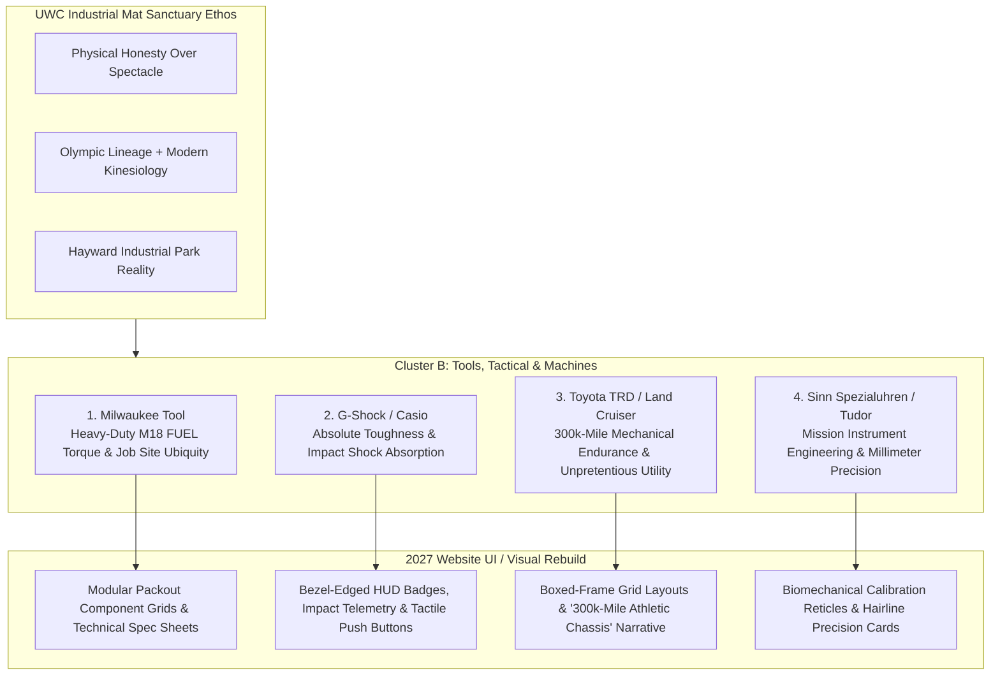
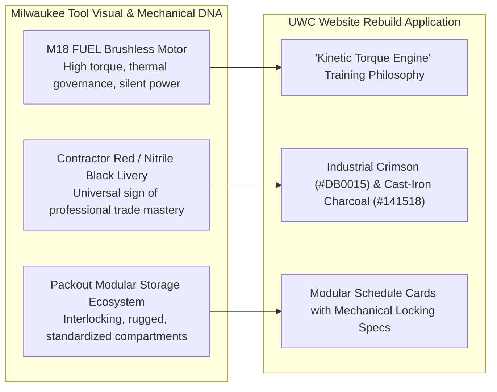
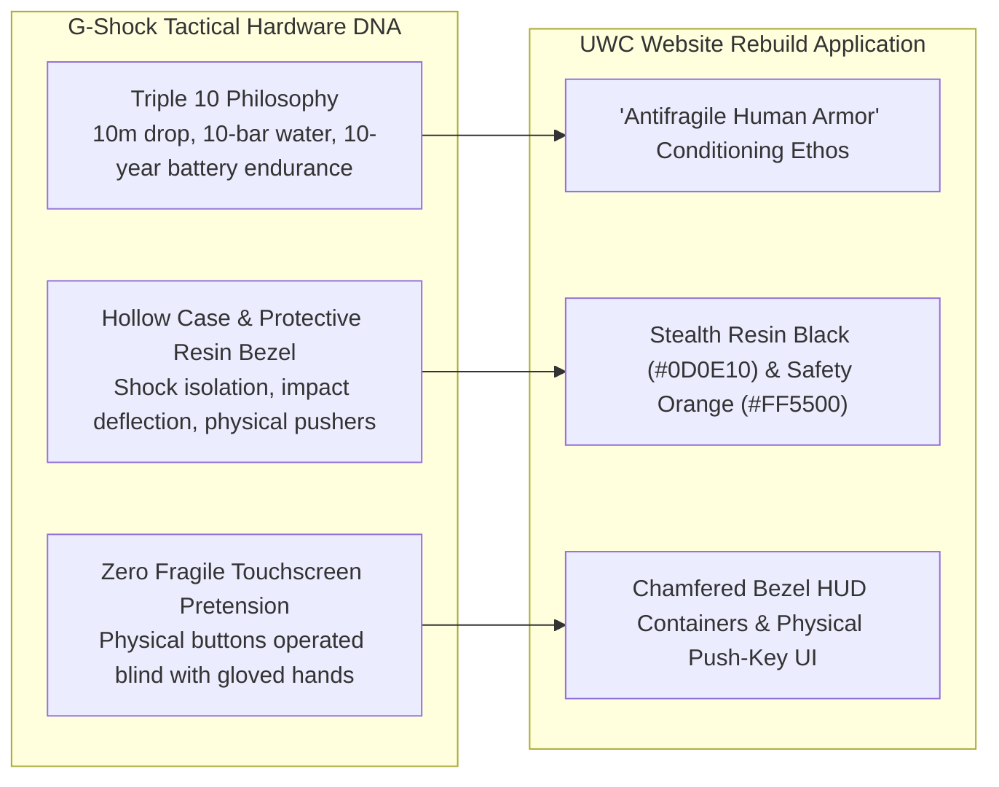
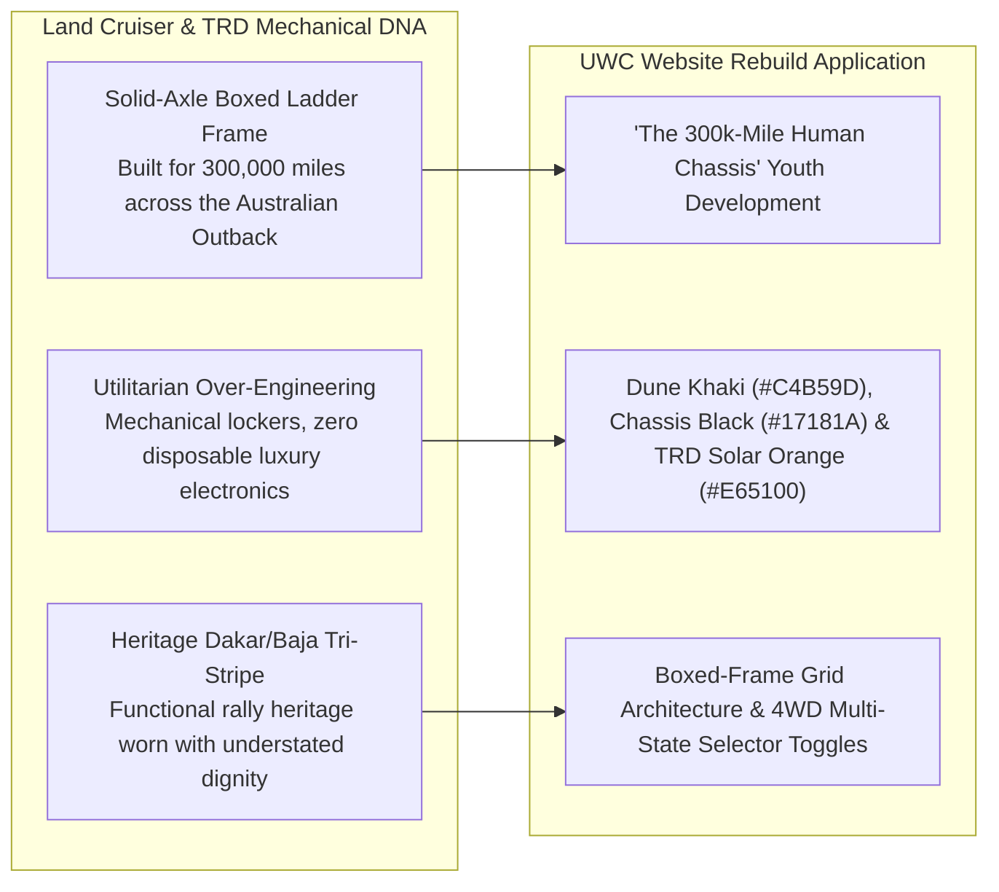
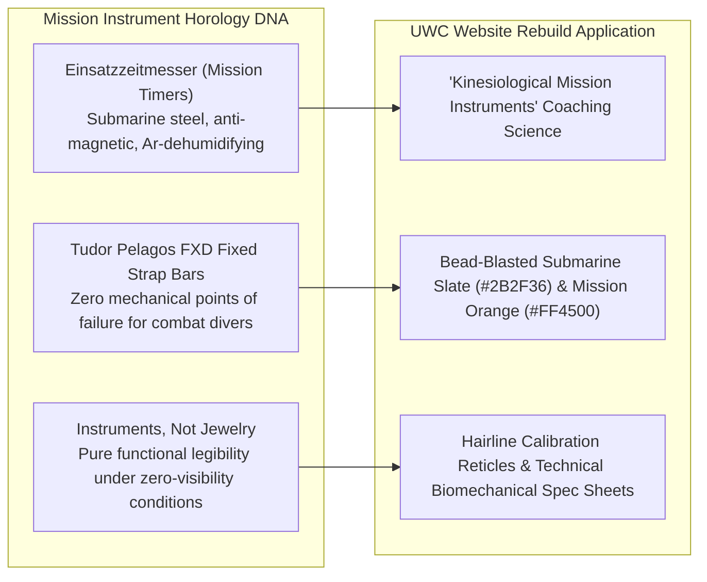
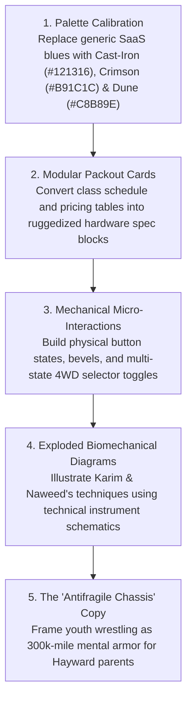

# Cluster B Analogous Brands: Industrial Tools, Tactical Hardware & Utility Machines

> **Client:** United Wrestling Club (UWC) — Hayward, CA  
> **Physical Address:** 30139 Industrial Pkwy SW Ste C, Hayward, CA (East Bay Industrial Flex Corridor)  
> **Brand Ethos:** *"The Industrial Mat Sanctuary — Physical Honesty Over Spectacle. Ancient Olympic Lineage (Karim Zemaryalai, 1980 Moscow Olympian & Ali Aliyev Dagestan Medalist) meets Modern Kinesiology (Naweed Zemaryalai, Chabot College Coach) in an East Bay Industrial Park."*  
> **Target Audience (ICPs):** East Bay Working-Class & STEM Parents (Anti-McDojo, Character & Grit), Scholastic CIF High School Contenders (High-Torque Athletic Edge), Adult Grapplers & Tradesmen (Injury-Conscious, Unvarnished Mat Craft)  
> **Document Purpose:** Systematic brand, visual, and architectural evaluation of 4 non-clothing industrial machine and tactical hardware brands to guide UWC's 2027 digital rebuild.  
> **Scope:** STRICTLY NON-CLOTHING — Heavy Trade Power Tools, Shock-Resistant Tactical Instrumentation, Utilitarian Off-Road Machines, and Mission-Timer Horology.  
> **Date:** October 2026 / 2027 Rebuild Roadmap  

---

---

## 1. Milwaukee Tool (Milwaukee Electric Tool Corp.)

### Brand Ethos & Core Narrative
*"Nothing but Heavy Duty."* Milwaukee Tool does not build decorative home improvement trinkets; they engineer high-torque, brushless cordless machinery built to survive job site drops, concrete slurry, and 12-hour shifts in the hands of union tradesmen whose livelihoods depend on their tools never stalling out under load.

### Why UWC's ICPs Revere It
* **East Bay Trades & STEM Parents:** From the union halls of Local 393 and Local 342 to contractors across Fremont, Union City, and San Leandro, Milwaukee is the gold standard of professional competence. Parents who earn their living with their hands know the difference between cheap plastic throwaway drills and an M18 FUEL impact wrench. When they evaluate a wrestling academy for their children, they spot "McDojo" fluff instantly. They choose UWC because it operates with the same heavy-duty, no-nonsense trade craftsmanship: no belt fees, no padded participation ribbons, just indestructible physical character built one rep at a time.
* **High School CIF Contenders:** High school wrestlers love raw mechanical power. They don't want yoga-gym gentility; they want to generate massive explosive torque on high-crotch takedowns and mat returns. The brushless motor ethos (maximum power output, zero thermal burnout, cool operating temperatures under maximum friction) is the exact physical reality of championship six-minute wrestling matches.
* **Adult Grapplers & Tradesmen:** Adult BJJ practitioners and blue-collar grapplers train after 8–10 hours of heavy physical labor. They demand an environment that respects their physical longevity. Milwaukee's REDLINK PLUS intelligence—preventing motor burnouts through smart load monitoring—mirrors UWC's kinesiological approach under Coach Naweed: high-intensity drilling engineered to protect joints, knees, and spines from chronic wear.

### Exact Visual Design DNA to Borrow

#### A. Typography
* **Primary Display / Headers:** `Industry Black` or `DIN Pro Black Condensed` (Alternative open-source: `Bebas Neue Pro` or `Barlow Condensed Black`).
  * *Weight:* 900 (Ultra/Heavy).
  * *Case:* All-Caps strictly.
  * *Tracking:* Tight (`-0.03em` to `-0.04em`), conveying dense, solid-forged mass.
  * *Line Height:* Compact (`0.95` to `1.05`).
* **Technical Spec & Subheads:** `Space Mono Bold` or `Chivo Mono SemiBold`.
  * *Weight:* 600–700.
  * *Case:* All-Caps with wide tracking (`+0.08em`).
  * *Usage:* Spec tags, session durations, mat capacity labels.
* **Body Copy:** `Barlow` (Regular 400 / Medium 500) paired with `Inter` for micro-specs.
  * *Line Height:* `1.55` for high readability on dark, high-contrast surfaces.

#### B. Color Palette
| Swatch | Role | Hex Code | Visual Reference / Description |
| :--- | :--- | :--- | :--- |
| **Milwaukee Heavy Crimson** | Primary Brand Accent | `#DB0015` | High-visibility job site power red; aggressive, industrial, unyielding. |
| **Overmold Nitrile Black** | Primary Background / Chassis | `#111215` | Matte impact-resistant rubber tool housing; absorbs glare. |
| **Cast-Iron Tool Dark Slate** | Card / Container Surface | `#1E2024` | Textured battery casing and motor housing surface. |
| **High-Torque Amber / Gold** | Warning & Tier Accent | `#F59E0B` | Battery gauge LED indicator / thermal warning signal. |
| **Cold Brushed Steel** | Border & Reticle Stroke | `#3A3F47` | 1px mechanical chamfered edges and separator rules. |
| **Thermal High-Contrast White** | Primary Text | `#FFFFFF` | Maximum legibility under dark ambient lighting. |

#### C. Photography Style
* **Lighting:** High-contrast, directional key lighting with hard rim separation. Industrial work-light aesthetic (mimicking high-output LED floodlights on night job sites). Deep, rich shadows that carve out shoulder caps, trap muscles, and neck bridges.
* **Focal Length:** 50mm and 85mm prime lenses shot between $f/2.2$ and $f/2.8$. Eliminates distracting industrial flex-park backgrounds, locking razor focus on kinetic contact points: hands wrapped in wrist-ties, chalk-dusted soles gripping vinyl, sweat beading on brows.
* **Grain & Shutter:** High-shutter speed (1/1000s) freezing chalk explosions and airborne sweat during takedowns. Fine, sharp digital sensor grain with enhanced micro-contrast (clarity +15, zero soft glam filters).
* **Subject Staging:** Unvarnished mechanical labor. Athletes mid-rep, coaches kneeling to physically manipulate an ankle hook, wrestlers collapsed on the mat during 30-second breathers staring at the ceiling. Absolutely zero staged smiles or thumbs-up poses.

#### D. UI Components & Layout Tactics
* **Modular Packout Card Grids:** Training programs, schedule blocks, and membership tiers housed in interlocking rectangular cards with subtle 1px mechanical chamfered corners, dark borders (`#3A3F47`), and subtle drop-in shadows (`0 4px 20px rgba(0,0,0,0.6)`).
* **"Hardware Spec Sheets" vs. Feature Lists:** Replace generic bullet points with tabular mechanical spec sheets:
  * `TORQUE TRANSFER: Freestyle Hand-Fighting & Snap-Downs`
  * `DUTY CYCLE: 90-Minute High-Friction Mat Block`
  * `OVERHEAT PROTECTION: Guided Kinesiological Warm-Down`
* **Heavy-Duty Push Buttons:** CTAs designed with visible physical bevels, inset shadow states (`active: translate-y-0.5`), bold uppercase typography (`CLAIM 7-DAY HEAVY-DUTY MAT TRIAL ->`), and high-visibility `#DB0015` crimson fill.
* **Battery-Gauge Status Indicators:** 4-segment horizontal bar visualizers showing class capacity (e.g., `[■ ■ ■ □] 3 SPOTS REMAINING`).

### UWC Translation (Website Rebuild Application)
* **The "Heavy Duty" Mat Philosophy:** UWC’s website opens not with an empty marketing slogan, but with a statement of industrial craftsmanship: *"Wrestling is the Heavy-Duty Trade of Human Movement. No Shortcuts. No Stalled Motors. Pure Grounded Competence."*
* **The Exploded-Diagram Breakdown:** An interactive graphic component breaking down Karim Zemaryalai's signature Russian Tie / 2-on-1 series styled like an exploded Milwaukee FUEL motor schematic, illustrating rotational torque, skeletal lever arms, and kinetic power transfer.

---

## 2. G-Shock / Casio (Toughness & Shock Resistance)

### Brand Ethos & Core Narrative
*"Absolute Toughness."* Born from engineer Kikuo Ibe’s determination to create a watch that never breaks even when dropped from a third-story window, G-Shock rejected the fragile luxury of delicate glass horology to forge a shock-absorbing, utilitarian instrument worn by Navy SEALs, construction workers, and tactical operators worldwide.

### Why UWC's ICPs Revere It
* **East Bay Parents:** Parents are terrified of raising fragile, screen-addicted kids who crumble at the first sign of social friction or physical discomfort. G-Shock represents absolute psychological and physical resilience. Wrestling is the human G-Shock drop test: a sport where you are knocked down a thousand times, shock-absorbed by the mat, and conditioned to pop right back up with your defenses intact.
* **High School CIF Contenders:** In wrestling, you cannot wear jewelry, watches, or flashy status symbols during competition. But in the locker room, high school contenders revere the matte black, indestructible G-Shock (5600 or 6900 series). It signals that you belong to an athletic subculture defined by physical impact rather than suburban country club aesthetics.
* **Adult Grapplers:** Grappling exposes pretension. A delicate smartwatch shatters under a heavy knee-on-belly; a G-Shock survives intact for twenty years. Adult grapplers respect equipment and training regimens that run on physical reality rather than fragile touchscreens.

### Exact Visual Design DNA to Borrow

#### A. Typography
* **Primary Display / Headers:** `Eurostile Bold Extended` or `Microgramma` (Alternative open-source: `Rajdhani Bold` or `Chivo Black Extended`).
  * *Weight:* 700–800.
  * *Case:* Uppercase strictly.
  * *Tracking:* Wide (`+0.06em` to `+0.10em`), evoking molded bezel lettering.
  * *Feel:* Geometric, squarish, mechanical, armored.
* **Telemetry & Timestamp Numerics:** `Share Tech Mono` or `DSEG7 Classic` (LCD segmented styling).
  * *Usage:* Practice clocks, tournament countdowns, rounds completed, mat volume counters.
* **Body Copy:** `Space Grotesk` (Regular 400 / Medium 500) with generous character width.
  * *Line Height:* `1.5`.

#### B. Color Palette
| Swatch | Role | Hex Code | Visual Reference / Description |
| :--- | :--- | :--- | :--- |
| **Stealth Matte Resin** | Core Background | `#0D0E10` | Non-reflective tactical polymer; zero fingerprint sheen. |
| **Gunship Carbon Core** | Card & Panel Surface | `#181A1E` | High-density shock-isolation casing tone. |
| **Emergency Bezel Orange** | Primary Accent / CTA | `#FF5500` | High-vis button accent; instant tactical focus. |
| **Protection Hazard Yellow** | Sub-Accent / Badging | `#FFCC00` | Water-resist & shock-resist bezel typography tone. |
| **Etched Resin Infill Gray** | Border & Recessed Markings | `#343840` | Subtle 1px stamped bezel outlines and mechanical seams. |
| **Inverted LCD Crisp White** | Display Text | `#F0F2F5` | Backlit digital instrument clarity. |

#### C. Photography Style
* **Lighting:** Low-angle, hard-edge rim lighting that carves athletes out of pitch-black environments. Emphasizes the physics of impact—shadows fall deeply across collarbones and ribcages, highlighting the armor-like musculature forged by wrestling.
* **Focal Length:** 24mm to 35mm wide-angle lenses placed low on the mat surface. Creates an immersive, ground-level perspective that puts the viewer directly in the splash zone of a takedown.
* **Grain & Shutter:** Extreme shutter speed (1/1250s) freezing the exact millisecond of impact: mat vinyl depressing under a wrestler’s foot, forearm frames blocking a shot, instantaneous deceleration.
* **Subject Staging:** Impact absorption and structural stability. Showing wrestlers absorbing a snap-down with a solid, unyielding neck bridge; defensive sprawling against an explosive shot; hands braced against the mat.

#### D. UI Components & Layout Tactics
* **Chamfered Bezel HUD Containers:** Cards featuring 45-degree angled corner cutouts, recessed inner borders (`box-shadow: inset 0 2px 4px rgba(0,0,0,0.8)`), and etched hardware badge graphics.
* **Tactile Mechanical Buttons:** Buttons styled with simulated knurled edges, heavy tactile border treatments (`border: 2px solid #343840`), and distinct depression on click (`active: transform translateY(2px)`).
* **Engraved Telemetry Badges:** Micro-pills styled like G-Shock caseback and bezel engravings:
  * `[SHOCK-TESTED: USAW REGULATION]`
  * `[PRESSURE RESIST: 200 LBS/SQ-IN]`
  * `[CALIBER: 1980 MOSCOW OLYMPIC DNA]`
* **Countdown Telemetry Clocks:** Live digitized round-timers and season registration clocks styled after Casio DW-5600 inverted LCD displays.

### UWC Translation (Website Rebuild Application)
* **The "Antifragile Conditioning" Value Proposition:** Pitching wrestling directly to Hayward parents as emotional and physical shock-resistance: *"The World Will Push Your Child. We Teach Them How to Absorb the Shock and Push Back."*
* **The "Impact Rating" Filter:** Class schedules featuring interactive filter toggles styled like rugged bezel pushers (`[LIGHT CONTACT: YOUTH FOUNDATIONS]` / `[MEDIUM CONTACT: JUNIOR VARSITY]` / `[FULL IMPACT: SCHOLASTIC & ADULT OPEN MAT]`).

---

## 3. Toyota TRD / Land Cruiser (70 Series & Heritage 4WD)

### Brand Ethos & Core Narrative
*"The World’s Toughest Machine."* The Toyota Land Cruiser (and TRD off-road division) does not build suburban show-ponies that break down after 50,000 miles; they manufacture solid-axle, over-engineered mechanical lifelines chosen by humanitarian missions, outback ranchers, and desert explorers who require uncompromised reliability in terrains where mechanical failure equals death.

### Why UWC's ICPs Revere It
* **East Bay Commuter & Trade Parents:** In Alameda and Contra Costa counties, the I-880 and Highway 92 corridors are filled with Tacomas, 4Runners, and Land Cruisers driven by parents who prize longevity over status-seeking luxury. They understand that a Range Rover looks pretty in a driveway but spends half its life in a repair bay, while a 1998 Land Cruiser with 280,000 miles starts on the first crank in sub-zero Sierra snow. They want that exact durability for their children’s bodies: joint integrity, core endurance, and character that will last for 40 years.
* **High School CIF Contenders:** High school wrestlers in Northern California look up to the rugged independence of TRD trucks hauling gear bags, camping equipment, and recovery gear. It represents rugged self-sufficiency—an athlete who doesn't rely on coaches holding their hand, but who grinds out morning roadwork on mountain trails.
* **Adult Grapplers:** Adult wrestlers and sambists know that wrestling develops a dense, indestructible physical chassis. Like a solid boxed ladder frame, a wrestler's hips, lower back, and core can handle loads that twist and break untrained athletes. The Land Cruiser is the automotive spirit animal of the 35-year-old adult grappler.

### Exact Visual Design DNA to Borrow

#### A. Typography
* **Primary Display / Headers:** `DIN 1451 Mittelschrift` or `Barlow Semi Condensed Bold` (Alternative open-source: `Overpass Heavy` or `Oswald Bold`).
  * *Weight:* 700–800.
  * *Case:* Uppercase strictly.
  * *Tracking:* Balanced (`+0.02em` to `+0.04em`), conveying clean, functional engineering.
  * *Feel:* Honest, utilitarian, road-tested, unpretentious.
* **Badging & Subheads:** `Overpass Mono Bold` or `Chivo Mono`.
  * *Tracking:* Extra-wide (`+0.12em`), mirroring stamped metal firewall VIN tags and 4WD selector console plates.
* **Body Copy:** `Public Sans` (Regular 400 / Medium 500).
  * *Line Height:* `1.6`—warm, readable, honest editorial clarity.

#### B. Color Palette
| Swatch | Role | Hex Code | Visual Reference / Description |
| :--- | :--- | :--- | :--- |
| **Heritage Dune Khaki** | Secondary Accent / Surface | `#C4B59D` | Natural desert canvas, raw linen, dust-caked steel panels. |
| **Boxed-Chassis Black** | Primary Background | `#17181A` | Anti-rust black frame-rail coating; grounded mass. |
| **Primer Slate Gray** | Card & Container Surface | `#26292E` | Anodized aluminum skid-plates and engine block cast iron. |
| **TRD Heritage Solar Orange**| Primary Interactive Accent | `#E65100` | Vintage Baja 1000 rally stripe; high-visibility functional warmth. |
| **Dakar Heritage Yellow** | Tri-Stripe Detail Accent | `#F59E0B` | Secondary rally stripe detail / caution marker. |
| **Enamel White** | Text & Stamped Badging | `#F8F9FA` | Heavy automotive enamel badge typography. |

#### C. Photography Style
* **Lighting:** Natural, raw, unvarnished outdoor dawn/dusk light, or natural daylight flooding through open warehouse rollup doors. Golden dust motes suspended in the air; authentic industrial warehouse ambience.
* **Focal Length:** 35mm and 50mm documentary lenses at human eye and chest level. Avoids distorted fisheye gym angles; presents honest, grounded proportions.
* **Grain & Texture:** Organic, 35mm film-style grain with tactile micro-texture. Emphasizes worn canvas mat covers, salt-stained training singlets, cracked leather wrestling shoes, and sweat stains on cotton tees.
* **Subject Staging:** Multi-generational endurance and patient labor. An older coach (Karim) calmly watching athletes drill; two wrestlers locked in a collar tie battling for position; an athlete lacing worn shoes sitting on a raw wooden bench.

#### D. UI Components & Layout Tactics
* **Boxed Ladder-Frame Grids:** Layouts defined by bold 2px structural divider lines (`#383D45`), creating a rigid, unshakeable visual architecture that feels welded together rather than floated.
* **Heritage Tri-Stripe Accents:** A subtle 3-stripe micro-accent (`#D32F2F` Red, `#E65100` Orange, `#F59E0B` Yellow) placed discreetly in card corner notches or hero header borders to signify UWC’s triple lineage: 1980 Moscow Olympics, Dagestani Sambo, and Collegiate NCAA Kinesiology.
* **Mechanical 4WD Transfer Case Toggles:** Program filtering designed as an authentic multi-position mechanical switch:
  * `[2H: YOUTH FUNDAMENTALS]`
  * `[4H: SCHOLASTIC CIF COMPETITIVE]`
  * `[4L: ADULT ALL-WEATHER GRAPPLING]`
* **Firewall Tag Program Cards:** Class and coaching cards styled like stamped aluminum vehicle data plates with monospaced specifications and riveted corner graphics.

### UWC Translation (Website Rebuild Application)
* **The "300,000-Mile Human Chassis" Hero Campaign:** The parent value proposition headline: *"We Don't Build Fragile Athletes for One Season. We Build the 300,000-Mile Chassis That Carries Your Child Through High School, College, and the Next 40 Years of Life."*
* **The "Maintenance & Longevity" Facility Page:** Showcasing UWC's Hayward warehouse not as an opulent luxury spa, but as a reliable, clean, zero-fluff maintenance depot for serious athletic engines: clean mats, Olympic weights, pull-up bars, and elite coaching.

---

## 4. Sinn Spezialuhren / Tudor Tool Watches (Mission Horology)

### Brand Ethos & Core Narrative
*"Instruments, Not Jewelry."* Sinn Spezialuhren (Frankfurt) and Tudor Tool Watches (Geneva) engineer utilitarian mission instruments for German GSG 9 maritime counter-terrorism units, French Marine Nationale combat swimmers, and Arctic explorers. Every single millimeter of metal, anti-magnetic shielding, and luminescent dial design exists to deliver fail-safe mission survival under extreme hydrostatic pressure and operational stress.

### Why UWC's ICPs Revere It
* **East Bay STEM, Biotech & Engineering Parents:** The East Bay contains a massive demographic of engineers, software architects, and scientists (Tesla Fremont Gigafactory, Lawrence Livermore National Lab, UC Berkeley, Silicon Valley hardware firms). These parents despise marketing hyperbole and commercial fluff. They revere Sinn and Tudor because of the unvarnished engineering rigor: German Submarine Steel (U-boat steel), Tegiment surface-hardening to 1,200 Vickers, and anti-magnetic shielding to 80,000 A/m. When they visit UWC, they immediately recognize that Coach Naweed's B.S. in Kinesiology brings scientific, biomechanical precision to Karim's Olympic wrestling lineage: it is an athletic laboratory, not an aggressive karate franchise.
* **High School CIF Contenders:** High-level scholastic wrestlers operate against relentless clocks: two-minute periods, ride-out countdowns, and stalling timers. They understand the sacred value of split-second positional precision. Tool watches represent the discipline of mastering time and physical space under intense pressure.
* **Adult Grapplers & Professionals:** Many adult grapplers in the East Bay are professionals who appreciate quiet, functional elegance. They wear a titanium Tudor Pelagos or a bead-blasted Sinn 556 because it doesn't shout for attention. They choose UWC for the same reason: zero gym bros, zero loud commercial bravado, just deep technical study of leverage and joint mechanics.

### Exact Visual Design DNA to Borrow

#### A. Typography
* **Primary Display / Headers:** `Akzidenz-Grotesk Bold` or `DIN 1451 Engschrift` (Alternative open-source: `Barlow Condensed` or `Chivo Black`).
  * *Weight:* 700–900.
  * *Case:* Uppercase strictly.
  * *Tracking:* Precise, calibrated (`+0.04em` to `+0.06em`).
  * *Feel:* Surgical, clinical, German instrument-grade legibility.
* **Tabular Data & Telemetry:** `Söhne Mono`, `Akkurat Mono`, or `Space Mono`.
  * *Features:* Tabular lining numbers (`font-variant-numeric: tabular-nums`) so that data columns, session times, and weight classes align with millimeter accuracy.
* **Body Copy:** `Inter Display` / `Inter` (Regular 400 / Medium 500).
  * *Line Height:* `1.5` with razor-sharp micro-typography hierarchy.

#### B. Color Palette
| Swatch | Role | Hex Code | Visual Reference / Description |
| :--- | :--- | :--- | :--- |
| **Bead-Blasted Submarine Slate** | Primary Surface / Frame | `#2B2F36` | Non-reflective, matte German U-boat steel; indestructible calm. |
| **Instrument Matte Black** | Core Background | `#121315` | Anti-reflective deep dial surface; pure void. |
| **Clinical Dial Charcoal** | Card / Container Surface | `#1B1E23` | Recessed instrument sub-dial tone. |
| **Mission Emergency Orange** | Primary Accent / Timing | `#FF4500` | Sinn EZM mission timer hand; high-urgency callout. |
| **Phosphorescent Lume Green** | Micro-Signal / Status | `#00E676` | Super-LumiNova operational indicator; signifies active spots/open mats. |
| **Sterile White** | Dial Markers & Copy | `#FFFFFF` | Maximum photometric contrast against black. |

#### C. Photography Style
* **Lighting:** Studio-grade, clinical chiaroscuro. Single large diffused overhead softbox or hard directional rim light highlighting the anatomical mechanics of the human body: muscular striations, tendon tension, skeletal alignment, and precise hand positioning.
* **Focal Length:** Macro and 90mm-105mm prime lenses capturing millimeter-level detail: the exact thumb placement of a 2-on-1 wrist lock, the angle of a lead foot driving off the mat, the pressure of a forehead planted in a collar tie.
* **Grain & Sharpness:** Ultra-crisp, optical perfection. Zero fake grain or nostalgic sepia filters; hyper-clean sensor resolution that reveals the true physical reality of high-level athletic training.
* **Subject Staging:** Biomechanical alignment and calm tactical focus. Coach Naweed demonstrating a counter-move with geometric precision; an athlete checking their breathing during interval drills; calm, focused eyes behind headgear.

#### D. UI Components & Layout Tactics
* **Mission Spec Sheets (Einsatz-Tabellen):** Program tiers and trial enrollment modules structured as strict, clinical specification sheets with 1px hairline borders (`rgba(255,255,255,0.12)`):
  * `CASE SPECIFICATION: 3,000 sq ft Seamless Vinyl Subfloor`
  * `CALIBER ENGINE: Olympic Dagestan Lineage + Collegiate NCAA Science`
  * `TOLERANCE RATING: 1:8 Coach-to-Athlete Ratio`
  * `MAGNETIC RESISTANCE: Zero Commercial Distractions / Zero Belt Fees`
* **Hairline Calibration Reticles & Grid Coordinates:** Subtle background watermarks featuring 1px coordinate lines, crosshairs, and datum marks that evoke navigational instrument charts and biomechanical alignment planes.
* **Super-LumiNova Active Badges:** Pulsing micro-pills with soft glowing green drop-shadows indicating live class schedules and active mat sessions:
  * `[● LIVE ON THE MAT: SCHOLASTIC VARSITY DRILLING]`
* **Tudor Fixed-Bar Layout Cards:** Cards with visual "lugs and fixed strap bars" styling—heavy solid corner brackets that look structural and impossible to detach.

### UWC Translation (Website Rebuild Application)
* **The "Biomechanical Instrument" Positioning:** Framing UWC’s curriculum as elite human engineering: *"Wrestling Taught as a Precision Physical Instrument. Karim’s Olympic Pedigree Meets Naweed’s Collegiate Kinesiology Science."*
* **The "Mission Specification" Trial Booking Flow:** Redesigning the trial registration modal from a generic contact form into a streamlined "Mission Clearance" interface where parents specify their athlete's grade, experience level, and physical goals, receiving an instant, calibrated class recommendation.

---

## 5. Comparative Visual DNA & Architectural Matrix

The following synthesis matrix compares the exact design parameters of all four Cluster B brands and defines the combined 2027 design language for United Wrestling Club:

| Parameter | Milwaukee Tool | G-Shock / Casio | Toyota TRD / Land Cruiser | Sinn / Tudor Tool Watches | **UWC 2027 Synthesized Rebuild Spec** |
| :--- | :--- | :--- | :--- | :--- | :--- |
| **Design Core** | Heavy-Duty Trade Power | Shock-Absorbing Toughness | Utilitarian Mechanical Endurance | Mission Instrument Precision | **"The Industrial Mat Sanctuary"** |
| **Primary Header Font** | `Industry Black` | `Eurostile Extended` | `DIN 1451 Mittelschrift` | `Akzidenz-Grotesk / DIN` | **`Barlow Condensed Black` + `DIN 1451`** |
| **Telemetry / Data Font** | `Space Mono Bold` | `Share Tech Mono` | `Overpass Mono` | `Söhne Mono` | **`Space Mono Bold` (Tabular)** |
| **Body Typography** | `Barlow` (500) | `Space Grotesk` (400) | `Public Sans` (400) | `Inter Display` (400) | **`Public Sans` (400/600, High Legibility)** |
| **Primary Background** | Overmold Black (`#111215`) | Stealth Resin (`#0D0E10`) | Chassis Black (`#17181A`) | Instrument Black (`#121315`) | **Deep Cast-Iron Black (`#121316`)** |
| **Card Surface** | Tool Dark Slate (`#1E2024`)| Carbon Core (`#181A1E`) | Primer Slate (`#26292E`) | Submarine Slate (`#2B2F36`) | **Industrial Steel Slate (`#1C1E23`)** |
| **Signature Accent** | Milwaukee Red (`#DB0015`) | Bezel Orange (`#FF5500`) | TRD Solar Orange (`#E65100`)| Mission Orange (`#FF4500`) | **Heritage Oxblood Crimson (`#B91C1C`) & TRD Orange (`#E65100`)** |
| **Secondary Accent** | Warning Amber (`#F59E0B`) | Hazard Yellow (`#FFCC00`) | Dune Khaki (`#C4B59D`) | Lume Green (`#00E676`) | **Dune Mat Khaki (`#C8B89E`) & Lume Green (`#00E676`)** |
| **Key UI Structure** | Packout Interlocking Cards | Chamfered Bezel HUDs | Boxed-Frame Grid Lines (2px)| Hairline Instrument Specs | **Modular Spec Cards with 1px Chamfered Steel Borders** |
| **Button Treatment** | Beveled High-Torque Push | Tactile Knurled Pusher | Heavy Stamped Metal Switch | Flat Surgical Mission CTA | **Tactile Mechanical Key with 2px Border & Hover Inset** |
| **Photo Direction** | Hard job-site floodlights | Dynamic 24mm mat splash | Natural daylight through rollups| Clinical macro chiaroscuro | **Natural Warehouse Rollup Light + Hard Rim Shadows** |
| **Emotional Hook** | Built for trade pros | Indestructible human armor | 300,000-mile human chassis | Calibrated biomechanical precision | **Substance over spectacle; unshakeable character** |

---

## 6. Implementation Checklist for UWC's 2027 Rebuild

1. **Purge All "McDojo" & SaaS Tropes:**
   * No generic blue buttons, wavy SVG background dividers, or cartoon mascot illustrations.
   * Eliminate all commercial karate/BJJ tropes (belt ranking counters, "black belt guaranteed" promises).
2. **Anchor in Hayward Industrial Reality:**
   * Celebrate the 30139 Industrial Pkwy warehouse setting. Feature natural photography of athletes training with the roll-up garage doors wide open to the cool East Bay evening breeze.
3. **Deploy the "Specification Sheet" Architecture:**
   * Every program card (Youth Fundamentals, High School Pre-Season, Adult Grappling) must feature a standardized "Mechanical Spec Box" outlining Coach-to-Athlete ratio, contact intensity, kinesiological focus, and required gear.
4. **Engineer High-Torque Conversion Flow:**
   * The primary CTA throughout the site must read: `[RESERVE HEAVY-DUTY MAT TRIAL ->]` or `[GET MISSION CLEARANCE]`, opening an interactive, low-friction scheduling modal styled like a calibrated test instrument.
