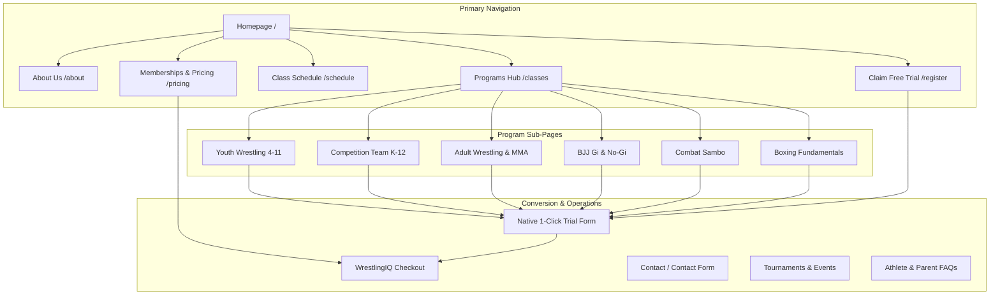

# Site Architecture & Conversion Audit: United Wrestling Club

> **Status: Snapshot.** Describes the pre-rebuild site (`unitedwrestlingclub.com`, late Oct 2026). Its findings were addressed by the Astro build, live on 2026-11-05 (see `decisions/ADR-20261106-astro-design-system.md`). Read as history, not as current state.

> **Target Domain:** [unitedwrestlingclub.com](https://www.unitedwrestlingclub.com/)  
> **Platform:** Next.js (SSG exported to AWS S3 & CloudFront)  
> **Registration Integration:** WrestlingIQ (Team 513)  
> **Date Conducted:** October 29, 2026  

---

## 1. Page Hierarchy (ASCII Tree)

### Current Site Structure
```text
Homepage (/)
├── About (/about)
├── Classes (/classes)
│   ├── Adult Wrestling (/classes/adult-wrestling)
│   ├── Boxing Fundamentals (/classes/boxing-fundamentals)
│   ├── Fundamental Boxing (/classes/fundamental-boxing) [Duplicate/Stale]
│   ├── Gi Jiu Jitsu (/classes/gi-jiu-jitsu)
│   ├── Intensity Training (/classes/intensity-training)
│   ├── Jiu Jitsu (/classes/jiu-jitsu) [Empty/Stale]
│   ├── Kid Wrestling (/classes/kid-wrestling)
│   ├── No-Gi Jiu Jitsu (/classes/nogi-jiu-jitsu)
│   ├── Open Mat (/classes/open-mat)
│   ├── Rest and Recovery (/classes/rest-and-recovery) [Stub]
│   ├── Sambo (/classes/sambo)
│   ├── Strength and Conditioning (/classes/strength-and-conditioning) [Stub]
│   ├── Wrestling Technique (/classes/wrestling-technique)
│   └── Youth Wrestling (/classes/youth-wrestling)
├── Schedule (/schedule)
├── Pricing (/pricing)
├── Events (/events)
├── Register (/register)
├── Rules (/rules)
├── FAQs (/faqs)
├── Donate (/donate)
└── Contact (/contact)
```

### Target Site Structure (Locked Zero-Redirect-Bloat IA)
```text
Homepage (/)                                                         [EXISTING - REDESIGN]
├── About & Coaches (/about)                                         [EXISTING - UPGRADE]
├── Classes & Programs Hub (/classes)                                [EXISTING - POPULATE EMPTY SHELL]
│   ├── [Youth & Scholastic]
│   │   ├── Kids Wrestling: Ages 4–11 (/classes/kid-wrestling)       [EXISTING - UPGRADE]
│   │   └── Competition Youth & HS: K–12 (/classes/youth-wrestling)  [EXISTING - UPGRADE]
│   ├── [Adult Grappling & Striking]
│   │   ├── Adult Wrestling & MMA (/classes/adult-wrestling)         [EXISTING - UPGRADE]
│   │   ├── No-Gi "Wrestle-Jitsu" (/classes/nogi-jiu-jitsu)          [EXISTING - UPGRADE]
│   │   ├── Gi Brazilian Jiu-Jitsu (/classes/gi-jiu-jitsu)           [EXISTING - UPGRADE]
│   │   ├── Combat Sambo (/classes/sambo)                            [EXISTING - UPGRADE]
│   │   └── Boxing Fundamentals (/classes/boxing-fundamentals)       [EXISTING - UPGRADE]
│   └── [Seminars & Open Mat]
│       ├── Women's Self-Defense (/classes/womens-self-defense)      [✨ NEW]
│       └── Saturday Open Mat (/classes/open-mat)                    [EXISTING - UPGRADE]
├── Schedule & Class Times (/schedule)                               [EXISTING - FIX 7:30/8PM BUG]
├── Memberships & Pricing (/pricing)                                 [EXISTING - ADD VALUE STACKS]
├── Tournaments & Events (/events)                                   [EXISTING - 41 EVENTS + MIXER]
├── Start Trial Intake Funnel (/register)                            [EXISTING - NATIVE 1-CLICK FUNNEL]
├── East Bay Locations Served (/locations)                           [✨ NEW HUB]
│   ├── Hayward, CA (/locations/hayward-ca)                          [✨ NEW]
│   ├── Union City, CA (/locations/union-city-ca)                    [✨ NEW]
│   ├── Fremont, CA (/locations/fremont-ca)                          [✨ NEW]
│   ├── Newark, CA (/locations/newark-ca)                            [✨ NEW]
│   └── Castro Valley & San Leandro (/locations/castro-valley-ca)    [✨ NEW]
├── East Bay Wrestling Guides (/guides)                              [✨ NEW HUB]
│   ├── Adult Wrestling in the Bay Area (/guides/adult-wrestling-bay-area)         [✨ NEW]
│   ├── Youth Wrestling vs. Karate (/guides/youth-wrestling-vs-martial-arts)       [✨ NEW]
│   ├── Takedowns for BJJ Grapplers (/guides/wrestling-for-bjj-takedowns)          [✨ NEW]
│   ├── Off-Season HS Wrestling (/guides/high-school-off-season-wrestling)         [✨ NEW]
│   └── DSAL Hayward to Olympic Pathway (/guides/dsal-hayward-wrestling-pathway)   [✨ NEW]
├── Contact & Parking Map (/contact)                                 [EXISTING - UPGRADE]
├── Parent & Athlete FAQs (/faqs)                                    [EXISTING - EXPAND 10 → 16]
├── Club Rules & Mat Hygiene (/rules)                                [EXISTING - UPGRADE]
├── Youth Scholarship Fund (/donate)                                 [EXISTING - POPULATE OR HIDE]
└── Machine Discovery Feeds
    ├── /robots.txt                                                  [✨ NEW - FIXES 404]
    ├── /sitemap.xml                                                 [✨ NEW - FIXES 404]
    ├── /llms.txt                                                    [✨ NEW - FIXES 404]
    └── /llms-full.txt                                               [✨ NEW - FIXES 404]
```

---

## 2. Visual Sitemap (Mermaid)



---

## 3. URL Map Table

| Page Route | Current URL | Target URL | Nav Placement | Intent & Priority |
| :--- | :--- | :--- | :--- | :--- |
| **Homepage** | `/` | `/` | Primary Header | Core Brand Anchor (High) |
| **About Us** | `/about` | `/about` | Primary Header | Founder Authority & Olympic Pedigree (High) |
| **Programs Hub** | `/classes` | `/programs` | Primary Header | Discipline Exploration (High) |
| **Youth Wrestling** | `/classes/youth-wrestling` | `/programs/youth` | Sub-nav | Parent Enrollment Intent (Highest) |
| **Adult Wrestling** | `/classes/adult-wrestling` | `/programs/adult-wrestling` | Sub-nav | High-Output Takedown Intent (High) |
| **BJJ / Wrestle-Jitsu** | `/classes/nogi-jiu-jitsu` | `/programs/wrestle-jitsu` | Sub-nav | Cross-Training Grappler Intent (High) |
| **Schedule** | `/schedule` | `/schedule` | Primary Header | Active Athlete & Prospect Reference (High) |
| **Pricing** | `/pricing` | `/pricing` | Primary Header | Bottom-of-Funnel Conversion (Highest) |
| **Free Trial Intake** | `/register` | `/free-trial` | Header CTA Pill | 24/7 Lead Capture Engine (Highest) |
| **Tournaments** | `/events` | `/events` | Footer / Secondary | Community & Travel Schedule (Medium) |
| **Contact** | `/contact` | `/contact` | Header / Footer | Direct Map, Phone & Inquiry (High) |

---

## 4. Technical, SEO & Conversion Architecture Deficits

### Deficit 1: Client-Side Rendering Cloaking (Critical SEO Failure)
* **Finding:** The Next.js build serves an empty root container with a CSS spinner (`<div class="sc-349eebb-1 RoRHF">`) upon initial server response. 
* **Impact:** Search engine bots (Googlebot, Bing) and AI scrapers (ChatGPT, Perplexity, Claude) that do not execute heavy JS render passes see an empty page with 0 indexable text.
* **Remedy:** Reconfigure Next.js export or deploy static HTML pre-rendering (`getStaticProps`) so full heading, text, and address tags exist in raw HTML response.

### Deficit 2: Missing Search Engine & Agent Directives (`404` Errors)
* **Finding:** `robots.txt`, `sitemap.xml`, and `llms.txt` all return HTTP 404 on CloudFront.
* **Impact:** Googlebot cannot discover the 20+ specialized class routes; AI answer engines cannot ingest the club's curriculum.
* **Remedy:** Deploy static `robots.txt`, XML sitemap of all program pages, and an `llms.txt` knowledge bundle.

### Deficit 3: Complete Absence of Schema.org Structured Data
* **Finding:** 0 JSON-LD tags present anywhere across the domain.
* **Impact:** Google Maps and Local Pack cannot verify entity details (hours, address `30139 Industrial Pkwy SW`, telephone `510-303-4869`, pricing range, coach credentials).
* **Remedy:** Inject `SportsClub`, `LocalBusiness`, and `Person` schema markup across all template headers.

### Deficit 4: Friction-Heavy External Conversion Leakage
* **Finding:** All CTA buttons ("Register Now") link directly to third-party unbranded WrestlingIQ registration URLs (`https://www.wrestlingiq.com/users/sign_up?paid_session_id=...`). Contact form posts to third-party Formspree endpoint without database storage or instant auto-responders.
* **Impact:** High bounce rate for curious parents who want a free trial class before committing to full recurring billing on an external platform.
* **Remedy:** Implement a native "Book a Free 1-Day Trial Pass" modal/funnel that captures Parent Name, Child Age, Phone, and Email *before* forwarding to WrestlingIQ or booking the calendar.

---

## 5. Internal Linking & Funnel Optimization Plan

1. **Contextual In-Content Cross-Links:** Link `/about` Olympic pedigree directly to the `/classes/youth-wrestling` and `/classes/adult-wrestling` sign-up pages.
2. **Schedule-to-Booking Micro-Funnel:** On `/schedule`, allow clicking any class block (e.g., *Tuesday 5:00 PM Competition Youth*) to immediately open a modal: *"Try This Class Free This Tuesday."*
3. **Local SEO Geo-Silos:** Create targeted geo-optimized landing pages for high-density neighboring feeder districts:
   * `/wrestling-hayward-ca`
   * `/wrestling-union-city-ca`
   * `/wrestling-fremont-ca`
   * `/youth-martial-arts-east-bay`
