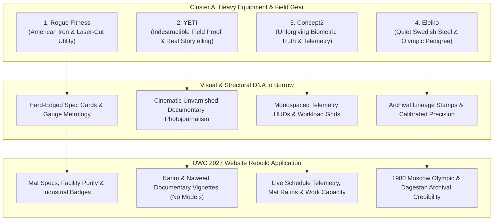

# Cluster A: Heavy Equipment, Strength & Field Gear — Brand & Visual Design Archetypes for UWC 2027

> **Client:** United Wrestling Club (Hayward, CA)  
> **Brand Ethos:** *"The Industrial Mat Sanctuary — Physical Honesty Over Spectacle. Ancient Olympic Lineage (Karim Zemaryalai 1980 Olympian, Ali Aliyev Dagestan medalist) meets Modern Kinesiology (Naweed Zemaryalai, Chabot College Coach) in an East Bay Industrial Park (30139 Industrial Pkwy SW, Hayward)."*  
> **Document Code:** `UWC-ANALOGOUS-CLUSTER-A-EQUIPMENT`  
> **Scope:** Strictly Non-Clothing Industrial & Field Gear Brands Outside Wrestling  
> **Target Audience (ICPs):** East Bay Parents (Character & Real Grit), High School CIF Contenders (Collegiate Standard), Adult Grapplers (Authentic No-Gi & Sambo Sanctuary)  
> **Deliverable Path:** `discovery/brand/analogous_brands/cluster_a_heavy_equipment_and_field_gear.md`  

---

## Executive Summary & Design Thesis

United Wrestling Club is not a commercial strip-mall martial arts franchise, nor is it a recreational gymnastics center. It is an unvarnished **industrial athletic sanctuary** located among distribution warehouses, machine shops, and logistics terminals on Industrial Parkway in Hayward, CA. 

When East Bay parents, high school varsity athletes, and adult grapplers evaluate UWC, their trust is not won by pastel gradients, slick tech-SaaS illustrations, or polished corporate stock photography. Their trust is won through **mechanical and physical honesty**—the exact same psychological resonance cultivated by premier heavy strength manufacturers and field equipment brands.

This dossier analyzes four world-class non-clothing brands—**Rogue Fitness**, **YETI**, **Concept2**, and **Eleiko**—extracting their exact visual design DNA (typography, hex color systems, camera staging, and UI components) and translating each directly into high-converting web architecture for UWC's 2027 rebuild.



---

## Brand 1: Rogue Fitness (Columbus, OH)

### 1. Brand Ethos & Core Narrative
**"Forged in American Iron."** Rogue Fitness champions relentless industrial utility, in-house domestic steel manufacturing, and zero-compromise mechanical durability built for the harshest strength environments on earth.

### 2. Why UWC's ICPs Revere It
* **East Bay Parents:** Parents immediately associate Rogue with institutional durability and safety. When they see heavy 11-gauge steel, textured powdercoat, and grade-8 hardware, they know their child is not training in a cheap, flimsy facility. It communicates safety through structural permanence.
* **High School Contenders:** High school wrestlers worship Rogue as the gold standard of collegiate weight rooms (Iowa, Penn State, Ohio State). The laser-cut steel numbers, knurled pull-up rigs, and matte black finish represent the physical grind required to win CIF state medals.
* **Adult Grapplers:** Adult practitioners (BJJ practitioners, judokas, Sambo fighters) respect Rogue's anti-lifestyle, anti-fluff ethos. Rogue does not sell gimmicks; it sells cold steel that never bends under load.

### 3. Exact Visual Design DNA to Borrow

#### A. Typography
* **Header Font:** `Agency FB` (Bold / Black) or `DIN 1451 Mittelschrift` (All-Caps, Condensed).
  * **Scale:** H1 `56px–72px` (`line-height: 0.95`, `letter-spacing: -0.03em`).
  * **Style:** Monolithic, architectural, industrial stamped appearance.
* **Body Font:** `Roboto` or `Inter` (Regular, Medium).
  * **Scale:** Body `15px–16px` (`line-height: 1.6`, `letter-spacing: 0.01em`).
* **Technical Spec Font:** `Roboto Mono` or `DIN Condensed` (Medium / Bold, All-Caps).
  * **Scale:** Subheads/Specs `12px–13px` (`letter-spacing: 0.08em`).

#### B. Color Palette
```
Primary Brand Red:       #C41230   /* Deep American Industrial Red */
Matte Powdercoat Black:  #111111   /* Deepest Void / Textured Steel */
Cold Gunmetal Slate:     #1E2226   /* Structural Tube Steel */
Hardware Zinc / Grey:    #8C929D   /* Grade-8 Bolt / Laser-Etched Accent */
Stark Canvas White:      #FFFFFF   /* High-Contrast Technical Readouts */
```

#### C. Photography Style
* **Lighting:** High-contrast chiaroscuro, low-key industrial lighting. Single overhead beam or side rim-light cutting through airborne chalk dust and mat humidity.
* **Focal Length & Aperture:** `50mm f/1.8` or `85mm f/1.4`. Shallow depth of field isolating laser-etched metal burrs, knurling textures, and beads of sweat on an athlete's jawline.
* **Grain & Grading:** Subtle 35mm film grain (`10–15%`), desaturated shadows, cool industrial tint on steel surfaces, warm natural skin tones.
* **Subject Staging:** Unposed, mid-strain exhaustion. Athletes resetting their grip between rounds, chalking hands against matte black uprights, or listening intently to coaching feedback. Zero manufactured smiles or promotional poses.

#### D. UI Components & Layout Tactics
* **The "Spec Sheet" Product/Program Card:** Hard-edged rectangles (`border-radius: 0px` to `2px`) wrapped in a 1px solid border (`#2A2F35`). Background: `#16191D`. Card headers feature a laser-etched style badge: `SPEC // YOUTH FOUNDATIONS`.
* **Industrial Spec Data Grids:** 2-column or 3-column key-value tables embedded directly in program cards:
  ```
  MAT SURFACE        // 2" Dollamur Seamless Flexi-Roll
  COACH RATIO        // 1:8 Max Mat Density
  CURRICULUM         // USAW Folkstyle & Freestyle Standards
  LOCATION           // 30139 Industrial Pkwy SW Ste C
  ```
* **Utilitarian Action Buttons:** Solid high-visibility `#C41230` background with sharp corners (`rounded-none`), uppercase `Agency FB` / `DIN` text, high-contrast hover state that shifts to `#E01E37` with an inset `1px solid rgba(255,255,255,0.2)` highlight line.
* **Industrial Badge Stamps:** Monospaced rectangular tag pills (`padding: 3px 8px`, `border: 1px solid #444D56`, `background: #0D0F11`, `color: #8C929D`) stating: `SANCTIONED USAW #513` and `MADE IN THE EAST BAY`.

### 4. UWC Translation (How This Translates Directly to UWC's Website Rebuild)
* **Facility Purity Section ("The Specs of the Sanctuary"):** Instead of generic gym photos, UWC features an interactive "Mat Specifications" section detailing the high-density subfloor foam, hospital-grade mat disinfectant protocol, and ventilation specs of the Industrial Parkway facility.
* **Program Tiers as Equipment Specs:** Format class levels (Youth Folkstyle, High School CIF Prep, Adult Wrestle-Jitsu) like Rogue rig spec sheets—listing mat duration, physical intensity score, contact ratio, and coach certification.
* **Hard-Cornered, High-Contrast UI:** Strip all bubbly, consumer-app rounded corners (`border-radius: 20px+`) from the site. Replace with sharp 2px industrial edges and dark gunmetal cards that reflect the steel beams of the Hayward warehouse.

---

## Brand 2: YETI (Austin, TX)

### 1. Brand Ethos & Core Narrative
**"Built for the Wild — Field-Tested When Failure Is Not an Option."** YETI stands for over-engineered, indestructible tools designed for people who work, hunt, and guide in unforgiving elements, brought to life through cinematic, unvarnished human documentary storytelling.

### 2. Why UWC's ICPs Revere It
* **East Bay Parents:** Parents trust YETI because it is the antithesis of planned obsolescence. When they buy YETI, they buy something their children will use for twenty years. They want that exact same enduring character built into their children's work ethic and resilience.
* **High School Contenders:** CIF wrestlers carry YETI gallon jugs to tournaments like armor. It is a symbol of hydration discipline, preparation, and survival through 14-hour Saturday tournament grinds in hot gymnasiums.
* **Adult Grapplers:** Grapplers value gear that survives the daily abuse of gym bags, trunk tosses, and outdoor conditioning. YETI represents quiet outdoor ruggedness without neon branding or flashy gimmicks.

### 3. Exact Visual Design DNA to Borrow

#### A. Typography
* **Header Font:** `Stratum 2` (Bold / Black) or `Knockout No. 68` / `DIN 1451`.
  * **Scale:** H1 `52px–68px` (`line-height: 1.05`, `letter-spacing: 0.04em`, uppercase).
  * **Style:** Bold, commanding, wide, authoritative field journal typography.
* **Body Font:** `Trade Gothic LT` or `Proxima Nova` (Regular, Medium).
  * **Scale:** Body `16px–17px` (`line-height: 1.65`, `letter-spacing: 0.01em`).
* **Story Eyebrow Font:** `Stratum 2 Medium` or `Barlow Semi Condensed` (Uppercase, tracked wide).
  * **Scale:** Eyebrows `13px` (`letter-spacing: 0.12em`, `color: #A3AAB2`).

#### B. Color Palette
```
YETI Deep Marine Navy:   #0C2340   /* Unforgiving Cold Water Foundation */
Field Tundra Tan:        #C2B69D   /* Weathered Canvas & Dirt Tone */
Safety Blaze Orange:     #E85A2A   /* High-Visibility Field Hazard Accent */
Slate Rock Charcoal:     #2B303A   /* Rotomolded Structural Shell */
Field Ice White:         #F5F7FA   /* Clean Glacial Contrast */
```

#### C. Photography Style
* **Lighting:** 100% natural, unadulterated environmental light. Early morning marine fog sweeping off the San Francisco Bay, harsh late-afternoon warehouse sun pouring through open commercial roll-up doors.
* **Focal Length & Lens:** `28mm` or `35mm` documentary lenses for environmental context; `85mm f/2.0` for intimate, weathered portraiture.
* **Grain & Grading:** Warm cinematic documentary color grading with rich shadows, textured midtone contrast, and unpolished skin imperfections (scrapes, mat burns, chalk-streaked forearms).
* **Subject Staging:** Real people in the middle of their craft. A father tying his 8-year-old son's wrestling shoes on the tailgate of a truck outside the Hayward facility; Coach Karim wrapping a high schooler's wrist; an adult grappler leaning against the warehouse brick catching his breath after five 6-minute live rounds.

#### D. UI Components & Layout Tactics
* **Full-Bleed "Field Dispatch" Story Cards:** Wide-aspect ratio (`16:9` or `21:9`) editorial cards with subtle dark gradient overlays (`linear-gradient(to top, rgba(12,35,64,0.95), transparent 60%)`), featuring an eyebrow tag: `DOCUMENTARY DISPATCH // EST. 1980`.
* **Exploded Durability Diagrams:** Interactive UI cards showing structural cutaways:
  * *UWC Mat System Cutaway:* Layer 1: Concrete Slab $\rightarrow$ Layer 2: Closed-Cell Foam Shock Core $\rightarrow$ Layer 3: Anti-Microbial Heavy Vinyl Shell.
* **Field-Tested Badge Tags:** Small rounded-rect pills (`border-radius: 4px`, `background: rgba(232, 90, 42, 0.1)`, `border: 1px solid #E85A2A`, `color: #E85A2A`) indicating: `FIELD-TESTED AT NCS & CIF STATE`.
* **Heavyweight Action Buttons:** Thick, confident rectangular buttons with generous horizontal padding (`18px 36px`), solid `#E85A2A` (Safety Blaze Orange) or `#0C2340` (Deep Marine), with bold tracked-out uppercase typography.

### 4. UWC Translation (How This Translates Directly to UWC's Website Rebuild)
* **The "UWC Presents" Storytelling Engine:** Dedicate a prominent section of the homepage to documentary-style narrative vignettes (modeled on *YETI Presents*). Feature 90-second mini-docs:
  1. *The 1980 Olympian in Hayward:* Karim's journey from Kabul and Dagestan to Industrial Parkway.
  2. *The Scholar-Athlete:* An East Bay high schooler balancing AP Calculus with 6:00 AM drilling sessions.
  3. *The Working Man's Sanctuary:* A Hayward machinist training Sambo takedowns at 7:30 PM to decompress from heavy manual labor.
* **"Zero-Gimmick Guarantee" Microcopy:** Adopt YETI's unyielding copy cadence: *"No participation trophies. No arbitrary belt grading fees. No theatrical choreography. Just the immutable laws of leverage, stamina, and gravity on an East Bay mat."*
* **Field Evidence vs. Marketing Hype:** Replace stock reviews with photo-documented case studies showing real match scores, tournament brackets, and collegiate recruit signings.

---

## Brand 3: Concept2 (Morrisville, VT)

### 1. Brand Ethos & Core Narrative
**"Uncompromising Mechanical Engineering — The Global Gold Standard of Athletic Truth."** Founded by Olympic rowers in Vermont, Concept2 designs indestructible air-resistance ergometers that provide unvarnished, mathematically precise biometric telemetry with zero decorative fluff.

### 2. Why UWC's ICPs Revere It
* **East Bay Parents:** Parents appreciate that Concept2 does not use flashy screens or subscription lock-ins to trick customers. The mechanical simplicity and 30-year operational life mean absolute integrity. They want a wrestling club that treats their child's training with the same seriousness.
* **High School Contenders:** CIF wrestlers know the Concept2 RowErg and SkiErg as the ultimate crucible of conditioning. You cannot lie to the PM5 monitor. If you pace at 1:45/500m, it shows 1:45. That exact mathematical honesty mirrors wrestling: you cannot fake a takedown against someone who out-conditioned you.
* **Adult Grapplers:** Adult athletes who cross-train know that Concept2 machines are virtually indestructible workhorses that never break down. They view UWC as the mat equivalent of a Concept2: stripped of gimmicks, engineered for raw physical output.

### 3. Exact Visual Design DNA to Borrow

#### A. Typography
* **Header Font:** `DIN 1451 Mittelschrift` or `Barlow Semi Condensed` (Bold / Extrabold, All-Caps).
  * **Scale:** H1 `48px–64px` (`letter-spacing: 0.02em`).
  * **Style:** Pragmatic, functional, machine-tooled lettering.
* **Biometric & Telemetry Font:** `JetBrains Mono` or `Space Mono` (Medium / Bold, Tabular Figures).
  * **Scale:** Numbers `36px–54px`, Metric Labels `12px` (`letter-spacing: 0.08em`).
  * **Style:** Emulates the monochromatic segmented LCD display of the iconic Concept2 PM5 performance monitor.
* **Body Font:** `Inter` or `Helvetica Neue` (Regular, Medium).
  * **Scale:** Body `15px–16px` (`line-height: 1.6`).

#### B. Color Palette
```
Concept2 Cast Iron Black:  #1A1A1A   /* Powdercoated Steel & Monorail Frame */
PM5 Backlit LCD Slate:     #8D9A88   /* The Authentic Greenish-Grey Monochrome LCD */
LCD Segment Charcoal:      #182019   /* Digital Matrix Telemetry Numerals */
Flywheel Machine Silver:   #D1D5DB   /* Perforated Damper Housing & Aluminum Rail */
Racing Blue Accent:        #005596   /* Concept2 Vermont Racing Stripe */
```

#### C. Photography Style
* **Lighting:** Crisp, cool directional daylight with zero theatrical mood lighting. Natural overhead shop fixtures illuminating unglamorous athletic labor.
* **Focal Length & Angle:** `50mm` eye-level framing. Straightforward, objective, documentary documentation. Camera placed mat-side at floor level looking up at footwork, stance depth, and hand-fighting.
* **Details & Texture:** Macro focus on the physical interfaces of training—sweat droplets hitting the vinyl, chalk marks on black mat borders, the mechanical tension in an athlete's shoulders during a tie-up.
* **Subject Staging:** Athletes completely immersed in the work. No smiling, no flexing. Heads down, lungs expanding, hands on knees between sprint drills.

#### D. UI Components & Layout Tactics
* **The "PM5 Telemetry" Live Metric HUD:** Dedicated telemetry blocks on program and schedule pages designed like the Concept2 PM5 LCD monitor:
  ```
  +-------------------------------------------------------------+
  | WORK INTERVAL: 6:00 MIN  |  REST: 1:00 MIN  |  ROUNDS: 5    |
  | MAT DENSITY: 12 ATHLETES |  INTENSITY: 88%  |  SANCTION: USAW|
  +-------------------------------------------------------------+
  ```
* **High-Density Tabular Schedule Grid:** Zero fluffy cards or oversized icons. Clean, monospaced tabular schedules with 1px border gridlines (`#2C3035`), alternating row shading (`#141618` vs. `#1B1E22`), and instant day-filter tabs.
* **Biomechanical Spec Boxes:** Interactive cards detailing Coach Naweed's Kinesiology principles:
  * Force vectors for level changes ($F = m \cdot a$).
  * Energy system allocation (ATP-CP vs. Glycolytic vs. Oxidative) during a 6-minute folkstyle match.
* **Monochrome Low-Latency Buttons:** Sharp rectangular buttons (`border-radius: 2px`) with `#1A1A1A` background, `1px solid #4B5563` border, white text, and a micro-interaction that shifts to `#005596` on hover with instantaneous `50ms` transition speed.

### 4. UWC Translation (How This Translates Directly to UWC's Website Rebuild)
* **Kinesiology Telemetry Integration:** Coach Naweed Zemaryalai holds a B.S. in Kinesiology and coaches collegiate athletes at Chabot College. Borrow Concept2's telemetry styling to showcase UWC's science-backed periodization:
  * Weekly training workload graphs.
  * Takedown completion percentages based on collegiate film breakdown.
  * Recovery and injury prevention protocols designed specifically for growing youth spines and joints.
* **The "Mat Workload" Schedule View:** Upgrade the currently broken schedule page into a high-density, interactive training grid that displays the physical focus of each session (e.g., *Monday: Russian 2-on-1 Leverage & Hand-Fighting; Wednesday: Mat Returns & Short Offense*).
* **The Honest Trial Counter:** A live or calibrated counter showing verified mat capacity (e.g., *"14 of 18 Mat Slots Reserved for Saturday Open Mat"*), reinforcing authenticity and exclusivity without manufactured hype.

---

## Brand 4: Eleiko (Halmstad, Sweden)

### 1. Brand Ethos & Core Narrative
**"Precision Swedish Steel — The Quiet Authority of Olympic Excellence."** Since 1957, Eleiko has forged the world's most calibrated Olympic weightlifting bars and bumper plates, defined by millimeter tolerances, waffle knurling, and a quiet, aristocratic refusal to compromise.

### 2. Why UWC's ICPs Revere It
* **East Bay Parents:** Parents recognize the difference between cheap gym equipment and certified Olympic instruments. Eleiko represents safety, precision, and world championship validation. Parents want their children coached by leaders who hold themselves to the same global standard.
* **High School Contenders:** CIF state aspirants understand that Eleiko is what the best in the world touch. When an athlete grips an Eleiko barbell, they feel the knurling grip their palms with perfect mechanical bite. At UWC, they experience that same world-class grip in Karim's Dagestani wrist-control techniques.
* **Adult Grapplers:** Grapplers and martial artists value the European, Olympic heritage of Eleiko. It represents the quiet confidence of an athlete who has already stood on the world stage—no need to shout, posture, or brag.

### 3. Exact Visual Design DNA to Borrow

#### A. Typography
* **Header Font:** `Akzidenz-Grotesk` (Bold) or `Neue Haas Grotesk Display` / `Inter Display` (Semi-Bold / Bold).
  * **Scale:** H1 `50px–66px` (`line-height: 1.05`, `letter-spacing: -0.02em`).
  * **Style:** Refined, architectural, quiet Swiss/Nordic precision with generous white space.
* **Body Font:** `Neue Haas Grotesk Text` or `Inter` (Regular, `400`).
  * **Scale:** Body `16px` (`line-height: 1.7`, `letter-spacing: -0.01em`).
* **Calibrated Metric Font:** `Inter` (Medium, Small-Caps, tracked wide).
  * **Scale:** Tags `11px–12px` (`letter-spacing: 0.14em`, `text-transform: uppercase`).

#### B. Color Palette
```
Swedish Steel Charcoal:   #111417   /* Heavy Nordic Barbell Foundation */
Olympic Competition Blue: #0D3B66   /* International Olympic Mat Blue */
Calibrated Gold Accent:   #C59B27   /* Understated Medalist Brass / Gold */
Satin Chrome Silver:      #D8DCE3   /* Precision-Turned Steel Sleeve */
Nordic Porcelain White:   #F9FAFB   /* Pristine Architectural Surface */
```

#### C. Photography Style
* **Lighting:** Museum-grade architectural lighting. Soft overhead diffused softboxes combined with a subtle rim light that traces the knurled metal texture of barbells and the crisp silhouette of athletes in motion.
* **Focal Length & Composition:** `85mm` to `105mm` prime lenses. Symmetrical, composed, dignified framing with generous negative space around the subject.
* **Details & Texture:** Macro close-ups of tactile contact points: calloused hands locking around an opponent's tricep; the 1.2mm diamond knurling pattern; the embroidered Olympic patch on Karim's vintage 1980 warm-up jacket.
* **Subject Staging:** Poised, dignified, quiet focus. Athletes standing tall with composed expressions before stepping onto the mat; Coach Karim demonstrating a precise ankle-pick with surgical economy of movement. Zero chaotic screaming or frantic editing.

#### D. UI Components & Layout Tactics
* **The "Calibrated Lineage" Certificate Card:** Ultra-clean rectangular container (`background: #161A1E`, `border: 1px solid rgba(197, 155, 39, 0.3)`) displaying verified Olympic credentials:
  * Karim Zemaryalai: 1980 Moscow Olympian (Freestyle Wrestling).
  * Ali Aliyev International Tournament Medalist (Makhachkala, Dagestan).
  * 45+ Years of Unbroken Technical Lineage.
* **Micro-Tolerance Spec Chips:** Elegant badges formatted like barbell calibration certificates:
  ```
  [ CALIBRATION: ±0.0% BULLSHIT ]  [ TOLERANCE: OLYMPIC STANDARD ]  [ LINEAGE: 1980 MOSCOW ]
  ```
* **Precision Divider Lines:** 1px hairline dividers (`rgba(216, 220, 227, 0.15)`) separating editorial paragraphs, giving the layout the clean feel of a European architectural blueprint.
* **Nordic Minimalist CTAs:** High-end ghost buttons with a thin 1px `#C59B27` (Calibrated Gold) border, crisp sans-serif type, expanding to a solid fill on hover with smooth 200ms cubic-bezier transition curves.

### 4. UWC Translation (How This Translates Directly to UWC's Website Rebuild)
* **The "Olympic Lineage" Heritage Section:** Position Karim Zemaryalai's pedigree with the quiet elegance of Eleiko's 1957 heritage. Display high-resolution archival black & white photography from the 1980 Olympics alongside modern training photos, framed with surgical Swiss typography.
* **The "Scientific Method" Curriculum Display:** Present UWC's training blocks as calibrated systems rather than casual drop-in classes. Break down the developmental stages from Youth Fundamentals (Coordination & Agility) to High School Varsity Mastery (Collegiate Hand-Fighting & Scramble Mechanics).
* **Understated Color Elevation:** Use `#C59B27` (Calibrated Gold) sparingly as a fine 1px accent or badge border, ensuring it never feels like tacky gold foil, but rather like the weathered bronze of an Olympic medal won through blood and sweat.

---

## Direct Cross-Brand Matrix: Cluster A

| Element | 1. Rogue Fitness | 2. YETI | 3. Concept2 | 4. Eleiko | **Synthesized UWC 2027 Spec** |
| :--- | :--- | :--- | :--- | :--- | :--- |
| **Brand Core** | American Iron & Laser-Cut Steel | Built for the Wild & Durability | Unforgiving Biometric Truth | Precision Swedish Olympic Steel | **The Industrial Mat Sanctuary** |
| **Primary ICP Draw** | Physical permanence & raw grit | Enduring reliability & zero-fluff | Mathematical conditioning standard | Uncompromising Olympic pedigree | **Substance over commercial hype** |
| **Header Typography** | `Agency FB` / `DIN Condensed` | `Stratum 2` / `Knockout` | `DIN 1451` / `Barlow Condensed` | `Akzidenz-Grotesk` / `Neue Haas` | **`DIN Condensed` / `Montserrat Black`** |
| **Data/Spec Typography** | `Roboto Mono` | `Trade Gothic` | `JetBrains Mono` (LCD HUD) | `Inter Display` | **`JetBrains Mono` (Telemetry & Specs)** |
| **Primary Dark Hex** | `#111111` (Matte Powdercoat) | `#0C2340` (Deep Marine) | `#1A1A1A` (Cast Iron) | `#111417` (Swedish Steel) | **`#121417` (Industrial Charcoal)** |
| **Signature Accent** | `#C41230` (Rogue Red) | `#E85A2A` (Safety Blaze) | `#005596` (Racing Blue) | `#C59B27` (Calibrated Gold) | **`#902524` (UWC Heritage Crimson)** |
| **Secondary Accent** | `#8C929D` (Zinc Hardware) | `#C2B69D` (Tundra Tan) | `#8D9A88` (PM5 LCD Green) | `#D8DCE3` (Satin Chrome) | **`#C59B27` (Olympic Medal Brass)** |
| **Card Architecture** | Hard 0px corners, 1px steel borders | Full-bleed story cards with tags | High-density tabular telemetry boxes | Architectural blueprint cards | **Modular 2px-corner spec cards** |
| **Photography Vibe** | Chalk dust in low-key warehouse | Documentary field photojournalism | Objective unglamorous floor-level | Serene, composed Olympic focus | **Authentic 35mm Hayward warehouse light** |
| **Key UI Component** | "Mat Specs" laser-etched card | "UWC Presents" video vignette | "Live Telemetry" schedule grid | "Olympic Lineage" certificate | **All 4 integrated into homepage** |

---

## Architectural UI Implementation Plan for UWC 2027

To integrate Cluster A's design DNA into UWC's Next.js / Tailwind CSS rebuild, apply these concrete layout guidelines:

### 1. Global CSS Design Tokens (`globals.css`)
```css
:root {
  /* Surface & Background Tokens */
  --uwc-surface-base: #0B0D0F;       /* Pitch industrial warehouse base */
  --uwc-surface-card: #14171B;       /* Elevated matte steel container */
  --uwc-surface-spec: #1A1E24;       /* High-density spec readout background */
  --uwc-border-subtle: #262B33;      /* 1px steel structural gridlines */

  /* Brand Accents */
  --uwc-accent-crimson: #902524;     /* Heritage Afghan/Olympic Crimson */
  --uwc-accent-crimson-hover: #AA2C2B;
  --uwc-accent-brass: #C59B27;       /* Eleiko-style calibrated bronze */
  --uwc-accent-telemetry: #8D9A88;   /* Concept2 PM5 monochromatic green */

  /* Text Hierarchy */
  --uwc-text-primary: #F9FAFB;      /* Crisp white technical readouts */
  --uwc-text-muted: #9CA3AF;        /* Gunmetal secondary specifications */
  --uwc-text-stamp: #6B7280;        /* Archival metadata & copyright stamps */
}
```

### 2. Component Blueprint: The "Industrial Spec" Program Card
```html
<!-- UWC High School CIF Contender Card (Rogue + Eleiko + Concept2 Hybrid) -->
<div class="relative bg-[#14171B] border border-[#262B33] p-6 hover:border-[#902524] transition-colors duration-150">
  <!-- Top Technical Header -->
  <div class="flex justify-between items-center pb-4 mb-4 border-b border-[#262B33]">
    <span class="font-mono text-xs uppercase tracking-widest text-[#C59B27]">SPEC // CIF-01</span>
    <span class="font-mono text-xs text-[#9CA3AF]">MAX MAT LOAD: 24 ATHLETES</span>
  </div>

  <!-- Title & Lineage -->
  <h3 class="font-sans font-black text-2xl uppercase tracking-tight text-white mb-1">
    High School & College Prep
  </h3>
  <p class="text-xs uppercase tracking-wider text-[#9CA3AF] mb-4">
    Folkstyle Scramble Architecture & Collegiate Periodization
  </p>

  <!-- Technical Specs Grid (Concept2 Telemetry Style) -->
  <div class="grid grid-cols-2 gap-2 bg-[#0B0D0F] p-3 border border-[#1E232B] mb-5 font-mono text-xs">
    <div>
      <span class="text-[#6B7280] block text-[10px]">SCHEDULE:</span>
      <span class="text-white font-medium">MON-THU 7:30-9:00 PM</span>
    </div>
    <div>
      <span class="text-[#6B7280] block text-[10px]">LEAD COACH:</span>
      <span class="text-white font-medium">NAWEED ZEMARYALAI (CHABOT)</span>
    </div>
    <div>
      <span class="text-[#6B7280] block text-[10px]">MAT DISINFECT:</span>
      <span class="text-emerald-400 font-medium">HOSPITAL-GRADE 2X/DAY</span>
    </div>
    <div>
      <span class="text-[#6B7280] block text-[10px]">CREDENTIALS:</span>
      <span class="text-white font-medium">USAW CLUB #513</span>
    </div>
  </div>

  <!-- Utilitarian CTA (Rogue Style) -->
  <button class="w-full bg-[#902524] hover:bg-[#AA2C2B] text-white font-sans font-bold text-sm uppercase tracking-wider py-3 px-4 transition-colors">
    Claim 1-Day Trial Pass ($15)
  </button>
</div>
```

---

## Summary of Strategic Takeaways for the Pitch Deck

When presenting this rebuild strategy to Naweed and Karim Zemaryalai, frame the design overhaul around this core business argument:

1. **You Are an East Bay Industrial Treasure, Not a Mall Dojo:** UWC's location in an industrial park on Industrial Parkway is not a limitation—it is its greatest brand asset. Borrowing design cues from Rogue, YETI, Concept2, and Eleiko transforms the warehouse into an **elite athletic sanctuary**.
2. **Attracting the Right Parents:** Wealthier, high-intent parents from Fremont, Castro Valley, and Hayward avoid flashy combat gyms because they fear injuries, cultish environments, and sleazy contracts. The quiet, calibrated aesthetic of Eleiko and Concept2 communicates safety, sports science, and world-class character development.
3. **Standing Out from Local Competitors:** Every local competitor (Combat Sports Academy, Tri-Valley, Yard Dogs) uses generic black-and-red MMA templates or dated blue WordPress themes. A Rogue/YETI-inspired aesthetic instantly sets UWC apart as the only true Olympic wrestling laboratory in Northern California.
