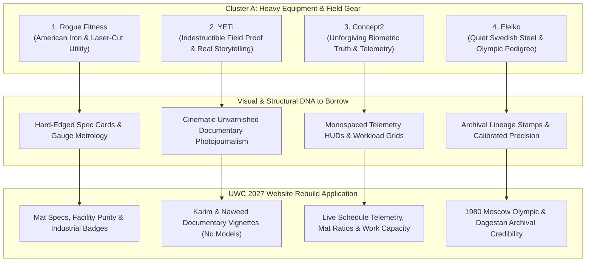

> Part 1 of 4 of [cluster_a_heavy_equipment_and_field_gear](../cluster_a_heavy_equipment_and_field_gear.md). Text is verbatim from the original; only links were rewritten.


# Cluster A: Heavy Equipment, Strength & Field Gear — Brand & Visual Design Archetypes for UWC 2027

> **Client:** United Wrestling Club (Hayward, CA)  
> **Brand Ethos:** *"The Industrial Mat Sanctuary — Physical Honesty Over Spectacle. Ancient Olympic Lineage (Karim Zemaryalai 1980 Olympian, Ali Aliyev Dagestan medalist) meets Modern Kinesiology (Naweed Zemaryalai, Chabot College Coach) in an East Bay Industrial Park (30139 Industrial Pkwy SW, Hayward)."*  
> **Document Code:** `UWC-ANALOGOUS-CLUSTER-A-EQUIPMENT`  
> **Scope:** Strictly Non-Clothing Industrial & Field Gear Brands Outside Wrestling  
> **Target Audience (ICPs):** East Bay Parents (Character & Real Grit), High School CIF Contenders (Collegiate Standard), Adult Grapplers (Authentic No-Gi & Sambo Sanctuary)  
> **Deliverable Path:** `discovery/brand/analogous_brands/cluster_a_heavy_equipment_and_field_gear.md`  

---

## Executive Summary & Design Thesis

United Wrestling Club is not a commercial strip-mall martial arts franchise, nor is it a recreational gymnastics center. It is an unvarnished **industrial athletic sanctuary** located among distribution warehouses, machine shops, and logistics terminals on Industrial Parkway in Hayward, CA. 

When East Bay parents, high school varsity athletes, and adult grapplers evaluate UWC, their trust is not won by pastel gradients, slick tech-SaaS illustrations, or polished corporate stock photography. Their trust is won through **mechanical and physical honesty**—the exact same psychological resonance cultivated by premier heavy strength manufacturers and field equipment brands.

This dossier analyzes four world-class non-clothing brands—**Rogue Fitness**, **YETI**, **Concept2**, and **Eleiko**—extracting their exact visual design DNA (typography, hex color systems, camera staging, and UI components) and translating each directly into high-converting web architecture for UWC's 2027 rebuild.



---

## Brand 1: Rogue Fitness (Columbus, OH)

### 1. Brand Ethos & Core Narrative
**"Forged in American Iron."** Rogue Fitness champions relentless industrial utility, in-house domestic steel manufacturing, and zero-compromise mechanical durability built for the harshest strength environments on earth.

### 2. Why UWC's ICPs Revere It
* **East Bay Parents:** Parents immediately associate Rogue with institutional durability and safety. When they see heavy 11-gauge steel, textured powdercoat, and grade-8 hardware, they know their child is not training in a cheap, flimsy facility. It communicates safety through structural permanence.
* **High School Contenders:** High school wrestlers worship Rogue as the gold standard of collegiate weight rooms (Iowa, Penn State, Ohio State). The laser-cut steel numbers, knurled pull-up rigs, and matte black finish represent the physical grind required to win CIF state medals.
* **Adult Grapplers:** Adult practitioners (BJJ practitioners, judokas, Sambo fighters) respect Rogue's anti-lifestyle, anti-fluff ethos. Rogue does not sell gimmicks; it sells cold steel that never bends under load.

### 3. Exact Visual Design DNA to Borrow

#### A. Typography
* **Header Font:** `Agency FB` (Bold / Black) or `DIN 1451 Mittelschrift` (All-Caps, Condensed).
  * **Scale:** H1 `56px–72px` (`line-height: 0.95`, `letter-spacing: -0.03em`).
  * **Style:** Monolithic, architectural, industrial stamped appearance.
* **Body Font:** `Roboto` or `Inter` (Regular, Medium).
  * **Scale:** Body `15px–16px` (`line-height: 1.6`, `letter-spacing: 0.01em`).
* **Technical Spec Font:** `Roboto Mono` or `DIN Condensed` (Medium / Bold, All-Caps).
  * **Scale:** Subheads/Specs `12px–13px` (`letter-spacing: 0.08em`).

#### B. Color Palette
```
Primary Brand Red:       #C41230   /* Deep American Industrial Red */
Matte Powdercoat Black:  #111111   /* Deepest Void / Textured Steel */
Cold Gunmetal Slate:     #1E2226   /* Structural Tube Steel */
Hardware Zinc / Grey:    #8C929D   /* Grade-8 Bolt / Laser-Etched Accent */
Stark Canvas White:      #FFFFFF   /* High-Contrast Technical Readouts */
```

#### C. Photography Style
* **Lighting:** High-contrast chiaroscuro, low-key industrial lighting. Single overhead beam or side rim-light cutting through airborne chalk dust and mat humidity.
* **Focal Length & Aperture:** `50mm f/1.8` or `85mm f/1.4`. Shallow depth of field isolating laser-etched metal burrs, knurling textures, and beads of sweat on an athlete's jawline.
* **Grain & Grading:** Subtle 35mm film grain (`10–15%`), desaturated shadows, cool industrial tint on steel surfaces, warm natural skin tones.
* **Subject Staging:** Unposed, mid-strain exhaustion. Athletes resetting their grip between rounds, chalking hands against matte black uprights, or listening intently to coaching feedback. Zero manufactured smiles or promotional poses.

#### D. UI Components & Layout Tactics
* **The "Spec Sheet" Product/Program Card:** Hard-edged rectangles (`border-radius: 0px` to `2px`) wrapped in a 1px solid border (`#2A2F35`). Background: `#16191D`. Card headers feature a laser-etched style badge: `SPEC // YOUTH FOUNDATIONS`.
* **Industrial Spec Data Grids:** 2-column or 3-column key-value tables embedded directly in program cards:
  ```
  MAT SURFACE        // 2" Dollamur Seamless Flexi-Roll
  COACH RATIO        // 1:8 Max Mat Density
  CURRICULUM         // USAW Folkstyle & Freestyle Standards
  LOCATION           // 30139 Industrial Pkwy SW Ste C
  ```
* **Utilitarian Action Buttons:** Solid high-visibility `#C41230` background with sharp corners (`rounded-none`), uppercase `Agency FB` / `DIN` text, high-contrast hover state that shifts to `#E01E37` with an inset `1px solid rgba(255,255,255,0.2)` highlight line.
* **Industrial Badge Stamps:** Monospaced rectangular tag pills (`padding: 3px 8px`, `border: 1px solid #444D56`, `background: #0D0F11`, `color: #8C929D`) stating: `SANCTIONED USAW #513` and `MADE IN THE EAST BAY`.

### 4. UWC Translation (How This Translates Directly to UWC's Website Rebuild)
* **Facility Purity Section ("The Specs of the Sanctuary"):** Instead of generic gym photos, UWC features an interactive "Mat Specifications" section detailing the high-density subfloor foam, hospital-grade mat disinfectant protocol, and ventilation specs of the Industrial Parkway facility.
* **Program Tiers as Equipment Specs:** Format class levels (Youth Folkstyle, High School CIF Prep, Adult Wrestle-Jitsu) like Rogue rig spec sheets—listing mat duration, physical intensity score, contact ratio, and coach certification.
* **Hard-Cornered, High-Contrast UI:** Strip all bubbly, consumer-app rounded corners (`border-radius: 20px+`) from the site. Replace with sharp 2px industrial edges and dark gunmetal cards that reflect the steel beams of the Hayward warehouse.

---
