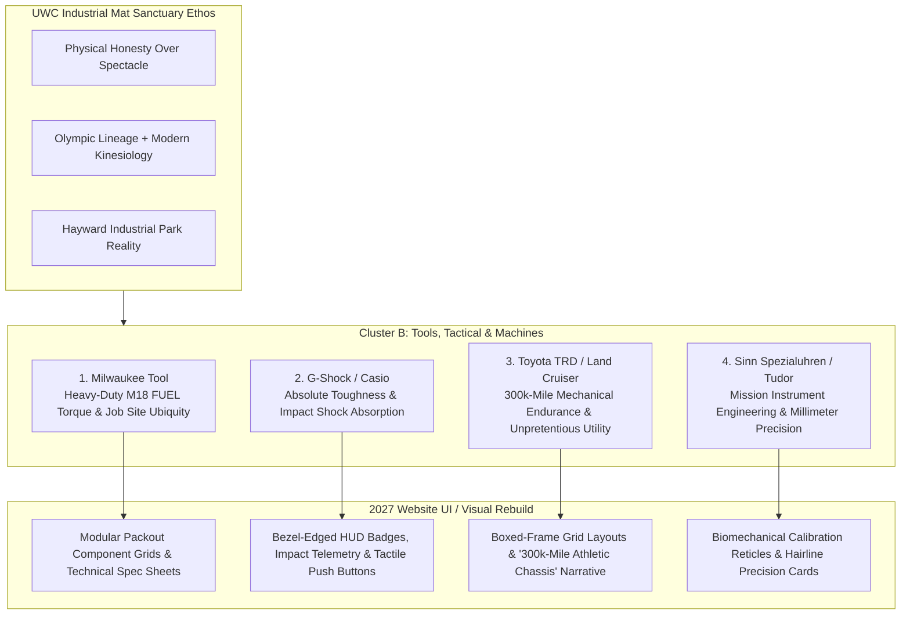
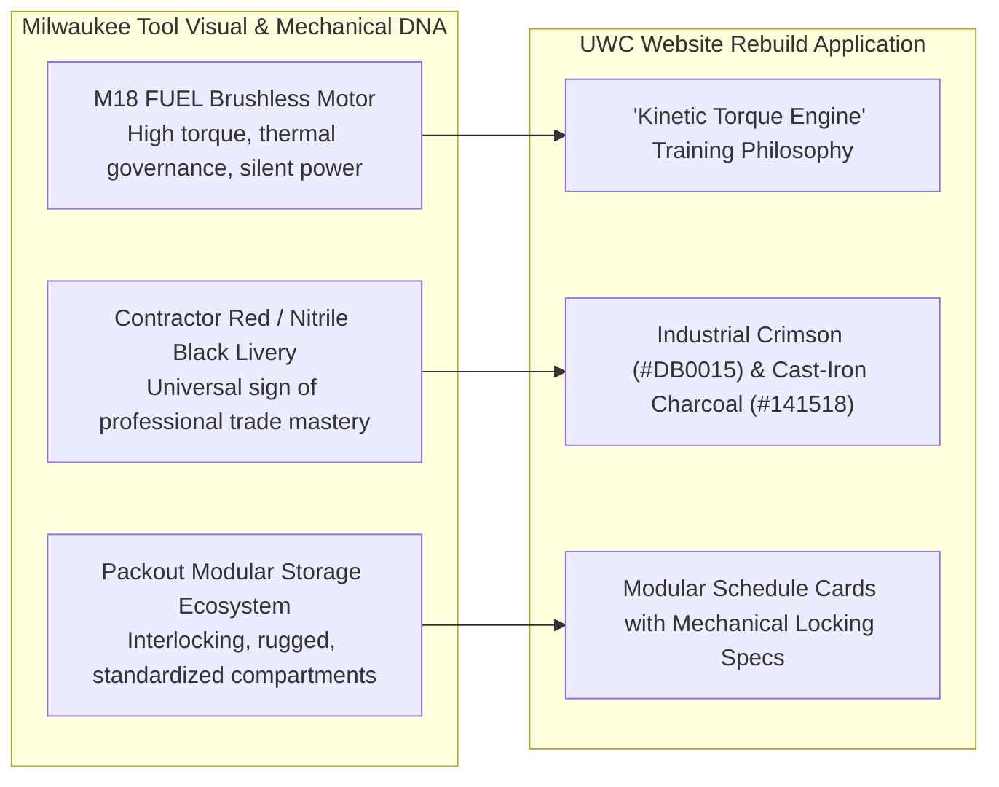

> Part 1 of 4 of [cluster_b_tools_tactical_and_machines](../cluster_b_tools_tactical_and_machines.md). Text is verbatim from the original; only links were rewritten.

# Cluster B Analogous Brands: Industrial Tools, Tactical Hardware & Utility Machines

> **Client:** United Wrestling Club (UWC) — Hayward, CA  
> **Physical Address:** 30139 Industrial Pkwy SW Ste C, Hayward, CA (East Bay Industrial Flex Corridor)  
> **Brand Ethos:** *"The Industrial Mat Sanctuary — Physical Honesty Over Spectacle. Ancient Olympic Lineage (Karim Zemaryalai, 1980 Moscow Olympian & Ali Aliyev Dagestan Medalist) meets Modern Kinesiology (Naweed Zemaryalai, Chabot College Coach) in an East Bay Industrial Park."*  
> **Target Audience (ICPs):** East Bay Working-Class & STEM Parents (Anti-McDojo, Character & Grit), Scholastic CIF High School Contenders (High-Torque Athletic Edge), Adult Grapplers & Tradesmen (Injury-Conscious, Unvarnished Mat Craft)  
> **Document Purpose:** Systematic brand, visual, and architectural evaluation of 4 non-clothing industrial machine and tactical hardware brands to guide UWC's 2027 digital rebuild.  
> **Scope:** STRICTLY NON-CLOTHING — Heavy Trade Power Tools, Shock-Resistant Tactical Instrumentation, Utilitarian Off-Road Machines, and Mission-Timer Horology.  
> **Date:** October 2026 / 2027 Rebuild Roadmap  

---

---

## 1. Milwaukee Tool (Milwaukee Electric Tool Corp.)

### Brand Ethos & Core Narrative
*"Nothing but Heavy Duty."* Milwaukee Tool does not build decorative home improvement trinkets; they engineer high-torque, brushless cordless machinery built to survive job site drops, concrete slurry, and 12-hour shifts in the hands of union tradesmen whose livelihoods depend on their tools never stalling out under load.

### Why UWC's ICPs Revere It
* **East Bay Trades & STEM Parents:** From the union halls of Local 393 and Local 342 to contractors across Fremont, Union City, and San Leandro, Milwaukee is the gold standard of professional competence. Parents who earn their living with their hands know the difference between cheap plastic throwaway drills and an M18 FUEL impact wrench. When they evaluate a wrestling academy for their children, they spot "McDojo" fluff instantly. They choose UWC because it operates with the same heavy-duty, no-nonsense trade craftsmanship: no belt fees, no padded participation ribbons, just indestructible physical character built one rep at a time.
* **High School CIF Contenders:** High school wrestlers love raw mechanical power. They don't want yoga-gym gentility; they want to generate massive explosive torque on high-crotch takedowns and mat returns. The brushless motor ethos (maximum power output, zero thermal burnout, cool operating temperatures under maximum friction) is the exact physical reality of championship six-minute wrestling matches.
* **Adult Grapplers & Tradesmen:** Adult BJJ practitioners and blue-collar grapplers train after 8–10 hours of heavy physical labor. They demand an environment that respects their physical longevity. Milwaukee's REDLINK PLUS intelligence—preventing motor burnouts through smart load monitoring—mirrors UWC's kinesiological approach under Coach Naweed: high-intensity drilling engineered to protect joints, knees, and spines from chronic wear.

### Exact Visual Design DNA to Borrow

#### A. Typography
* **Primary Display / Headers:** `Industry Black` or `DIN Pro Black Condensed` (Alternative open-source: `Bebas Neue Pro` or `Barlow Condensed Black`).
  * *Weight:* 900 (Ultra/Heavy).
  * *Case:* All-Caps strictly.
  * *Tracking:* Tight (`-0.03em` to `-0.04em`), conveying dense, solid-forged mass.
  * *Line Height:* Compact (`0.95` to `1.05`).
* **Technical Spec & Subheads:** `Space Mono Bold` or `Chivo Mono SemiBold`.
  * *Weight:* 600–700.
  * *Case:* All-Caps with wide tracking (`+0.08em`).
  * *Usage:* Spec tags, session durations, mat capacity labels.
* **Body Copy:** `Barlow` (Regular 400 / Medium 500) paired with `Inter` for micro-specs.
  * *Line Height:* `1.55` for high readability on dark, high-contrast surfaces.

#### B. Color Palette
| Swatch | Role | Hex Code | Visual Reference / Description |
| :--- | :--- | :--- | :--- |
| **Milwaukee Heavy Crimson** | Primary Brand Accent | `#DB0015` | High-visibility job site power red; aggressive, industrial, unyielding. |
| **Overmold Nitrile Black** | Primary Background / Chassis | `#111215` | Matte impact-resistant rubber tool housing; absorbs glare. |
| **Cast-Iron Tool Dark Slate** | Card / Container Surface | `#1E2024` | Textured battery casing and motor housing surface. |
| **High-Torque Amber / Gold** | Warning & Tier Accent | `#F59E0B` | Battery gauge LED indicator / thermal warning signal. |
| **Cold Brushed Steel** | Border & Reticle Stroke | `#3A3F47` | 1px mechanical chamfered edges and separator rules. |
| **Thermal High-Contrast White** | Primary Text | `#FFFFFF` | Maximum legibility under dark ambient lighting. |

#### C. Photography Style
* **Lighting:** High-contrast, directional key lighting with hard rim separation. Industrial work-light aesthetic (mimicking high-output LED floodlights on night job sites). Deep, rich shadows that carve out shoulder caps, trap muscles, and neck bridges.
* **Focal Length:** 50mm and 85mm prime lenses shot between $f/2.2$ and $f/2.8$. Eliminates distracting industrial flex-park backgrounds, locking razor focus on kinetic contact points: hands wrapped in wrist-ties, chalk-dusted soles gripping vinyl, sweat beading on brows.
* **Grain & Shutter:** High-shutter speed (1/1000s) freezing chalk explosions and airborne sweat during takedowns. Fine, sharp digital sensor grain with enhanced micro-contrast (clarity +15, zero soft glam filters).
* **Subject Staging:** Unvarnished mechanical labor. Athletes mid-rep, coaches kneeling to physically manipulate an ankle hook, wrestlers collapsed on the mat during 30-second breathers staring at the ceiling. Absolutely zero staged smiles or thumbs-up poses.

#### D. UI Components & Layout Tactics
* **Modular Packout Card Grids:** Training programs, schedule blocks, and membership tiers housed in interlocking rectangular cards with subtle 1px mechanical chamfered corners, dark borders (`#3A3F47`), and subtle drop-in shadows (`0 4px 20px rgba(0,0,0,0.6)`).
* **"Hardware Spec Sheets" vs. Feature Lists:** Replace generic bullet points with tabular mechanical spec sheets:
  * `TORQUE TRANSFER: Freestyle Hand-Fighting & Snap-Downs`
  * `DUTY CYCLE: 90-Minute High-Friction Mat Block`
  * `OVERHEAT PROTECTION: Guided Kinesiological Warm-Down`
* **Heavy-Duty Push Buttons:** CTAs designed with visible physical bevels, inset shadow states (`active: translate-y-0.5`), bold uppercase typography (`CLAIM 7-DAY HEAVY-DUTY MAT TRIAL ->`), and high-visibility `#DB0015` crimson fill.
* **Battery-Gauge Status Indicators:** 4-segment horizontal bar visualizers showing class capacity (e.g., `[■ ■ ■ □] 3 SPOTS REMAINING`).

### UWC Translation (Website Rebuild Application)
* **The "Heavy Duty" Mat Philosophy:** UWC’s website opens not with an empty marketing slogan, but with a statement of industrial craftsmanship: *"Wrestling is the Heavy-Duty Trade of Human Movement. No Shortcuts. No Stalled Motors. Pure Grounded Competence."*
* **The Exploded-Diagram Breakdown:** An interactive graphic component breaking down Karim Zemaryalai's signature Russian Tie / 2-on-1 series styled like an exploded Milwaukee FUEL motor schematic, illustrating rotational torque, skeletal lever arms, and kinetic power transfer.

---
