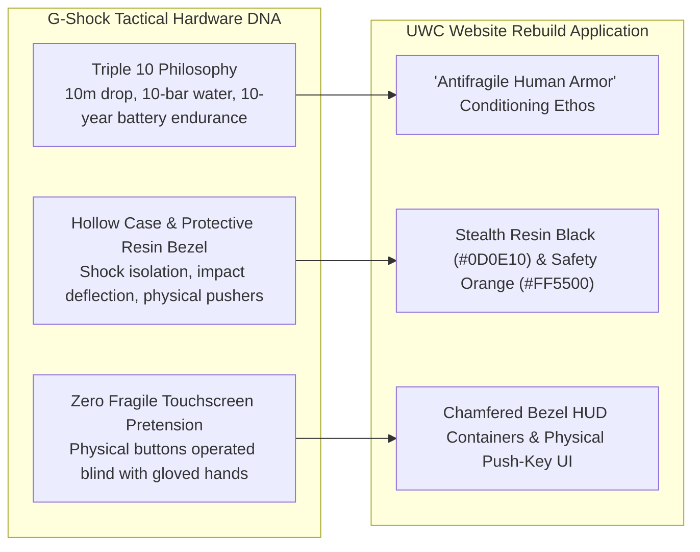

> Part 2 of 4 of [cluster_b_tools_tactical_and_machines](../cluster_b_tools_tactical_and_machines.md). Text is verbatim from the original; only links were rewritten.

## 2. G-Shock / Casio (Toughness & Shock Resistance)

### Brand Ethos & Core Narrative
*"Absolute Toughness."* Born from engineer Kikuo Ibe’s determination to create a watch that never breaks even when dropped from a third-story window, G-Shock rejected the fragile luxury of delicate glass horology to forge a shock-absorbing, utilitarian instrument worn by Navy SEALs, construction workers, and tactical operators worldwide.

### Why UWC's ICPs Revere It
* **East Bay Parents:** Parents are terrified of raising fragile, screen-addicted kids who crumble at the first sign of social friction or physical discomfort. G-Shock represents absolute psychological and physical resilience. Wrestling is the human G-Shock drop test: a sport where you are knocked down a thousand times, shock-absorbed by the mat, and conditioned to pop right back up with your defenses intact.
* **High School CIF Contenders:** In wrestling, you cannot wear jewelry, watches, or flashy status symbols during competition. But in the locker room, high school contenders revere the matte black, indestructible G-Shock (5600 or 6900 series). It signals that you belong to an athletic subculture defined by physical impact rather than suburban country club aesthetics.
* **Adult Grapplers:** Grappling exposes pretension. A delicate smartwatch shatters under a heavy knee-on-belly; a G-Shock survives intact for twenty years. Adult grapplers respect equipment and training regimens that run on physical reality rather than fragile touchscreens.

### Exact Visual Design DNA to Borrow

#### A. Typography
* **Primary Display / Headers:** `Eurostile Bold Extended` or `Microgramma` (Alternative open-source: `Rajdhani Bold` or `Chivo Black Extended`).
  * *Weight:* 700–800.
  * *Case:* Uppercase strictly.
  * *Tracking:* Wide (`+0.06em` to `+0.10em`), evoking molded bezel lettering.
  * *Feel:* Geometric, squarish, mechanical, armored.
* **Telemetry & Timestamp Numerics:** `Share Tech Mono` or `DSEG7 Classic` (LCD segmented styling).
  * *Usage:* Practice clocks, tournament countdowns, rounds completed, mat volume counters.
* **Body Copy:** `Space Grotesk` (Regular 400 / Medium 500) with generous character width.
  * *Line Height:* `1.5`.

#### B. Color Palette
| Swatch | Role | Hex Code | Visual Reference / Description |
| :--- | :--- | :--- | :--- |
| **Stealth Matte Resin** | Core Background | `#0D0E10` | Non-reflective tactical polymer; zero fingerprint sheen. |
| **Gunship Carbon Core** | Card & Panel Surface | `#181A1E` | High-density shock-isolation casing tone. |
| **Emergency Bezel Orange** | Primary Accent / CTA | `#FF5500` | High-vis button accent; instant tactical focus. |
| **Protection Hazard Yellow** | Sub-Accent / Badging | `#FFCC00` | Water-resist & shock-resist bezel typography tone. |
| **Etched Resin Infill Gray** | Border & Recessed Markings | `#343840` | Subtle 1px stamped bezel outlines and mechanical seams. |
| **Inverted LCD Crisp White** | Display Text | `#F0F2F5` | Backlit digital instrument clarity. |

#### C. Photography Style
* **Lighting:** Low-angle, hard-edge rim lighting that carves athletes out of pitch-black environments. Emphasizes the physics of impact—shadows fall deeply across collarbones and ribcages, highlighting the armor-like musculature forged by wrestling.
* **Focal Length:** 24mm to 35mm wide-angle lenses placed low on the mat surface. Creates an immersive, ground-level perspective that puts the viewer directly in the splash zone of a takedown.
* **Grain & Shutter:** Extreme shutter speed (1/1250s) freezing the exact millisecond of impact: mat vinyl depressing under a wrestler’s foot, forearm frames blocking a shot, instantaneous deceleration.
* **Subject Staging:** Impact absorption and structural stability. Showing wrestlers absorbing a snap-down with a solid, unyielding neck bridge; defensive sprawling against an explosive shot; hands braced against the mat.

#### D. UI Components & Layout Tactics
* **Chamfered Bezel HUD Containers:** Cards featuring 45-degree angled corner cutouts, recessed inner borders (`box-shadow: inset 0 2px 4px rgba(0,0,0,0.8)`), and etched hardware badge graphics.
* **Tactile Mechanical Buttons:** Buttons styled with simulated knurled edges, heavy tactile border treatments (`border: 2px solid #343840`), and distinct depression on click (`active: transform translateY(2px)`).
* **Engraved Telemetry Badges:** Micro-pills styled like G-Shock caseback and bezel engravings:
  * `[SHOCK-TESTED: USAW REGULATION]`
  * `[PRESSURE RESIST: 200 LBS/SQ-IN]`
  * `[CALIBER: 1980 MOSCOW OLYMPIC DNA]`
* **Countdown Telemetry Clocks:** Live digitized round-timers and season registration clocks styled after Casio DW-5600 inverted LCD displays.

### UWC Translation (Website Rebuild Application)
* **The "Antifragile Conditioning" Value Proposition:** Pitching wrestling directly to Hayward parents as emotional and physical shock-resistance: *"The World Will Push Your Child. We Teach Them How to Absorb the Shock and Push Back."*
* **The "Impact Rating" Filter:** Class schedules featuring interactive filter toggles styled like rugged bezel pushers (`[LIGHT CONTACT: YOUTH FOUNDATIONS]` / `[MEDIUM CONTACT: JUNIOR VARSITY]` / `[FULL IMPACT: SCHOLASTIC & ADULT OPEN MAT]`).

---
