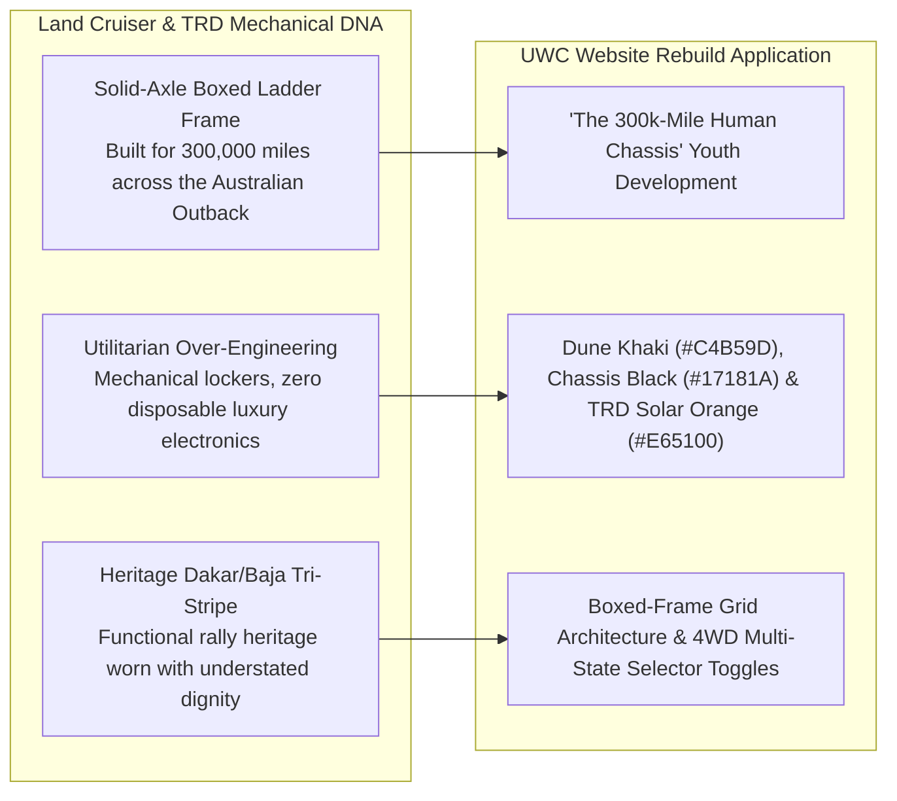

> Part 3 of 4 of [cluster_b_tools_tactical_and_machines](../cluster_b_tools_tactical_and_machines.md). Text is verbatim from the original; only links were rewritten.

## 3. Toyota TRD / Land Cruiser (70 Series & Heritage 4WD)

### Brand Ethos & Core Narrative
*"The World’s Toughest Machine."* The Toyota Land Cruiser (and TRD off-road division) does not build suburban show-ponies that break down after 50,000 miles; they manufacture solid-axle, over-engineered mechanical lifelines chosen by humanitarian missions, outback ranchers, and desert explorers who require uncompromised reliability in terrains where mechanical failure equals death.

### Why UWC's ICPs Revere It
* **East Bay Commuter & Trade Parents:** In Alameda and Contra Costa counties, the I-880 and Highway 92 corridors are filled with Tacomas, 4Runners, and Land Cruisers driven by parents who prize longevity over status-seeking luxury. They understand that a Range Rover looks pretty in a driveway but spends half its life in a repair bay, while a 1998 Land Cruiser with 280,000 miles starts on the first crank in sub-zero Sierra snow. They want that exact durability for their children’s bodies: joint integrity, core endurance, and character that will last for 40 years.
* **High School CIF Contenders:** High school wrestlers in Northern California look up to the rugged independence of TRD trucks hauling gear bags, camping equipment, and recovery gear. It represents rugged self-sufficiency—an athlete who doesn't rely on coaches holding their hand, but who grinds out morning roadwork on mountain trails.
* **Adult Grapplers:** Adult wrestlers and sambists know that wrestling develops a dense, indestructible physical chassis. Like a solid boxed ladder frame, a wrestler's hips, lower back, and core can handle loads that twist and break untrained athletes. The Land Cruiser is the automotive spirit animal of the 35-year-old adult grappler.

### Exact Visual Design DNA to Borrow

#### A. Typography
* **Primary Display / Headers:** `DIN 1451 Mittelschrift` or `Barlow Semi Condensed Bold` (Alternative open-source: `Overpass Heavy` or `Oswald Bold`).
  * *Weight:* 700–800.
  * *Case:* Uppercase strictly.
  * *Tracking:* Balanced (`+0.02em` to `+0.04em`), conveying clean, functional engineering.
  * *Feel:* Honest, utilitarian, road-tested, unpretentious.
* **Badging & Subheads:** `Overpass Mono Bold` or `Chivo Mono`.
  * *Tracking:* Extra-wide (`+0.12em`), mirroring stamped metal firewall VIN tags and 4WD selector console plates.
* **Body Copy:** `Public Sans` (Regular 400 / Medium 500).
  * *Line Height:* `1.6`—warm, readable, honest editorial clarity.

#### B. Color Palette
| Swatch | Role | Hex Code | Visual Reference / Description |
| :--- | :--- | :--- | :--- |
| **Heritage Dune Khaki** | Secondary Accent / Surface | `#C4B59D` | Natural desert canvas, raw linen, dust-caked steel panels. |
| **Boxed-Chassis Black** | Primary Background | `#17181A` | Anti-rust black frame-rail coating; grounded mass. |
| **Primer Slate Gray** | Card & Container Surface | `#26292E` | Anodized aluminum skid-plates and engine block cast iron. |
| **TRD Heritage Solar Orange**| Primary Interactive Accent | `#E65100` | Vintage Baja 1000 rally stripe; high-visibility functional warmth. |
| **Dakar Heritage Yellow** | Tri-Stripe Detail Accent | `#F59E0B` | Secondary rally stripe detail / caution marker. |
| **Enamel White** | Text & Stamped Badging | `#F8F9FA` | Heavy automotive enamel badge typography. |

#### C. Photography Style
* **Lighting:** Natural, raw, unvarnished outdoor dawn/dusk light, or natural daylight flooding through open warehouse rollup doors. Golden dust motes suspended in the air; authentic industrial warehouse ambience.
* **Focal Length:** 35mm and 50mm documentary lenses at human eye and chest level. Avoids distorted fisheye gym angles; presents honest, grounded proportions.
* **Grain & Texture:** Organic, 35mm film-style grain with tactile micro-texture. Emphasizes worn canvas mat covers, salt-stained training singlets, cracked leather wrestling shoes, and sweat stains on cotton tees.
* **Subject Staging:** Multi-generational endurance and patient labor. An older coach (Karim) calmly watching athletes drill; two wrestlers locked in a collar tie battling for position; an athlete lacing worn shoes sitting on a raw wooden bench.

#### D. UI Components & Layout Tactics
* **Boxed Ladder-Frame Grids:** Layouts defined by bold 2px structural divider lines (`#383D45`), creating a rigid, unshakeable visual architecture that feels welded together rather than floated.
* **Heritage Tri-Stripe Accents:** A subtle 3-stripe micro-accent (`#D32F2F` Red, `#E65100` Orange, `#F59E0B` Yellow) placed discreetly in card corner notches or hero header borders to signify UWC’s triple lineage: 1980 Moscow Olympics, Dagestani Sambo, and Collegiate NCAA Kinesiology.
* **Mechanical 4WD Transfer Case Toggles:** Program filtering designed as an authentic multi-position mechanical switch:
  * `[2H: YOUTH FUNDAMENTALS]`
  * `[4H: SCHOLASTIC CIF COMPETITIVE]`
  * `[4L: ADULT ALL-WEATHER GRAPPLING]`
* **Firewall Tag Program Cards:** Class and coaching cards styled like stamped aluminum vehicle data plates with monospaced specifications and riveted corner graphics.

### UWC Translation (Website Rebuild Application)
* **The "300,000-Mile Human Chassis" Hero Campaign:** The parent value proposition headline: *"We Don't Build Fragile Athletes for One Season. We Build the 300,000-Mile Chassis That Carries Your Child Through High School, College, and the Next 40 Years of Life."*
* **The "Maintenance & Longevity" Facility Page:** Showcasing UWC's Hayward warehouse not as an opulent luxury spa, but as a reliable, clean, zero-fluff maintenance depot for serious athletic engines: clean mats, Olympic weights, pull-up bars, and elite coaching.

---
