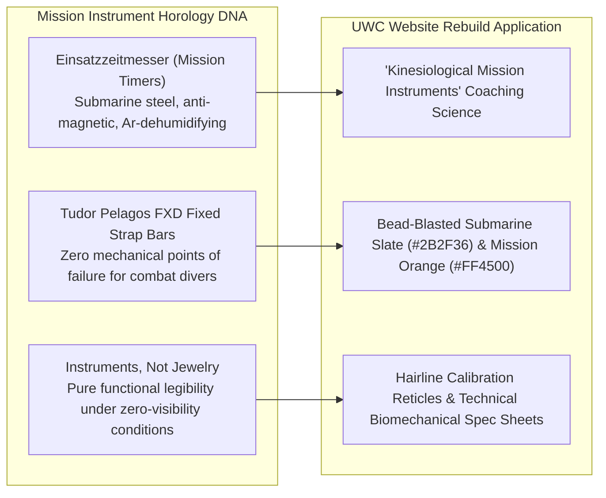
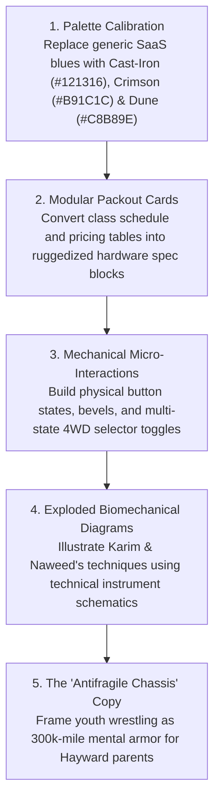

> Part 4 of 4 of [cluster_b_tools_tactical_and_machines](../cluster_b_tools_tactical_and_machines.md). Text is verbatim from the original; only links were rewritten.

## 4. Sinn Spezialuhren / Tudor Tool Watches (Mission Horology)

### Brand Ethos & Core Narrative
*"Instruments, Not Jewelry."* Sinn Spezialuhren (Frankfurt) and Tudor Tool Watches (Geneva) engineer utilitarian mission instruments for German GSG 9 maritime counter-terrorism units, French Marine Nationale combat swimmers, and Arctic explorers. Every single millimeter of metal, anti-magnetic shielding, and luminescent dial design exists to deliver fail-safe mission survival under extreme hydrostatic pressure and operational stress.

### Why UWC's ICPs Revere It
* **East Bay STEM, Biotech & Engineering Parents:** The East Bay contains a massive demographic of engineers, software architects, and scientists (Tesla Fremont Gigafactory, Lawrence Livermore National Lab, UC Berkeley, Silicon Valley hardware firms). These parents despise marketing hyperbole and commercial fluff. They revere Sinn and Tudor because of the unvarnished engineering rigor: German Submarine Steel (U-boat steel), Tegiment surface-hardening to 1,200 Vickers, and anti-magnetic shielding to 80,000 A/m. When they visit UWC, they immediately recognize that Coach Naweed's B.S. in Kinesiology brings scientific, biomechanical precision to Karim's Olympic wrestling lineage: it is an athletic laboratory, not an aggressive karate franchise.
* **High School CIF Contenders:** High-level scholastic wrestlers operate against relentless clocks: two-minute periods, ride-out countdowns, and stalling timers. They understand the sacred value of split-second positional precision. Tool watches represent the discipline of mastering time and physical space under intense pressure.
* **Adult Grapplers & Professionals:** Many adult grapplers in the East Bay are professionals who appreciate quiet, functional elegance. They wear a titanium Tudor Pelagos or a bead-blasted Sinn 556 because it doesn't shout for attention. They choose UWC for the same reason: zero gym bros, zero loud commercial bravado, just deep technical study of leverage and joint mechanics.

### Exact Visual Design DNA to Borrow

#### A. Typography
* **Primary Display / Headers:** `Akzidenz-Grotesk Bold` or `DIN 1451 Engschrift` (Alternative open-source: `Barlow Condensed` or `Chivo Black`).
  * *Weight:* 700–900.
  * *Case:* Uppercase strictly.
  * *Tracking:* Precise, calibrated (`+0.04em` to `+0.06em`).
  * *Feel:* Surgical, clinical, German instrument-grade legibility.
* **Tabular Data & Telemetry:** `Söhne Mono`, `Akkurat Mono`, or `Space Mono`.
  * *Features:* Tabular lining numbers (`font-variant-numeric: tabular-nums`) so that data columns, session times, and weight classes align with millimeter accuracy.
* **Body Copy:** `Inter Display` / `Inter` (Regular 400 / Medium 500).
  * *Line Height:* `1.5` with razor-sharp micro-typography hierarchy.

#### B. Color Palette
| Swatch | Role | Hex Code | Visual Reference / Description |
| :--- | :--- | :--- | :--- |
| **Bead-Blasted Submarine Slate** | Primary Surface / Frame | `#2B2F36` | Non-reflective, matte German U-boat steel; indestructible calm. |
| **Instrument Matte Black** | Core Background | `#121315` | Anti-reflective deep dial surface; pure void. |
| **Clinical Dial Charcoal** | Card / Container Surface | `#1B1E23` | Recessed instrument sub-dial tone. |
| **Mission Emergency Orange** | Primary Accent / Timing | `#FF4500` | Sinn EZM mission timer hand; high-urgency callout. |
| **Phosphorescent Lume Green** | Micro-Signal / Status | `#00E676` | Super-LumiNova operational indicator; signifies active spots/open mats. |
| **Sterile White** | Dial Markers & Copy | `#FFFFFF` | Maximum photometric contrast against black. |

#### C. Photography Style
* **Lighting:** Studio-grade, clinical chiaroscuro. Single large diffused overhead softbox or hard directional rim light highlighting the anatomical mechanics of the human body: muscular striations, tendon tension, skeletal alignment, and precise hand positioning.
* **Focal Length:** Macro and 90mm-105mm prime lenses capturing millimeter-level detail: the exact thumb placement of a 2-on-1 wrist lock, the angle of a lead foot driving off the mat, the pressure of a forehead planted in a collar tie.
* **Grain & Sharpness:** Ultra-crisp, optical perfection. Zero fake grain or nostalgic sepia filters; hyper-clean sensor resolution that reveals the true physical reality of high-level athletic training.
* **Subject Staging:** Biomechanical alignment and calm tactical focus. Coach Naweed demonstrating a counter-move with geometric precision; an athlete checking their breathing during interval drills; calm, focused eyes behind headgear.

#### D. UI Components & Layout Tactics
* **Mission Spec Sheets (Einsatz-Tabellen):** Program tiers and trial enrollment modules structured as strict, clinical specification sheets with 1px hairline borders (`rgba(255,255,255,0.12)`):
> Superseded 2026-11-08: The mat footprint is 3,800 sq ft, not 3,000 sq ft. Old text: [archive](../../../archive/stale-2026-11-08/cluster_b_tools_tactical_and_machines.md).
  * `CALIBER ENGINE: Olympic Dagestan Lineage + Collegiate NCAA Science`
  * `TOLERANCE RATING: 1:8 Coach-to-Athlete Ratio`
  * `MAGNETIC RESISTANCE: Zero Commercial Distractions / Zero Belt Fees`
* **Hairline Calibration Reticles & Grid Coordinates:** Subtle background watermarks featuring 1px coordinate lines, crosshairs, and datum marks that evoke navigational instrument charts and biomechanical alignment planes.
* **Super-LumiNova Active Badges:** Pulsing micro-pills with soft glowing green drop-shadows indicating live class schedules and active mat sessions:
  * `[● LIVE ON THE MAT: SCHOLASTIC VARSITY DRILLING]`
* **Tudor Fixed-Bar Layout Cards:** Cards with visual "lugs and fixed strap bars" styling—heavy solid corner brackets that look structural and impossible to detach.

### UWC Translation (Website Rebuild Application)
* **The "Biomechanical Instrument" Positioning:** Framing UWC’s curriculum as elite human engineering: *"Wrestling Taught as a Precision Physical Instrument. Karim’s Olympic Pedigree Meets Naweed’s Collegiate Kinesiology Science."*
* **The "Mission Specification" Trial Booking Flow:** Redesigning the trial registration modal from a generic contact form into a streamlined "Mission Clearance" interface where parents specify their athlete's grade, experience level, and physical goals, receiving an instant, calibrated class recommendation.

---

## 5. Comparative Visual DNA & Architectural Matrix

The following synthesis matrix compares the exact design parameters of all four Cluster B brands and defines the combined 2027 design language for United Wrestling Club:

| Parameter | Milwaukee Tool | G-Shock / Casio | Toyota TRD / Land Cruiser | Sinn / Tudor Tool Watches | **UWC 2027 Synthesized Rebuild Spec** |
| :--- | :--- | :--- | :--- | :--- | :--- |
| **Design Core** | Heavy-Duty Trade Power | Shock-Absorbing Toughness | Utilitarian Mechanical Endurance | Mission Instrument Precision | **"The Industrial Mat Sanctuary"** |
| **Primary Header Font** | `Industry Black` | `Eurostile Extended` | `DIN 1451 Mittelschrift` | `Akzidenz-Grotesk / DIN` | **`Barlow Condensed Black` + `DIN 1451`** |
| **Telemetry / Data Font** | `Space Mono Bold` | `Share Tech Mono` | `Overpass Mono` | `Söhne Mono` | **`Space Mono Bold` (Tabular)** |
| **Body Typography** | `Barlow` (500) | `Space Grotesk` (400) | `Public Sans` (400) | `Inter Display` (400) | **`Public Sans` (400/600, High Legibility)** |
| **Primary Background** | Overmold Black (`#111215`) | Stealth Resin (`#0D0E10`) | Chassis Black (`#17181A`) | Instrument Black (`#121315`) | **Deep Cast-Iron Black (`#121316`)** |
| **Card Surface** | Tool Dark Slate (`#1E2024`)| Carbon Core (`#181A1E`) | Primer Slate (`#26292E`) | Submarine Slate (`#2B2F36`) | **Industrial Steel Slate (`#1C1E23`)** |
| **Signature Accent** | Milwaukee Red (`#DB0015`) | Bezel Orange (`#FF5500`) | TRD Solar Orange (`#E65100`)| Mission Orange (`#FF4500`) | **Heritage Oxblood Crimson (`#B91C1C`) & TRD Orange (`#E65100`)** |
| **Secondary Accent** | Warning Amber (`#F59E0B`) | Hazard Yellow (`#FFCC00`) | Dune Khaki (`#C4B59D`) | Lume Green (`#00E676`) | **Dune Mat Khaki (`#C8B89E`) & Lume Green (`#00E676`)** |
| **Key UI Structure** | Packout Interlocking Cards | Chamfered Bezel HUDs | Boxed-Frame Grid Lines (2px)| Hairline Instrument Specs | **Modular Spec Cards with 1px Chamfered Steel Borders** |
| **Button Treatment** | Beveled High-Torque Push | Tactile Knurled Pusher | Heavy Stamped Metal Switch | Flat Surgical Mission CTA | **Tactile Mechanical Key with 2px Border & Hover Inset** |
| **Photo Direction** | Hard job-site floodlights | Dynamic 24mm mat splash | Natural daylight through rollups| Clinical macro chiaroscuro | **Natural Warehouse Rollup Light + Hard Rim Shadows** |
| **Emotional Hook** | Built for trade pros | Indestructible human armor | 300,000-mile human chassis | Calibrated biomechanical precision | **Substance over spectacle; unshakeable character** |

---

## 6. Implementation Checklist for UWC's 2027 Rebuild

1. **Purge All "McDojo" & SaaS Tropes:**
   * No generic blue buttons, wavy SVG background dividers, or cartoon mascot illustrations.
   * Eliminate all commercial karate/BJJ tropes (belt ranking counters, "black belt guaranteed" promises).
2. **Anchor in Hayward Industrial Reality:**
   * Celebrate the 30139 Industrial Pkwy warehouse setting. Feature natural photography of athletes training with the roll-up garage doors wide open to the cool East Bay evening breeze.
3. **Deploy the "Specification Sheet" Architecture:**
   * Every program card (Youth Fundamentals, High School Pre-Season, Adult Grappling) must feature a standardized "Mechanical Spec Box" outlining Coach-to-Athlete ratio, contact intensity, kinesiological focus, and required gear.
4. **Engineer High-Torque Conversion Flow:**
   * The primary CTA throughout the site must read: `[RESERVE HEAVY-DUTY MAT TRIAL ->]` or `[GET MISSION CLEARANCE]`, opening an interactive, low-friction scheduling modal styled like a calibrated test instrument.
