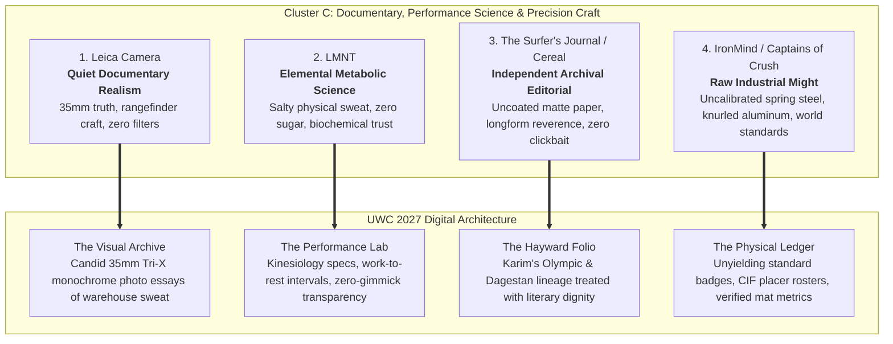
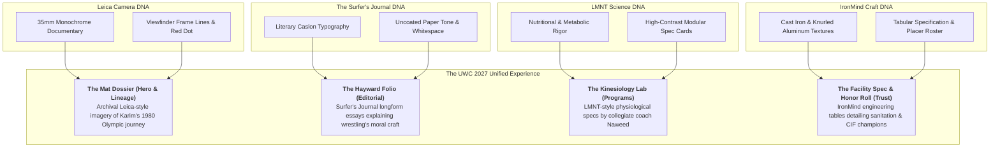

# United Wrestling Club: Analogous Brand Influences — Cluster C
## Documentary Media, Human Performance Science & Precision Craft (Non-Clothing)

> **Client:** United Wrestling Club (Hayward, CA)  
> **Physical Location:** 30139 Industrial Pkwy SW, Ste C, Hayward, CA 94544  
> **Target Audience (ICPs):** East Bay Parents (character, resilience, anti-bullying), Scholastic CIF Contenders (high school champions), Adult Grapplers (BJJ/Sambo/Judo cross-trainers)  
> **UWC Core Ethos:** *"The Industrial Mat Sanctuary — Physical Honesty Over Spectacle. Ancient Olympic Lineage (Karim Zemaryalai 1980 Olympian, Ali Aliyev Dagestan medalist) meets Modern Kinesiology (Naweed Zemaryalai, Chabot College Coach) in an East Bay Industrial Park."*  
> **Document Code:** `UWC-ANALOGOUS-CLUSTER-C`  
> **Date:** October 31, 2026  

---

## Executive Summary & Comparative Matrix

To elevate United Wrestling Club's 2027 website rebuild far above suburban recreation centers, franchise martial arts academies ("McDojos"), and aggressive commercial MMA gyms, UWC must borrow visual and philosophical DNA from disciplines that share its dedication to unvarnished truth, mechanical precision, and rigorous physical standards.

Wrestling is the purest, most unforgiving amateur athletic pursuit in human history: there are no judges to charm, no protective gear to hide behind, and no commercial shortcuts to mastery. The four non-clothing brands profiled below—**Leica Camera**, **LMNT**, **The Surfer's Journal / Cereal**, and **IronMind / Captains of Crush**—command fierce loyalty from UWC’s target ICPs because they reject superficial marketing in favor of functional substance.



### Brand Comparison Matrix

| Brand | Primary Domain | Core Philosophy | Key Visual DNA | UWC Rebuild Application |
| :--- | :--- | :--- | :--- | :--- |
| **Leica Camera** | Precision Optics & Documentary Photography | *Das Wesentliche* (The Essential): stripping away all ornamentation to capture unvarnished reality. | DIN Pro typography, 1px brightline viewfinder frames, surgical red-dot pips, monochrome 35mm grain. | **The Mat Dossier:** Archival photography of Coach Karim (1980) and raw documentary coverage of East Bay youth drilling. |
| **LMNT** | Metabolic Science & Functional Hydration | Evidence-based physical biochemistry: real athletes need salt and electrolytes, not neon sugar water. | Monospaced metric callouts, stark nutritional grids, high-contrast dark carbon surfaces, punchy citrus accents. | **The Kinesiology Lab:** Coach Naweed’s SF State / Chabot College scientific conditioning curriculum framed with clinical rigor. |
| **The Surfer's Journal / Cereal** | Reader-Funded Longform Independent Print | Reverence for the soul of a demanding craft; timeless literature and heavy uncoated paper over pop-up commerce. | Classic literary serifs (Caslon/Plantin), expansive white space, hairline rules, generous line heights. | **The Hayward Folio:** Longform storytelling covering Soviet-Afghan conflict, Moscow Olympics, and the sanctuary on Industrial Pkwy. |
| **IronMind / Captains of Crush** | Heavy Strength & Grip Tools | "Stronger Minds, Stronger Bodies": raw spring steel, certified world standards, zero marketing fluff. | Industrial bold grotesques, machine-stamped octagonal badges, knurled textures, steel-spec data tables. | **The Mat Spec Sheet & Placer Board:** Facility engineering disclosures, antimicrobial mat protocols, and unyielding CIF state placer rosters. |

---

## 1. Leica Camera (Wetzlar, Germany)

### Brand Ethos & Core Narrative
Leica embodies *Das Wesentliche* ("The Essential")—the belief that true vision requires stripping away every extraneous dial, screen, and electronic gimmick until only precision mechanical glass, light, and the photographer's intuition remain. For over a century, Leica rangefinders have documented the defining, unposed historical moments of human struggle and triumph without artificial distortion.

### Why UWC's ICPs Revere It
* **East Bay Parents (Tech / Professional & Discerning Blue-Collar):** Parents in Alameda County are inundated with oversaturated, hyper-filtered smartphone culture. Leica represents timeless heirloom durability, uncompromising European engineering, and the patience to capture a child’s authentic emotional growth rather than a staged smile.
* **Scholastic CIF Contenders:** Elite high school wrestlers instinctively understand the ethos of a manual rangefinder: nothing is autofocus, nothing is handed to you, and your split-second execution determines whether the image is sharp or ruined.
* **Adult Grapplers (BJJ, Sambo, Judo Practitioners):** Grapplers admire tools machined to micron tolerances that outlast their owners. Leica's refusal to succumb to disposable consumer trends mirrors the grappler's devotion to fundamental mechanics that never become obsolete.

### Exact Visual Design DNA to Borrow

#### Typography
* **Primary Display / Headers:** `DIN 1451 Mittelschrift` or `DIN Pro Bold`
  * Weight: `700` (Bold) or `600` (Semi-Bold)
  * Tracking / Letter-spacing: `+0.06em` to `+0.12em` (open, architectural precision)
  * Casing: Uppercase for technical identifiers (`MAT ARCHIVE // 30139 INDUSTRIAL PKWY`); Sentence case for narrative titles.
* **Body Copy:** `Akzidenz-Grotesk` or `Neue Haas Grotesk` (Fallback: `Inter` / `Helvetica Neue`)
  * Weight: `400` (Regular) and `500` (Medium for emphasis)
  * Leading / Line-height: `1.55` (24px on 15px base)
  * Tracking: `-0.01em` (clean, dense European legibility)
* **Metadata & Technical Micro-Copy:** `DIN Pro Condensed` or `Space Mono`
  * Weight: `500`
  * Size: `11px` / `0.75rem`
  * Tracking: `+0.15em` (all-caps camera-engraving style)

#### Color Palette
```
┌────────────────────────────────────────────────────────┐
│  LEICA OPTICAL PALETTE                                 │
│                                                        │
│  [ #121212 ] Wetzlar Matte Black (Primary Ground)     │
│  [ #F7F6F2 ] Archival Silver Halide (Surface Tint)     │
│  [ #C8C7C3 ] Satin Chrome / Lens Metal (Borders/Rules) │
│  [ #E3001B ] Leica Vermilion Dot (Precision Accent)    │
│  [ #6E7072 ] Anodized Gunmetal (Muted Secondary)       │
└────────────────────────────────────────────────────────┘
```
* **Wetzlar Matte Black:** `#121212` (Deep, anti-reflective vulcanite camera chassis black)
* **Archival Silver Halide Off-White:** `#F7F6F2` (Warm, unbleached fiber-print paper base)
* **Satin Chrome:** `#C8C7C3` (Machined aluminum and brass lens barrel highlight)
* **Leica Vermilion Dot:** `#E3001B` (Surgical red accent; used on fewer than 2% of UI elements)
* **Anodized Gunmetal:** `#6E7072` (Engraved aperture markings and secondary metadata)

#### Photography Style
* **Lighting:** Natural, directional industrial light pouring through open roll-up bay doors or high warehouse clerestory windows; zero harsh studio flash, zero artificial neon ring lights.
* **Focal Length:** Strict 35mm and 50mm prime equivalents. This mimics natural human optical perspective, eliminating wide-angle fisheye distortion that cheapens athletic photos.
* **Grain & Contrast:** High-microcontrast black-and-white (emulating Kodak Tri-X 400 pushed to 1600 or Leica Monochrom digital sensor output). Crisp shadows, textured mid-tones capturing skin tension and sweat beads, and clean highlights without blown-out clipping.
* **Subject Staging:** 100% candid, decisive-moment documentary realism. Athletes in mid-scramble with eyes locked in concentration; Coach Karim kneeling on the mat physically gripping an athlete's wrist; chalk clouds settling on black mat vinyl; wrestlers resting against the corrugated metal wall between rounds. Zero posed flexing, zero fake snarls.

#### UI Components & Layout Tactics
* **Viewfinder Brightline Frames:** Card containers and image wrappers framed with ultra-crisp `1px` solid borders (`#C8C7C3` on light themes, `#262626` on dark themes) featuring subtle corner crop marks that echo rangefinder frame lines.
* **Lens-Engraving Metadata Strips:** Small micro-data rows beneath images or video embeds displaying authentic operational parameters:
  ```
  [ REC // 35MM EQUIV ] [ USAW CLUB #513 ] [ INDUSTRIAL WAREHOUSE BAY C ] [ LIVE ON MAT ]
  ```
* **The "Red Dot" Indicator:** A singular `8px` circular red dot (`#E3001B`) positioned next to high-priority live indicators (e.g., `"MAT CAPACITY: 18/24 ATHLETES"` or `"SPRING TERM IN SESSION"`).
* **Tactile Switch Controls:** Radio selectors and program schedule toggles styled with precision knurled bevels and zero-border-radius edges reminiscent of mechanical shutter speed dials.

### UWC Translation: How This Directly Informs the 2027 Rebuild
* **The "Field Archive" Homepage Hero:** Instead of a generic stock-video background or a promotional carousel, the hero opens on a monumental 35mm monochrome photograph of a youth wrestler resting their forehead against their knees after a 6-minute grind, framed in Leica-style viewfinder crop marks. A quiet caption reads: *"Hayward, California. 6:42 PM. The Mat Does Not Lie."*
* **The Karim Zemaryalai Lineage Dossier:** Coach Karim's background (1980 Olympian, Soviet-Afghan wartime resilience, Ali Aliyev medalist) is displayed as an unembellished photographic dossier. Archival black-and-white photos from Kabul, Moscow, and Dagestan are paired with tight, museum-grade typography and zero marketing bluster.
* **Anti-Filter Parent Assurance:** The "Why Wrestling" parent landing page uses raw documentary photography showing real East Bay children learning to shake hands after a loss, looking their coach in the eye, and dusting themselves off. It signals to parents: *This is not an influencer gym. This is character built in black and white.*

---

## 2. LMNT (Elemental Hydration Science)

### Brand Ethos & Core Narrative
LMNT cuts through decades of sports-beverage marketing deception with brutal biochemical truth: hard training demands sodium and potassium, not sugar, neon food dyes, or artificial maltodextrin. Founded by research biochemist Robb Wolf and combat sports coaches, LMNT treats hydration as an unyielding metabolic discipline rooted in peer-reviewed human physiology.

### Why UWC's ICPs Revere It
* **East Bay Parents:** Parents are exhausted by sports organizations peddling sugar-loaded blue and red syrups to their 9-year-olds. LMNT represents clean, transparent nutritional integrity that treats young athletes like developing physiological organisms rather than junk-food consumers.
* **Scholastic CIF Contenders:** High school wrestlers undergo brutal weight descent and severe fluid-electrolyte shifts during January dual tournaments. LMNT is a sacred staple in their gym bags because it prevents third-period quad cramps and restores cellular osmolarity without adding empty calories.
* **Adult Grapplers:** BJJ and Sambo practitioners heavily overlap with the metabolic health, keto/low-carb, and Huberman/Attia longevity communities. They sweat out 1.5 to 2.5 liters of fluid per 90-minute open mat session and view salt as functional combat fuel.

### Exact Visual Design DNA to Borrow

#### Typography
* **Primary Headers:** `GT America Expanded Black` or `Druk Wide Bold` (Fallback: `Montserrat 900` or `Barlow Semi Condensed ExtraBold`)
  * Weight: `900` / Heavy Black
  * Tracking: `-0.02em` to `0.00em` (massive, punchy, industrial weight)
  * Casing: Uppercase (`ELEMENTAL CONDITIONING`, `ZERO SUGAR. ZERO FLUFF.`)
* **Data Metrics & Numerical Callouts:** `Space Mono` or `Roboto Mono`
  * Weight: `700` (Bold)
  * Tracking: `+0.04em`
  * Application: Large numerical readouts (`1,000 MG`, `3:1 RATIO`, `94% RETENTION`)
* **Body Copy:** `Public Sans` or `Inter`
  * Weight: `400` (Regular) and `600` (Semi-Bold)
  * Leading: `1.6`
  * Tracking: `0.00em`

#### Color Palette
```
┌────────────────────────────────────────────────────────┐
│  LMNT PERFORMANCE SCIENCE PALETTE                      │
│                                                        │
│  [ #15181B ] Carbon Black / Deep Asphalt (Primary Dark)│
│  [ #F4F6F8 ] Crystalline Salt White (Light Ground)     │
│  [ #FF5722 ] Elemental Citrus / Raw Amber (Accent One) │
│  [ #2EC4B6 ] Osmotic Cyan / Electrolyte (Accent Two)   │
│  [ #3D444D ] High-Density Graphite (Card Surface)      │
└────────────────────────────────────────────────────────┘
```
* **Carbon Black:** `#15181B` (Dense, non-reflective athletic mat rubber dark)
* **Crystalline Salt White:** `#F4F6F8` (Ultra-crisp background field for high-contrast tables)
* **Elemental Citrus:** `#FF5722` (High-visibility warning amber/orange denoting energy and heat)
* **Osmotic Cyan:** `#2EC4B6` (Clinical electrolyte blue denoting hydration and scientific precision)
* **High-Density Graphite:** `#3D444D` (Card backgrounds, dividing rules, and data containers)

#### Photography Style
* **Lighting:** Hard, high-contrast directional edge lighting (rim light) that emphasizes muscle striations, neck bridges, and sweat dripping off chins.
* **Focal Length:** 50mm to 85mm medium telephoto to isolate the physical intensity of exertion.
* **Micro-Texture:** Unforgiving focus on macro physical realities: white salt stains dried on black rashguards, sweat puddles on dark vinyl mats, taped finger joints gripping canvas, veins dilated under isometric pressure.
* **Subject Staging:** Intense physical execution. Grapplers in deep isometric lockups, explosive penetration steps, heavy breathing against the wall during recovery intervals. No smiles; only raw metabolic output.

#### UI Components & Layout Tactics
* **Nutritional/Scientific Breakdown Grids:** Modular, bordered data cards that present training parameters with the exactitude of an FDA supplement facts panel:
  ```
  ┌────────────────────────────────────────────────────────┐
  │ PROGRAM METRIC BREAKDOWN // ADVANCED CIF SQUAD         │
  ├────────────────────────────────────────────────────────┤
  │ ISOMETRIC CORE TIME            │ 18 MIN / SESSION      │
  │ GRIP ENDURANCE DRILLS          │ 400 LBS ACCUMULATED   │
  │ ANAEROBIC GLYCOLYTIC BURSTS    │ 6 X 45-SEC ROUNDS     │
  │ COACH-TO-ATHLETE RATIO         │ 1 : 6 MAXIMUM         │
  └────────────────────────────────────────────────────────┘
  ```
* **Pill-Badge Tagging:** High-contrast tags with solid black fills and vibrant cyan or orange borders: `[ EVIDENCE-BASED ]`, `[ ZERO GIMMICKS ]`, `[ COLLEGIATE KINESIOLOGY ]`.
* **Blocky, Solid CTAs:** High-contrast rectangular buttons with `2px` border radius, uppercase bold type, and explicit action phrasing: `JOIN THE EVALUATION SQUAD`, `VIEW KINESIOLOGY PROTOCOL`.

### UWC Translation: How This Directly Informs the 2027 Rebuild
* **Naweed Zemaryalai’s Kinesiology Section:** Frame Coach Naweed's B.S. in Kinesiology and Chabot College coaching credentials not as an academic footnote, but as a core competitive differentiator. Use LMNT-style physiological breakdown cards detailing how UWC's conditioning prevents ACL tears, develops rotational power, and manages athlete fatigue.
* **The "No Sugar / No McDojo" Contrast Table:** A stark comparison grid placing UWC side-by-side with local strip-mall martial arts franchises:
  * *Commercial Academies:* \$75 belt tests, choreographed forms, participation trophies, sugary snacks after class.
  * *United Wrestling Club:* 0 belt fees, Olympic freestyle technique, verified athletic stamina, pure physical honesty.
* **Hydration & Conditioning Specs for Parents:** An interactive parent resource widget explaining how UWC manages youth hydration, weight safety (strictly zero dangerous cutting), and athletic nutrition for school-age wrestlers.

---

## 3. The Surfer’s Journal / Cereal Magazine

### Brand Ethos & Core Narrative
*The Surfer's Journal* (founded 1992 by Steve & Debbee Pezman) and *Cereal* (founded by Rosa Park & Rich Stapleton) represent the pinnacle of independent, reader-funded editorial craft. By rejecting sensationalist clickbait, animated pop-ups, and commercial brand compromise, they treat physically demanding subcultures and architectural spaces with the literary dignity, contemplation, and permanent weight of museum-grade print.

### Why UWC's ICPs Revere It
* **East Bay Parents:** Educated Bay Area parents (from Berkeley to Fremont) are culturally sophisticated. They immediately recognize and trust quiet, literary restraint. A website that looks like an editorial publication rather than a loud fitness ad reassures them that UWC is an institution of moral and intellectual substance.
* **Scholastic CIF Contenders:** Serious wrestlers know that wrestling is an ancient, monastic art. Most media depicts wrestling as either WWE theatrical madness or angry cage fighting. When high school wrestlers see their sport treated with literary beauty and archival respect, it validates their grueling daily sacrifice.
* **Adult Grapplers:** Lifelong martial artists view grappling as a physical meditation—a personal chess match played with bone and muscle. The meditative, unhurried cadence of *The Surfer’s Journal* appeals directly to their introspective appreciation of the craft.

### Exact Visual Design DNA to Borrow

#### Typography
* **Primary Editorial Headers:** `Adobe Caslon Pro`, `Cormorant Garamond`, or `Freight Big Pro` (Fallback: `Newsreader` or `EB Garamond`)
  * Weight: `400` (Regular) or `400 Italic` (for poetic pull quotes)
  * Line-height: `1.25`
  * Tracking: `+0.02em` to `+0.04em` (spacious, dignified, literary)
  * Casing: Sentence case or Title case; never all-caps for serifs.
* **Body Copy:** `Minion Pro`, `Plantin`, or `Georgia Pro` (Fallback: `Charter` / `Source Serif 4`)
  * Weight: `400` (Book)
  * Line-height: `1.75` to `1.85` (luxuriously open editorial reading rhythm)
  * Measure / Column Width: `65ch` maximum (prevents cognitive fatigue)
  * Size: `18px` / `1.125rem` on desktop
* **Foliated Captions & Section Numbers:** `Gill Sans Light` or `Aperçu` (Fallback: `Public Sans` Light)
  * Weight: `300` or `400`
  * Tracking: `+0.18em` (all-caps tracked out wide: `VOL. IV — THE MAT SANCTUARY — ISSUE NO. 27`)

#### Color Palette
```
┌────────────────────────────────────────────────────────┐
│  EDITORIAL ARCHIVAL PALETTE                            │
│                                                        │
│  [ #F9F8F5 ] Heavy Uncoated Book Paper (Main Ground)   │
│  [ #1C1D1F ] Printer's Carbon Ink (Primary Text)       │
│  [ #D6CEBE ] Raw Canvas / Linen Sizing (Muted Accent)  │
│  [ #782020 ] Heritage Oxblood Letterpress (Brand Spot) │
│  [ #8A8883 ] Muted Dust / Pencil Lead (Subheads/Rules) │
└────────────────────────────────────────────────────────┘
```
* **Heavy Uncoated Book Paper:** `#F9F8F5` (Warm, non-glare, tactile cream paper tone)
* **Printer's Carbon Ink:** `#1C1D1F` (Softened black; reads like oil-based ink pressed into rag paper)
* **Raw Canvas / Linen Sizing:** `#D6CEBE` (Warm natural canvas textile tone reflecting the mat room)
* **Heritage Oxblood:** `#782020` (Subdued historical crimson; used for drop caps and category tags)
* **Muted Dust / Pencil Lead:** `#8A8883` (Fine rules, dates, image citations, and footnotes)

#### Photography Style
* **Lighting:** Golden hour afternoon light grazing across dusty gym floorboards; soft ambient shadows; light catching airborne chalk and dust particles in the quiet hour before practice begins.
* **Focal Length:** 50mm standard prime or 90mm portrait prime with shallow depth of field (f/2.0 to f/2.8).
* **Color Grading:** Subdued, organic earth tones (Kodak Portra 400 profile). Muted mat blues, warm skin tones, weathered concrete grays. Zero HDR clarity sliding, zero oversaturated reds or blues.
* **Subject Staging:** Unhurried, poetic, and reflective moments:
  * A close-up of Coach Karim’s weathered hands adjusting the fingers of a 10-year-old wrestler.
  * Empty wrestling shoes lined up neatly against the baseboards beneath the USA Wrestling banner.
  * An athlete sitting alone on the edge of the mat, re-taping a thumb, looking out into the warehouse driveway.

#### UI Components & Layout Tactics
* **Asymmetrical Editorial Grid:** Layouts featuring 60% wide image showcases paired with 40% generous white-space text columns, complete with classical typographical drop-caps (`float: left; font-size: 3.5rem; line-height: 0.85; margin-right: 0.75rem; color: #782020;`).
* **Pull Quotes with Literary Framing:** Italicized quotes enclosed between hairline rules:
  ```
  ──────────────────────────────────────────────────────────
  "The boy who learns to endure the mat on Industrial Parkway
   will never be intimidated by an exam, a boardroom, or a bully."
                  — Coach Karim Zemaryalai, 1980 Olympian
  ──────────────────────────────────────────────────────────
  ```
* **Zero Pop-Up Guarantee:** Complete absence of modal pop-ups, spin-to-win discount wheels, sticky chat bubbles, or artificial countdown timers. Every interaction is quiet, respectful, and self-directed.
* **Folio Numbering & Footnotes:** Subtle academic/literary footnotes referencing specific years, USA Wrestling sanctioning IDs, and historical tournament records.

### UWC Translation: How This Directly Informs the 2027 Rebuild
* **"The Hayward Folio" (Longform Heritage Section):** A dedicated, magazine-style longform essay on the website tracing Karim’s journey from training on traditional dirt and canvas pits in Kabul, to competing against the world's best at the Moscow Olympics, to medaling at the Ali Aliyev tournament in Dagestan, to establishing a sanctuary for youth in an East Bay industrial park.
* **The "Parents' Reading Room":** A thoughtfully formatted essay library answering core parental anxieties: *Why Wrestling Teaches What Team Sports Cannot*, *The Reality of Mat Safety and Injury Prevention*, and *Building Emotional Resilience in the Age of Screens*.
* **Quiet Admission Process:** Rather than a high-pressure "BUY NOW" sales funnel, the enrollment CTA is styled as an invitation to dialogue: *"Request a Mat Evaluation Session — Speak with Coach Naweed."*

---

## 4. IronMind / Captains of Crush (Nevada City, California)

### Brand Ethos & Core Narrative
Founded in 1988 by Dr. Randall J. Strossen, IronMind represents the pinnacle of uncompromising physical strength: "Stronger Minds, Stronger Bodies." Makers of the legendary Captains of Crush grippers, Apollon's Axle, and the Red Nail, IronMind refuses to participate in fitness fads, unproven gadgets, or cosmetic bodybuilding hype. Their tools are forged from uncalibrated raw spring steel and aircraft-grade knurled aluminum, engineered to test human will against unyielding physical resistance.

### Why UWC's ICPs Revere It
* **East Bay Parents:** Parents want their children to develop genuine physical armor: indestructible tendon strength, joint resilience, grip power, and the mental toughness that comes from testing oneself against uncompromising physical reality.
* **Scholastic CIF Contenders:** Hand fighting and wrist control are the bedrock of high school wrestling. A wrestler with crushing hand strength dictates the tie-up, breaks an opponent's defense, and dominates the mat. Captains of Crush grippers are mythical badges of honor passed down in wrestling locker rooms.
* **Adult Grapplers:** In BJJ, Sambo, and Judo, grip strength is the ultimate bottleneck. Adult grapplers recognize IronMind as the global gold standard for tendon health, forearm development, and functional grappling power.

### Exact Visual Design DNA to Borrow

#### Typography
* **Primary Headers:** `Rockwell Bold`, `Franklin Gothic Heavy`, or `Trade Gothic Bold No. 2` (Fallback: `Roboto Slab 800` or `Oswald 700`)
  * Weight: `800` / Heavy Slab or Industrial Grotesque
  * Tracking: `+0.04em` to `+0.08em`
  * Casing: Uppercase (`CAPTAINS OF CRUSH`, `CERTIFIED PHYSICAL RIGOR`)
* **Technical Specifications & Verification Rosters:** `Courier Prime` or `SF Mono`
  * Weight: `500` / Regular Monospace
  * Tracking: `+0.02em`
  * Styling: Strict tabular alignment (`text-align: right` on metrics, clean dotted leader lines)
* **Body Copy:** `Trade Gothic LT` or `Franklin Gothic Book` (Fallback: `Public Sans` or `Arial`)
  * Weight: `400` and `700`
  * Line-height: `1.50` (dense, factual, no-nonsense utility)

#### Color Palette
```
┌────────────────────────────────────────────────────────┐
│  IRONMIND INDUSTRIAL STRENGTH PALETTE                  │
│                                                        │
│  [ #16181B ] Cast Iron / Raw Billet Steel (Dark Base)  │
│  [ #E9ECEF ] Knurled Aircraft Aluminum (Light Surface) │
│  [ #B30000 ] Industrial Tooling Red (Warning Accent)   │
│  [ #D4A017 ] Cast Brass Inspection Stamp (Certification)│
│  [ #495057 ] Oiled Spring Wire / Gunmetal (Borders)    │
└────────────────────────────────────────────────────────┘
```
* **Cast Iron / Raw Billet Steel:** `#16181B` (Heavy machine-shop black; dense, cold, indestructible)
* **Knurled Aircraft Aluminum:** `#E9ECEF` (Precision metallic light grey surface)
* **Industrial Tooling Red:** `#B30000` (Stark, OSHA-inspired safety red; zero neon glow)
* **Cast Brass Inspection Stamp:** `#D4A017` (Deep metallic gold/brass representing certified standards)
* **Oiled Spring Wire Gunmetal:** `#495057` (High-density mechanical wire gray for dividers and borders)

#### Photography Style
* **Lighting:** Hard overhead single-source shop lighting or directional tungsten highlighting metal textures, cross-hatched knurling, and chalk dust.
* **Focal Length:** 50mm to 100mm macro telephoto lenses.
* **Micro-Texture:** Extreme focus on physical friction and mechanical materials:
  * Deep diamond-pattern knurled aluminum grips.
  * Hands coated in white magnesium carbonate chalk grasping thick wrist ties.
  * Heavy steel coil springs showing microscopic tool marks and silver-zinc sheen.
  * Forearm musculature contracted under isometric tension with prominent vascularity.
* **Subject Staging:** Functional grip execution. No smiling, no airbrushed fitness models; hands physically clamping down on a 2-inch axle, wrestlers locking an airtight gable grip, raw steel plates loaded on heavy pins.

#### UI Components & Layout Tactics
* **Machined Specification Data Tables:** Tabular layouts with monospace values, stark horizontal rules, and strict industrial labeling:
  ```
  ┌─────────────────────────────────────────────────────────────────┐
  │ FACILITY ENGINEERING & MAT SPECIFICATIONS // UWC HAYWARD        │
  ├─────────────────────────────────────────────────────────────────┤
  │ MAT SURFACE SYSTEM    │ DOLLAMUR 2.0" CLOSED-CELL VINYL FOAM   │
  │ SUB-FLOOR BUFFER      │ DUAL-LAYER SPRUNG PLYWOOD MATRIX        │
  │ SANITATION PROTOCOL   │ HOSPITAL-GRADE MAT-GUARD DUAL-CYCLE     │
  │ TOTAL MAT FOOTPRINT   │ 3,000 SQ FT CONTIGUOUS COMPETITION MAT │
  │ AIRFLOW / CLIMATE     │ HIGH-CFM INDUSTRIAL ROLLUP VENTILATION  │
  └─────────────────────────────────────────────────────────────────┘
  ```
* **Octagonal Stamped Certification Badges:** CSS-rendered octagonal or chamfered border containers (`clip-path: polygon(...)`) enclosing official stamps: `[ CERTIFIED USAW CLUB ]`, `[ OLYMPIC PEDIGREE ]`, `[ 100% UNVACCINATED AGAINST MEDIOCRITY ]`.
* **The "Certified Placer Roster" Component:** Mirroring IronMind’s famous Captains of Crush certification page (which lists every human who ever closed a No. 3 or No. 4 gripper), UWC features a permanent, unyielding digital record of every high school state qualifier, section champion, and collegiate commit produced on the Hayward mats.

### UWC Translation: How This Directly Informs the 2027 Rebuild
* **The "Facility & Mat Hygiene Spec Sheet":** Wrestling parents are constantly terrified of ringworm, staph, and impetigo. By adopting IronMind's unapologetic technical specification style, UWC publishes an exhaustive, engineering-grade disclosure of their daily antimicrobial sanitation protocol, mat foam density, and air exchange rates. This turns a common parent fear into UWC's highest trust asset.
* **The UWC Honor Roll & Wall of Champions:** A permanent, searchable ledger honoring every East Bay wrestler who has represented UWC at CIF State, Reno Worlds, Fargo, or NCAA programs. No fluff, no participation trophies—just athlete name, weight class, graduation year, and verified podium finish.
* **The "Physical Honesty" Curriculum Blueprint:** Detail the four pillars of physical conditioning taught at UWC (Isometric Grip Endurance, Neck & Spine Armor, Hip Mobility, Anaerobic Threshold) with the rugged precision of an IronMind catalog.

---

## 5. The Unified "Documentary Science & Craft" System for UWC 2027

By combining the strengths of these four non-clothing brands, UWC avoids the trap of looking like a generic suburban gym or a loud MMA fight basement. Instead, it becomes an **authoritative athletic institution**:



### The 4 Core Page Archetypes

1. **The Homepage (The Industrial Sanctuary):**
   * *Aesthetic:* Leica documentary realism meets Surfer's Journal negative space.
   * *Key Element:* Full-width candid 35mm film photograph of the Hayward warehouse with open roll-up doors, framed by hairline brightline borders and a single red Leica-style live indicator.
   * *Headline:* Set in sturdy DIN Pro: *"THE INDUSTRIAL MAT SANCTUARY. OLYMPIC PEDIGREE // EAST BAY GRIT."*

2. **The Lineage & Coaches Page (The Karim & Naweed Dossier):**
   * *Aesthetic:* Archival editorial monograph.
   * *Key Element:* Historic photographs of Karim Zemaryalai at the 1980 Moscow Games and 1983 Ali Aliyev tournament, paired with dignified Caslon pull quotes and Naweed’s collegiate kinesiology credentials formatted in clean LMNT data cards.

3. **The Youth & Parent Program Page (Character & Physical Armor):**
   * *Aesthetic:* The Surfer's Journal literary depth meets IronMind physical safety.
   * *Key Element:* Longform reading layout explaining how wrestling dismantles screen addiction and builds anti-bullying confidence, accompanied by an IronMind-grade facility hygiene spec table that eliminates parent hygiene fears.

4. **The Competitive CIF & Adult Grappling Page (The Forge):**
   * *Aesthetic:* LMNT high-contrast metabolic science meets IronMind unyielding standards.
   * *Key Element:* High-density schedule and conditioning cards, work:rest anaerobic intervals, and the permanent UWC State Placer Ledger.

---

## 6. Design System Tokens & Code Implementation Guide

To enable frontend engineers or Webflow/Next.js developers to implement this exact aesthetic in the 2027 rebuild, use the following production-ready design tokens.

### CSS Custom Properties (Design Tokens)

```css
:root {
  /* ========================================================
     BRAND IDENTITY: DOCUMENTARY SCIENCE & PRECISION CRAFT
     ======================================================== */

  /* Surface & Ground Tokens */
  --uwc-bg-canvas: #F9F8F5;          /* Heavy uncoated book paper (TSJ/Cereal) */
  --uwc-bg-surface: #FFFFFF;         /* Crisp white card surface */
  --uwc-bg-subtle: #F2EFE9;          /* Washed canvas & linen tint */
  --uwc-bg-dark: #121212;            /* Leica Wetzlar vulcanite matte black */
  --uwc-bg-dark-surface: #18191C;    /* LMNT carbon slate card surface */

  /* Ink & Typography Tokens */
  --uwc-text-primary: #1C1D1F;       /* Printer's carbon ink */
  --uwc-text-secondary: #5A5D62;     /* Muted lead / 35mm film grain tone */
  --uwc-text-muted: #8A8883;         /* Archival date stamp / footnote grey */
  --uwc-text-light: #F7F6F2;         /* Off-white text on dark surfaces */

  /* Precision Brand Accents */
  --uwc-accent-oxblood: #782020;     /* UWC Heritage oxblood letterpress */
  --uwc-accent-leica-red: #E3001B;   /* Surgical 1px red-dot / active indicator */
  --uwc-accent-citrus: #FF5722;      /* LMNT elemental metabolic amber */
  --uwc-accent-cyan: #2EC4B6;        /* LMNT osmotic kinesiology cyan */
  --uwc-accent-brass: #D4A017;       /* IronMind cast brass inspection gold */

  /* Structural Metal & Border Tokens */
  --uwc-border-hairline: #E5E1D8;    /* 0.5px - 1px paper-edge hairline rule */
  --uwc-border-chrome: #C8C7C3;      /* Leica satin chrome precision border */
  --uwc-border-steel: #3D444D;       /* IronMind dark gunmetal divider */

  /* Typography Stacks */
  --uwc-font-display: 'DIN Pro', 'DIN 1451 Mittelschrift', -apple-system, sans-serif;
  --uwc-font-editorial: 'Adobe Caslon Pro', 'Newsreader', 'Cormorant Garamond', Georgia, serif;
  --uwc-font-mono: 'Space Mono', 'Courier Prime', SFMono-Regular, Menlo, monospace;
  --uwc-font-sans: 'Public Sans', 'Inter', -apple-system, BlinkMacSystemFont, sans-serif;

  /* Elevation & Borders */
  --uwc-radius-none: 0px;            /* Unapologetic mechanical precision */
  --uwc-radius-tight: 2px;           /* Subtle industrial stamp corner */
  --uwc-radius-card: 4px;            /* Maximum card radius; never rounded pill shapes */
}
```

### Production Component Examples (Tailwind / HTML / CSS)

#### Component A: The Leica-Inspired "Viewfinder" Archival Card
```html
<div class="relative bg-[#121212] text-[#F7F6F2] p-6 border border-[#262626] font-mono">
  <!-- Top Viewfinder Metadata Row -->
  <div class="flex justify-between items-center text-[10px] tracking-widest text-[#8A8883] border-b border-[#262626] pb-3 mb-4">
    <div class="flex items-center space-x-2">
      <span class="inline-block w-2 h-2 rounded-full bg-[#E3001B]"></span>
      <span>HAYWARD ARCHIVE // MAT C</span>
    </div>
    <span>35MM PRIME // ISO 1600</span>
    <span>EST. 1980 LINEAGE</span>
  </div>

  <!-- Main Image with Viewfinder Corner Crops -->
  <div class="relative overflow-hidden mb-4 border border-[#333333]">
    
    <div class="absolute top-2 left-2 w-3 h-3 border-t-2 border-l-2 border-[#C8C7C3]/60"></div>
    <div class="absolute top-2 right-2 w-3 h-3 border-t-2 border-r-2 border-[#C8C7C3]/60"></div>
    <div class="absolute bottom-2 left-2 w-3 h-3 border-b-2 border-l-2 border-[#C8C7C3]/60"></div>
    <div class="absolute bottom-2 right-2 w-3 h-3 border-b-2 border-r-2 border-[#C8C7C3]/60"></div>
  </div>

  <!-- Narrative Caption -->
  <p class="font-sans text-sm text-[#C8C7C3] leading-relaxed">
    Coach Karim Zemaryalai training under Soviet masters in Dagestan prior to the 1980 Moscow Games. Technique handed down directly across four decades to Hayward youth.
  </p>
</div>
```

#### Component B: The IronMind / LMNT "Facility & Kinesiology Spec Grid"
```html
<div class="bg-[#F9F8F5] border-2 border-[#1C1D1F] p-6 max-w-xl text-[#1C1D1F]">
  <div class="flex justify-between items-end border-b-2 border-[#1C1D1F] pb-3 mb-4">
    <div>
      <span class="block text-[11px] font-mono tracking-widest uppercase text-[#782020]">Verified Operational Protocol</span>
      <h3 class="text-2xl font-bold font-['DIN_Pro'] tracking-tight uppercase">Mat Safety & Rigor Specs</h3>
    </div>
    <span class="font-mono text-xs font-bold bg-[#1C1D1F] text-white px-2 py-1">USAW #513</span>
  </div>

  <table class="w-full text-xs font-mono border-collapse">
    <tbody>
      <tr class="border-b border-[#E5E1D8]">
        <td class="py-2.5 uppercase font-bold text-[#5A5D62]">Impact Attenuation</td>
        <td class="py-2.5 text-right font-bold text-[#1C1D1F]">2.0" High-Density Vinyl / Sprung Matrix</td>
      </tr>
      <tr class="border-b border-[#E5E1D8]">
        <td class="py-2.5 uppercase font-bold text-[#5A5D62]">Microbial Protocol</td>
        <td class="py-2.5 text-right font-bold text-[#1C1D1F]">Dual-Cycle Hospital Grade Disinfection</td>
      </tr>
      <tr class="border-b border-[#E5E1D8]">
        <td class="py-2.5 uppercase font-bold text-[#5A5D62]">Lead Kinesiologist</td>
        <td class="py-2.5 text-right font-bold text-[#1C1D1F]">Naweed Zemaryalai, B.S. (Chabot Coach)</td>
      </tr>
      <tr>
        <td class="py-2.5 uppercase font-bold text-[#5A5D62]">Commercial Belt Fees</td>
        <td class="py-2.5 text-right font-bold text-[#782020]">$0.00 (Zero McDojo Upsells)</td>
      </tr>
    </tbody>
  </table>
</div>
```

---

## 7. Strategic Synthesis & Summary for Stakeholders

| ICP | Emotional Hook | Brand Influence Utilized | Conversion Result |
| :--- | :--- | :--- | :--- |
| **East Bay Parents** | *Safety, character, and anti-bullying resilience without the strip-mall hype.* | **Leica** (real, unposed candid photos) + **The Surfer's Journal** (dignified literary essays) + **IronMind** (flawless hygiene specs). | Parents perceive UWC as a premier youth development institute, justifying premium monthly dues and driving long-term family commitment. |
| **Scholastic CIF Athletes** | *Becoming state champions through scientific edge and unyielding mat time.* | **LMNT** (metabolic and kinesiology conditioning breakdowns) + **IronMind** (grip strength standards and the State Placer Honor Roll). | Top high school wrestlers in Hayward, San Leandro, Fremont, and Castro Valley choose UWC over generic gyms for their off-season preparation. |
| **Adult Grapplers** | *Pure technique, multi-generational lineage, and functional physical armor.* | **Leica** (historical Soviet/Olympic archive) + **The Surfer's Journal** (respect for the craft) + **LMNT** (sweat-tested endurance). | Serious adults (software engineers, healthcare professionals, blue-collar workers) treat UWC as their private, authentic wrestling sanctuary. |

By building upon these four masters of documentary truth, performance science, and precision craft, the 2027 United Wrestling Club digital rebuild will establish a category of one: **an uncompromising, industrial sanctuary of physical excellence in the heart of the East Bay.**
