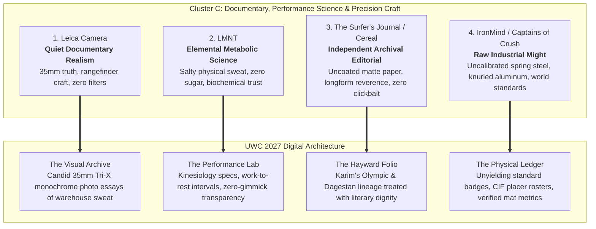

> Part 1 of 6 of [cluster_c_documentary_science_and_craft](../cluster_c_documentary_science_and_craft.md). Text is verbatim from the original; only links were rewritten.


# United Wrestling Club: Analogous Brand Influences — Cluster C
## Documentary Media, Human Performance Science & Precision Craft (Non-Clothing)

> **Client:** United Wrestling Club (Hayward, CA)  
> **Physical Location:** 30139 Industrial Pkwy SW, Ste C, Hayward, CA 94544  
> **Target Audience (ICPs):** East Bay Parents (character, resilience, anti-bullying), Scholastic CIF Contenders (high school champions), Adult Grapplers (BJJ/Sambo/Judo cross-trainers)  
> **UWC Core Ethos:** *"The Industrial Mat Sanctuary — Physical Honesty Over Spectacle. Ancient Olympic Lineage (Karim Zemaryalai 1980 Olympian, Ali Aliyev Dagestan medalist) meets Modern Kinesiology (Naweed Zemaryalai, Chabot College Coach) in an East Bay Industrial Park."*  
> **Document Code:** `UWC-ANALOGOUS-CLUSTER-C`  
> **Date:** October 31, 2026  

---

## Executive Summary & Comparative Matrix

To elevate United Wrestling Club's 2027 website rebuild far above suburban recreation centers, franchise martial arts academies ("McDojos"), and aggressive commercial MMA gyms, UWC must borrow visual and philosophical DNA from disciplines that share its dedication to unvarnished truth, mechanical precision, and rigorous physical standards.

Wrestling is the purest, most unforgiving amateur athletic pursuit in human history: there are no judges to charm, no protective gear to hide behind, and no commercial shortcuts to mastery. The four non-clothing brands profiled below—**Leica Camera**, **LMNT**, **The Surfer's Journal / Cereal**, and **IronMind / Captains of Crush**—command fierce loyalty from UWC’s target ICPs because they reject superficial marketing in favor of functional substance.



### Brand Comparison Matrix

| Brand | Primary Domain | Core Philosophy | Key Visual DNA | UWC Rebuild Application |
| :--- | :--- | :--- | :--- | :--- |
| **Leica Camera** | Precision Optics & Documentary Photography | *Das Wesentliche* (The Essential): stripping away all ornamentation to capture unvarnished reality. | DIN Pro typography, 1px brightline viewfinder frames, surgical red-dot pips, monochrome 35mm grain. | **The Mat Dossier:** Archival photography of Coach Karim (1980) and raw documentary coverage of East Bay youth drilling. |
| **LMNT** | Metabolic Science & Functional Hydration | Evidence-based physical biochemistry: real athletes need salt and electrolytes, not neon sugar water. | Monospaced metric callouts, stark nutritional grids, high-contrast dark carbon surfaces, punchy citrus accents. | **The Kinesiology Lab:** Coach Naweed’s SF State / Chabot College scientific conditioning curriculum framed with clinical rigor. |
| **The Surfer's Journal / Cereal** | Reader-Funded Longform Independent Print | Reverence for the soul of a demanding craft; timeless literature and heavy uncoated paper over pop-up commerce. | Classic literary serifs (Caslon/Plantin), expansive white space, hairline rules, generous line heights. | **The Hayward Folio:** Longform storytelling covering Soviet-Afghan conflict, Moscow Olympics, and the sanctuary on Industrial Pkwy. |
| **IronMind / Captains of Crush** | Heavy Strength & Grip Tools | "Stronger Minds, Stronger Bodies": raw spring steel, certified world standards, zero marketing fluff. | Industrial bold grotesques, machine-stamped octagonal badges, knurled textures, steel-spec data tables. | **The Mat Spec Sheet & Placer Board:** Facility engineering disclosures, antimicrobial mat protocols, and unyielding CIF state placer rosters. |

---

## 1. Leica Camera (Wetzlar, Germany)

### Brand Ethos & Core Narrative
Leica embodies *Das Wesentliche* ("The Essential")—the belief that true vision requires stripping away every extraneous dial, screen, and electronic gimmick until only precision mechanical glass, light, and the photographer's intuition remain. For over a century, Leica rangefinders have documented the defining, unposed historical moments of human struggle and triumph without artificial distortion.

### Why UWC's ICPs Revere It
* **East Bay Parents (Tech / Professional & Discerning Blue-Collar):** Parents in Alameda County are inundated with oversaturated, hyper-filtered smartphone culture. Leica represents timeless heirloom durability, uncompromising European engineering, and the patience to capture a child’s authentic emotional growth rather than a staged smile.
* **Scholastic CIF Contenders:** Elite high school wrestlers instinctively understand the ethos of a manual rangefinder: nothing is autofocus, nothing is handed to you, and your split-second execution determines whether the image is sharp or ruined.
* **Adult Grapplers (BJJ, Sambo, Judo Practitioners):** Grapplers admire tools machined to micron tolerances that outlast their owners. Leica's refusal to succumb to disposable consumer trends mirrors the grappler's devotion to fundamental mechanics that never become obsolete.

### Exact Visual Design DNA to Borrow

#### Typography
* **Primary Display / Headers:** `DIN 1451 Mittelschrift` or `DIN Pro Bold`
  * Weight: `700` (Bold) or `600` (Semi-Bold)
  * Tracking / Letter-spacing: `+0.06em` to `+0.12em` (open, architectural precision)
  * Casing: Uppercase for technical identifiers (`MAT ARCHIVE // 30139 INDUSTRIAL PKWY`); Sentence case for narrative titles.
* **Body Copy:** `Akzidenz-Grotesk` or `Neue Haas Grotesk` (Fallback: `Inter` / `Helvetica Neue`)
  * Weight: `400` (Regular) and `500` (Medium for emphasis)
  * Leading / Line-height: `1.55` (24px on 15px base)
  * Tracking: `-0.01em` (clean, dense European legibility)
* **Metadata & Technical Micro-Copy:** `DIN Pro Condensed` or `Space Mono`
  * Weight: `500`
  * Size: `11px` / `0.75rem`
  * Tracking: `+0.15em` (all-caps camera-engraving style)

#### Color Palette
```
┌────────────────────────────────────────────────────────┐
│  LEICA OPTICAL PALETTE                                 │
│                                                        │
│  [ #121212 ] Wetzlar Matte Black (Primary Ground)     │
│  [ #F7F6F2 ] Archival Silver Halide (Surface Tint)     │
│  [ #C8C7C3 ] Satin Chrome / Lens Metal (Borders/Rules) │
│  [ #E3001B ] Leica Vermilion Dot (Precision Accent)    │
│  [ #6E7072 ] Anodized Gunmetal (Muted Secondary)       │
└────────────────────────────────────────────────────────┘
```
* **Wetzlar Matte Black:** `#121212` (Deep, anti-reflective vulcanite camera chassis black)
* **Archival Silver Halide Off-White:** `#F7F6F2` (Warm, unbleached fiber-print paper base)
* **Satin Chrome:** `#C8C7C3` (Machined aluminum and brass lens barrel highlight)
* **Leica Vermilion Dot:** `#E3001B` (Surgical red accent; used on fewer than 2% of UI elements)
* **Anodized Gunmetal:** `#6E7072` (Engraved aperture markings and secondary metadata)

#### Photography Style
* **Lighting:** Natural, directional industrial light pouring through open roll-up bay doors or high warehouse clerestory windows; zero harsh studio flash, zero artificial neon ring lights.
* **Focal Length:** Strict 35mm and 50mm prime equivalents. This mimics natural human optical perspective, eliminating wide-angle fisheye distortion that cheapens athletic photos.
* **Grain & Contrast:** High-microcontrast black-and-white (emulating Kodak Tri-X 400 pushed to 1600 or Leica Monochrom digital sensor output). Crisp shadows, textured mid-tones capturing skin tension and sweat beads, and clean highlights without blown-out clipping.
* **Subject Staging:** 100% candid, decisive-moment documentary realism. Athletes in mid-scramble with eyes locked in concentration; Coach Karim kneeling on the mat physically gripping an athlete's wrist; chalk clouds settling on black mat vinyl; wrestlers resting against the corrugated metal wall between rounds. Zero posed flexing, zero fake snarls.

#### UI Components & Layout Tactics
* **Viewfinder Brightline Frames:** Card containers and image wrappers framed with ultra-crisp `1px` solid borders (`#C8C7C3` on light themes, `#262626` on dark themes) featuring subtle corner crop marks that echo rangefinder frame lines.
* **Lens-Engraving Metadata Strips:** Small micro-data rows beneath images or video embeds displaying authentic operational parameters:
  ```
  [ REC // 35MM EQUIV ] [ USAW CLUB #513 ] [ INDUSTRIAL WAREHOUSE BAY C ] [ LIVE ON MAT ]
  ```
* **The "Red Dot" Indicator:** A singular `8px` circular red dot (`#E3001B`) positioned next to high-priority live indicators (e.g., `"MAT CAPACITY: 18/24 ATHLETES"` or `"SPRING TERM IN SESSION"`).
* **Tactile Switch Controls:** Radio selectors and program schedule toggles styled with precision knurled bevels and zero-border-radius edges reminiscent of mechanical shutter speed dials.

### UWC Translation: How This Directly Informs the 2027 Rebuild
* **The "Field Archive" Homepage Hero:** Instead of a generic stock-video background or a promotional carousel, the hero opens on a monumental 35mm monochrome photograph of a youth wrestler resting their forehead against their knees after a 6-minute grind, framed in Leica-style viewfinder crop marks. A quiet caption reads: *"Hayward, California. 6:42 PM. The Mat Does Not Lie."*
* **The Karim Zemaryalai Lineage Dossier:** Coach Karim's background (1980 Olympian, Soviet-Afghan wartime resilience, Ali Aliyev medalist) is displayed as an unembellished photographic dossier. Archival black-and-white photos from Kabul, Moscow, and Dagestan are paired with tight, museum-grade typography and zero marketing bluster.
* **Anti-Filter Parent Assurance:** The "Why Wrestling" parent landing page uses raw documentary photography showing real East Bay children learning to shake hands after a loss, looking their coach in the eye, and dusting themselves off. It signals to parents: *This is not an influencer gym. This is character built in black and white.*

---
