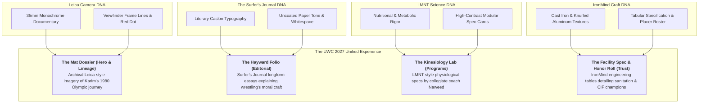

> Part 5 of 6 of [cluster_c_documentary_science_and_craft](../cluster_c_documentary_science_and_craft.md). Text is verbatim from the original; only links were rewritten.

## 5. The Unified "Documentary Science & Craft" System for UWC 2027

By combining the strengths of these four non-clothing brands, UWC avoids the trap of looking like a generic suburban gym or a loud MMA fight basement. Instead, it becomes an **authoritative athletic institution**:

### The 4 Core Page Archetypes

1. **The Homepage (The Industrial Sanctuary):**
   * *Aesthetic:* Leica documentary realism meets Surfer's Journal negative space.
   * *Key Element:* Full-width candid 35mm film photograph of the Hayward warehouse with open roll-up doors, framed by hairline brightline borders and a single red Leica-style live indicator.
   * *Headline:* Set in sturdy DIN Pro: *"THE INDUSTRIAL MAT SANCTUARY. OLYMPIC PEDIGREE // EAST BAY GRIT."*

2. **The Lineage & Coaches Page (The Karim & Naweed Dossier):**
   * *Aesthetic:* Archival editorial monograph.
   * *Key Element:* Historic photographs of Karim Zemaryalai at the 1980 Moscow Games and 1983 Ali Aliyev tournament, paired with dignified Caslon pull quotes and Naweed’s collegiate kinesiology credentials formatted in clean LMNT data cards.

3. **The Youth & Parent Program Page (Character & Physical Armor):**
   * *Aesthetic:* The Surfer's Journal literary depth meets IronMind physical safety.
   * *Key Element:* Longform reading layout explaining how wrestling dismantles screen addiction and builds anti-bullying confidence, accompanied by an IronMind-grade facility hygiene spec table that eliminates parent hygiene fears.

4. **The Competitive CIF & Adult Grappling Page (The Forge):**
   * *Aesthetic:* LMNT high-contrast metabolic science meets IronMind unyielding standards.
   * *Key Element:* High-density schedule and conditioning cards, work:rest anaerobic intervals, and the permanent UWC State Placer Ledger.

---
