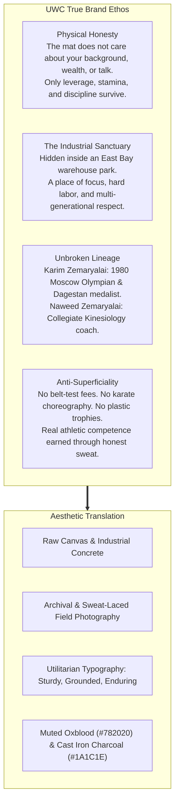
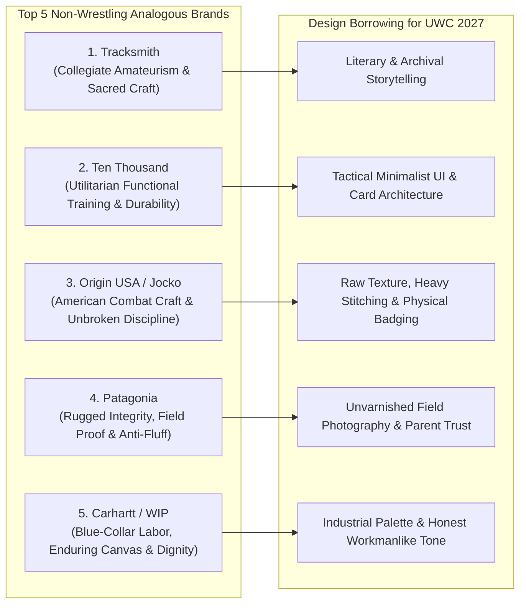

# United Wrestling Club: Brand Ethos, Aesthetic DNA & Analogous Brand Influences

> **Client:** United Wrestling Club (Hayward, CA)  
> **Target Audience (ICPs):** East Bay Parents (character & anti-bullying), Scholastic CIF Wrestlers, Adult BJJ/Sambo Practitioners  
> **Physical Location:** 30139 Industrial Pkwy SW Ste C, Hayward, CA  
> **Document Code:** `UWC-BRAND-ETHOS-ANALOGOUS-V1`  
> **Date:** October 31, 2026  

---

## 1. UWC Core Brand Ethos: Substance Over Spectacle

The previous moodboards drifted into either museum-like Olympic gold, high-voltage CrossFit neon, or suburban recreation. UWC's actual identity is simpler, rarer, and far more powerful: **an unpretentious sanctuary of physical honesty in an industrial warehouse.**

### The 4 Ethos Pillars Defined:
1. **Physical Honesty (The Anti-McDojo):** Modern commercial martial arts sell black belts and participation trophies. UWC teaches the brutal, beautiful reality of wrestling: you cannot fake a double leg, and you cannot posture against gravity. Parents choose UWC because it builds real, unbreakable character.
2. **Quiet Dignity over Loud Aggression:** UWC is not an angry MMA cage-fight basement. It is helmed by an Olympic veteran who lived through boycotts and war. The demeanor is quiet, disciplined, and profoundly respectful.
3. **The Blue-Collar Industrial Sanctuary:** Located in an industrial flex park on Industrial Pkwy in Hayward. Athletes hear freight trucks and roll up garage doors to let the cool Bay Area evening air sweep across the mats. It smells of clean vinyl, canvas, and honest work.
4. **Ancient Technique Informed by Modern Science:** Karim brings Dagestani wrist-ties and Soviet pressure; Naweed brings a B.S. in Kinesiology and collegiate sports science from SF State and Chabot College.

---

## 2. Aesthetic DNA: Visual Guidelines

| Element | The Wrong Direction (Discarded) | The True UWC Aesthetic (Adopted) |
| :--- | :--- | :--- |
| **Color Palette** | Shiny gold foil, electric neon red, corporate blue | **Deep oxblood (`#782020`), matte cast-iron (`#1A1C1E`), raw unbleached canvas (`#F4F1EA`), and cool industrial concrete (`#94A3B8`)** |
| **Typography** | Greek/Roman serif (`Cinzel`) or video game HUD fonts | **Timeless American athletic grotesques (e.g. `DIN Condensed`, `Barlow`, `National`) paired with warm editorial body (`Public Sans` or `Newsreader`)** |
| **Photography** | Polished gym stock photos or aggressive snarling faces | **35mm film grain, high-contrast black & white, natural industrial light through rollups, focused athlete eyes, chalk dust, and genuine coach-student moments** |
| **UI Atmosphere** | Slick SaaS software or busy neon gaming portal | **Tactile, spacious, utilitarian, and clean; feels like an athletic field journal or an archival lookbook** |

---

## 3. Top 5 Analogous Brands Outside Wrestling

These 5 brands operate outside wrestling, but UWC's three core ICPs (East Bay parents, high school contenders, adult grapplers) already respect, purchase from, and emotionally identify with them:

---

### Brand 1: Tracksmith (Running)
* **Core Brand Ethos:** The sacred craft of amateurism. Running is not about neon spandex or celebrity hype; it is an introspective pursuit of excellence done in rain, snow, and cold gravel.
* **Why UWC's ICPs Connect:** Wrestling is the purest amateur sport on earth. Parents and athletes love Tracksmith because it treats everyday athletes like scholars of their craft rather than consumers.
* **Design DNA to Borrow:**
  * **Typography:** Elegant yet sturdy neo-grotesque headers with literary, generous editorial spacing.
  * **Photography:** Documentary-style 35mm film stills showing runners in grey mornings, weathered track houses, and post-workout exhaustion.
  * **Color:** Off-white eggshell/parchment surfaces with rich deep ivy and burgundy accents.
  * **UI Application for UWC:** The homepage reads like an editorial retrospective on wrestling lineage rather than a sales pitch.

---

### Brand 2: Ten Thousand (Functional Athletic Training)
* **Core Brand Ethos:** "Decidedly Not For Everyone." Hyper-engineered, distraction-free training apparel for athletes who suffer in silence in dark garages and outdoor tracks.
* **Why UWC's ICPs Connect:** Adult grapplers and serious high schoolers hate flashy gym clothes. They want matte black, high-durability gear that withstands mat burn and double-leg friction.
* **Design DNA to Borrow:**
  * **UI Layout:** Clean, modular data cards with monospaced metrics, clear specs, and zero clutter.
  * **Tone of Voice:** Spartan, confident, and direct: *"Built for the mat. Proven under pressure."*
  * **Color:** Carbon black, matte gunmetal, industrial grey, and crisp white text.
  * **UI Application for UWC:** The training schedule and program cards use clean modular blocks with schedule tags, mat capacity, and target skill levels.

---

### Brand 3: Origin USA (Combat Craft & Jocko Willink)
* **Core Brand Ethos:** "Discipline Equals Freedom." Uncompromising American manufacturing of BJJ gis, combat boots, and training gear. Built on the belief that wrestling and jiu-jitsu forge the human soul.
* **Why UWC's ICPs Connect:** Adult grapplers and wrestling parents in the East Bay revere Jocko Willink's ethos of humility, grit, and hard physical labor.
* **Design DNA to Borrow:**
  * **Visual Assets:** Vintage athletic block lettering, industrial stamp badges, and heavy textile textures (woven canvas, reinforced stitching).
  * **Narrative Hook:** Celebrating the daily grind: *"Sweat is the cost of entry."*
  * **Color:** Deep oxblood red, heavy canvas beige, and cast-iron black.
  * **UI Application for UWC:** Hero badges indicating *"Est. 1980 Lineage"*, *"Sanctioned USAW Club #513"*, and *"Olympic Pedigree"*.

---

### Brand 4: Patagonia (Outdoor & Alpine)
* **Core Brand Ethos:** Unflinching integrity, durability over fashion, and multi-generational responsibility. Built for real mountains, not city sidewalks.
* **Why UWC's ICPs Connect:** In Northern California and the SF Bay Area, Patagonia is the ultimate badge of quiet substance. Parents trust Patagonia because it refuses to engage in cheap consumerist tricks.
* **Design DNA to Borrow:**
  * **Photography:** Raw, candid portraits of real athletes and children with wind-chapped cheeks and focused eyes. Zero models.
  * **Philosophy Copy:** Plain-English mission statements that focus on long-term human development rather than quick fixes.
  * **Typography:** Clean, humanistic typography with high contrast and readable layouts.
  * **UI Application for UWC:** The Youth Wrestling page focuses on how wrestling prepares kids for life, overcoming fear, and building respectful emotional resilience.

---

### Brand 5: Carhartt / Carhartt WIP (Workwear & Blue-Collar Heritage)
* **Core Brand Ethos:** Honest labor, indestructible utility, and working-class pride. Worn by construction workers and artists alike who value things that don't break.
* **Why UWC's ICPs Connect:** Hayward and the East Bay have deep working-class and manufacturing roots. UWC is physically in an industrial park surrounded by supply shops and auto warehouses. Embracing this blue-collar grit feels authentic, not manufactured.
* **Design DNA to Borrow:**
  * **Aesthetic:** Heavy canvas textures, brass hardware tones, bold utilitarian block type, and rugged framing.
  * **Color:** Industrial brass/gold (`#C59B27`), heavy duck canvas (`#E8DFD1`), and dark grease charcoal (`#1C1E21`).
  * **UI Application for UWC:** Facility and membership sections celebrate the warehouse setting: *"No chandeliers. No juice bar. Just 3,000 sq ft of championship mats and Olympic instruction."*

---

## 4. The Unified Synthesis: "The Industrial Mat Sanctuary"

By synthesizing the quiet craft of **Tracksmith**, the modular discipline of **Ten Thousand**, and the blue-collar utility of **Carhartt/Origin**, UWC's redesigned visual identity becomes:

* **Primary Background:** Warm raw canvas (`#F7F5F0`) for day/content pages; deep charcoal slate (`#121316`) for hero/training sections.
* **Signature Accent:** Deep Heritage Oxblood (`#781D1D`) — grounded, historic, and athletic.
* **Secondary Accent:** Industrial Brass (`#B8860B`) — understated medal tone, not shiny plastic gold.
* **Typography Pairing:** `DIN Condensed` / `Barlow Semi Condensed` for athletic headlines, paired with `Public Sans` for ultra-clean, trustworthy parent reading.
* **Photography Direction:** Black & white archival shots of Karim in 1980 mixed with raw, natural-light color photos of modern East Bay kids and collegiate athletes drilling in the Hayward warehouse.
