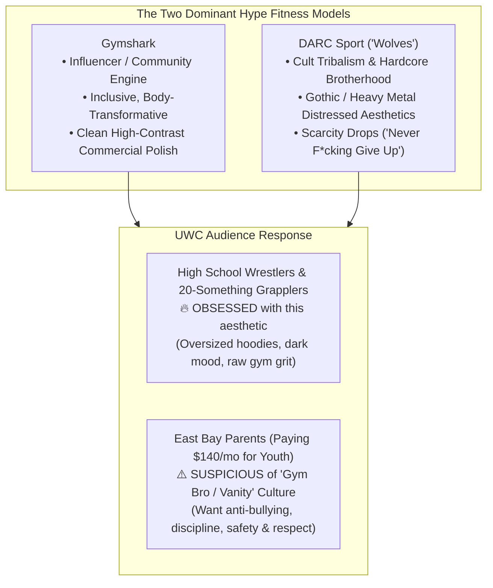
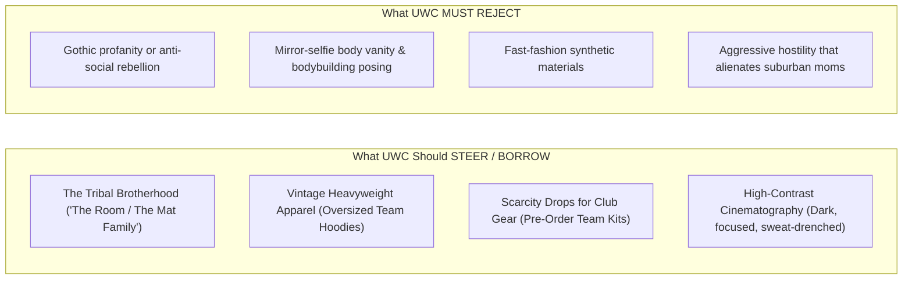

# Deconstructing Gymshark & DARC Sport for United Wrestling Club
## The Cult-Tribe & Aesthetic Fitness Models: Opportunities, ICP Friction & Strategic Adaptation

> **Client:** United Wrestling Club (Hayward, CA)  
> **Brand Inquiry:** Gymshark, DARC Sport, YoungLA, RawGear (The Hype / Cult Tribe Fitness Archetypes)  
> **Document Code:** `UWC-BRAND-GYMSHARK-DARC-ANALYSIS`  
> **Date:** October 31, 2026  

---

## 1. Executive Breakdown: What Gymshark & DARC Sport Actually Are

### The Core Mechanisms:
1. **DARC Sport (Civil Regime / "Wolves"):**
   * *The Cult of Suffering:* DARC Sport does not sell clothing; they sell an identity of solitary suffering, loyalty, and tribal brotherhood (*"Wolves / We Stand Alone Together"*). Drops sell out in 90 seconds.
   * *Visual DNA:* Gothic blackletter type, distressed block capitals, heavyweight oversized 300+ GSM cotton, low-key desaturated gym lighting, wolf/dagger iconography.
2. **Gymshark:**
   * *The Aspirational Community:* Built on early influencer athlete sponsorships, body-contouring cuts, and youth gym empowerment.
   * *Visual DNA:* High-contrast athletic minimalism, bold typographic contrast, seamless studio photography, and accessible transformation messaging.

---

## 2. The ICP Tension: High Schoolers vs. Paying Parents

UWC serves two drastically different decision-makers who view these brands through opposite lenses:

| Dimension | High School Wrestlers & Young Adults (Ages 14–28) | East Bay Parents of Youth Wrestlers (Ages 32–50) |
| :--- | :--- | :--- |
| **View of DARC Sport** | **Revered as elite hardcore culture.** They wear oversized DARC tees to practice; it signals you actually grind. | **Intimidating or edgy.** Gothic lettering and skull/wolf motifs look aggressive or unwholesome for an 8-year-old child. |
| **View of Gymshark** | **Baseline modern gym style.** Universal staple for high school lifters and casual training. | **Vanity & superficiality.** Evokes teenagers taking shirtless mirror selfies rather than serious Olympic discipline. |
| **Core Desire** | To look dangerous, belong to an elite brotherhood, and wear gear that feels culturally relevant. | To develop anti-bullying resilience, mental grit, academic focus, and respectful manners under trusted coaches. |

---

## 3. What to Steal vs. What to Reject

### 1. What to Steal from DARC Sport:
* **The "Wolfpack" Brotherhood:** DARC Sport’s most powerful asset is that wearing it feels like joining an ancient tribe. UWC has the *real* version of this: wrestling is the ultimate crucible of shared suffering. Karim's room is a true brotherhood.
* **Heavyweight Streetwear Merch Drops:** High school kids will never wear generic blue Gildan polo shirts. But if UWC releases a vintage-washed, heavyweight 400 GSM charcoal hoodie with distressed athletic lettering reading *"UNITED WRESTLING CLUB • HAYWARD INDUSTRIAL MATS • EST. 1980"*, it will sell out immediately and turn athletes into walking billboards across Bay Area high schools.
* **Cinematic Low-Key Lighting:** Dark, shadow-drenched action shots focusing on gripped wrists, chalk-dusted skin, and grim determination.

### 2. What to Steal from Gymshark:
* **Frictionless Digital Community:** Intuitive, mobile-first design where training schedules, event sign-ups, and athlete spotlights are fast and seamless.
* **Inclusive Youth Onboarding:** Framing wrestling not as an exclusionary fight club, but as an empowering physical journey anyone can begin.

### 3. What UWC Must Completely Reject:
* **Mirror Vanity & Body Posing:** Wrestling is functional combat physics, not cosmetic hypertrophy. No mirror selfies or shirtless aesthetic flexing.
* **Aggressive "Edgelord" Branding:** Zero profanity, zero aggressive skulls or grim reaper motifs. A Hayward mother enrolling her 7-year-old must feel complete moral trust and safety.

---

## 4. The 2027 Hybrid Translation: "Dignified Tribalism"

We synthesize DARC Sport’s tribal cult energy with the Olympic dignity of Karim Zemaryalai:

* **Visual Identity:** Dark, high-contrast, heavyweight typography (`Barlow Condensed Black 900` / `Tungsten`), but paired with clean institutional structure rather than gothic fonts.
* **Team Merch Line ("The Hayward Mat Supply"):** Heavyweight oversized tees and hoodies designed like vintage boxing/wrestling club apparel (distressed stamps, heavyweight fleece).
* **Website Experience:** Dark, immersive, high-energy athlete sections, balanced by clean, trustworthy, parent-facing program pages.
