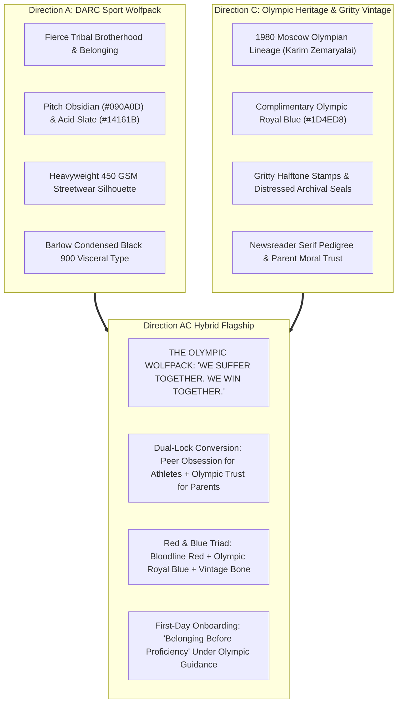

# Direction AC (Flagship): "The Olympic Wolfpack"
## Visual Moodboard, Brand Architecture & Hybrid Conversion Specification
### Synthesizing DARC Sport Tribal Brotherhood with 1980 Olympic Heritage & Vintage Gritty Blue

> **Client:** United Wrestling Club (Hayward, CA)  
> **Brand Anchors:** DARC Sport ("Wolves") + 1980 Moscow Olympic Lineage (Karim Zemaryalai) + USA Wrestling RTC Heritage  
> **Core Strategic Decision:** User confirmed Direction A is "strongest, most aligned," requested Direction C be "more Olympic, keep gritty vintage motifs, add complimentary blue," dropped Direction B, and mandated an A/C hybrid.  
> **Document Code:** `UWC-MOODBOARD-DIR-AC-HYBRID`  
> **Date:** October 31, 2026  

---

## 1. Executive Concept & Cultural Thesis

Direction AC solves the fundamental marketing paradox of United Wrestling Club:
- **Direction A (DARC Sport Tribal Energy)** drives intense youth, high school, and adult athletic devotion: earned respect, dark gritty authenticity, heavyweight streetwear, and unapologetic brotherhood.
- **Direction C (Olympic Heritage Archive)** delivers absolute moral authority, Olympian credibility, and emotional trust for East Bay parents investing in their children's character.

By fusing them, UWC becomes **The Olympic Wolfpack**:
An authentic East Bay combat temple where athletes train with the fierce intensity of a wolfpack, guided by the technical precision of a 1980 Moscow Olympian and collegiate kinesiology staff.

---

## 2. Color Palette & Material Hierarchy

| Swatch Name | Role | Hex Code | Visual Reference / Emotional Association |
| :--- | :--- | :--- | :--- |
| **Pitch Void** | Canvas & Background | `#090A0D` | Anti-reflective deep matte black; darkness that isolates the mat focus. |
| **Acid Slate** | Card & Container Surface | `#14161B` | 450 GSM distressed heavyweight fleece; weathered industrial slate. |
| **Bloodline Red** | Primary Action / Sacrifice | `#BA1C1C` | High-visceral arterial red; represents sweat, grit, and singlet crest. |
| **Olympic Royal Blue** | Complimentary Lineage | `#1D4ED8` | Authentic USA Wrestling / Olympic mat blue; signals international sanction. |
| **Vintage Bone** | Primary Typography | `#F4F1EA` | Unbleached canvas / 1980 archival print; zero eye-fatigue contrast. |
| **Medal Brass** | Archival Badges & Foil | `#C5A059` | 1980 Moscow Olympic qualification & Ali Aliyev Dagestan medalist foil. |

---

## 3. Typography Stack & Hierarchy

* **Primary Impact Display (H1 & Heroes):** `Barlow Condensed Black 900`
  * *Styling:* All-caps, tight tracking (`-0.02em`), leading (`0.95`). Bold, visceral, and unyielding.
* **Heritage Editorial Subheads (Olympic Pedigree):** `Newsreader 600 SemiBold Italic`
  * *Styling:* Classical serif authority. Lends dignified Olympic gravity to hero headers and founder quotes.
* **Badges, Coordinates & Telemetry:** `Space Mono` or `Space Grotesk Bold`
  * *Styling:* Uppercase, tracked (`+0.08em`). Tags facility specs, class timestamps, and credentials.
* **Parent-Facing Body & Moral Trust:** `Public Sans` (400 Regular & 500 Medium)
  * *Styling:* Clean, humanistic sans-serif designed for effortless readability across desktop and mobile.

---

## 4. Curated Photographic Stills Integration

| Still Filename | Resolution | Sharpness | Aesthetic & Strategic Placement |
|:---|:---:|:---:|:---|
| [still_20_champions_family_outro.jpg](stills/still_20_champions_family_outro.jpg) | `1920 × 1080` | `8.5 / 10` | **Master Hero Plate (The Wolfpack):** 45+ athlete team celebration beneath gym mural. Female youth leaders anchor front row; varsity contenders flex in brotherhood. Placement: Homepage Closing Pre-Footer. |
| [still_06_dummy_takedown_drill.jpg](stills/still_06_dummy_takedown_drill.jpg) | `1920 × 1080` | `9.5 / 10` | **Hero Plate (The Contender):** Direct, locked gaze into lens. Tack-sharp youth athlete wearing official UWC red-and-blue singlet with American flag badge. Placement: `/classes/youth-wrestling` Hero. |
| [still_16_naweed_adult_collar_tie.jpg](stills/still_16_naweed_adult_collar_tie.jpg) | `1920 × 1080` | `8.5 / 10` | **Combat Plate (Collegiate Craft):** Coach Naweed executing high-level collar-tie pressure. High tonal contrast (black rashguard vs white shirt). Placement: `/classes/adult-wrestling` Hero. |
| [still_05_coach_naweed_profile.jpg](stills/still_05_coach_naweed_profile.jpg) | `1920 × 1080` | `8.0 / 10` | **Bio Portrait (The Lineage Bearer):** Stoic profile in red UWC coaching shirt with cauliflower ear and uncompromised authority. Placement: `/about` & `/coaches` Bio Card. |
| [still_01_olympic_flag.jpg](stills/still_01_olympic_flag.jpg) | `1920 × 1080` | `8.0 / 10` | **Sanction Plate (Facility Proof):** USA Wrestling official wall banner with digital match clock (25:21). Placement: Global Footer Trust Bar. |

---

## 5. Sol (GPT-6.1) Dual-Lock Conversion Engine

1. **"Belonging Before Proficiency" (Onboarding Modal):**
   * *Problem:* High-intensity combat aesthetics intimidate parents of young children and beginner teenagers.
   * *Solution:* Explicit first-day walk-through on the landing page: Coach Naweed greets the newcomer at the door, pairs them with a mentor, and walks them through basic movement without contact.
   * *CTA:* `Claim 2-Class Assessment Pass (No Card Required)`.
2. **"Direct Access to the Olympic Master":**
   * *Problem:* Historical Olympic achievements can feel distant or theoretical.
   * *Solution:* Bridge Karim's 1980 Moscow qualification directly to tonight's 5:30 PM class taught by his son Naweed (SFSU Kinesiology).
3. **"Hayward Olympic Mat Supply" (Merch Engine):**
   * High-margin, limited-run 450 GSM hoodies, vintage drop-shoulder tees, and USAW singlets featuring distressed archival stamps and embroidered Olympic rings crests.
