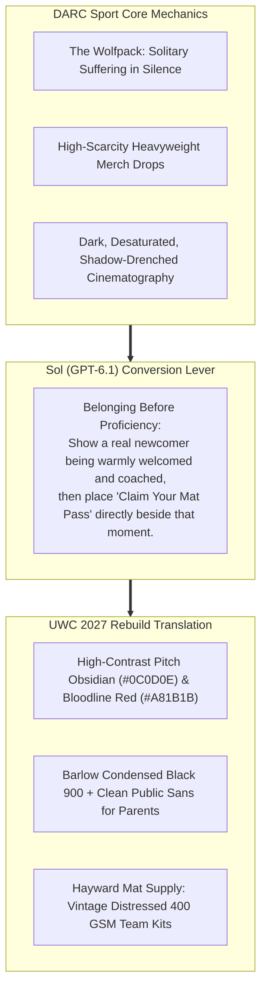

# Direction A: "The Mat Wolfpack" (DARC Sport x Combat Brotherhood)
## Visual Moodboard, Brand Architecture & Conversion Specification

> **Client:** United Wrestling Club (Hayward, CA)  
> **Brand Anchors:** DARC Sport ("Wolves") + Vintage Heavyweight Athletic Streetwear  
> **Strategic Intent:** Captures extreme youth & high school athlete tribal loyalty, but refines it with Olympic dignity and "Belonging Before Proficiency" to earn unconditional parent trust.  
> **Document Code:** `UWC-MOODBOARD-DIR-A`  
> **Date:** October 31, 2026  

---

## 1. Executive Concept & Cultural Thesis

DARC Sport built an obsessive, multi-million dollar cult by rejecting commercial fitness vanity in favor of **the wolfpack: suffering in silence, unbreakable brotherhood, and earned respect.**

Wrestling is the true origin of this ethos. On the mat at 30139 Industrial Parkway in Hayward, athletes don't posture for mirrors; they bleed, scramble, and forge character together. Direction A harnesses this electric tribal energy—distressed athletic block typography, acid-washed charcoal surfaces, and heavyweight fleece silhouettes—while stripping away all adolescent profanity and edgelord rebellion.

---

## 2. Color Palette & Material Hierarchy

| Swatch Name | Role | Hex Code | Visual Reference / Texture |
| :--- | :--- | :--- | :--- |
| **Pitch Obsidian** | Canvas & Background | `#0C0D0E` | Anti-reflective deep matte black; darkness that frames focus. |
| **Acid-Wash Slate** | Card & Container Surface | `#181A1D` | 350 GSM vintage-washed fleece texture; distressed, heavy, and worn. |
| **Bloodline Crimson** | Primary CTA & Heraldry | `#A81B1B` | Deep arterial red; signals lineage, sacrifice, and combat intensity. |
| **Vintage Bone White** | Primary Typography | `#F3F2EE` | Unbleached athletic print; soft off-white with zero eye fatigue. |
| **Wolfpack Muted Grey** | Subtitles & Frame Borders | `#7E8590` | Weathered stencil paint on industrial concrete. |

---

## 3. Typography Stack

* **Primary Display Headlines:** `Barlow Condensed Black 900` or `Tungsten Bold`
  * *Styling:* All-caps, tight tracking (`-0.02em`), massive line height (`0.95`). Bold, visceral, and unapologetic.
* **Secondary Labels & Badges:** `Space Grotesk Bold` (uppercase, letter-spaced `+0.08em`).
* **Parent-Facing Body & Trust Copy:** `Public Sans` (Regular 400 & Medium 500)
  * *Why:* Ensures parent-facing sections on safety, character, and coaching credentials read with maximum clarity and moral trust.

---

## 4. Key UI Components & Sol Conversion Tactics

1. **"The Room" Athlete Grid:** High-contrast, desaturated action photography of real UWC wrestlers drilling with sweat dripping off foreheads. Zero models.
2. **"Belonging Before Proficiency" Onboarding Card:** Explicitly illustrates an 8-year-old beginner or high school novice walking into the warehouse, being greeted by Coach Naweed, and stepping onto the mat without intimidation.
3. **"Hayward Mat Supply" Limited Merch Portal:** Pre-order portal for heavyweight 400 GSM hoodies featuring distressed athletic stamps (*"UNITED WRESTLING CLUB • INDUSTRIAL MATS • EST. 1980"*).

---

## 5. Photographic Video Stills Integration

| Still Filename | Resolution | Sharpness | Role & Aesthetic Application |
|:---|:---:|:---:|:---|
| [still_20_champions_family_outro.jpg](stills/still_20_champions_family_outro.jpg) | `1920 × 1080` | `8.5 / 10` | **Master Hero Plate:** 45+ athlete team flex and celebration under gym mural. High-contrast Wolfpack brotherhood. |
| [still_16_naweed_adult_collar_tie.jpg](stills/still_16_naweed_adult_collar_tie.jpg) | `1920 × 1080` | `8.5 / 10` | **Action Plate:** Razor-sharp profile of Coach Naweed in combat collar tie. Stark black vs white contrast. |
| [still_10_stance_mural_lines.jpg](stills/still_10_stance_mural_lines.jpg) | `1920 × 1080` | `7.5 / 10` | **Conditioning Plate:** Disciplined squad charging across mat in unison during warmups beneath the crest. |

