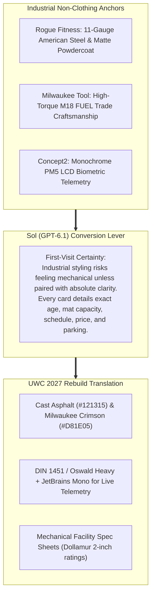

# Direction B: "The Industrial Iron Foundry" (Rogue x Milwaukee x Concept2)
## Visual Moodboard, Brand Architecture & Conversion Specification

> **Client:** United Wrestling Club (Hayward, CA)  
> **Brand Anchors:** Rogue Fitness (American Iron) + Milwaukee Tool (Heavy-Duty Trades) + Concept2 (Biometric Telemetry)  
> **Strategic Intent:** Rooted 100% in the physical warehouse reality of 30139 Industrial Parkway. Converts through "First-Visit Certainty", technical specification cards, and zero-fluff transparency.  
> **Document Code:** `UWC-MOODBOARD-DIR-B`  
> **Date:** October 31, 2026  

---

## 1. Executive Concept & Cultural Thesis

Hayward, San Leandro, and Union City are not country clubs; they are blue-collar manufacturing, logistics, and skilled-trade hubs along the I-880 corridor. UWC is physically housed inside an industrial flex park.

Direction B embraces this warehouse reality without apology. Inspired by **Rogue's laser-cut American steel**, **Milwaukee Tool's high-torque contractor gear**, and **Concept2's unflinching telemetry monitors**, Direction B rejects all decorative fluff. Training at UWC is presented as precision human engineering: building an unbreakable 300,000-mile physical chassis under Olympic instruction.

---

## 2. Color Palette & Material Hierarchy

| Swatch Name | Role | Hex Code | Visual Reference / Texture |
| :--- | :--- | :--- | :--- |
| **Cast Asphalt Black** | Primary Canvas | `#121315` | Industrial asphalt and dark warehouse flooring. |
| **Machine Steel Charcoal** | Card Surfaces | `#1E2126` | Textured matte black powdercoat on 11-gauge steel. |
| **Milwaukee High-Torque Red** | Primary Action Accent | `#D81E05` | High-visibility contractor crimson; signals power and immediacy. |
| **Galvanized Zinc Grey** | Subtitles & Hardware Dividers | `#9CA3AF` | Raw zinc plating and bead-blasted aluminum. |
| **Digital Telemetry Green** | Status & Operational Indicators | `#22C55E` | Super-LumiNova and PM5 LCD digital matrix green. |

---

## 3. Typography Stack

* **Primary Display Headlines:** `DIN 1451 Mittelschrift` or `Oswald Heavy`
  * *Styling:* All-caps, robust industrial weighting, tabular numbers. Feels like laser-etched equipment plates.
* **Telemetry & Specifications:** `JetBrains Mono` or `Space Mono`
  * *Styling:* Monospaced tabular data for session duration, mat capacity, coach-to-student ratios, and pricing.
* **Body & Explanatory Copy:** `Inter Display` (Regular 400 & Medium 500)
  * *Styling:* Clinical, objective, and transparent. Zero hyperbole.

---

## 4. Key UI Components & Sol Conversion Tactics

1. **"Mechanical Facility Spec Sheet":** Presents the gym's physical assets with equipment-grade precision (*"3,000 sq ft seamless Dollamur mats • 2-inch cross-linked foam • Dual-layer sub-surface shock absorption • Hospital-grade antimicrobial sanitation protocol"*).
2. **"Live Telemetry Schedule Grid":** Class cards styled like Concept2 monitors showing class time, target energy system (*Anaerobic Scramble Endurance*), coach ratio, and live open slots.
3. **"First-Visit Certainty Protocol":** A 4-step arrival diagram answering every parent concern: where to park on Industrial Pkwy, entrance through Unit C, barefoot mat transition, and what to wear.

---

## 5. Photographic Video Stills Integration

| Still Filename | Resolution | Sharpness | Role & Aesthetic Application |
|:---|:---:|:---:|:---|
| [still_03_varsity_stance_focus.jpg](stills/still_03_varsity_stance_focus.jpg) | `1920 × 1080` | `8.5 / 10` | **Spec 01 (Biomechanical Chassis):** Varsity athlete in low coiled ready stance against Reebok mat wall. Perfect forward focus. |
| [still_14_airborne_lateral_drop.jpg](stills/still_14_airborne_lateral_drop.jpg) | `1920 × 1080` | `7.5 / 10` | **Spec 02 (Torque Discharge):** High-amplitude collegiate lateral throw showing explosive physics and elevation. |
| [still_01_olympic_flag.jpg](stills/still_01_olympic_flag.jpg) | `1920 × 1080` | `8.0 / 10` | **Spec 03 (Facility Hardware):** USA Wrestling official banner and LED match clock (25:21). Certified timing and sanctioning proof. |

