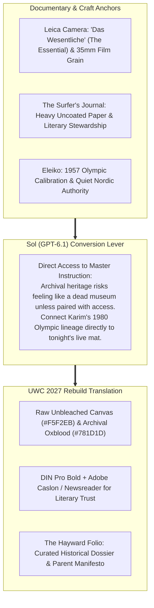

# Direction C: "The Olympic Field Archive" (Leica x Surfer's Journal x Eleiko)
## Visual Moodboard, Brand Architecture & Conversion Specification

> **Client:** United Wrestling Club (Hayward, CA)  
> **Brand Anchors:** Leica Camera (Mechanical Rangefinder Optics) + The Surfer's Journal (Heavy Matte Editorial) + Eleiko (Olympic Barbell Standards)  
> **Strategic Intent:** Elevates UWC into a timeless, museum-grade living archive of Olympic lineage and human character. Converts through "Direct Access to Master Instruction" and moral parent trust.  
> **Document Code:** `UWC-MOODBOARD-DIR-C`  
> **Date:** October 31, 2026  

---

## 1. Executive Concept & Cultural Thesis

Most martial arts gyms look like commercial strip-mall karate studios or loud gaming hubs. None of them possess the genuine, unassailable pedigree of United Wrestling Club: an Afghan-born Olympic qualifier from the 1980 Moscow Games, medaling in Dagestan, and building a 40-year coaching sanctuary in Alameda County.

Direction C presents UWC not as a gym, but as **a living Olympic field archive.** Inspired by **Leica's unvarnished 35mm human truth**, **The Surfer's Journal's reader-supported heavy uncoated paper stock**, and **Eleiko's quiet Swedish precision**, this direction treats wrestling as a sacred, multi-generational craft. It is the ultimate antidote to commercial "McDojo" superficiality.

---

## 2. Color Palette & Material Hierarchy

| Swatch Name | Role | Hex Code | Visual Reference / Texture |
| :--- | :--- | :--- | :--- |
| **Unbleached Canvas** | Primary Background Ground | `#F5F2EB` | Heavy uncoated 120lb archival paper stock; warm, organic, timeless. |
| **Nordic Charcoal Slate** | Primary Headings & Dark Containers | `#181A1D` | Deep matte carbon; maximum readability with zero glare. |
| **Archival Oxblood** | Signature Accent & Wax Seals | `#781D1D` | Historic, dignified red; signifies deep lineage and sacred effort. |
| **Olympic Medalist Brass** | Certified Badges & Rules | `#C5A059` | Subtle, muted antique gold; authentic medal calibration. |
| **Silver Halide Grey** | Viewfinder Frames & Dividers | `#E2E8F0` | 35mm film frame borders and camera reticle lines. |

---

## 3. Typography Stack

* **Primary Editorial Display:** `DIN Pro Bold` or `Baskerville Display`
  * *Styling:* Classical, restrained, dignified. Feels like an archival publication masthead.
* **Literary Parent & Narrative Body:** `Newsreader` or `Adobe Caslon Pro`
  * *Styling:* High-trust, editorial serif with generous line-height (`1.7`). Makes parent reading contemplative and deeply reassuring.
* **Curatorial Metadata & Telemetry:** `Space Mono`
  * *Styling:* Viewfinder coordinates, historical dates, and class timestamps.

---

## 4. Key UI Components & Sol Conversion Tactics

1. **"The Hayward Folio" (Archival Dossier):** High-contrast 35mm Tri-X black-and-white portraits of Karim Zemaryalai at the 1980 Moscow Olympics and Ali Aliyev Tournament, accompanied by curatorial field notes.
2. **"Direct Access to the Master" Callout:** Connects historical lineage directly to present-day practice: *"The same Dagestani hand-fighting techniques Karim used in 1980 are taught to youth athletes tonight at 5:30 PM."*
3. **"The Anti-Bullying Character Manifesto":** An unvarnished letter to parents detailing how wrestling develops quiet, respectful emotional resilience without aggressive posturing.

---

## 5. Photographic Video Stills Integration

| Still Filename | Resolution | Sharpness | Role & Aesthetic Application |
|:---|:---:|:---:|:---|
| [still_06_dummy_takedown_drill.jpg](stills/still_06_dummy_takedown_drill.jpg) | `1920 × 1080` | `9.5 / 10` | **Plate 01 (The Youth Contender):** Direct, locked gaze into camera lens. Tack-sharp 35mm optical framing capturing moral focus in official UWC singlet. |
| [still_05_coach_naweed_profile.jpg](stills/still_05_coach_naweed_profile.jpg) | `1920 × 1080` | `8.0 / 10` | **Plate 02 (The Head Coach):** Stoic, authoritative profile of Coach Naweed in red UWC uniform. Genuine mat lineage and collegiate credibility. |
| [still_18_full_team_45plus_portrait.jpg](stills/still_18_full_team_45plus_portrait.jpg) | `1920 × 1080` | `8.0 / 10` | **Plate 03 (The Academy Assembly):** Formal team roster portrait beneath the Zemaryalai Foundation mural. Archival documentation of 45+ athletes. |
| [still_07_youth_single_elevation.jpg](stills/still_07_youth_single_elevation.jpg) | `1920 × 1080` | `8.5 / 10` | **Plate 04 (Dagestani Mechanics):** Precision single-leg elevation takedown technique in motion. |

