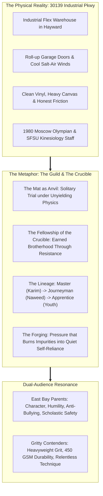
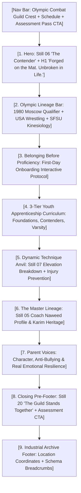
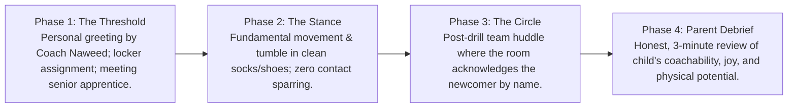
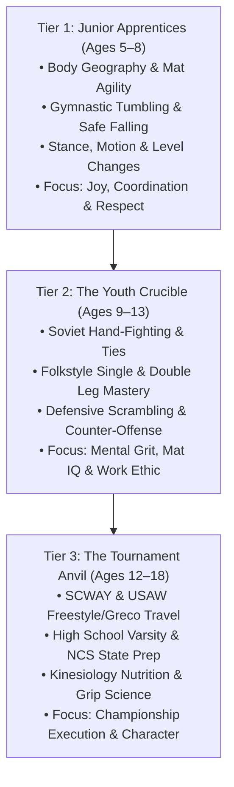
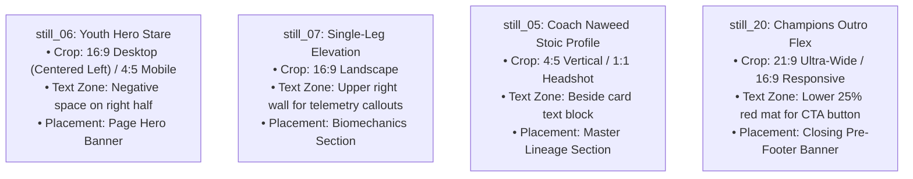

# Refined Iteration AC-1: "The Olympic Combat Guild & Crucible"
## Visual Moodboard, Brand Architecture & Youth Experience Specification
### Fusing Master-Apprentice Lineage, Physical Craftsmanship & Olympic Dignity

> **Client:** United Wrestling Club (Hayward, CA)  
> **Brand System:** Refined Iteration AC-1 (Anvil, Crucible & Olympic Guild Metaphor)  
> **Key Anchors:** 1980 Moscow Olympic Lineage (Karim Zemaryalai) + Master-Apprentice Physical Craft + Collegiate Kinesiology (SFSU / Chabot)  
> **Core Constraint:** Zero animal or predator tropes. Grounded in the authentic industrial warehouse reality of 30139 Industrial Pkwy, Hayward.  
> **Document Code:** `UWC-MOODBOARD-DIR-AC-1-CRUCIBLE`  
> **Target Page Wireframe:** `/classes/youth-wrestling` (Scholastic Pipeline & Youth Foundation)  
> **Date:** October 31, 2026  

---

## 1. Real-World Metaphor Deep Dive: "The Olympic Combat Guild & Crucible"



### 1.1 Core Philosophy & Cultural Thesis
Commercial fitness and suburban martial arts have degenerated into spectacle. Strip-mall karate studios sell colored polyester belts every six weeks; trendy fitness brands rely on adolescent animal mascots and edgelord rebellion. 

United Wrestling Club represents the antithesis of this vanity: **The Olympic Combat Guild & Crucible.**

Wrestling is humanity's oldest physical craft. There is no choreography, no subjective scoring, and no hiding behind teammates. When an 8-year-old steps onto the circle, gravity, leverage, and momentum act as an unyielding anvil. 

Yet, wrestling contains a profound paradox that mirrors ancient artisan guilds:
1. **The Solitary Trial:** On the mat, every athlete stands alone. You alone endure the fatigue; you alone execute the sprawl; you alone own the result.
2. **The Indispensable Fellowship:** You cannot forge steel without a hammer and an anvil. You cannot master wrestling without a brother or sister who provides authentic, honest resistance. Every takedown you drill requires a partner willing to catch your weight and push your threshold.

At UWC, we do not cultivate aggressive pack posturing. We operate an **Olympic Combat Guild**—a sanctuary where multi-generational masters transmit timeless Olympic techniques, and the shared pressure of the crucible tempers raw youth into unshakeable, humble human beings.

---

### 1.2 Terminology Glossary: Replacing Animal Tropes with Guild Craftsmanship

To protect the brand from juvenile clichés and third-party trademark entanglements while retaining visceral gravitas, UWC adopts a dedicated lexical architecture:

| Legacy / Animal Trope | UWC Guild & Crucible Terminology | Strategic & Cultural Rationale |
| :--- | :--- | :--- |
| **"The Predator Pack / Animal Mascot"** | **"The Guild" / "The Fellowship of the Mat"** | Shifts focus from predatory aggression to skilled craftsmanship, mutual honor, and communal elevation. |
| **"Alpha / Beta"** | **"The Lineage: Master, Journeyman, Apprentice"** | Anchors authority in earned technical competence and mentoring responsibility rather than animal dominance. |
| **"Savage / Lethal / Killer"** | **"Tempered / Resilient / Unbroken"** | Reassures suburban parents that their child will learn composure and restraint, not violence. |
| **"The Den / The Lair"** | **"The Crucible" / "The Anvil" / "The Room"** | Evokes the industrial flex warehouse on Industrial Pkwy where character is refined under pressure. |
| **"Predator Mindset"** | **"Quiet Self-Reliance / Olympic Precision"** | Promotes inner stoicism and collegiate academic focus over chest-thumping bravado. |
| **"Bloodshed / Carnage"** | **"The Labor / The Honest Friction"** | Honors the blue-collar wrestling tradition of honest, sweat-drenched physical labor. |

---

### 1.3 Why the Crucible Resonates Across Both Audiences

The Olympic Combat Guild operates as a dual-lock resonance engine that simultaneously convinces cynical Bay Area parents and energizes hungry athletic contenders:

#### A. For East Bay Parents (Hayward, Fremont, Union City, Castro Valley, Newark)
* **The Character Anvil:** Parents are terrified of social media fragility, screen addiction, and passive bullying. They do not want their child to become an aggressor; they want an armor of quiet confidence.
* **Master-Apprentice Stewardship:** Seeing Coach Karim Zemaryalai (1980 Moscow Olympian) and Coach Naweed Zemaryalai (SFSU Kinesiology) treats their child like an apprentice in a historic studio.
* **Zero Commercial Gouging:** No expensive black-belt testing fees, no long-term trap contracts, and no plastic trophies. Respect is earned through sweat, punctuality, and humility.

#### B. For Contenders & Varsity Athletes (CIF State Hopefuls & Adult Grapplers)
* **Heavyweight Authenticity:** Contenders cringe at suburban family karate. The "Crucible" aesthetic signals intense, no-nonsense mat sessions where Bay Area champions are forged.
* **Technical Purity:** Dagestani ties, Soviet foot-sweeps, and collegiate folkstyle mechanics provide the real technical edge high schoolers and No-Gi grapplers crave.
* **Earned Brotherhood:** Surviving intense situational live goes creates a bond tighter than any casual social club.

---

## 2. Visual & Token Architecture

The AC-1 system synthesizes the deep obsidian void of elite combat spaces with the archival dignity of Olympic heritage and the tactile durability of heavy industrial canvas.

```
                              AC-1 TOKEN ARCHITECTURE
                                         │
        ┌────────────────────────────────┼────────────────────────────────┐
        ▼                                ▼                                ▼
    CANVAS VOID:                     LINEAGE DUO:                    TYPOGRAPHY:
#090A0D (Pitch Void)            #BA1C1C (Bloodline Red)         #F4F1EA (Vintage Bone)
#14161B (Acid Slate)            #1D4ED8 (Olympic Royal)         #C5A059 (Medal Brass)
```

### 2.1 Complete Color Palette Specification

```css
:root {
  /* Canvas Surfaces: Heavy Industrial Void */
  --uwc-pitch-void: #090A0D;      /* Page background; anti-reflective matte black */
  --uwc-acid-slate: #14161B;      /* Card surfaces, elevated modals; weathered slate */
  --uwc-iron-rim: #22262E;        /* Subtle hairline structural borders */
  
  /* Primary Action & Sacred Sacrifice */
  --uwc-bloodline-red: #BA1C1C;   /* Furnace heat, singlet trim, primary CTAs */
  --uwc-furnace-hover: #D92323;   /* Interactive hover state */
  
  /* Heritage & Olympic Sanction */
  --uwc-olympic-blue: #1D4ED8;    /* 1980 Moscow mat blue, USAW sanction badges */
  --uwc-lineage-cobalt: #1E40AF;  /* Secondary technical callouts & tabs */
  
  /* High-Contrast Archival Neutrals */
  --uwc-vintage-bone: #F4F1EA;    /* High-contrast headlines & text; zero eye glare */
  --uwc-anvil-grey: #8E95A5;      /* Subtitles, secondary copy, coordinates */
  --uwc-medal-brass: #C5A059;     /* 1980 qualification foil, master seals */
}
```

| Swatch Name | Role | Hex Code | Visual Reference / Cultural Association |
| :--- | :--- | :--- | :--- |
| **Pitch Void** | Canvas & Background | `#090A0D` | Deep matte carbon black; isolates the mat lighting and frames focus. |
| **Acid Slate** | Container & Card Surface | `#14161B` | 450 GSM weathered fleece texture; cast iron plate with subtle tooth. |
| **Bloodline Red** | Primary Action & Heat | `#BA1C1C` | High-visceral arterial crimson; represents the furnace of the crucible. |
| **Olympic Royal Blue** | Lineage & Sanction | `#1D4ED8` | International Olympic & USA Wrestling mat blue; unassailable technical law. |
| **Vintage Bone** | Primary Typography | `#F4F1EA` | Unbleached heavy canvas, 1980 archival print; warm, readable, glare-free. |
| **Medal Brass** | Archival Badges & Foil | `#C5A059` | 1980 Moscow Olympic qualification & Dagestan medalist metallic accent. |

---

### 2.2 Typography Pairings & Hierarchy

The typography stack balances industrial force with timeless academic stewardship:

1. **Primary Impact Display (H1, Key Figures, Badges):** `Barlow Condensed Black 900`
   * *Style:* All-caps, ultra-tight tracking (`letter-spacing: -0.02em`), compact leading (`line-height: 0.92-0.95`).
   * *Role:* Delivers the raw, heavy, industrial authority of a steel foundry or Olympic stadium scoreboard.
2. **Heritage Editorial Subheads & Master Quotes:** `Newsreader 600 SemiBold Italic`
   * *Style:* Classical serif with open optical spacing (`font-style: italic`, `line-height: 1.35`).
   * *Role:* Confers generational dignity and Olympic gravitas. Transforms marketing copy into a personal testimony from Coach Karim and Naweed.
3. **Curatorial Metadata, Telemetry & Coordinates:** `Space Mono Bold`
   * *Style:* Monospaced uppercase, tracked (`letter-spacing: +0.08em`, `font-size: 0.75rem-0.85rem`).
   * *Role:* Calibrates class times, facility specs, weight categories, and chronological milestones.
4. **Parent-Facing Body & Moral Trust:** `Public Sans (400 Regular & 500 Medium)`
   * *Style:* Modern, humanistic sans-serif with exceptional micro-legibility (`line-height: 1.65`).
   * *Role:* Guarantees that parents can read safety policies, curriculum outlines, and hygiene standards without cognitive fatigue.

---

### 2.3 Textures, Borders & UI Styling

* **Container Architecture:** Hard-cornered or micro-rounded cards (`border-radius: 2px` to `4px`) referencing industrial shipping containers, Olympic archive folios, and heavy mat tape.
* **Dividers & Borders:** 1px hairline rules using `rgba(244, 241, 234, 0.10)` or dual-line rules (1px Olympic Blue paired with 1px Bloodline Red).
* **Atmospheric Light:** Low-key dramatic lighting (`box-shadow: 0 20px 40px -15px rgba(0,0,0,0.85)`) with subtle red/blue ambient rim highlights mimicking warehouse stadium fixtures.
* **Tactile Ground:** Subtly peppered with 3% opacity film grain overlay to eliminate flat corporate sterility.

---

## 3. Page Wireframe & Copy Spec: `/classes/youth-wrestling`

> **Silo Mapping:** Dedicated destination for keywords `wrestling teams`, `competition youth wrestling`, `youth wrestling near me`, `scway wrestling clubs`, and `kids wrestling` (Local SEO Keyword Reroute Map Cluster #2 & #7).  
> **Conversion Objective:** Overcome parent intimidation through "Belonging Before Proficiency" and book the Free 2-Class Assessment Pass.



---

### Section 1: Sticky Navigation Header
* **Left:** UWC Shield Crest (Red & Olympic Blue embroidery) + Wordmark: `UNITED WRESTLING CLUB`
* **Center Links:** `Lineage & Master` · `Youth Apprenticeship` · `Scholastic Pipeline` · `Schedule` · `The Anvil`
* **Right Elements:** 
  * Telemetry Tag: `HAYWARD MATS • 5:30 PM LIVE` (Pulsing green indicator)
  * CTA Button: `[ Claim 2-Class Assessment Pass ]` (Bloodline Red button with Vintage Bone text)

---

### Section 2: Hero Section (The Solitary Apprentice)
* **Visual Anchor:** Full-bleed background with desktop right-aligned portrait: `still_06_dummy_takedown_drill.jpg`.
* **Telemetry Tag (Space Mono):**  
  `GUILD SILO // YOUTH APPRENTICESHIP (AGES 5–14) // HAYWARD, CA`
* **Primary Headline (Barlow Condensed 900):**  
  **FORGED ON THE MAT.**  
  **UNBROKEN IN LIFE.**
* **Subhead (Newsreader 600 Italic):**  
  *"The East Bay’s premier youth wrestling guild—where 1980 Olympic lineage and honest pressure forge quiet confidence, physical resilience, and unbreakable character in your child."*
* **Parent Reassurance Micro-Copy (Public Sans):**  
  No martial arts experience required. No belt-testing fees. Every child begins with our personalized *Belonging Before Proficiency* mentorship protocol.
* **CTA Button Cluster:**
  * Primary: `[ Claim Free 2-Class Assessment Pass ]` *(Bloodline Red fill, arrow glyph)*
  * Secondary: `[ Explore the 3-Tier Curriculum ]` *(Ghost button, 1px Vintage Bone border)*
* **Key Metric Ticker (Space Mono):**  
  `1980 OLYMPIC LINEAGE` · `100% NO-STRIKE SAFETY` · `42 5-STAR PARENT REVIEWS` · `MVAL/NCS PIPELINE`

---

### Section 3: The Olympic Authority & Lineage Bar
A dark, distressed acid slate banner running across the screen directly beneath the hero:
* **Badge 1 (USA Wrestling Sanctioned):** Official USA Wrestling Regional Training Center Crest.
* **Badge 2 (1980 Moscow Olympic Heritage):** Head Instructor Karim Zemaryalai (1980 Olympic Qualifier & Dagestan Medalist).
* **Badge 3 (Sports Science):** Collegiate Kinesiology System (SF State & Chabot Coaching Staff).
* **Badge 4 (East Bay Community Feeder):** Official Pathway for James Logan, Hayward, Newark Memorial, and Castro Valley High Schools.

---

### Section 4: "Belonging Before Proficiency" — First-Day Onboarding Protocol
*Section Header:*  
`TELEMETRY // ZERO INTIMIDATION PROTOCOL`  
**BEFORE WE TEACH TECHNIQUE, WE BUILD BELONGING.**  
*Newsreader Subhead: "Why your child will never feel lost, ignored, or overwhelmed on our mats."*



* **Interactive Modal Spec ("What Happens on Day 1"):**
  * When a parent clicks *"How Day 1 Works"*, an elegant Acid Slate modal slides into view:
  * **Video Embed:** 45-Second silent arrival walkthrough (Industrial Pkwy turn-in, suite entrance, shoe cubbies, parent viewing seats).
  * **What to Wear Checklist:** T-shirt or rashguard, athletic shorts without zippers, clean socks or wrestling shoes, water bottle.
  * **Coach Naweed’s Personal Promise:** *"I will personally welcome your child at the door. They will not be thrown into live wrestling. They will be paired with an experienced partner who remembers exactly what it felt like to be new."*

---

### Section 5: The 3-Tier Youth Apprenticeship Curriculum
Structured like a master artisan guild, dividing athletes by developmental readiness rather than arbitrary martial arts belt sales:



#### Curriculum Card Architecture (Acid Slate cards with 1px Olympic Blue top rim):
1. **Tier 1: Junior Apprentices (Ages 5–8) — The Mat Foundation**
   * *Curriculum Focus:* Developing spatial awareness, agility, balance, and fall-safety through gamified wrestling physics.
   * *The Antidote to Bullying:* Teaches children how to command personal space, maintain posture, and deflect physical aggression without ever throwing a strike.
   * *Class Schedule:* Mon / Wed / Fri at 4:30 PM.
2. **Tier 2: The Youth Crucible (Ages 9–13) — Folkstyle & Freestyle Competence**
   * *Curriculum Focus:* Precision takedowns (sweep singles, high crotches, ankle picks), referee’s position escapes, and Dagestani wrist control.
   * *Mental Conditioning:* Building the stoic capacity to remain calm under physical discomfort and fatigue.
   * *Class Schedule:* Mon through Thu at 5:30 PM.
3. **Tier 3: The Scholastic Anvil (Ages 12–18) — High School Varsity & National Travel**
   * *Curriculum Focus:* High-intensity situational sparring, weight-class kinesiology, match management, and preparation for California CIF State and USAW Fargo Nationals.
   * *The Collegiate Pathway:* College recruitment mentoring and tape preparation.
   * *Class Schedule:* Mon through Fri at 6:30 PM + Saturday Open Mat at 10:00 AM.

---

### Section 6: Dynamic Technique Anvil (The Craft in Motion)
* **Visual Anchor:** Split-screen layout featuring `still_07_youth_single_elevation.jpg` on the left.
* **Headline:** **THE BIOMECHANICS OF LEVERAGE.**
* **Newsreader Subhead:** *"Why wrestling is the ultimate physical chess match."*
* **Copy Block:**  
  *Wrestling does not reward brute force. A 75-pound youth who understands head position, hip torque, and kinetic drive will consistently conquer a 90-pound opponent who relies purely on aggression.*
* **Technical Callouts on the Image (Space Mono badges):**
  * `[ POINT 01 // KINETIC ELEVATION ]` Locked lock behind the knee joint; drives force upward through the hips.
  * `[ POINT 02 // HEAD POSITION ]` Head planted firmly into the ribcage, breaking the opponent’s postural alignment.
  * `[ POINT 03 // MAT IMPACT DISPERSION ]` Clean, controlled takedown onto competition vinyl mats; zero joint hyperextension.

---

### Section 7: The Master Lineage (Father & Son Olympic Tradition)
* **Visual Anchor:** Portrait card featuring `still_05_coach_naweed_profile.jpg`.
* **Headline (Barlow Condensed):** **A LINEAGE PRESERVED. A SCIENCE REFINED.**
* **Founder Spotlight:**
  * **Master Karim Zemaryalai (Founder & Technical Director):** Qualified for the 1980 Moscow Olympic Games; bronze medalist at the Ali Aliyev International Tournament in Dagestan. Brings 40+ years of Soviet/Central Asian grappling supremacy to Hayward.
  * **Coach Naweed Zemaryalai (Head Coach & Program Director):** B.S. in Kinesiology from San Francisco State University; collegiate wrestler and coach at Chabot College. Blends ancient mat wisdom with modern biomechanics, active recovery, and youth motor skill development.
* **Coach Naweed Quote (Newsreader Italic):**  
  *"We do not train children to be bullies, and we do not train them to be victims. We teach them that true strength is quiet, respectful, and calm under fire. When a child learns they can survive anything on the mat, nothing in the classroom or schoolyard can intimidate them."*

---

### Section 8: Parent Testimonials & Moral Trust Proof
* **Format:** Three archival testimonial cards styled like printed workshop records:
  * *Card 1 (Fremont Parent):* "My son was being pushed around in middle school. Six months at UWC didn't make him aggressive—it made him quiet, confident, and tall. The bullying stopped because his entire physical presence changed." — **Marcus T., Fremont**
  * *Card 2 (Hayward Mother):* "I was terrified of wrestling gyms. I expected sweaty teenage boys shouting. Instead, Coach Naweed greeted us, knew my daughter's name, and made her feel like family from minute one." — **Elena R., Hayward**
  * *Card 3 (James Logan High School Athlete):* "The technique taught in this room is years ahead of normal high school rooms. The Dagestani hand-fighting Naweed teaches gave me three pins at NCS." — **Devon K., Union City**

---

### Section 9: Closing Pre-Footer Banner (The Fellowship Assembled)
* **Visual Anchor:** Full-width cinematic plate: `still_20_champions_family_outro.jpg` with dark gradient base.
* **Badge (Space Mono):** `THE CIRCLE IS OPEN // STEP ONTO THE MAT`
* **Headline (Barlow Condensed 900):**  
  **THE GUILD STANDS TOGETHER.**  
  **YOUR CHILD BELONGS IN THIS ROOM.**
* **Subhead (Newsreader Italic):**  
  *"No mirrors. No vanity belts. Just 45+ athletes and families who work, learn, and grow together. Claim your child's 2-class assessment pass today."*
* **High-Intent CTA:**
  * `[ Claim Free 2-Class Assessment Pass ]` *(Bloodline Red button with glowing shadow)*
  * Microcopy: *Takes 45 seconds · No credit card required · Instant SMS confirmation with coach arrival guide.*

---

### Section 10: Archival Industrial Footer
* **Facility Address & Coordinates:** `30139 Industrial Pkwy SW Ste C, Hayward, CA 94544` (`37.5931° N, 122.0526° W`)
* **Local Feeder Communities Served:** Hayward, Fremont, Union City, Newark, Castro Valley, San Leandro.
* **Breadcrumb Schema (JSON-LD aligned):** `Home > Classes > Youth Wrestling (Ages 5–14)`

---

## 4. Curated Stills Integration Plan

This table specifies the exact responsive cropping, negative space mapping, color grading, and DOM layout for each of the four designated production stills:



| Asset Filename | Placement & Role | Exact Responsive Crop Specs | Negative Space & Text Overlay Zones | Tonal Grading & Visual Treatment | Technical CSS & Accessibility Spec |
| :--- | :--- | :--- | :--- | :--- | :--- |
| `still_06_dummy_takedown_drill.jpg` | **Hero Master Plate:** `/classes/youth-wrestling` Hero Banner. Establishes the intense, self-reliant apprentice gaze. | **Desktop:** `16:9` (`1920×1080`), subject anchored at `x: 35%-40%`.<br>**Mobile:** `4:5` vertical (`1080×1350`), centered on chest crest and eyes. | Clean smooth grey gym wall across the entire right quadrant (`x: 55%-100%`). Ideal for H1, subhead, and CTA placement with zero facial clash. | Neutral shadow lift; boost micro-contrast on red singlet trim (`#BA1C1C`) and American flag crest; subtle 15% vignette on left edge. | `alt="Youth wrestling apprentice in official red and blue United Wrestling Club singlet standing square on the mat in Hayward, CA"`<br>`object-position: 40% center;` |
| `still_07_youth_single_elevation.jpg` | **Dynamic Craft Plate:** Biomechanics of Leverage feature block. Demonstrates kinetic execution over brute force. | **Desktop:** `16:9` widescreen.<br>**Mobile:** `1:1` square centered on the attacking wrestler's driving knee and elevated thigh. | The upper-right quadrant (`x: 60%-95%`, `y: 10%-40%`) features empty grey wall space, perfect for SVG telemetry pointers and biomechanical stat badges. | High-clarity freeze on mat impact; warm cast-iron tones; enhance contrast between red mat and blue/white singlet. | `alt="Youth wrestler executing a textbook single-leg elevation takedown drill at United Wrestling Club"`<br>`object-position: center center;` |
| `still_05_coach_naweed_profile.jpg` | **Lineage Bio Portrait:** Head Coach Profile Card in Master Lineage section. Proves quiet, stoic authority and mat pedigree. | **Desktop & Mobile:** `4:5` vertical portrait (`800×1000`) or `1:1` square cropped tightly from mid-chest to top of head. | Frame is tightly composed. Image sits on the left of a 2-column container; all biographical text sits in the adjacent right container. | Desaturate background distractions; preserve warm skin tones and crisp crimson hue of the UWC coaching shirt; emphasize cauliflower ear texture. | `alt="Coach Naweed Zemaryalai, Head Coach of United Wrestling Club and SFSU Kinesiology alumnus"`<br>`object-position: center 25%;` |
| `still_20_champions_family_outro.jpg` | **The Guild Assembled Plate:** Closing Pre-Footer CTA Banner. Visual proof of belonging, multi-generational brotherhood, and family culture. | **Desktop:** `21:9` panoramic or `16:9` widescreen.<br>**Mobile:** `16:9` with horizontal overflow scroll or centered 4:3 crop showcasing front-row youth flex. | **Top Zone (`y: 0%-25%`):** Clean UWC mural typography.<br>**Bottom Zone (`y: 75%-100%`):** Wide red mat floor, treated with a 65% dark gradient burn for high-contrast headline and CTA button. | Vibrant multi-color pop; balanced warm mat red; clean highlights across smiling athlete faces; eliminates dark warehouse shadows. | `alt="United Wrestling Club 45-athlete roster celebration and championship flex under the gym mural in Hayward, CA"`<br>`object-position: center bottom;` |

---

## 5. Summary Architecture Matrix

| Dimension | Specification |
| :--- | :--- |
| **Metaphor** | The Olympic Combat Guild & Crucible (Craftsmanship, Master-Apprentice, Anvil & Fellowship) |
| **Excluded Terms** | Animal pack metaphors, "Alpha/Beta", "Savage", "Predator", third-party fitness apparel trademarks |
| **Canvas Palette** | Pitch Void (`#090A0D`), Acid Slate (`#14161B`), Iron Rim (`#22262E`) |
| **Accent Palette** | Bloodline Red (`#BA1C1C`), Olympic Royal Blue (`#1D4ED8`), Vintage Bone (`#F4F1EA`), Medal Brass (`#C5A059`) |
| **Typography** | `Barlow Condensed Black 900` + `Newsreader 600 Italic` + `Space Mono Bold` + `Public Sans` |
| **Hero Image** | `still_06_dummy_takedown_drill.jpg` (Direct youth eye contact in official red/blue singlet) |
| **Action Image** | `still_07_youth_single_elevation.jpg` (Single-leg elevation takedown biomechanics) |
| **Bio Portrait** | `still_05_coach_naweed_profile.jpg` (Coach Naweed stoic authority & collegiate pedigree) |
| **Closing Banner** | `still_20_champions_family_outro.jpg` (45+ athlete team flex & belonging proof) |
| **Primary Conversion Hook** | "Belonging Before Proficiency" Onboarding Experience + Free 2-Class Assessment Pass |
