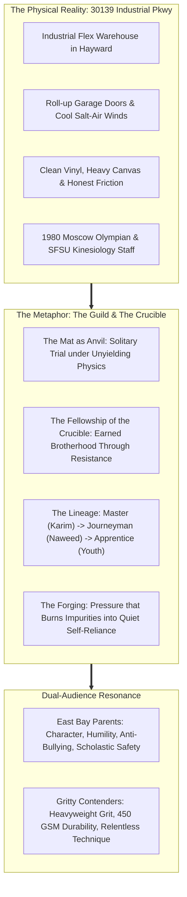

> Part 1 of 3 of [iteration_AC_1_crucible_guild](../iteration_AC_1_crucible_guild.md). Text is verbatim from the original; only links were rewritten.

# Refined Iteration AC-1: "The Olympic Combat Guild & Crucible"
## Visual Moodboard, Brand Architecture & Youth Experience Specification
### Fusing Master-Apprentice Lineage, Physical Craftsmanship & Olympic Dignity

> **Client:** United Wrestling Club (Hayward, CA)  
> **Brand System:** Refined Iteration AC-1 (Anvil, Crucible & Olympic Guild Metaphor)  
> **Key Anchors:** 1980 Moscow Olympic Lineage (Karim Zemaryalai) + Master-Apprentice Physical Craft + Collegiate Kinesiology (SFSU / Chabot)  
> **Core Constraint:** Zero animal or predator tropes. Grounded in the authentic industrial warehouse reality of 30139 Industrial Pkwy, Hayward.  
> **Document Code:** `UWC-MOODBOARD-DIR-AC-1-CRUCIBLE`  
> **Target Page Wireframe:** `/classes/youth-wrestling` (Scholastic Pipeline & Youth Foundation)  
> **Date:** October 31, 2026  

---

## 1. Real-World Metaphor Deep Dive: "The Olympic Combat Guild & Crucible"

### 1.1 Core Philosophy & Cultural Thesis
Commercial fitness and suburban martial arts have degenerated into spectacle. Strip-mall karate studios sell colored polyester belts every six weeks; trendy fitness brands rely on adolescent animal mascots and edgelord rebellion. 

United Wrestling Club represents the antithesis of this vanity: **The Olympic Combat Guild & Crucible.**

Wrestling is humanity's oldest physical craft. There is no choreography, no subjective scoring, and no hiding behind teammates. When an 8-year-old steps onto the circle, gravity, leverage, and momentum act as an unyielding anvil. 

Yet, wrestling contains a profound paradox that mirrors ancient artisan guilds:
1. **The Solitary Trial:** On the mat, every athlete stands alone. You alone endure the fatigue; you alone execute the sprawl; you alone own the result.
2. **The Indispensable Fellowship:** You cannot forge steel without a hammer and an anvil. You cannot master wrestling without a brother or sister who provides authentic, honest resistance. Every takedown you drill requires a partner willing to catch your weight and push your threshold.

At UWC, we do not cultivate aggressive pack posturing. We operate an **Olympic Combat Guild**—a sanctuary where multi-generational masters transmit timeless Olympic techniques, and the shared pressure of the crucible tempers raw youth into unshakeable, humble human beings.

---

### 1.2 Terminology Glossary: Replacing Animal Tropes with Guild Craftsmanship

To protect the brand from juvenile clichés and third-party trademark entanglements while retaining visceral gravitas, UWC adopts a dedicated lexical architecture:

| Legacy / Animal Trope | UWC Guild & Crucible Terminology | Strategic & Cultural Rationale |
| :--- | :--- | :--- |
| **"The Predator Pack / Animal Mascot"** | **"The Guild" / "The Fellowship of the Mat"** | Shifts focus from predatory aggression to skilled craftsmanship, mutual honor, and communal elevation. |
| **"Alpha / Beta"** | **"The Lineage: Master, Journeyman, Apprentice"** | Anchors authority in earned technical competence and mentoring responsibility rather than animal dominance. |
| **"Savage / Lethal / Killer"** | **"Tempered / Resilient / Unbroken"** | Reassures suburban parents that their child will learn composure and restraint, not violence. |
| **"The Den / The Lair"** | **"The Crucible" / "The Anvil" / "The Room"** | Evokes the industrial flex warehouse on Industrial Pkwy where character is refined under pressure. |
| **"Predator Mindset"** | **"Quiet Self-Reliance / Olympic Precision"** | Promotes inner stoicism and collegiate academic focus over chest-thumping bravado. |
| **"Bloodshed / Carnage"** | **"The Labor / The Honest Friction"** | Honors the blue-collar wrestling tradition of honest, sweat-drenched physical labor. |

---

### 1.3 Why the Crucible Resonates Across Both Audiences

The Olympic Combat Guild operates as a dual-lock resonance engine that simultaneously convinces cynical Bay Area parents and energizes hungry athletic contenders:

#### A. For East Bay Parents (Hayward, Fremont, Union City, Castro Valley, Newark)
* **The Character Anvil:** Parents are terrified of social media fragility, screen addiction, and passive bullying. They do not want their child to become an aggressor; they want an armor of quiet confidence.
* **Master-Apprentice Stewardship:** Seeing Coach Karim Zemaryalai (1980 Moscow Olympian) and Coach Naweed Zemaryalai (SFSU Kinesiology) treats their child like an apprentice in a historic studio.
* **Zero Commercial Gouging:** No expensive black-belt testing fees, no long-term trap contracts, and no plastic trophies. Respect is earned through sweat, punctuality, and humility.

#### B. For Contenders & Varsity Athletes (CIF State Hopefuls & Adult Grapplers)
* **Heavyweight Authenticity:** Contenders cringe at suburban family karate. The "Crucible" aesthetic signals intense, no-nonsense mat sessions where Bay Area champions are forged.
* **Technical Purity:** Dagestani ties, Soviet foot-sweeps, and collegiate folkstyle mechanics provide the real technical edge high schoolers and No-Gi grapplers crave.
* **Earned Brotherhood:** Surviving intense situational live goes creates a bond tighter than any casual social club.

---
