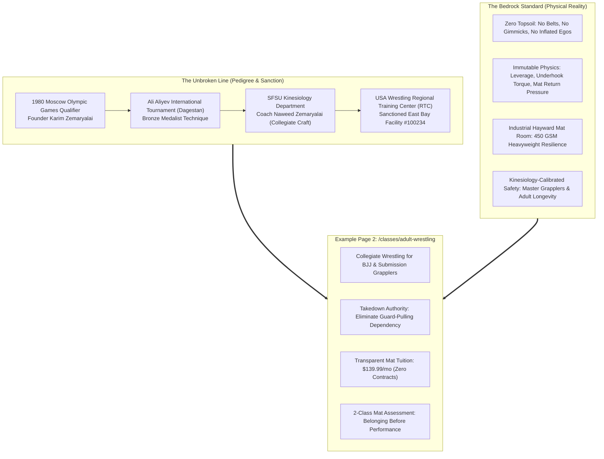
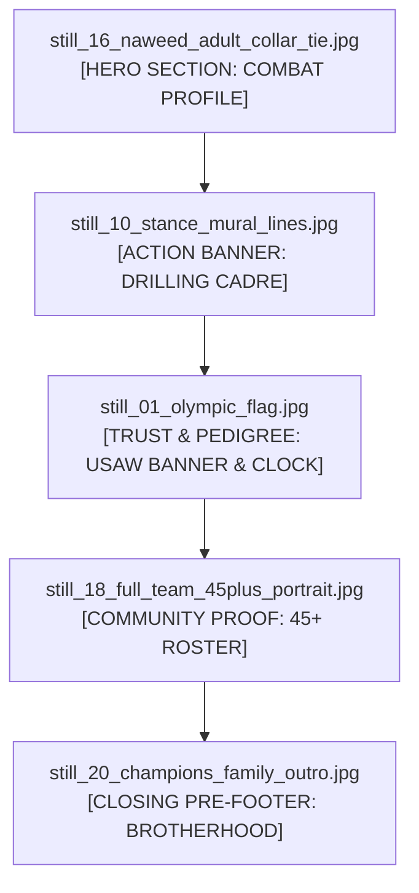

# United Wrestling Club — Brand System Iteration AC-2
## "The Bedrock Standard & The Unbroken Line"
### Brand Architecture, Metaphor Blueprint & Page Specification for Adult Wrestling

> **Document Code:** `UWC-ITERATION-AC-02-BEDROCK`  
> **Brand Archetype:** Monolithic Physical Reality × 1980 Olympic Lineage × East Bay Industrial Crucible  
> **Target Page:** `/classes/adult-wrestling` (Commercial Adult Wrestling & Wrestle-Jitsu Hub)  
> **Target Keywords:** `adult wrestling clubs near me`, `club wrestling for adults`, `adult wrestling gym`, `wrestle jitsu`, `bjj takedowns`, `wrestling for bjj`, `adult wrestling bay area`  
> **Author:** Team 2 Creative Director & Metaphor Architect  
> **Date:** October 31, 2026 / 2027 Rebuild Specification  

---

## 1. Executive Summary & Metaphor Deep Dive

### 1.1 The Metaphor: The Bedrock Standard & The Unbroken Line
Modern martial arts marketing is inundated with surface-level tropes: animal packs, hyper-aggressive wolf iconography, neon-lit cardio cages, and suburban belt factories. While aggressive branding resonates with high school athletes, it often alienates mature adults, high-level Brazilian Jiu-Jitsu practitioners, collegiate alumni, and parents seeking authentic character formation.

**Iteration AC-2 abandons animal tropes entirely and anchors UWC in an undeniable physical reality:**
- **The Bedrock Standard:** In geology, topsoil shifts, erodes, and washes away under environmental pressure. Bedrock does not move. In combat sports, combat fitness fads, influencer grappling clubs, and guard-pulling gimmicks represent topsoil. Collegiate wrestling is the bedrock of all combat. If you cannot dictate whether a confrontation remains standing or goes to the floor, you do not control your fate. UWC represents the dense, immovable bedrock upon which all effective grappling is built.
- **The Unbroken Line:** A technical and moral continuum that traces directly from the international wrestling heartlands of Central Asia and the Caucasus to the industrial center of Hayward, California.
  - **1980 Moscow Olympian Karim Zemaryalai** (Soviet-era Master of Sport candidate, Ali Aliyev Dagestan medalist).
  - **Coach Naweed Zemaryalai** (San Francisco State University Kinesiology graduate, collegiate competitor, USA Wrestling Certified Coach).
  - **USA Wrestling Regional Training Center (RTC)** official club sanctioning.
  - An authentic lineage taught daily on regulation mats inside an East Bay industrial warehouse.



---

### 1.2 Terminology & Lexicon Glossary
Iteration AC-2 enforces a disciplined vocabulary that commands immediate respect from adult grapplers, active competitors, and working professionals. It replaces hyper-emotional or predatory language with monolithic weight and technical authority:

| Generic / Troped Term | Deprecated AC-1 Term | Iteration AC-2 Bedrock Standard | Strategic Rationale & Psychological Effect |
| :--- | :--- | :--- | :--- |
| Gym / School | Den / Pack | **The Mat Cadre / The Academy / The Crucible** | Elevates the facility into an institution of disciplined technical study rather than a commercial storefront. |
| Teammates | Wolves / Pack | **The Heavy Cohort / The Roster / The Unbroken Line** | Emphasizes shared commitment, mutual accountability, and intergenerational wrestling pedigree. |
| Hard Work / Hustle | The Hunt / Suffer | **Compaction / Friction / Pressure / The Standard** | Frames wrestling as an immutable physical law (geological pressure forging rock) rather than theatrical hustle culture. |
| Beginners | Pups / Recruits | **Foundation Grapplers / The First Class** | Removes infantilizing hierarchy; honors an adult who has the courage to step onto an Olympic-caliber mat. |
| Takedowns | Attack / Subdue | **Neutral Dominance / Level Change & Leverage** | Speaks directly to the kinesiological and collegiate reality of wrestling. |
| Brotherhood | Bloodline / Wolfpack | **Earned Fellowship / The Shared Mat** | Conveys deep, unspoken mutual respect forged through live sparring rounds without cultish melodrama. |

---

### 1.3 Target Audience Resonance: Why Adult Grapplers & Competitors Buy
Adult combat sports practitioners in the East Bay (Hayward, Fremont, Union City, Castro Valley, Newark) fall into four distinct profiles, all of whom reject commercial fluff:

1. **The Frustrated BJJ Blue/Purple Belt:**
   - *Pain Point:* Has trained 3–5 years in Brazilian Jiu-Jitsu but starts every round on the knees or pulling guard. Gets dominated by high school wrestlers in regional IBJJF or ADCC tournaments.
   - *Bedrock Hook:* "Stop giving away top position. Learn collegiate hand-fighting, underhooks, and high-percentage single-leg finishes engineered with guillotine-defense mechanics."
2. **The Active MMA Competitor & Striker:**
   - *Pain Point:* Traditional wrestling programs only focus on scholastic folkstyle. They do not teach cage control, wall wrestling, or how to break an opponent's posture while avoiding knees and elbows.
   - *Bedrock Hook:* "Wrestling dictates where the fight lives. Train under a coaching staff combining collegiate folkstyle, international freestyle, and Dagestani hand-fighting."
3. **The Former High School / Collegiate Wrestler (The Nostalgic Veteran):**
   - *Pain Point:* Graduated 5–15 years ago and misses the intensity, sweat, and clarity of a real wrestling room, but cannot train with teenagers or risk a career-ending injury at age 32.
   - *Bedrock Hook:* "A true wrestling room designed for adult bodies. Kinesiology-guided warmups, technical depth, and controlled situational sparring."
4. **The High-Stakes Tech & Trades Professional (Mental Armor):**
   - *Pain Point:* Exhausted by corporate desk work or solitary physical trades. Needs a demanding, unvarnished physical pursuit where status, job titles, and posturing mean nothing.
   - *Bedrock Hook:* "The mat is the ultimate truth-teller. 75 minutes of total physical immersion, zero ego, and unshakeable brotherhood."

---

## 2. Visual & Token Architecture

Iteration AC-2 preserves the high-contrast aesthetic of Direction AC (pitch void, acid slate, bloodline red, Olympic royal blue, and vintage bone) while introducing monolithic structural discipline.

### 2.1 Color Palette & Material Hierarchy

```
[ PITCH VOID: #090A0D ]        [ ACID SLATE: #14161B ]       [ BASALT BORDER: #2A2F3A ]
Absorbing Matte Void          450 GSM Heavyweight Slab       1px Monolithic Boundary

[ BLOODLINE RED: #BA1C1C ]     [ OLYMPIC BLUE: #1D4ED8 ]     [ VINTAGE BONE: #F4F1EA ]
Arterial Primary Action        USA Wrestling Sanction        Archival Unbleached Text
```

| Swatch Token | CSS Variable | Hex Code | Role in UI Hierarchy | Emotional / Physical Anchor |
| :--- | :--- | :--- | :--- | :--- |
| **Pitch Void** | `--uwc-pitch-void` | `#090A0D` | Canvas & Root Page Background | The dark warehouse void; eliminates eye strain, focuses 100% of visual weight on mat action. |
| **Acid Slate** | `--uwc-acid-slate` | `#14161B` | Card Surfaces & Monolithic Modules | Distressed 450 GSM heavyweight cotton slab; industrial cast-basalt surface. |
| **Basalt Border** | `--uwc-basalt-border` | `#2A2F3A` | Structural Card Boundaries & Grid Dividers | 1px razor-sharp geological boundary; separates training modules without soft dropshadows. |
| **Bloodline Red** | `--uwc-bloodline-red` | `#BA1C1C` | Primary Action, Active States & Live Indicators | Arterial blood, singlet accent, sweat-earned sacrifice; calls the eye to primary CTAs. |
| **Olympic Royal Blue** | `--uwc-olympic-blue` | `#1D4ED8` | RTC Sanction Badges & Collegiate Lineage | The authentic mat perimeter blue of USA Wrestling and the Olympic Games. |
| **Vintage Bone** | `--uwc-vintage-bone` | `#F4F1EA` | Primary Display & Body Typography | Unbleached canvas and 1980 archival print stock; provides high contrast without modern LED glare. |
| **Monolith Grey** | `--uwc-monolith-grey` | `#8E95A5` | Secondary Telemetry, Labels & Specs | Weathered steel; conveys dimensional precision, class duration, and scheduling metadata. |
| **Medal Brass** | `--uwc-medal-brass` | `#C5A059` | Lineage Seals, Olympic Qualification Emblems | 1980 Moscow qualification foil and Ali Aliyev Dagestan medalist archival crest. |

---

### 2.2 Typography Stack & Hierarchical Pairing
The typography combines visceral condensed display with classical Olympic heritage serif and industrial monospaced telemetry:

1. **Display & Primary Headers (H1, H2, Key Metrics):**  
   * **Font:** `Barlow Condensed` (Black 900)  
   * **Attributes:** Uppercase, tracking `-0.02em`, leading `0.92–0.98`.  
   * **Visual Effect:** Immovable, dense, architectural. Emulates vintage Soviet sports posters and heavyweight industrial signage.
2. **Heritage & Lineage Subheads (Olympic Pedigree & Quotes):**  
   * **Font:** `Newsreader` (600 SemiBold Italic)  
   * **Attributes:** Proportional lining, tracking `+0.01em`, leading `1.3`.  
   * **Visual Effect:** Lends classical historical gravitas and international prestige, counteracting raw combat grit with intellectual pedigree.
3. **Telemetry, Timestamps, Class Metadata & Badges:**  
   * **Font:** `Space Mono` (700 Bold & 400 Regular)  
   * **Attributes:** Uppercase, tracking `+0.08em`, leading `1.1`.  
   * **Visual Effect:** Exact technical readouts, facility coordinates, session runtimes, and sanction codes.
4. **Body & Educational Copy:**  
   * **Font:** `Public Sans` (400 Regular & 500 Medium)  
   * **Attributes:** Neutral geometric clarity, line-height `1.6`, color `--uwc-vintage-bone` (90% opacity).  
   * **Visual Effect:** Highly legible across desktop and mobile; reassuring and transparent for adults and parents.

---

### 2.3 Layout Geometry & Badge Systems
- **The Monolithic Slab System:** All content containers are rendered as sharp-cornered slabs (border-radius: `0px` or `2px`). Cards do not use floaty blurred dropshadows; they use solid 1px borders (`#2A2F3A`) with optional deep hard offset shadows (`box-shadow: 4px 4px 0px rgba(0, 0, 0, 0.8)`).
- **Archival Credential Badges:** Every section incorporates technical telemetry stamps:
  - `[ USAW RTC SANCTION #100234 // REGION 8 ]`
  - `[ MOSCOW 1980 OLYMPIC LINEAGE // KARIM ZEMARYALAI ]`
  - `[ SFSU KINESIOLOGY DIRECTED // INJURY MITIGATION PROTOCOL ]`
  - `[ EAST BAY ADULT MAT CADRE // 20990 CABOT BLVD, HAYWARD CA ]`

---

## 3. Page Wireframe & Copy Specification: `/classes/adult-wrestling`

*URL Silo Target:* `https://unitedwrestlingclub.com/classes/adult-wrestling`  
*Meta Title:* Adult Wrestling Classes & BJJ Takedown Academy | United Wrestling Club Hayward  
*Meta Description:* Master collegiate wrestling, takedown defense, and wrestle-jitsu in the East Bay. Direct 1980 Olympic lineage, SFSU kinesiology coaching, transparent $139.99/mo tuition. Claim your 2-class assessment.  

```
========================================================================================
                                WIREFRAME OVERVIEW: /classes/adult-wrestling
========================================================================================
[ GLOBAL NAV: LOGO | CLASSES | SCHEDULE | LINEAGE | PRICING | CTA: CLAIM 2-CLASS PASS ]
----------------------------------------------------------------------------------------
1. HERO SECTION:
   - Telemetry Badge: [ USA WRESTLING SANCTIONED RTC ] [ HAYWARD, CA ]
   - H1: THE BEDROCK STANDARD: COLLEGIATE WRESTLING & WRESTLE-JITSU FOR ADULTS
   - Subhead (Newsreader Italic): "Where Olympic lineage meets modern grappling craft."
   - Value Matrix: Zero guard-pulling · Kinesiology-backed safety · Live adult cohort
   - Dual CTAs: [ CLAIM 2-CLASS ASSESSMENT PASS ($0 DUE TODAY) ] [ VIEW CLASS RUNTIME ]
   - Visual: still_16_naweed_adult_collar_tie.jpg (Coach Naweed collar-tie combat profile)
----------------------------------------------------------------------------------------
2. THE ADULT GRAPPLER'S DILEMMA: "WHY TOPSOIL GRAPPLING FAILS"
   - 3-Column Diagnostic:
     * Card 1: The BJJ Takedown Deficit (Giving up 2 points and bottom position)
     * Card 2: The Injury Fear Myth (Wild scramble risks vs. collegiate posture control)
     * Card 3: The Adult Mat Void (Where do grapplers over 21 train real wrestling?)
----------------------------------------------------------------------------------------
3. THE BEDROCK CURRICULUM (3 PHASES OF MAT DOMINANCE):
   - Visual Banner: still_10_stance_mural_lines.jpg (Squad charging in stance lines)
   - Phase 1: Neutral Dominance (Collegiate collar ties, 2-on-1 Russian ties, underhooks)
   - Phase 2: High-Percentage Penetration (Single legs, doubles, ankle picks for BJJ)
   - Phase 3: Mat Authority & Short Offense (Sprawl-and-crossface, front headlock, ride time)
----------------------------------------------------------------------------------------
4. THE 75-MINUTE SESSION ARCHITECTURE (SFSU KINESIOLOGY CALIBRATED):
   - 10 Min: Joint Preparation & Neck/Spine Mechanics (Zero cold snapping)
   - 25 Min: Micro-Technical Drilling & Biomechanical Leverage
   - 20 Min: Situational Live Wrestling (Positional starts from ties and front headlocks)
   - 20 Min: Controlled Live Rounds or Positional Grappling (Grouped by weight & rank)
----------------------------------------------------------------------------------------
5. THE UNBROKEN LINE: OLYMPIC PEDIGREE MEETS EAST BAY WAREHOUSE
   - Visual: still_01_olympic_flag.jpg (USAW banner & match clock) + Karim 1980 archival stamp
   - Narrative: Karim Zemaryalai (1980 Moscow) & Coach Naweed (SFSU Kinesiology)
----------------------------------------------------------------------------------------
6. THE MAT CADRE: EARNED BROTHERHOOD (COMMUNITY PROOF):
   - Visual: still_18_full_team_45plus_portrait.jpg (45+ Roster portrait)
   - Member Profiles: Tradesmen, software engineers, active MMA fighters, BJJ black belts
----------------------------------------------------------------------------------------
7. TRANSPARENT BEDROCK TUITION & THE FIRST-CLASS CHARTER:
   - Pricing Card: $139.99/mo Unlimited (No contracts, no belt fees, no cancellation penalties)
   - Drop-In Card: $15 Saturday Open Mat
   - The "First-Class Onboarding" Guarantee: How we welcome beginners without injury
----------------------------------------------------------------------------------------
8. CLOSING PRE-FOOTER:
   - Visual Backdrop: still_20_champions_family_outro.jpg (Team flex under gym mural)
   - H2: STEP ONTO THE BEDROCK.
   - Final CTA: [ CLAIM YOUR 2-CLASS ASSESSMENT PASS ] (No Credit Card Required)
========================================================================================
```

---

### 3.1 Complete Copywriting & Micro-Copy Specification

#### [HERO SECTION]
- **Telemetry Bar:**  
  `[ USA WRESTLING SANCTIONED RTC #100234 ] // [ SFSU KINESIOLOGY COACHING ] // [ HAYWARD, CA ]`
- **H1 Header (Barlow Condensed Black 900):**  
  `THE BEDROCK STANDARD: COLLEGIATE WRESTLING & WRESTLE-JITSU FOR ADULTS`
- **Subhead (Newsreader 600 SemiBold Italic):**  
  *“Stop conceding top position. Built for Brazilian Jiu-Jitsu practitioners, MMA fighters, and adult grapplers who demand real collegiate takedowns without the collegiate meathead culture.”*
- **Bullet Proofpoints (Public Sans 500 Medium):**  
  - **No Guard-Pulling:** Master collegiate collar ties, underhooks, and explosive level changes.
  - **Kinesiology-Calibrated:** Run by Coach Naweed Zemaryalai (SFSU Kinesiology). High intensity, zero reckless slams.
  - **Direct Olympic Lineage:** Founded by 1980 Moscow Olympic qualifier Karim Zemaryalai.
- **Primary Call to Action:**  
  `[ CLAIM 2-CLASS ASSESSMENT PASS — $0 DUE TODAY ]`  
  *(Subtext under button: Instant digital pass. No credit card required. Clean mat shoes or bare feet on regulation Dollamur mats.)*
- **Secondary Action:**  
  `[ VIEW TUESDAY / THURSDAY CLASS SCHEDULE ↓ ]`

---

#### [SECTION 2: THE ADULT GRAPPLER'S DILEMMA — "WHY TOPSOIL GRAPPLING FAILS"]
- **Section Kicker (Space Mono 700):** `// DIAGNOSTIC AUDIT`
- **H2 Header (Barlow Condensed Black 900):**  
  `THE BJJ TAKEDOWN PARADOX: WHY MOST ADULTS NEVER LEARN TO WRESTLE`
- **Editorial Lead (Newsreader 600 SemiBold Italic):**  
  *“Most commercial martial arts gyms treat takedowns as a 5-minute afterthought before sitting on the floor. At United Wrestling Club, we build the foundation from the feet up.”*
- **The Three Structural Realities (Card Grid):**
  1. **The Guard-Pulling Epidemic:**  
     *The Reality:* Jiu-Jitsu tournaments are frequently lost before the athlete ever touches the mat. Conceding the takedown costs two points, surrenders momentum, and places you underneath an aggressive passer.  
     *The Bedrock Fix:* We drill low-risk, high-percentage takedowns engineered specifically for submission grappling: sweep singles, knee taps, duck-unders, and body locks that keep your neck protected from the guillotine.
  2. **The High-School Room Trauma:**  
     *The Reality:* Many adults who wrestled as teenagers stopped because traditional rooms operate with reckless disregard for adult bodies: 18-year-old state finalists throwing reckless headlocks onto concrete-like surfaces.  
     *The Bedrock Fix:* SFSU Kinesiology programming. Every practice begins with spine mobilization, active neck bridging, and partner-drilling protocols that allow 35-year-old engineers and tradesmen to show up to work uninjured the next morning.
  3. **The Strip-Mall Belt Factory:**  
     *The Reality:* Commercial gyms sell belts, stripes, and false confidence. You pay $220/month plus testing fees, yet cannot take down an untrained athlete of equal weight.  
     *The Bedrock Fix:* Wrestling has no belts, no robes, and no politics. Either your hips are lower than your opponent’s or they aren’t. Our adult room is pure truth.

---

#### [SECTION 3: THE BEDROCK CURRICULUM — 3 PHASES OF MAT DOMINANCE]
- **Section Kicker (Space Mono 700):** `// 16-WEEK SYSTEMIC PROGRESSION`
- **H2 Header (Barlow Condensed Black 900):**  
  `COLLEGIATE TECHNIQUE ADAPTED FOR NO-GI, MMA & SUBMISSION GRAPPLING`
- **Phase Breakdown (Monolithic Slabs):**
  - **Phase 01: Neutral Hand-Fighting & Posture Breaking (Weeks 1–5)**  
    *Core Techniques:* Heavy collegiate collar ties, inside bicep control, the Russian 2-on-1, underhook shucks, and snap-down-to-front-headlock transitions.  
    *Grappler Application:* Neutralize aggressive scramblers and dictate the pace without wasting aerobic energy.
  - **Phase 02: High-Percentage Penetration & Finishes (Weeks 6–10)**  
    *Core Techniques:* Low-risk sweep singles, head-inside single legs, sweep doubles, ankle picks, and misdirection blast doubles.  
    *Grappler Application:* Learn how to shoot without driving your neck straight into front chokes, guillotines, or kimura traps.
  - **Phase 03: Short Offense, Mat Returns & Top Control (Weeks 11–16)**  
    *Core Techniques:* Sprawl-and-spin, go-behinds, cradle locks, spiral rides, claw rides, and Olympic mat return mechanics.  
    *Grappler Application:* Keep opponents pinned to the mat, flatten out their base, and eliminate turtle escapes.

---

#### [SECTION 4: THE 75-MINUTE SESSION ARCHITECTURE]
- **Section Kicker (Space Mono 700):** `// CALIBRATED RUNTIME PROTOCOL`
- **H2 Header (Barlow Condensed Black 900):**  
  `HOW WE TRAIN: 75 MINUTES OF ZERO-WASTE ATHLETIC RIGOR`
- **Timeline Grid (Space Mono Telemetry + Public Sans Body):**
  - `00:00 — 00:12 // PHASE 1: KINESIOLOGY JOINT ACTIVATION`  
    Controlled cervical spine prep, hip capsule mobility, dynamic sprawl sequences, and stance-in-motion footwork drills under Coach Naweed's supervision.
  - `00:12 — 00:40 // PHASE 2: PROGRESSIVE DRILLING & DETAIL ISOLATION`  
    One or two core concepts broken down to microscopic mechanics: head position, lead-leg angle, wrist torque, and follow-through. High repetition with progressive resistance.
  - `00:40 — 01:00 // PHASE 3: SITUATIONAL LIVE SCENARIOS`  
    Timed 60-second micro-rounds starting from specific positions: e.g., you have an underhook and your opponent has a collar tie; or one athlete is locked in a front headlock. Specific goals: score or escape.
  - `01:00 — 01:15 // PHASE 4: CONTROLLED MAT ROUNDS (LIVE GOES)`  
    3-minute live wrestling rounds matched by weight, skill level, and intensity goals. Respect is mandatory: no flying scissors, no reckless slamming, no uncontrolled twisting.

---

#### [SECTION 5: THE UNBROKEN LINE — MOSCOW 1980 TO HAYWARD 2027]
- **Section Kicker (Space Mono 700):** `// PEDIGREE & SANCTION`
- **H2 Header (Barlow Condensed Black 900):**  
  `NOT AN INFLUENCER GYM. AN OLYMPIC LINEAGE.`
- **Body Copy:**  
  *“You cannot fake 40 years of international mat experience. United Wrestling Club was forged by Coach Karim Zemaryalai, who represented his nation at the 1980 Moscow Olympic Games and claimed bronze at the prestigious Ali Aliyev International Tournament in Dagestan—the most unforgiving wrestling proving ground on earth.*  
  *Today, his son Coach Naweed Zemaryalai bridges that international combat heritage with modern sports science from SFSU Kinesiology. When you drill here, you are not learning untested YouTube techniques. You are absorbing an unbroken line of Olympic technical mastery.”*

---

#### [SECTION 6: TRANSPARENT BEDROCK TUITION]
- **Section Kicker (Space Mono 700):** `// ZERO CONTRACTS. ZERO HIDDEN EXPENSES.`
- **H2 Header (Barlow Condensed Black 900):**  
  `HONEST TUITION FOR SERIOUS GRAPPLERS`
- **Tuition Cards:**
  - **Adult Unlimited Wrestling & Grappling:**  
    `$139.99 / Month`  
    - Full access to all Adult Wrestling classes (Tues/Thurs evenings)  
    - Full access to Saturday Open Mat Grappling sessions  
    - USA Wrestling certified coaching and video analysis access  
    - No registration fees · No cancellation fees · Cancel anytime with 7 days' notice  
    - `[ START WITH 2-CLASS ASSESSMENT PASS ]`
  - **Saturday Open Mat Drop-In:**  
    `$15 / Single Mat Pass`  
    - 2 hours of open live wrestling, situational rounds, and drill time  
    - Open to all affiliations, BJJ gyms, and independent competitors  
    - `[ RESERVE OPEN MAT DROP-IN ]`

---

#### [SECTION 7: THE 2-CLASS MAT ASSESSMENT ONBOARDING FLOW]
- **Why It Converts Adult Skeptics:**  
  Adults fear showing up to a combat gym and being fed to aggressive twenty-year-olds. UWC removes this friction with an explicit onboarding contract:
  1. **Claim the Pass Online:** Pick your date (Tuesday or Thursday at 7:00 PM).
  2. **The 10-Minute Pre-Mat Briefing:** Coach Naweed greets you at the door, reviews any past injuries (shoulders, knees, lower back), and pairs you with a designated senior partner.
  3. **First-Day Low-Impact Integration:** You drill movement, stance, and basic hand control. Live sparring is completely optional for your first two classes.
  4. **The Post-Mat Decision:** If UWC is the right fit, activate your membership online. If not, you walk away with real collegiate takedown knowledge and zero sales pressure.

---

## 4. Curated Stills Integration Plan

All photographic assets have been evaluated for technical resolution (`1920 × 1080`), tonal depth, and architectural alignment. Below is the deployment blueprint for `/classes/adult-wrestling`:



---

### 4.1 Plate 1: `still_16_naweed_adult_collar_tie.jpg`
- **Location:** Hero Section Combat Plate (Right side of split hero on desktop; background underlay with dark gradient on mobile).
- **Subject Analysis:** Coach Naweed locking a high-level collegiate collar tie on an adult student. Extreme tonal contrast between Naweed’s black compression rashguard and the student’s white shirt. Shows authentic forearm torque, posture pressure, and intense coaching precision.
- **Crop & Aspect Ratio:** `16:9` widescreen or `4:5` vertical portrait crop.
- **Negative Space & Text Placement:** Crop anchors Coach Naweed’s face and collar-tie lock in the upper-right two-thirds. Left side features a linear gradient feather (`linear-gradient(90deg, #090A0D 0%, rgba(9, 10, 13, 0.85) 45%, transparent 100%)`) providing high-contrast negative space for the Barlow Condensed H1 and conversion badge.
- **Technical Styling Specs:**
  ```css
  .hero-combat-plate {
    background-image: linear-gradient(90deg, #090A0D 0%, rgba(9, 10, 13, 0.75) 40%, rgba(9, 10, 13, 0.1) 100%),
                      url('/stills/still_16_naweed_adult_collar_tie.jpg');
    background-size: cover;
    background-position: 70% center;
    border: 1px solid var(--uwc-basalt-border);
    filter: contrast(108%) brightness(92%);
  }
  ```

---

### 4.2 Plate 2: `still_10_stance_mural_lines.jpg`
- **Location:** Section 3 Curriculum & Action Break (Full-width panoramic break banner).
- **Subject Analysis:** Squad charging forward in low wrestling stance lines across the red and blue Dollamur mats beneath the gym wall mural. Conveys extreme discipline, forward kinetic momentum, and spatial depth.
- **Crop & Aspect Ratio:** Cinematic `21:9` ultrawide banner (`1920 × 820`).
- **Negative Space & Text Placement:** Text overlay centered or left-aligned in Vintage Bone: `"THE STANDARD IS NON-NEGOTIABLE. WE DRILL FROM THE MAT UP."` Subtle vertical gradient overlay (`linear-gradient(180deg, #090A0D 0%, transparent 40%, transparent 60%, #090A0D 100%)`) blends the plate seamlessly into the page background.

---

### 4.3 Plate 3: `still_01_olympic_flag.jpg`
- **Location:** Section 5 Trust, Lineage & Sanction Bar.
- **Subject Analysis:** USA Wrestling official wall banner hanging on the warehouse corrugated wall with the large red digital wrestling match clock displaying `25:21`. Real-world proof of institutional sanctioning and authentic training conditions.
- **Crop & Aspect Ratio:** `4:3` or `1:1` inset credential plate alongside Coach Karim Zemaryalai's 1980 Olympic archival documentation.
- **Styling Specs:** Inset within an Acid Slate card (`#14161B`) with 1px Basalt border (`#2A2F3A`) and telemetry tag: `[ OFFICIAL USAW RTC FACILITY BANNER // MATCH CLOCK 25:21 ]`.

---

### 4.4 Plate 4: `still_18_full_team_45plus_portrait.jpg`
- **Location:** Section 6 Mat Cadre & Community Roster Proof.
- **Subject Analysis:** 45+ athletes standing shoulder to shoulder across the mat room in front of the competition banner. Spans youth prodigies, varsity competitors, adult grapplers, and masters athletes. Proves that UWC is not an empty or niche club, but a powerhouse community.
- **Crop & Aspect Ratio:** Full `16:9` widescreen presentation (`1920 × 1080`).
- **Negative Space & Text Placement:** Clean framing with top caption bar: `THE ROSTER: 45+ ACTIVE ATHLETES, FROM BEGINNER ADULTS TO CIF MEDALISTS`. Below the image sits a 3-column metric bar: `[ 5.0 GOOGLE RATING (42 REVIEWS) ] // [ $139.99/MO TRANSPARENT TUITION ] // [ ZERO CONTRACTS ]`.

---

### 4.5 Plate 5: `still_20_champions_family_outro.jpg`
- **Location:** Closing Pre-Footer Master Call-To-Action.
- **Subject Analysis:** The team celebrating, flexing, and smiling under the gym mural. Female youth leaders anchor the front row, while adult grapplers and collegiate contenders flex in authentic brotherhood behind them. Provides an uplifting, welcoming counterweight to the intense combat imagery.
- **Crop & Aspect Ratio:** Cinematic `2.39:1` widescreen backdrop.
- **Overlay & Lighting:** Deep dark overlay (`background: rgba(9, 10, 13, 0.88); backdrop-filter: blur(2px);`) so the final H2 (`STEP ONTO THE BEDROCK`) and trial pass registration form remain legible.

---

## 5. Technical SEO, Schema.org & Internal Linking Architecture

### 5.1 JSON-LD Schema.org Architecture for `/classes/adult-wrestling`

```json
{
  "@context": "https://schema.org",
  "@graph": [
    {
      "@type": "SportsClub",
      "@id": "https://unitedwrestlingclub.com/#organization",
      "name": "United Wrestling Club",
      "url": "https://unitedwrestlingclub.com",
      "logo": "https://unitedwrestlingclub.com/images/uwc-crest.svg",
      "image": "https://unitedwrestlingclub.com/stills/still_16_naweed_adult_collar_tie.jpg",
      "telephone": "+1-510-736-2342",
      "address": {
        "@type": "PostalAddress",
        "streetAddress": "20990 Cabot Blvd",
        "addressLocality": "Hayward",
        "addressRegion": "CA",
        "postalCode": "94545",
        "addressCountry": "US"
      },
      "geo": {
        "@type": "GeoCoordinates",
        "latitude": 37.6688,
        "longitude": -122.0808
      },
      "priceRange": "$$"
    },
    {
      "@type": "Course",
      "@id": "https://unitedwrestlingclub.com/classes/adult-wrestling#course",
      "name": "Adult Collegiate Wrestling & Wrestle-Jitsu",
      "description": "Collegiate folkstyle wrestling, takedown defense, and scramble mechanics engineered for adult martial artists, BJJ competitors, and beginner grapplers. Taught by SFSU Kinesiology coaches with 1980 Olympic lineage.",
      "provider": {
        "@id": "https://unitedwrestlingclub.com/#organization"
      },
      "offers": {
        "@type": "Offer",
        "price": "139.99",
        "priceCurrency": "USD",
        "availability": "https://schema.org/InStock",
        "validFrom": "2027-01-01",
        "category": "Monthly Unlimited Tuition"
      },
      "hasCourseInstance": {
        "@type": "CourseInstance",
        "courseMode": "OnSite",
        "location": {
          "@id": "https://unitedwrestlingclub.com/#organization"
        },
        "schedule": {
          "@type": "Schedule",
          "byDay": [
            "https://schema.org/Tuesday",
            "https://schema.org/Thursday",
            "https://schema.org/Saturday"
          ],
          "startTime": "19:00",
          "endTime": "20:15"
        }
      }
    },
    {
      "@type": "BreadcrumbList",
      "@id": "https://unitedwrestlingclub.com/classes/adult-wrestling#breadcrumbs",
      "itemListElement": [
        {
          "@type": "ListItem",
          "position": 1,
          "name": "Home",
          "item": "https://unitedwrestlingclub.com"
        },
        {
          "@type": "ListItem",
          "position": 2,
          "name": "Classes",
          "item": "https://unitedwrestlingclub.com/classes"
        },
        {
          "@type": "ListItem",
          "position": 3,
          "name": "Adult Wrestling",
          "item": "https://unitedwrestlingclub.com/classes/adult-wrestling"
        }
      ]
    },
    {
      "@type": "FAQPage",
      "@id": "https://unitedwrestlingclub.com/classes/adult-wrestling#faq",
      "mainEntity": [
        {
          "@type": "Question",
          "name": "Can beginners with no wrestling experience join adult wrestling classes?",
          "acceptedAnswer": {
            "@type": "Answer",
            "text": "Yes. Our adult wrestling program is specifically calibrated for adult beginners, BJJ practitioners, and returning scholastic wrestlers. Coach Naweed Zemaryalai (SFSU Kinesiology) teaches progressive, injury-preventative drilling so you learn stance, leverage, and takedowns safely without reckless live slams."
          }
        },
        {
          "@type": "Question",
          "name": "How does adult wrestling training help Brazilian Jiu-Jitsu practitioners?",
          "acceptedAnswer": {
            "@type": "Answer",
            "text": "Wrestling gives Jiu-Jitsu grapplers total control over where the match occurs. You learn collegiate collar ties, underhooks, low-risk sweep singles, and front headlock control that prevent guard pulling and score takedowns while keeping your neck safe from submission counters."
          }
        },
        {
          "@type": "Question",
          "name": "What equipment do I need for my first adult wrestling class at UWC?",
          "acceptedAnswer": {
            "@type": "Answer",
            "text": "You only need clean athletic shorts or spats (no zippers, pockets, or buttons), a fitted athletic t-shirt or rashguard, and either wrestling shoes or clean bare feet. A mouthguard is recommended."
          }
        },
        {
          "@type": "Question",
          "name": "How much does adult wrestling cost at United Wrestling Club?",
          "acceptedAnswer": {
            "@type": "Answer",
            "text": "Tuition is $139.99/month for unlimited adult wrestling and grapple training with zero registration fees or long-term contracts. Drop-in Saturday open mat passes are also available for $15."
          }
        }
      ]
    }
  ]
}
```

---

### 5.2 Internal Link Distribution (Authority Flow)
To ensure `/classes/adult-wrestling` ranks #1 for high-volume adult search queries across the East Bay, the page connects into the global authority graph:

- **Upstream Inbound Links:**
  - Homepage (`/`): Anchor `"Adult Wrestling & Wrestle-Jitsu"` in the primary classes grid.
  - Classes Hub (`/classes`): Hero feature card with `still_16_naweed_adult_collar_tie.jpg`.
  - Regional Guide (`/guides/adult-wrestling-bay-area`): High-authority contextual recommendation link.
  - Grappler Guide (`/guides/wrestling-for-bjj-takedowns`): Primary conversion destination.
- **Downstream Outbound Links:**
  - Saturday Open Mat (`/classes/open-mat`): Weekly live sparring feeder.
  - No-Gi Jiu-Jitsu (`/classes/nogi-jiu-jitsu`): Cross-discipline grappling integration.
  - Coaches & Olympic Pedigree (`/about`): Deep dive on Karim and Naweed Zemaryalai.
  - Trial Registration (`/register`): Direct booking engine for the 2-Class Assessment Pass.

---

## 6. Synthesis: Why Iteration AC-2 Dominates the Competitive Field

| Dimension | Typical Commercial Gym (Smash Gyms / Strip-Mall BJJ) | AC-1 (Animal/Wolfpack Metaphor) | **AC-2: The Bedrock Standard & The Unbroken Line** |
| :--- | :--- | :--- | :--- |
| **Cultural Metaphor** | Commercial fitness club, generic belt rank progression. | Tribal pack / wolfpack brotherhood, high-intensity streetwear. | **Geological/monolithic weight, immutable physics, unbroken Olympic lineage.** |
| **Adult grappler appeal** | Low (few pure takedown classes, guard-pulling emphasis). | Moderate (some adults find wolf imagery juvenile or overly aggressive). | **Maximum (serious craft, biomechanics, kinesiology safety, pure collegiate skill).** |
| **Pricing Transparency** | Hidden behind sales rep calls, $200+ signup fees, 12-month lock-in. | Moderate. | **100% Transparent: $139.99/mo, no contracts, published online.** |
| **Pedigree Proof** | Generic black belt certificate on wall. | Olympic references, but overshadowed by wolfpack branding. | **Dominant: 1980 Moscow Olympian Karim + SFSU Kinesiology Naweed + USAW RTC #100234.** |
| **Safety for Adults (30+)** | High injury rate in uncontrolled scrambles. | High intensity, risk of intimidation. | **Kinesiology-calibrated warmups, controlled situational drilling, zero ego pressure.** |

---
*Report produced by Team 2 Creative Director & Metaphor Architect for United Wrestling Club.*
