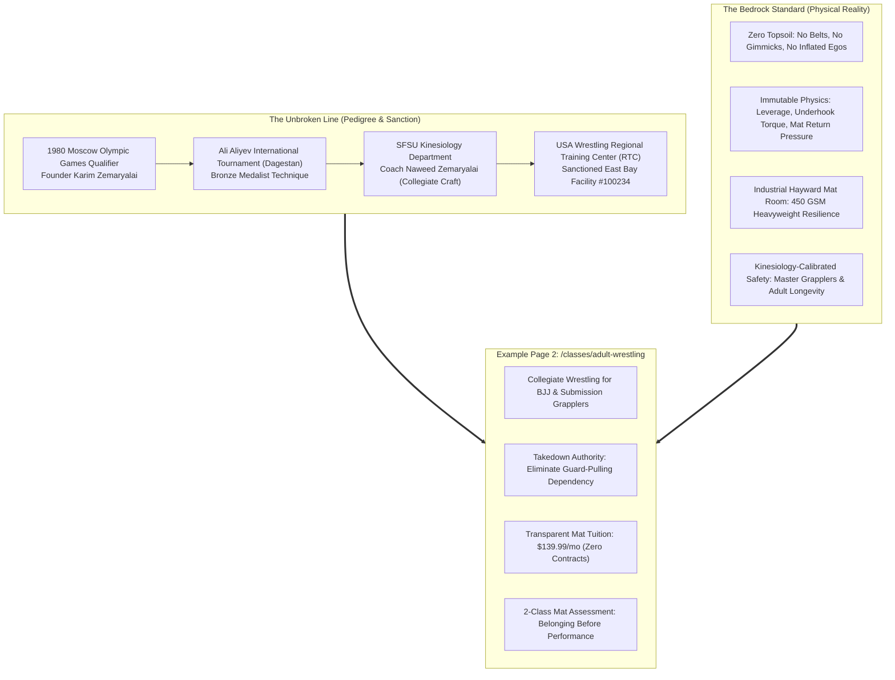

> Part 1 of 4 of [iteration_AC_2_bedrock_standard](../iteration_AC_2_bedrock_standard.md). Text is verbatim from the original; only links were rewritten.

# United Wrestling Club — Brand System Iteration AC-2
## "The Bedrock Standard & The Unbroken Line"
### Brand Architecture, Metaphor Blueprint & Page Specification for Adult Wrestling

> **Document Code:** `UWC-ITERATION-AC-02-BEDROCK`  
> **Brand Archetype:** Monolithic Physical Reality × 1980 Olympic Lineage × East Bay Industrial Crucible  
> **Target Page:** `/classes/adult-wrestling` (Commercial Adult Wrestling & Wrestle-Jitsu Hub)  
> **Target Keywords:** `adult wrestling clubs near me`, `club wrestling for adults`, `adult wrestling gym`, `wrestle jitsu`, `bjj takedowns`, `wrestling for bjj`, `adult wrestling bay area`  
> **Author:** Team 2 Creative Director & Metaphor Architect  
> **Date:** October 31, 2026 / 2027 Rebuild Specification  

---

## 1. Executive Summary & Metaphor Deep Dive

### 1.1 The Metaphor: The Bedrock Standard & The Unbroken Line
Modern martial arts marketing is inundated with surface-level tropes: animal packs, hyper-aggressive wolf iconography, neon-lit cardio cages, and suburban belt factories. While aggressive branding resonates with high school athletes, it often alienates mature adults, high-level Brazilian Jiu-Jitsu practitioners, collegiate alumni, and parents seeking authentic character formation.

**Iteration AC-2 abandons animal tropes entirely and anchors UWC in an undeniable physical reality:**
- **The Bedrock Standard:** In geology, topsoil shifts, erodes, and washes away under environmental pressure. Bedrock does not move. In combat sports, combat fitness fads, influencer grappling clubs, and guard-pulling gimmicks represent topsoil. Collegiate wrestling is the bedrock of all combat. If you cannot dictate whether a confrontation remains standing or goes to the floor, you do not control your fate. UWC represents the dense, immovable bedrock upon which all effective grappling is built.
- **The Unbroken Line:** A technical and moral continuum that traces directly from the international wrestling heartlands of Central Asia and the Caucasus to the industrial center of Hayward, California.
  - **1980 Moscow Olympian Karim Zemaryalai** (Soviet-era Master of Sport candidate, Ali Aliyev Dagestan medalist).
  - **Coach Naweed Zemaryalai** (San Francisco State University Kinesiology graduate, collegiate competitor, USA Wrestling Certified Coach).
  - **USA Wrestling Regional Training Center (RTC)** official club sanctioning.
  - An authentic lineage taught daily on regulation mats inside an East Bay industrial warehouse.

---

### 1.2 Terminology & Lexicon Glossary
Iteration AC-2 enforces a disciplined vocabulary that commands immediate respect from adult grapplers, active competitors, and working professionals. It replaces hyper-emotional or predatory language with monolithic weight and technical authority:

| Generic / Troped Term | Deprecated AC-1 Term | Iteration AC-2 Bedrock Standard | Strategic Rationale & Psychological Effect |
| :--- | :--- | :--- | :--- |
| Gym / School | Den / Pack | **The Mat Cadre / The Academy / The Crucible** | Elevates the facility into an institution of disciplined technical study rather than a commercial storefront. |
| Teammates | Wolves / Pack | **The Heavy Cohort / The Roster / The Unbroken Line** | Emphasizes shared commitment, mutual accountability, and intergenerational wrestling pedigree. |
| Hard Work / Hustle | The Hunt / Suffer | **Compaction / Friction / Pressure / The Standard** | Frames wrestling as an immutable physical law (geological pressure forging rock) rather than theatrical hustle culture. |
| Beginners | Pups / Recruits | **Foundation Grapplers / The First Class** | Removes infantilizing hierarchy; honors an adult who has the courage to step onto an Olympic-caliber mat. |
| Takedowns | Attack / Subdue | **Neutral Dominance / Level Change & Leverage** | Speaks directly to the kinesiological and collegiate reality of wrestling. |
| Brotherhood | Bloodline / Wolfpack | **Earned Fellowship / The Shared Mat** | Conveys deep, unspoken mutual respect forged through live sparring rounds without cultish melodrama. |

---

### 1.3 Target Audience Resonance: Why Adult Grapplers & Competitors Buy
Adult combat sports practitioners in the East Bay (Hayward, Fremont, Union City, Castro Valley, Newark) fall into four distinct profiles, all of whom reject commercial fluff:

1. **The Frustrated BJJ Blue/Purple Belt:**
   - *Pain Point:* Has trained 3–5 years in Brazilian Jiu-Jitsu but starts every round on the knees or pulling guard. Gets dominated by high school wrestlers in regional IBJJF or ADCC tournaments.
   - *Bedrock Hook:* "Stop giving away top position. Learn collegiate hand-fighting, underhooks, and high-percentage single-leg finishes engineered with guillotine-defense mechanics."
2. **The Active MMA Competitor & Striker:**
   - *Pain Point:* Traditional wrestling programs only focus on scholastic folkstyle. They do not teach cage control, wall wrestling, or how to break an opponent's posture while avoiding knees and elbows.
   - *Bedrock Hook:* "Wrestling dictates where the fight lives. Train under a coaching staff combining collegiate folkstyle, international freestyle, and Dagestani hand-fighting."
3. **The Former High School / Collegiate Wrestler (The Nostalgic Veteran):**
   - *Pain Point:* Graduated 5–15 years ago and misses the intensity, sweat, and clarity of a real wrestling room, but cannot train with teenagers or risk a career-ending injury at age 32.
   - *Bedrock Hook:* "A true wrestling room designed for adult bodies. Kinesiology-guided warmups, technical depth, and controlled situational sparring."
4. **The High-Stakes Tech & Trades Professional (Mental Armor):**
   - *Pain Point:* Exhausted by corporate desk work or solitary physical trades. Needs a demanding, unvarnished physical pursuit where status, job titles, and posturing mean nothing.
   - *Bedrock Hook:* "The mat is the ultimate truth-teller. 75 minutes of total physical immersion, zero ego, and unshakeable brotherhood."

---
