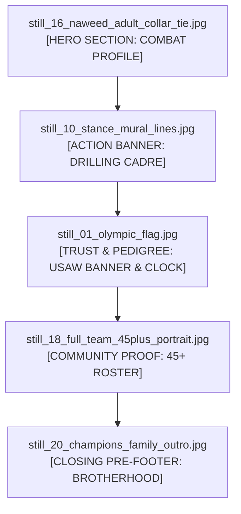

> Part 3 of 4 of [iteration_AC_2_bedrock_standard](../iteration_AC_2_bedrock_standard.md). Text is verbatim from the original; only links were rewritten.

## 4. Curated Stills Integration Plan

All photographic assets have been evaluated for technical resolution (`1920 × 1080`), tonal depth, and architectural alignment. Below is the deployment blueprint for `/classes/adult-wrestling`:



---

### 4.1 Plate 1: `still_16_naweed_adult_collar_tie.jpg`
- **Location:** Hero Section Combat Plate (Right side of split hero on desktop; background underlay with dark gradient on mobile).
- **Subject Analysis:** Coach Naweed locking a high-level collegiate collar tie on an adult student. Extreme tonal contrast between Naweed’s black compression rashguard and the student’s white shirt. Shows authentic forearm torque, posture pressure, and intense coaching precision.
- **Crop & Aspect Ratio:** `16:9` widescreen or `4:5` vertical portrait crop.
- **Negative Space & Text Placement:** Crop anchors Coach Naweed’s face and collar-tie lock in the upper-right two-thirds. Left side features a linear gradient feather (`linear-gradient(90deg, #090A0D 0%, rgba(9, 10, 13, 0.85) 45%, transparent 100%)`) providing high-contrast negative space for the Barlow Condensed H1 and conversion badge.
- **Technical Styling Specs:**
  ```css
  .hero-combat-plate {
    background-image: linear-gradient(90deg, #090A0D 0%, rgba(9, 10, 13, 0.75) 40%, rgba(9, 10, 13, 0.1) 100%),
                      url('/stills/still_16_naweed_adult_collar_tie.jpg');
    background-size: cover;
    background-position: 70% center;
    border: 1px solid var(--uwc-basalt-border);
    filter: contrast(108%) brightness(92%);
  }
  ```

---

### 4.2 Plate 2: `still_10_stance_mural_lines.jpg`
- **Location:** Section 3 Curriculum & Action Break (Full-width panoramic break banner).
- **Subject Analysis:** Squad charging forward in low wrestling stance lines across the red and blue Dollamur mats beneath the gym wall mural. Conveys extreme discipline, forward kinetic momentum, and spatial depth.
- **Crop & Aspect Ratio:** Cinematic `21:9` ultrawide banner (`1920 × 820`).
- **Negative Space & Text Placement:** Text overlay centered or left-aligned in Vintage Bone: `"THE STANDARD IS NON-NEGOTIABLE. WE DRILL FROM THE MAT UP."` Subtle vertical gradient overlay (`linear-gradient(180deg, #090A0D 0%, transparent 40%, transparent 60%, #090A0D 100%)`) blends the plate seamlessly into the page background.

---

### 4.3 Plate 3: `still_01_olympic_flag.jpg`
- **Location:** Section 5 Trust, Lineage & Sanction Bar.
- **Subject Analysis:** USA Wrestling official wall banner hanging on the warehouse corrugated wall with the large red digital wrestling match clock displaying `25:21`. Real-world proof of institutional sanctioning and authentic training conditions.
- **Crop & Aspect Ratio:** `4:3` or `1:1` inset credential plate alongside Coach Karim Zemaryalai's 1980 Olympic archival documentation.
- **Styling Specs:** Inset within an Acid Slate card (`#14161B`) with 1px Basalt border (`#2A2F3A`) and telemetry tag: `[ OFFICIAL USAW RTC FACILITY BANNER // MATCH CLOCK 25:21 ]`.

---

### 4.4 Plate 4: `still_18_full_team_45plus_portrait.jpg`
- **Location:** Section 6 Mat Cadre & Community Roster Proof.
- **Subject Analysis:** 45+ athletes standing shoulder to shoulder across the mat room in front of the competition banner. Spans youth prodigies, varsity competitors, adult grapplers, and masters athletes. Proves that UWC is not an empty or niche club, but a powerhouse community.
- **Crop & Aspect Ratio:** Full `16:9` widescreen presentation (`1920 × 1080`).
- **Negative Space & Text Placement:** Clean framing with top caption bar: `THE ROSTER: 45+ ACTIVE ATHLETES, FROM BEGINNER ADULTS TO CIF MEDALISTS`. Below the image sits a 3-column metric bar: `[ 5.0 GOOGLE RATING (42 REVIEWS) ] // [ $139.99/MO TRANSPARENT TUITION ] // [ ZERO CONTRACTS ]`.

---

### 4.5 Plate 5: `still_20_champions_family_outro.jpg`
- **Location:** Closing Pre-Footer Master Call-To-Action.
- **Subject Analysis:** The team celebrating, flexing, and smiling under the gym mural. Female youth leaders anchor the front row, while adult grapplers and collegiate contenders flex in authentic brotherhood behind them. Provides an uplifting, welcoming counterweight to the intense combat imagery.
- **Crop & Aspect Ratio:** Cinematic `2.39:1` widescreen backdrop.
- **Overlay & Lighting:** Deep dark overlay (`background: rgba(9, 10, 13, 0.88); backdrop-filter: blur(2px);`) so the final H2 (`STEP ONTO THE BEDROCK`) and trial pass registration form remain legible.

---
