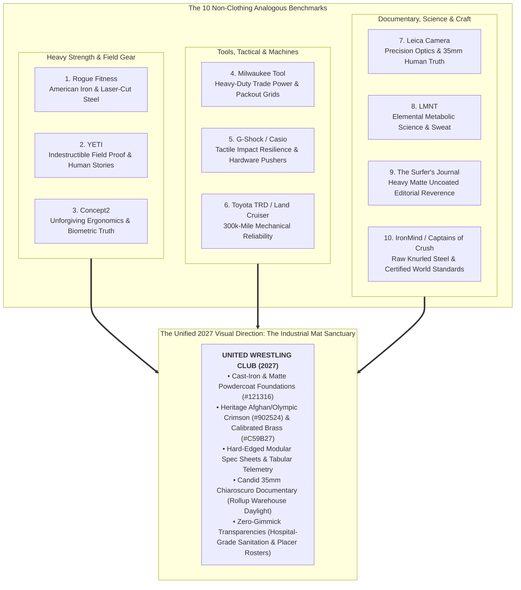

> Part 1 of 3 of [top_10_non_clothing_analogous_brands](../top_10_non_clothing_analogous_brands.md). Text is verbatim from the original; only links were rewritten.

# Top 10 Non-Clothing Analogous Brands for United Wrestling Club (UWC)
## The Executive Synthesis & Master Visual Direction: "The Industrial Mat Sanctuary"

> **Client:** United Wrestling Club (Hayward, CA)  
> **Physical Sanctuary:** 30139 Industrial Pkwy SW Ste C, Hayward, CA 94544 (East Bay Industrial Flex Corridor)  
> **Executive Leadership:** Karim Zemaryalai (1980 Moscow Olympian & Ali Aliyev Dagestan Medalist) & Naweed Zemaryalai (SF State / Chabot College Kinesiology Coach)  
> **Target Audience (ICPs):** East Bay Parents (Character, Anti-Bullying, Real Grit), Scholastic CIF High School Contenders (High-Torque Collegiate Prep), Adult Grapplers & Tradesmen (Injury-Conscious, Unvarnished Mat Craft)  
> **Document Code:** `UWC-MASTER-ANALOGOUS-NONCLOTHING-V1`  
> **Date:** October 31, 2026 / 2027 Rebuild Master Reference  

---

## 1. Executive Summary: Why Non-Clothing Brands Unlock UWC's True Identity

United Wrestling Club is not a commercial strip-mall martial arts franchise ("McDojo"), nor is it a high-gloss suburban fitness club, nor an aggressive cage-fight basement. It is an unvarnished **Industrial Mat Sanctuary** operating inside an active industrial flex park among freight terminals, distribution depots, and machine shops on Industrial Parkway in Hayward, California.

Every previous attempt to design for UWC failed when it borrowed tropes from generic athletic apparel, trendy boutique gyms, or consumer fitness software:
- **Discarded Mistake 1 (The Olympic Museum):** Shiny faux-gold gradients, marble columns, and Roman serifs that felt pretentious, sterile, and disconnected from an East Bay warehouse.
- **Discarded Mistake 2 (The CrossFit / MMA Neon Cage):** Electric red glows, barbed-wire textures, snarling cage fighters, and dark techno club vibes that alienated high-intent East Bay parents seeking safety and discipline.
- **Discarded Mistake 3 (The Suburban Rec Center):** Pastel blues, generic stock photos of smiling children, bouncy rounded cards, and "free pass" pop-ups that diminished Karim’s authentic 1980 Olympic and Dagestani lineage to cheap day-care recreation.

### The Non-Clothing Breakthrough

To unlock UWC's genuine character, we must look beyond clothing and fitness apparel. Clothing brands sell seasonal trends, vanity, and lifestyle signaling. In contrast, the world's premier **heavy equipment, trade power tools, tactical hardware, expedition gear, precision optics, and human performance science brands** sell only one thing: **uncompromising, physical truth.**

When an athlete steps onto an unvarnished wrestling mat, reality is absolute. You cannot posture against gravity. You cannot buy a black belt. A double-leg takedown or an ankle pick either works through leverage, friction, and biomechanics—or it fails. 

By anchoring UWC’s 2027 visual architecture, copy tone, and user experience in the mechanical integrity of these **Top 10 Non-Clothing Analogous Brands**, UWC establishes an untouchable **Category of One** in Northern California:

---
