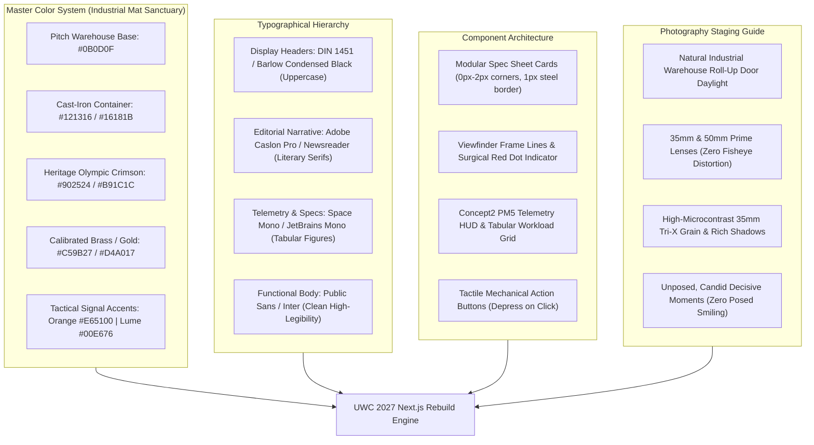

> Part 3 of 3 of [top_10_non_clothing_analogous_brands](../top_10_non_clothing_analogous_brands.md). Text is verbatim from the original; only links were rewritten.

## 4. The Unified 2027 Master Visual Direction: "The Industrial Mat Sanctuary"

By synthesizing the structural engineering of Rogue and Milwaukee, the documentary soul of YETI and Leica, the physiological rigor of Concept2 and LMNT, the literary dignity of The Surfer's Journal, and the unbending standards of TRD and IronMind, United Wrestling Club establishes a master visual language tailored for its physical reality:



---

### A. Master Design Tokens (`globals.css` / Tailwind Config)

```css
:root {
  /* ==========================================================
     THE INDUSTRIAL MAT SANCTUARY: MASTER CSS DESIGN TOKENS
     Synthesized across Rogue, YETI, Concept2, Milwaukee, 
     G-Shock, TRD, Leica, LMNT, TSJ, and IronMind.
     ========================================================== */

  /* Surface & Container Grounds */
  --uwc-bg-void: #0B0D0F;              /* Deep warehouse perimeter black */
  --uwc-bg-surface: #121316;           /* Cast-iron primary background */
  --uwc-bg-card: #181A1E;              /* Elevated matte tool steel container */
  --uwc-bg-card-spec: #1E2127;         /* High-density telemetry box surface */
  --uwc-bg-canvas-light: #F9F8F5;      /* Heavy uncoated book paper (TSJ editorial) */

  /* Border & Chamfer Grids */
  --uwc-border-steel: #262B33;         /* 1px structural steel gridline */
  --uwc-border-hairline: #3A3F47;      /* 1px chamfered edge separator */
  --uwc-border-chrome: #C8C7C3;        /* Leica satin chrome viewfinder border */

  /* Signature Heritage & Authority Accents */
  --uwc-accent-crimson: #902524;       /* Heritage Afghan/Olympic Crimson (Rogue/UWC) */
  --uwc-accent-crimson-hover: #AA2C2B;
  --uwc-accent-brass: #C59B27;         /* Eleiko & IronMind calibrated medal gold */
  --uwc-accent-telemetry: #8D9A88;     /* Concept2 PM5 monochromatic LCD slate */
  --uwc-accent-orange: #E65100;        /* TRD Heritage & G-Shock emergency orange */
  --uwc-accent-red-dot: #E3001B;       /* Surgical Leica live active dot */
  --uwc-accent-lume: #00E676;          /* Sinn/Tudor phosphorescent active mat signal */

  /* Text & Ink Tokens */
  --uwc-text-primary: #F9FAFB;         /* Crisp high-contrast readout white */
  --uwc-text-muted: #9CA3AF;           /* Gunmetal secondary spec copy */
  --uwc-text-dark-ink: #1C1D1F;        /* Carbon printer's ink on light editorial canvas */
  --uwc-text-stamp: #6B7280;           /* Archival metadata and USAW license text */

  /* Typography Stacks */
  --uwc-font-display: 'Barlow Condensed', 'DIN 1451', -apple-system, sans-serif;
  --uwc-font-editorial: 'Newsreader', 'Adobe Caslon Pro', Georgia, serif;
  --uwc-font-mono: 'Space Mono', 'JetBrains Mono', SFMono-Regular, monospace;
  --uwc-font-sans: 'Public Sans', 'Inter', -apple-system, sans-serif;

  /* Structural Geometry */
  --uwc-radius-none: 0px;              /* Hard-forged industrial permanence */
  --uwc-radius-tight: 2px;             /* Subtle machine-tooled corner */
  --uwc-radius-max: 4px;               /* Absolute maximum; no bubbly rounded pills */
}
```

---

### B. Typography Pairings & Hierarchy

| Role | Font Family | Weight | Case & Tracking | Leading | Direct Analogous Influence |
| :--- | :--- | :--- | :--- | :--- | :--- |
| **Monolithic Display Headers** | `Barlow Condensed` / `DIN 1451` | `900` (Black) | UPPERCASE, `-0.03em` | `0.95` | Milwaukee Tool, Rogue Fitness, G-Shock |
| **Archival Heritage Headers** | `Newsreader` / `Adobe Caslon Pro` | `400` (Regular / Italic) | Sentence Case, `+0.02em` | `1.20` | The Surfer's Journal, Leica Camera |
| **Telemetry & Data Numerals** | `Space Mono` / `JetBrains Mono` | `700` (Bold) | Tabular Figures, `+0.04em` | `1.00` | Concept2 PM5, LMNT Science, IronMind |
| **Functional Body Text** | `Public Sans` / `Inter` | `400` (Regular) / `600` | Normal, `0.00em` | `1.60` | Toyota TRD, Sinn Horology, Rogue |
| **Metadata & Badging** | `DIN Pro` / `Space Mono` | `600` (Semi-Bold) | UPPERCASE, `+0.12em` | `1.00` | Leica Lens Engraving, USAW Badges |

---

### C. Master Component Architecture

#### 1. The High-Torque Program "Spec Sheet" Card (Rogue + Milwaukee + Concept2 Hybrid)

```html
<div class="relative bg-[#181A1E] border border-[#262B33] p-6 hover:border-[#902524] transition-colors duration-150 rounded-[2px] font-sans">
  <!-- Top Technical Header -->
  <div class="flex justify-between items-center pb-3 mb-4 border-b border-[#262B33]">
    <div class="flex items-center space-x-2">
      <span class="inline-block w-2 h-2 rounded-full bg-[#E3001B]"></span>
      <span class="font-mono text-[11px] uppercase tracking-widest text-[#C59B27]">SPEC // HS-CIF-01</span>
    </div>
    <span class="font-mono text-[11px] text-[#9CA3AF] tracking-wider">USAW SANCTIONED #513</span>
  </div>

  <!-- Title & Lineage -->
  <h3 class="font-display font-black text-3xl uppercase tracking-tight text-white mb-1">
    Scholastic CIF High School Prep
  </h3>
  <p class="text-xs uppercase tracking-wider text-[#9CA3AF] mb-5">
    Collegiate Hand-Fighting, Scramble Architecture & Periodized Engine
  </p>

  <!-- Technical Telemetry Data Grid (Concept2 / LMNT Style) -->
  <div class="grid grid-cols-2 gap-2 bg-[#0B0D0F] p-4 border border-[#262B33] mb-6 font-mono text-xs">
    <div>
      <span class="text-[#6B7280] block text-[10px] tracking-wider uppercase">SCHEDULE:</span>
      <span class="text-white font-medium">MON-THU 7:30–9:00 PM</span>
    </div>
    <div>
      <span class="text-[#6B7280] block text-[10px] tracking-wider uppercase">LEAD COACH:</span>
      <span class="text-white font-medium">NAWEED Z. (CHABOT / SF STATE)</span>
    </div>
    <div>
      <span class="text-[#6B7280] block text-[10px] tracking-wider uppercase">MAT HYGIENE:</span>
      <span class="text-emerald-400 font-medium">HOSPITAL-GRADE 2X/DAY</span>
    </div>
    <div>
      <span class="text-[#6B7280] block text-[10px] tracking-wider uppercase">COACH RATIO:</span>
      <span class="text-white font-medium">1 : 8 MAXIMUM MAT LOAD</span>
    </div>
  </div>

  <!-- Utilitarian Action Button (Milwaukee / Rogue Style) -->
  <button class="w-full bg-[#902524] hover:bg-[#AA2C2B] text-white font-display font-bold text-sm uppercase tracking-widest py-3.5 px-4 rounded-[2px] transition-all active:translate-y-0.5">
    Reserve 1-Day Evaluation Pass ($15) &rarr;
  </button>
</div>
```

#### 2. The Leica-Inspired "Viewfinder" Archival Story Card (Leica + The Surfer's Journal)

```html
<div class="relative bg-[#121316] text-[#F7F6F2] p-6 border border-[#262B33] font-mono rounded-[2px]">
  <!-- Viewfinder Metadata Row -->
  <div class="flex justify-between items-center text-[10px] tracking-widest text-[#8A8883] border-b border-[#262B33] pb-3 mb-4">
    <div class="flex items-center space-x-2">
      <span class="inline-block w-2 h-2 rounded-full bg-[#00E676] animate-pulse"></span>
      <span>HAYWARD ARCHIVE // INDUSTRIAL PKWY</span>
    </div>
    <span>35MM DOCUMENTARY PRIME</span>
    <span>EST. 1980 MOSCOW LINEAGE</span>
  </div>

  <!-- Main Image with Rangefinder Corner Crop Lines -->
  <div class="relative overflow-hidden mb-4 border border-[#262B33]">
    
    <div class="absolute top-2 left-2 w-3 h-3 border-t-2 border-l-2 border-[#C8C7C3]/70"></div>
    <div class="absolute top-2 right-2 w-3 h-3 border-t-2 border-r-2 border-[#C8C7C3]/70"></div>
    <div class="absolute bottom-2 left-2 w-3 h-3 border-b-2 border-l-2 border-[#C8C7C3]/70"></div>
    <div class="absolute bottom-2 right-2 w-3 h-3 border-b-2 border-r-2 border-[#C8C7C3]/70"></div>
  </div>

  <!-- Literary Monograph Caption -->
  <p class="font-serif italic text-base text-[#D6CEBE] leading-relaxed mb-2">
    "The mat does not care where you come from or what you say. It only respects leverage, conditioning, and truth."
  </p>
  <span class="text-[11px] font-sans uppercase tracking-wider text-[#9CA3AF]">
    — Coach Karim Zemaryalai (1980 Olympian, Kabul & Dagestan Veteran)
  </span>
</div>
```

---

### D. Photography Staging & Lighting Directive for Hayward

To ensure all photography produced for UWC's 2027 launch adheres to this master standard, photographer briefs must enforce the following four rules:

1. **Natural Industrial Lighting Only:**
   - Shoot during late afternoon (4:00 PM – 7:30 PM) when the Hayward warehouse roll-up doors are open to Industrial Parkway.
   - Use natural sunlight streaming across the vinyl mats mixed with ambient overhead shop fixtures. Zero bright flash units, zero colorful LED neon tubes.
2. **Fixed 35mm and 50mm Prime Lenses:**
   - Strictly prohibit wide-angle fisheye lenses or heavy telephoto zoom compression. Images must represent the natural field of vision of a human being standing mat-side.
3. **Decisive-Moment Candid Reality:**
   - Zero staged poses. Zero athletes looking into the lens with forced smiles. Zero fake snarling at the camera.
   - Capture real moments: Coach Karim physically adjusting an athlete's wrist-tie; Coach Naweed drawing a leverage vector on a whiteboard; a high school wrestler sitting on a wooden bench untying worn wrestling shoes with sweat dripping onto the floor.
4. **Authentic Micro-Texture & High Microcontrast:**
   - Emphasize the tactile reality of the sport: chalk dust settling on black mat borders, salt stains on cotton tees, taped fingers, and honest exhaustion.

---

## 5. Strategic Takeaways for the Pitch to Naweed & Karim

When Sprintz presents this master brand framework to Naweed and Karim Zemaryalai, anchor the pitch in these three commercial arguments:

1. **Transforming the Industrial Warehouse from a Liability into UWC's Greatest Asset:**
   - Strip-mall karate dojos and corporate gym franchises spend millions trying to look clean and domestic. UWC's location in an industrial flex park on Industrial Parkway is an authentic, rare treasure. Borrowing from Rogue, Milwaukee Tool, and YETI makes the warehouse feel like a **hallowed ground of physical labor**—a destination where serious people build unbreakable character.
2. **Winning High-Intent East Bay Parents (Safety & Character Over Fluff):**
   - High-income parents in Fremont, Castro Valley, Hayward Hills, and Union City are terrified of aggressive, meathead fight gyms and disgusted by commercial McDojos that charge $80 for plastic belt tests. The quiet, calibrated aesthetic of Leica, Eleiko, and Concept2 proves that UWC is a **disciplined educational institution** led by an Olympian and a college kinesiology professor.
3. **Dominating Local Competitors (Zero Category Confusion):**
   - Every local combat sports competitor (Combat Sports Academy, Tri-Valley, Yard Dogs) uses generic black-and-red template sites or outdated WordPress blogs. This 10-brand non-clothing synthesis establishes UWC as Northern California's sole **Industrial Mat Sanctuary**, positioning it in a category of one for the next decade.
