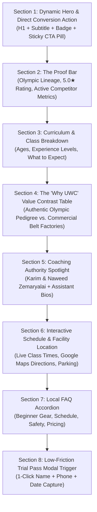

# Top 10 Data-Driven Programmatic Landing Pages: United Wrestling Club

> **Target Territory:** Alameda County (Hayward, Tri-City: Fremont/Union City/Newark, Castro Valley, San Leandro, Oakland)  
> **Framework:** Discipline + Geo-Intent Programmatic SEO Architecture  
> **Data Sources:** OpenSEO Labs Ranked Keywords, Local SERPs, Google Ads Search Volumes & CPC Metrics  
> **Updated:** October 30, 2026  

---

## 1. Matrix Overview: Top 10 High-Intent Programmatic Pages

To capture high-intent demand across Alameda County, this matrix blends **pure wrestling query patterns** with **high-volume, high-CPC buyer-intent martial arts keywords** (where parents and adult grapplers actively search for combat sports instruction).

| # | Page Route | Target Region | Core Target Keyword Cluster | Monthly Search Volume | KD | Est. CPC | Intent / Value Angle |
| :-: | :--- | :--- | :--- | :-: | :-: | :-: | :--- |
| **1** | `/wrestling-hayward-ca` | Hayward (HQ) | "wrestling gym" / "wrestling club" | 8,300 | 4–10 | $1.89 | Core brand & hometown academy anchor |
| **2** | `/youth-wrestling-east-bay` | Tri-City / Central County | "youth wrestling near me" / "youth wrestling clubs" | 7,600 | 4–6 | $3.22 | High-converting parent enrollment funnel |
| **3** | `/kids-martial-arts-hayward` | Hayward / Castro Valley | "martial arts for kids" / "kids martial arts near me" | 18,100 | 0–12 | $4.73 | High-value parent capture vs. commercial karate |
| **4** | `/wrestling-classes-fremont-ca` | Fremont (Tri-City) | "wrestling classes near me" / "wrestling Fremont" | 1,900 | 2 | $2.31 | Capture 230k population Tri-City vacuum |
| **5** | `/wrestling-club-union-city` | Union City (Tri-City) | "wrestling clubs near me" / "wrestling Union City" | 8,100 | 2 | $1.40 | James Logan High / MVAL scholastic pipeline |
| **6** | `/adult-wrestling-bay-area` | Alameda County / East Bay | "adult wrestling clubs near me" / "club wrestling adults" | 2,740 | 4–12 | $1.82 | Adult takedowns & fitness without college room |
| **7** | `/bjj-takedowns-wrestle-jitsu` | Alameda County / NorCal | "bjj near me" / "bjj classes near me" / "bjj takedowns" | 68,480 | 17–21 | $3.96 | Guard-puller antidote for East Bay grapplers |
| **8** | `/martial-arts-fremont-ca` | Fremont / Newark | "martial arts fremont ca" / "mixed martial arts near me" | 40,710 | 0–13 | $2.86 | Captures Tri-City combat sports searchers |
| **9** | `/competition-team-pre-k-12` | NorCal / CIF / SCYWAY | "wrestling teams" / "wrestling tournaments near me" | 2,600 | 4–20 | $3.87 | Elite scholastic year-round travel squad |
| **10** | `/open-mat-wrestling-grappling` | East Bay / Oakland / Fremont | "open mat wrestling near me" / "open mat bay area" | 1,070 | 0–19 | $1.23 | Regional Saturday 10AM–12PM $15 drop-in magnet |

---

## 2. Standardized Page Layout Schema (Section-by-Section Blueprint)

Every programmatic landing page must enforce this unified 8-section layout. This eliminates thin content penalties, satisfies Google's Helpful Content System, embeds rich JSON-LD schema, and drives conversion.

### Section-by-Section Wireframe Specification



#### Section 1: Hero & Conversion Hook (`<header>` / `<section class="hero">`)
* **H1 Tag Pattern:** `[Core Discipline / Keyword] in [City / Region] | United Wrestling Club`
* **Subheadline Pattern:** Specific value proposition highlighting Olympic lineage, age brackets (Pre-K to Adult), and beginner-friendly environment.
* **Trust Badges:** `1980 Olympic Qualifier Lineage` · `5.0★ Google Rated (42 Reviews)` · `Hayward, CA Facility`.
* **Primary CTA:** High-contrast button: `Claim Free 1-Day Trial Pass` (opens native modal, no external redirect).
* **Secondary CTA:** `Call / Text Coach Naweed: (510) 303-4869`.

#### Section 2: Authority & Social Proof Bar (`<section class="proof-bar">`)
* **Live Counter / Highlights:**
  * 42 Five-Star Google Reviews (100% 5-Star).
  * 1980 Moscow Olympics Qualified Founder (Karim Zemaryalai).
  * Collegiate Kinesiology & Chabot College Coaching Staff (Naweed Zemaryalai).
  * 30139 Industrial Pkwy SW Location (Minutes from I-880).

#### Section 3: Curriculum & Technical Breakdown (`<section class="curriculum">`)
* **H2:** `What You Will Learn in Our [City / Discipline] Program`
* **Structure:** 3–4 card grid detailing:
  1. *Stance, Motion & Level Changes:* Biomechanical foundations.
  2. *High-Percentage Takedowns:* Folkstyle & Freestyle leg attacks, upper-body throws, and snap-downs.
  3. *Mat Control & Defense:* Escapes, reversals, ride time, and safe falling mechanics.
  4. *Live Mat Application:* Controlled situational drilling and live goes matched by size and skill.

#### Section 4: The Strategic Contrast Matrix (`<section class="comparison">`)
* **H2:** `How United Wrestling Club Compares to Typical [City] Martial Arts Schools`
* **Comparison Table:**

| Feature / Standard | Typical Commercial Martial Arts / Karate | United Wrestling Club (UWC) |
| :--- | :--- | :--- |
| **Instructional Lineage** | Franchise black belts / strip-mall instructors | **1980 Moscow Olympic Qualifier & Dagestan Medalist** |
| **Discipline Reality** | Kata, air punching, expensive belt promotion fees | **Real Olympic Folkstyle/Freestyle, Sambo & Wrestle-Jitsu** |
| **Conditioning Output** | Low-to-moderate cardio drills | **Elite functional grappling strength, agility, and stamina** |
| **Sparring & Pressure** | Zero full-contact resistance | **Controlled live wrestling against resisting partners** |
| **Pricing Model** | $250+/mo long-term lock-in contracts | **Flexible monthly memberships ($89.99–$150/mo), no long contracts** |

#### Section 5: Coaching Pedigree Spotlight (`<section class="coaches">`)
* **H2:** `Led by Real Competitors and Collegiate Coaches`
* **Coach Cards:**
  * *Naweed Zemaryalai:* Head Coach, Chabot College Coach, SF State Kinesiology.
  * *Karim Zemaryalai:* Founder, 1980 Olympian, Ali Aliyev Tournament Medalist.
  * *Discipline Specialists:* Sandeep Singh Gosal (Youth Comp), Farid (Boxing), Sambo Master Instructor (Kyrgyzstan).

#### Section 6: Schedule, Facility & Map (`<section class="schedule-location">`)
* **H2:** `Class Schedule & Easy Commute from [City]`
* **Schedule Snippet:** Exact class days and times for the targeted program.
* **Directions Snippet:** *"Located right off I-880 on Industrial Pkwy SW. 6 minutes from Union City, 9 minutes from Fremont, 8 minutes from Castro Valley."*
* **Embedded Google Map:** Responsive iframe pointing to `CID: 16896090141452237997`.

#### Section 7: Local FAQ Accordion (`<section class="faq">`)
* **H2:** `Frequently Asked Questions About [Program] in [City]`
* 4–5 expandable questions incorporating structured FAQPage schema:
  1. *Do I or my child need prior wrestling or martial arts experience?*
  2. *What gear or clothing is required for the first free class?*
  3. *How does wrestling help student athletes in high school or other sports?*
  4. *Where exactly is the facility located and where do we park?*

#### Section 8: Final High-Converting Trial Intake (`<section class="final-cta">`)
* **Form Embed:** 4-field frictionless lead capture:
  * Name (Parent / Athlete)
  * Phone Number (for SMS confirmation)
  * Email Address
  * Select Class Date (Mon/Tue/Wed/Thu/Fri/Sat)
* **Button:** `Confirm Free Trial Class →`

---

## 3. High-Value "Martial Arts" Expansion Strategy

### Why Layer "Martial Arts" Keywords?
While wrestling has dedicated organic searchers, queries containing *"martial arts"* carry **5x to 10x the monthly search volume** with massive local commercial intent:
* *"martial arts near me"*: **90,500/mo** (KD: 9, CPC: $2.68).
* *"mixed martial arts near me"*: **40,500/mo** (KD: 13, CPC: $1.70).
* *"martial arts for kids near me"*: **18,100/mo** (KD: 0, CPC: $4.73).
* *"fremont martial arts"* / *"martial arts fremont ca"*: **420/mo** combined (KD: 0, CPC: $2.86).

Parents searching for "martial arts" generally want three core outcomes:
1. **Discipline and self-confidence.**
2. **Real self-defense against bullies.**
3. **High-energy physical fitness.**

By deploying dedicated martial arts landing pages (Pages #3 and #8), UWC intercepts parents before they enroll in expensive, low-intensity strip-mall karate studios, positioning Olympic wrestling and Brazilian Jiu-Jitsu as **the ultimate, practical martial art**.

---

## 4. Deep-Dive Blueprints for Key Strategic Pages

### Blueprint 3: `/kids-martial-arts-hayward`
* **Target Intent:** Parents searching for kids karate, taekwondo, or martial arts in Hayward and Castro Valley.
* **Primary Keyword:** *"kids martial arts near me"* (18,100 vol, KD 0, CPC $4.73), *"hayward martial arts"* (40 vol, KD 0, CPC $4.16).
* **Strategic Positioning:** *"Why Olympic Wrestling & BJJ Beat Traditional Karate for Kids."*
* **Content Angle:** Explain how wrestling teaches practical takedown defense, body control, and mental toughness without striking or concussion risk.
* **Target Offer:** Free Youth Mat Assessment & Trial Class.

### Blueprint 7: `/bjj-takedowns-wrestle-jitsu`
* **Target Intent:** Adult grapplers in Hayward, Fremont, and Oakland frustrated with guard-pulling culture who want aggressive takedowns and top control.
* **Primary Keyword:** *"bjj near me"* (40,500 vol, KD 21, CPC $1.97), *"bjj classes near me"* (27,100 vol, KD 17, CPC $3.96), *"wrestle jitsu"* (880 vol, KD 3).
* **Strategic Positioning:** *"The Missing Link in Your BJJ Game: High-Percentage Olympic Takedowns & Dominant Heavy Top Pressure."*
* **Content Angle:** Taught by collegiate wrestlers who hold legitimate BJJ black belts. Bridges the gap between IBJJF rules, ADCC submission grappling, and collegiate wrestling ride time.
* **Target Offer:** Free Grappler Takedown Diagnostic Session.

### Blueprint 8: `/martial-arts-fremont-ca`
* **Target Intent:** Adults and parents in Fremont searching for high-level combat sports training.
* **Primary Keyword:** *"martial arts fremont ca"* (210 vol, KD 0, CPC $2.86), *"fremont martial arts"* (210 vol, KD 0, CPC $2.86), *"mixed martial arts near me"* (40,500 vol, KD 13).
* **Strategic Positioning:** *"Fremont's Gateway to Olympic Wrestling, No-Gi Jiu-Jitsu & Combat Sambo (Just 7 Minutes Away)."*
* **Content Angle:** Compare UWC's multi-discipline combat coaching against generic strip-mall studios. Easy commute up I-880 or Mission Blvd.
* **Target Offer:** Free 1-Day All-Access Pass.

---

## 5. Structured Data (JSON-LD) Specification for All 10 Pages

Every page template will automatically inject standardized Schema.org JSON-LD linking `SportsClub`, `BreadcrumbList`, and `FAQPage`:

```html
<script type="application/ld+json">
{
  "@context": "https://schema.org",
  "@graph": [
    {
      "@type": "SportsClub",
      "@id": "https://www.unitedwrestlingclub.com/#organization",
      "name": "United Wrestling Club",
      "url": "https://www.unitedwrestlingclub.com",
      "telephone": "+1-510-303-4869",
      "email": "unitedwrestlingclub@gmail.com",
      "priceRange": "$15 - $150",
      "address": {
        "@type": "PostalAddress",
        "streetAddress": "30139 Industrial Pkwy SW Ste C",
        "addressLocality": "Hayward",
        "addressRegion": "CA",
        "postalCode": "94544",
        "addressCountry": "US"
      },
      "geo": {
        "@type": "GeoCoordinates",
        "latitude": 37.6091918,
        "longitude": -122.0673447
      },
      "areaServed": [
        {"@type": "City", "name": "Hayward"},
        {"@type": "City", "name": "Fremont"},
        {"@type": "City", "name": "Union City"},
        {"@type": "City", "name": "Newark"},
        {"@type": "City", "name": "Castro Valley"},
        {"@type": "City", "name": "San Leandro"},
        {"@type": "AdministrativeArea", "name": "Alameda County"}
      ]
    },
    {
      "@type": "BreadcrumbList",
      "itemListElement": [
        {
          "@type": "ListItem",
          "position": 1,
          "name": "Home",
          "item": "https://www.unitedwrestlingclub.com"
        },
        {
          "@type": "ListItem",
          "position": 2,
          "name": "Programs",
          "item": "https://www.unitedwrestlingclub.com/classes"
        },
        {
          "@type": "ListItem",
          "position": 3,
          "name": "[Page Program Name]",
          "item": "https://www.unitedwrestlingclub.com/[page-slug]"
        }
      ]
    },
    {
      "@type": "FAQPage",
      "mainEntity": [
        {
          "@type": "Question",
          "name": "Do beginners or kids need prior experience to join?",
          "acceptedAnswer": {
            "@type": "Answer",
            "text": "No prior experience is necessary. Our coaches specialize in teaching foundational athletic movement, stance, and basic techniques in a controlled, supportive environment."
          }
        },
        {
          "@type": "Question",
          "name": "What should I wear to my first free trial class?",
          "acceptedAnswer": {
            "@type": "Answer",
            "text": "Athletic shorts (without zippers or pockets) and a clean t-shirt or rashguard. Wrestling shoes or bare feet on the mats. Bring a water bottle."
          }
        }
      ]
    }
  ]
}
</script>
```

---

## 6. Implementation Rollout Schedule

```
Phase 1 (Week 1): Deploy /wrestling-hayward-ca, /youth-wrestling-east-bay, and /kids-martial-arts-hayward.
Phase 2 (Week 2): Deploy Tri-City pages (/wrestling-classes-fremont-ca, /wrestling-club-union-city, /martial-arts-fremont-ca).
Phase 3 (Week 3): Deploy adult grappling pages (/adult-wrestling-bay-area, /bjj-takedowns-wrestle-jitsu, /open-mat-wrestling-grappling).
Phase 4 (Week 4): Deploy /competition-team-pre-k-12 and connect automated SMS trial reminders.
```
