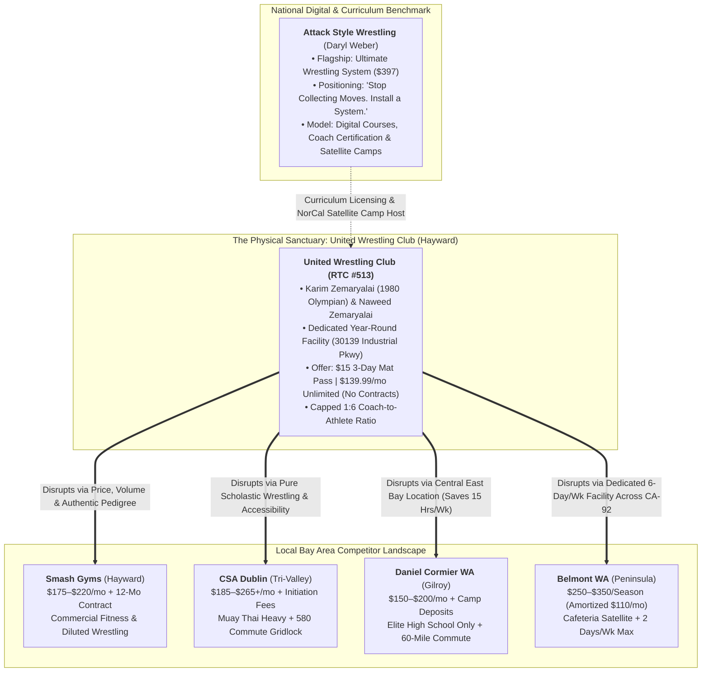
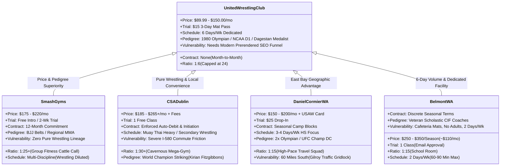
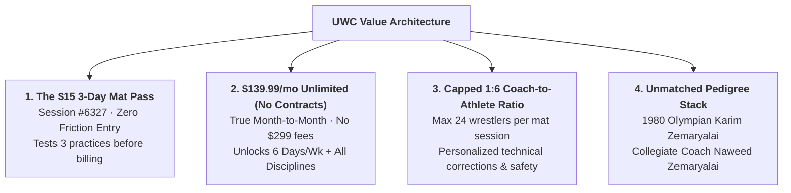

# Attack Style Wrestling & Competitor Offers Audit: Strategic Synthesis
## Technical Analysis, Positioning Intelligence & Regional Value Architecture for United Wrestling Club (UWC)

> **Client:** United Wrestling Club (Hayward, CA)  
> **Facility Address:** 30139 Industrial Pkwy SW Ste C, Hayward, CA 94544  
> **Executive Leadership:** Coach Karim Zemaryalai (1980 Moscow Olympian & Ali Aliyev Dagestan Medalist) & Coach Naweed Zemaryalai (Chabot College Wrestling Coach / Kinesiology Faculty)  
> **Document Code:** `UWC-DISCOVERY-ASW-COMPETITOR-OFFERS-V1`  
> **Date:** November 2026  
> **Deliverable Path:** `discovery/market/attack_style_wrestling_and_competitor_offers.md`  

---

## Executive Summary: The Strategic Matrix

United Wrestling Club (UWC) possesses the most authentic international and collegiate wrestling pedigree in Northern California. Operating out of an unvarnished industrial flex park on Industrial Parkway in Hayward, UWC bridges elite Olympic/Caucasian freestyle lineage with practical scholastic CIF development and adult No-Gi "Wrestle-Jitsu."

However, combat sports consumers in Alameda, Santa Clara, Contra Costa, and San Mateo counties are consistently routed toward commercial fitness chains, MMA mega-gyms, or distant satellite rooms due to two primary factors:
1. **Aggressive Digital Funnels & Packaging:** Commercial competitors package average training into frictionless intro passes, high-gloss branding, and structured memberships.
2. **The "Move Collector" Trap:** Recreational grapplers and scholastic athletes waste years collecting isolated techniques from social media rather than mastering an integrated wrestling system.

This discovery audit provides a two-part operational blueprint:
* **Part I: Deep Profile of Attack Style Wrestling (ASW):** Analyzing Daryl Weber’s nationally dominant digital training platform, deconstructing the flagship **Ultimate Wrestling System ($397)**, unpacking the core positioning hook (*"Stop collecting moves. Install a system"*), and establishing an actionable partnership framework for UWC as **USA Wrestling Regional Training Center #513 (RTC #513)**.
* **Part II: Bay Area Competitor Offer & Schedule Audit:** A granular teardown of four key regional contenders—**Smash Gyms (Hayward Hub)**, **Combat Sports Academy / CSA (Dublin)**, **Daniel Cormier Wrestling Academy / DCWA (Gilroy)**, and **Belmont Wrestling Academy / Peninsula WC (Peninsula)**—exposing their contract lock-ins, schedule friction, and coaching vulnerabilities against UWC's **$15 3-Day Mat Pass**, **$139.99/mo Unlimited (No Contracts)**, and **1:6 Coach-to-Athlete Ratio**.

---

# PART I: Deep Profile of Attack Style Wrestling (ASW)

## 1. Founder Dossier: Daryl Weber

* **Website:** [`attackstylewrestling.com`](https://attackstylewrestling.com/)
* **Athletic Pedigree:** 
  * 1996 NCAA Division I National Champion at the University of Iowa under legendary head coach **Dan Gable**.
  * 3-time NCAA Division I All-American.
  * Member of Dan Gable’s historic University of Iowa dynasty, renowned for extreme pace, mental conditioning, aggressive hand-fighting, and relentless forward pressure.
* **Coaching Dynasty:**
  * Former Head Coach at Christiansburg High School (Christiansburg, Virginia).
  * Built one of the most dominant high school wrestling dynasties in United States scholastic history, winning **14 consecutive Virginia State Team Championships**.
  * Coached over **40 individual state champions**, numerous high school All-Americans, and collegiate Division I competitors.
* **Core Philosophy & Mission:**
  Daryl Weber translated Dan Gable’s legendary University of Iowa training philosophy into a repeatable, modular teaching framework that works for elementary, middle school, and high school athletes. Weber realized that while coaches and athletes desire Gable-level intensity, they fail because they lack structured practice roadmaps and teach isolated, disconnected moves. ASW was founded to democratize championship-level training systems for athletes, parents, and wrestling coaches nationwide.

---

## 2. Core Product Portfolio & Price Architecture

Attack Style Wrestling operates primarily as a high-margin digital education platform, supplemented by coach certification subscriptions and regional clinic hosting.

| Product Tier | Product Name | Price Point | Format & Delivery | Core Value Proposition |
| :--- | :--- | :---: | :--- | :--- |
| **Flagship Course** | **The Ultimate Wrestling System (UWS)** | **$397.00** *(or 3 payments of $147)* | Lifetime digital streaming access (Video portal, mobile-responsive) | The complete, end-to-end blueprint covering all positions: takedowns, bottom escapes, top pinning, front headlocks, setups, and drilling progressions. |
| **Positional System** | **Ultimate Takedown System** | **$97.00 – $127.00** | On-demand video library | High-percentage finishes for single legs, double legs, high crotches, and low singles under live defensive resistance. |
| **Positional System** | **Setup Mastery System** | **$67.00 – $97.00** | On-demand video course | The "5 Ingredients of Setups." Eliminates blind shooting; teaches hand fighting, clearing ties, collar ties, underhooks, and Russian 2-on-1s. |
| **Positional System** | **Escapes & Reversals System** | **$67.00 – $97.00** | On-demand video course | Systematic bottom wrestling: clearing wrist control, explosive stand-ups, switch series, and Granby rolls against heavy mat-riders. |
| **Positional System** | **Pinning & Turns System** | **$67.00 – $97.00** | On-demand video course | High-leverage top turns: cradles, arm bars, cross-face tilts, and half-nelsons designed to terminate matches by fall. |
| **Specialized Pack** | **Front Headlock Offense & Defense** | **$47.00 – $67.00** | Targeted video module | The front headlock series: gator rolls, shucks, cement mixers, front headlock defense, and scoring from the front sprawl. |
| **Specialized Pack** | **Skill Development & Drills Pack** | **$39.00 – $47.00** | Printable templates & drill video clips | High-repetition practice drills, reaction drills, and conditioning templates that bridge practice technique into live match execution. |
| **Mindset / Culture** | **Gable Mentality & Mindset Training** | **$47.00 – $67.00** | Audio/video mindset series | Pre-match routines, mental toughness training, overcoming match anxiety, and embracing discomfort. |
| **Coach Platform** | **Gable Trained Coach Membership** | **$29.00 – $49.00/mo** *(or $297.00/yr)* | Recurring SaaS community & coaching portal | Complete season practice blueprints, Standards of Learning (SOL) curriculum tracks, and practice planning templates. |
| **Physical Clinics** | **Attack Style Satellite Camps & Clinics** | **$150.00 – $225.00** per athlete | 2 to 3-day regional physical clinic hosted at partner facilities | Intensive physical camp run by Daryl Weber or certified staff; host club provides facility and shares registration revenue. |

---

## 3. Core Positioning Hook & Underlying Philosophy

### The Core Hook: *"Stop collecting moves. Install a system."*

Weber identified the single greatest technical bottleneck across American wrestling:
> **The Move Collector Trap:** Young wrestlers and well-meaning coaches consume hundreds of YouTube, TikTok, and Instagram clips. They accumulate 50 unrelated moves (a sweep single from one creator, an ankle pick from another, a funky roll from a highlight reel). In a high-pressure match against an aggressive opponent, their cognitive load spikes, they hesitate, and they freeze. They know fifty moves, but they own zero completed sequences.

### The Attack Style Philosophy: The 4 Tenets of a Systematic Wrestler
1. **Position-Solved Cascades:** A system defines exactly what happens at every node of an exchange. If you shoot a sweep single and your opponent sprawls, the system dictates the immediate transition (e.g., shelf the leg $\rightarrow$ drive across $\rightarrow$ or drop to ankle pick). If they block the head, you transition instantly to a front headlock. There is no thinking; there is only conditioned chaining.
2. **Setup Over Shot:** 90% of missed takedowns are not bad shots; they are shots taken without setups. Attack Style prioritizes violent hand fighting, snapping, collar-tie control, and level changes before penetration.
3. **The Gable Factor (Pace as a Weapon):** Borrowing Dan Gable’s core tenet—*"I never wrestled a guy who was tired, because they always quit before they got tired"*—Weber’s system uses relentless, non-stop forward offense to physically and mentally break opponents by the second period.
4. **Standards of Learning (SOL) Progression:** Technique is segmented into logical skill ladders (Novice $\rightarrow$ Intermediate $\rightarrow$ Advanced). Coaches do not invent practice on the drive to the gym; they execute calibrated progressions.

---

## 4. Strategic Fit for United Wrestling Club

### Digital Curriculum Provider vs. Physical Competitor
Attack Style Wrestling is a **digital content and curriculum company**, not a brick-and-mortar gym competitor. ASW does not operate a physical mat facility in the San Francisco Bay Area or Northern California.
* **No Direct Mat Competition:** ASW does not compete with UWC for local Alameda County youth, middle school, or adult grapplers.
* **Ideal Symbiotic Fit:** Online video platforms cannot replace physical mat hours, live partner resistance, or real-time coach feedback. ASW’s digital training makes an athlete *smarter*, but they still require a dedicated, world-class physical room like UWC to *install and test* the system.
* **The RTC #513 Edge:** UWC is registered as USA Wrestling Regional Training Center #513 (WrestlingIQ Team #513). While ASW provides national curriculum authority, UWC provides the live training sanctuary and Olympic coaching staff.

---

## 5. High-Value Partnership & Revenue Opportunities

### Opportunity A: Host Regional NorCal ASW Satellite Camps at UWC (RTC #513)
UWC’s facility at `30139 Industrial Pkwy SW Ste C` in Hayward is strategically positioned at the geographic crossroads of Northern California (CA-92 San Mateo Bridge, I-880, and I-580 corridors).
* **The Camp Format:** Host an official 3-Day "Attack Style Wrestling NorCal Intensive" ahead of the high school winter season (October/November) or during the summer freestyle block (June/July).
* **Financial Model & Revenue Share:**
  * **Capacity:** 60 athletes across two mat surfaces.
  * **Tuition:** $195.00 per athlete for a 3-day clinic (15 total mat hours).
  * **Gross Revenue:** 60 athletes $\times$ $195 = **$11,700.00**.
  * **Revenue Split:** Typical 65/35 or 70/30 split between ASW (instruction/brand) and UWC (host facility/logistics). UWC captures **$3,500 – $4,100 in net profit** for a single weekend.
* **High-Intent Membership Pipeline:** 30%–40% of clinic attendees will be unattached scholastic wrestlers from local leagues (MVAL, WACC, EBAL, BVAL). Experiencing UWC’s facility and coaching staff during an ASW camp directly converts 10–15 new recurring members into UWC’s **$139.99/mo Varsity Track** or **$150/mo Competition Team**, generating an additional **$16,800 – $27,000 in annual recurring club tuition**.

### Opportunity B: Member Value Bundles & Curriculum Licensing
* **The "UWC Competition Team + Attack Style Digital Vault" Offer:**
  * Package ASW’s digital course access or Gable Trained drill libraries into UWC’s $150.00/mo Competition Team membership.
  * Marketing hook: *"Train live 6 days a week under 1980 Olympian Karim Zemaryalai; study national championship systems at home with on-demand Attack Style video access."*
* **Coaching Staff Standardization:**
  * Adopt Weber’s Standards of Learning (SOL) framework to standardize practice planning across UWC’s coaching bench (Naweed Zemaryalai, Sandeep Singh Gosal, Rashad Rahimi). This ensures substitute coaches follow the exact same technical progression.

---

## 6. Brand & Marketing Inspiration for UWC

United Wrestling Club can directly incorporate the best elements of ASW’s branding, messaging, and offer architecture into its live website and marketing funnels:

### 1. The "System vs. Moves" Copy Hook
UWC can adapt Weber’s hook to solve the specific pain points of Bay Area grapplers:
* **For Scholastic High School Wrestlers:**  
  > *"Stop collecting random YouTube moves that fail under live section pressure. Install an integrated Olympic and collegiate wrestling system under Coach Karim and Coach Naweed Zemaryalai."*
* **For Adult BJJ Grapplers (Wrestle-Jitsu):**  
  > *"Tired of giving up easy takedowns or pulling guard? Stop learning isolated sweeps. Install a complete hand-fighting, ankle-pick, and mat-return system that makes you impossible to take down."*

### 2. Brutalist, High-Contrast Visual Architecture
ASW eschews generic corporate fitness aesthetics in favor of high-impact, industrial combat cues:
* **Typography:** Bold, all-caps condensed athletic display typefaces (DIN Pro, Bebas Neue, Oswald) paired with crisp tabular mono numerals.
* **Palette:** Heavy black, charcoal slate, crisp white, and intense crimson/gold accents—mirroring UWC’s Afghan/Olympic heritage colors (`#121316` Dark Iron, `#902524` Heritage Crimson, `#C59B27` Calibrated Brass).
* **Authentic Imagery:** Candid, high-contrast chiaroscuro photography showing mat sweat, worn headgear, and unvarnished warehouse mats rather than smiling stock fitness models.

### 3. Modular Value Stacking & Risk-Reversal Framing
ASW succeeds by breaking a complex sport into digestible, outcome-oriented packages. UWC already replicates this by organizing its training into 4 clear tracks (Junior Olympian Foundation, Scholastic Varsity Pipeline, Adult Wrestle-Jitsu, and Women's Self-Defense) backed by clear risk reversals:
* UWC’s **$15 3-Day Mat Pass** (`WrestlingIQ Session #6327`).
* UWC’s **14-Day Mat-Fit Guarantee** (100% tuition refund if a child isn’t more confident within 14 days).

---

# PART II: Local Bay Area Competitor Offers & Schedule Audit

To dominate local search and conversion across Alameda, Contra Costa, and San Mateo counties, UWC must systematically exploit the vulnerabilities, pricing bloat, and schedule friction of its primary regional rivals.

---

## 1. Comprehensive Regional Competitor Matrix

| Competitor Gym | Facility Location & Type | Monthly Tuition Models | Contract Terms & Commitments | Drop-In / Intro Offer | Coach-to-Athlete Ratio | Schedule Volume & Friction | Core Disciplines | Primary Operational Vulnerabilities |
| :--- | :--- | :--- | :--- | :--- | :---: | :--- | :--- | :--- |
| **United Wrestling Club (UWC)** | **Hayward, CA** Dedicated Year-Round Industrial Mat Sanctuary | **$89.99/mo** (2-Day Kids) **$139.99/mo** (Unlimited HS/Adult) **$150.00/mo** (Comp Team) | **Zero Contracts** Honest Month-to-Month auto-renewal; cancel anytime | **$15.00 3-Day Mat Pass** *(Session #6327)* $15 Daily Drop-In | **1:6** Strictly capped at 24 athletes per session | **6 Days / Week** Mon–Fri afternoons & evenings + Saturday regional open mat | **Olympic Folkstyle, Freestyle, Greco, Sambo, Wrestle-Jitsu, Boxing** | Digital checkout previously routed to cold external WrestlingIQ URLs (currently being solved with native 1-click modal). |
| **Smash Gyms** | **Hayward Hub / Sunnyvale / San Jose** Commercial Fitness Franchise Network | **$175.00 – $220.00/mo** *(Student promo ~$100/mo; Family $300/mo up to 4)* | **12-Month Contracts** standard; early termination penalties; auto-renew lock-in | **Free 2-Week Trial** / Free Intro Class (lead capture funnel) | **1:20 to 1:30** Crowded commercial classes | **7 Days / Week** High schedule count, but wrestling is restricted to 1–2 auxiliary slots | **Muay Thai, BJJ, Kickboxing, Body Burn HIIT, Fitness** | Zero Olympic or NCAA D1 wrestling pedigree; wrestling is treated as basic takedown defense for casual hobbyists; aggressive contract billing. |
| **Combat Sports Academy (CSA)** | **Dublin / Pleasanton, CA** 25,000 sq ft Combat Mega-Gym | **$185.00 – $265.00+/mo** *(Single program to All-Access CrossFit; Family $350–$450+)* | **Structured Contracts** with initiation/enrollment fees; mandatory branded gear | **1 Free Trial Class** (strict local resident check) | **1:25 to 1:35** Massive team practices | **6 Days / Week** Heavy schedule, but requires rush-hour I-580 Dublin grade commute | **World-Class Muay Thai, BJJ, MMA, CrossFit, Youth Striking** | Overwhelming striking focus; pure scholastic Folkstyle/Freestyle is secondary; cavernous facility intimidates beginners; severe East Bay commute friction. |
| **Daniel Cormier Wrestling Academy (DCWA)** | **Gilroy, CA** Elite Feeder Center & High School Complex | **~$100.00/mo** (Baby Hawks 2x/wk) **$150.00 – $200.00/mo** (Comp Squad + Camps) | **Seasonal Blocks** & USA Wrestling card required; camp deposits | **$25.00 Drop-In** Walk-in rate | **1:12 to 1:18** High-pace competition room | **3–4 Days / Week** Intense evening blocks; 55–65 miles from East Bay hubs | **Pure Scholastic Folkstyle & Freestyle Wrestling** | Extreme geographic barrier (55–65 miles south; 2.5–3 hours round-trip in I-880/US-101 traffic); cutthroat room intimidates beginners; zero adult or self-defense classes. |
| **Belmont Wrestling Academy & Peninsula WC** | **Belmont & San Mateo, CA** High School Cafeteria / Multi-Purpose Satellites | **$250.00 – $350.00 per season** *(Averages ~$100–$120/mo amortized; $100/wk camps)* | **Discrete Seasonal Terms** (Fall, Winter, Spring, Summer); manual PDF forms | **1 Free Trial Class** (Requires advance email coach approval) | **1:12 to 1:16** Volunteer and scholastic staff | **2 Days / Week Only** (Tue/Thu 60–90 min); practices canceled during school holidays | **Scholastic Youth & High School Folkstyle Wrestling** | No dedicated year-round facility; mats rolled out in high school cafeterias; capped at only 2 practices per week; zero adult, BJJ, or self-defense tracks. |

---

## 2. In-Depth Competitor Profiles

---

### Competitor 1: Smash Gyms (Hayward / Alameda County Hub)
* **Digital Presence:** `smashgyms.com` | Organic Traffic: **1,052/mo** | Keywords: **88**
* **Google Business Profile:** 5.0★ (Chain aggregate across South Bay & East Bay)
* **Physical Footprint:** Commercial retail strip facilities featuring heavy bags, caged octagons, and turf areas.

#### Offer & Pricing Analysis
Smash Gyms operates on a classic high-volume commercial fitness model. While they aggressively advertise *"Free 2-Week Trials"* to capture parent phone numbers and emails, enrollment requires entering a **12-month auto-debit membership contract** ranging between **$175.00 and $220.00/month**. Canceling before the 12-month term incurs significant buyout fees or 30-to-60-day written cancellation notices. Families pay upwards of **$300.00/mo** for family packages.

#### Schedule & Operational Friction
Smash Gyms offers dozens of class times per week, but their schedule is dominated by **Body Burn HIIT, heavy-bag kickboxing, and adult BJJ**. Dedicated wrestling is virtually non-existent; at best, wrestling is offered as a 45-minute "MMA Takedowns" class once or twice per week taught by a regional pro fighter or BJJ purple/brown belt.

#### Critical Vulnerabilities vs. UWC
1. **No True Wrestling Pedigree:** Smash Gyms cannot compete with Coach Karim Zemaryalai (1980 Olympian, Dagestan Ali Aliyev medalist) or Coach Naweed Zemaryalai (Chabot College wrestling coach). Their coaches teach basic double-legs designed for MMA, lacking folkstyle ride mechanics, hand-fighting systems, and freestyle turns.
2. **The "Cattle-Call" Ratio:** Classes often cram 25 to 35 students on the mat with a single instructor, resulting in a dangerous **1:25+ coach-to-athlete ratio**.
3. **Contract Lock-In:** Parents and adults are locked into 1-year agreements. In contrast, UWC offers **honest month-to-month memberships ($139.99/mo)** with zero contracts.

---

### Competitor 2: Combat Sports Academy — CSA (Dublin / Tri-Valley)
* **Digital Presence:** `csagym.com` | Organic Traffic: **722/mo** | Keywords: **233**
* **Google Business Profile:** 4.8★ (320+ reviews)
* **Physical Footprint:** 25,000 sq ft mega-facility on Stoneridge Mall Rd in Dublin/Pleasanton, CA.

#### Offer & Pricing Analysis
CSA is an internationally recognized combat sports brand founded by US National Muay Thai team coach Kirian Fitzgibbons. It is also one of the most expensive gyms in California. Memberships range from **$185.00/mo** (single discipline) to **$265.00+/mo** (all-access combat + CrossFit). Enrollment requires upfront initiation fees, mandatory custom CSA fight gear purchases, and long-term billing agreements. For a family with two children, monthly dues frequently exceed **$400.00/mo**.

#### Schedule & Commute Friction
While CSA's facility is world-class, its location on the eastern side of the Dublin grade creates massive friction for East Bay families. Parents commuting from Hayward, Union City, Fremont, or San Leandro face the **brutal I-580 East rush-hour corridor**, turning an 18-mile drive into a 45-to-60-minute traffic grind each way.

#### Critical Vulnerabilities vs. UWC
1. **Striking-Centric Culture:** CSA is a world-renowned striking and Muay Thai powerhouse. Pure scholastic wrestling (Folkstyle, Freestyle, Greco-Roman) is treated as a secondary component to support MMA fighters. High school wrestlers seeking CIF State qualification will not find dedicated scholastic tournament coaching.
2. **Cavernous, Intimidating Environment:** The massive 25,000 sq ft warehouse with active UFC fighters, loud music, and heavyweight striking sparring can be terrifying for elementary and middle school beginners.
3. **Severe Price Premium:** UWC’s **$139.99/mo Unlimited** rate is nearly 45% lower than CSA’s all-access tier, while delivering authentic Olympic wrestling coaching right in Hayward.

---

### Competitor 3: Daniel Cormier Wrestling Academy (DCWA) / AWA (Gilroy)
* **Digital Presence:** `danielcormierwrestling.com` | Organic Traffic: **~380/mo** | Keywords: **62**
* **Google Maps Pack:** #3 Bay Area Local Pack (5.0★, 31 reviews in Gilroy)
* **Physical Footprint:** Dedicated training facility in Gilroy, CA, partnered with Gilroy High School.

#### Offer & Pricing Analysis
Led by two-time Olympian and UFC Hall of Famer Daniel Cormier, DCWA is a national scholastic wrestling powerhouse. Pricing is relatively accessible for serious competitors (**~$100/mo** for Baby Hawks 2x/wk; **$150–$200/mo** for high school competition teams), but requires mandatory USA Wrestling memberships, seasonal camp fees, and travel team expenses. Single session drop-ins are **$25.00**.

#### Schedule & Commute Friction
Gilroy is situated at the southernmost tip of Santa Clara County, **55 to 65 miles south of Hayward, Fremont, and Oakland**. For an East Bay family, attending practice at DCWA requires driving down I-880 through San Jose traffic and onto US-101 South during peak evening commute hours—a **2.5 to 3-hour round-trip commitment per practice**.

#### Critical Vulnerabilities vs. UWC
1. **Geographic Impossibility for Weekday Training:** A Hayward or Fremont wrestler cannot sustain 4 to 6 practices a week in Gilroy without destroying family schedules and academic study hours.
2. **Hyper-Competitive Filter:** DCWA is tailored to established, elite CIF state qualifiers and national travel athletes. Novice elementary wrestlers or multi-sport high school beginners can easily get washed out or neglected.
3. **No Multi-Discipline Adult Grappling:** DCWA is purely a youth/high school wrestling room. It offers zero adult No-Gi "Wrestle-Jitsu", Combat Sambo, Gi BJJ, or Women’s Self-Defense.
4. **The Positioning Counter-Stroke:** UWC is the **"East Bay Cormier Academy"**—offering equal Olympic lineage (Karim Zemaryalai) and collegiate tournament coaching directly on Industrial Parkway in Hayward.

---

### Competitor 4: Belmont Wrestling Academy & Peninsula Wrestling Club
* **Digital Presence:** `peninsulawrestlingclub.com` | Organic Traffic: **75/mo** | Keywords: **25**
* **Google Maps Pack:** Belmont WA holds #1 Bay Area Local Pack (5.0★, 13 reviews) due to Peninsula proximity.
* **Physical Footprint:** High school cafeteria and multi-purpose room satellite mats at Carlmont High School (Belmont) and Serra/Aragon High Schools (San Mateo).

#### Offer & Pricing Analysis
Belmont WA and Peninsula WC are traditional scholastic feeder clubs run by veteran high school coaches Ricardo García and Mike Klobuchar. They operate on a **seasonal block tuition model** (**$250.00 – $350.00 per season**, which amortizes to ~$100–$120/mo). Registrations are handled via archaic downloadable PDF packets or SportsEngine portals, requiring manual coach email verification.

#### Schedule & Operational Friction
Practices are strictly limited to **2 days per week** (typically Tuesdays and Thursdays for 60 to 90 minutes). Because they operate inside high school cafeterias or aux gyms, **practices are frequently canceled** due to school board meetings, holiday closures, finals weeks, or campus maintenance, with zero makeup sessions provided.

#### Critical Vulnerabilities vs. UWC
1. **Low Mat Volume (2 Days vs. 6 Days):** A wrestler cannot build championship-level conditioning or technical mastery on 2 hours of mat time per week. UWC provides **6 days a week of training (Mon–Sat)**, delivering 300% more mat time.
2. **Cafeteria Satellite Facilities:** Rolling out mats in a school cafeteria surrounded by lunch tables lacks the focused, professional culture of UWC’s dedicated Industrial Parkway sanctuary.
3. **Zero Adult Grappling:** Neither club offers training for adults, BJJ practitioners, or college grapplers.
4. **The Trans-Bay Corridor Advantage:** UWC is located directly off CA-92 (San Mateo–Hayward Bridge). For Peninsula parents in San Mateo, Foster City, Belmont, and Redwood City, UWC is a fast 15-to-20-minute reverse commute across the bridge, offering a dedicated year-round wrestling home.

---

## 3. UWC's Disruptive Value Architecture

United Wrestling Club beats every commercial gym and scholastic satellite in the Bay Area across four pillars:

### Pillar 1: The $15 3-Day Mat Pass (`WrestlingIQ Session #6327`)
* **The Problem It Solves:** Commercial MMA gyms force parents into aggressive sales presentations or 12-month contracts after a single 30-minute intro class. Traditional high school clubs demand $300 upfront seasonal checks before a child even knows if they like wrestling.
* **The UWC Solution:** A frictionless **$15.00 3-Day Mat Pass**. For $5 a session, parents and athletes get 3 full practices across a single week to experience the coaching room, meet Coach Naweed and Coach Karim, and test their grit with zero ongoing billing commitment.

### Pillar 2: The $139.99/mo Unlimited Membership (Zero Contracts)
* **The Problem It Solves:** Bay Area BJJ academies and Smash Gyms charge $175 to $225/mo and enforce predatory 1-year auto-renewing contracts with cancellation penalties.
* **The UWC Solution:** Transparent, honest month-to-month billing at **$139.99/month**.
  * **6 Days a Week:** Monday through Friday training plus Saturday regional open mat.
  * **Multi-Discipline Access:** Unlocks Olympic Folkstyle, Freestyle, Greco-Roman, No-Gi "Wrestle-Jitsu", Gi BJJ, Combat Sambo, and Boxing Fundamentals under a single flat tuition.
  * **Zero Hidden Fees:** No mandatory $299 uniform gear packages, no registration fees, no cancellation penalties.

### Pillar 3: Capped 1:6 Coach-to-Athlete Ratio
* **The Problem It Solves:** Commercial gyms run profitable "cattle-call" classes where 30 to 40 kids are supervised by a single tired coach, resulting in poor technique, chaotic mat safety, and injuries.
* **The UWC Solution:** Strict cap of **24 athletes per youth session**, manned by a minimum of 3 to 4 coaches and senior mentors (Coach Karim, Coach Naweed, Coach Sandeep, Coach Rashad). This guarantees a **1:6 coach-to-athlete ratio**, ensuring every wrestler receives individual hand-fighting adjustments, stance corrections, and dedicated mat safety oversight.

### Pillar 4: The 1980 Olympic & Dagestan Pedigree Stack
* While commercial gyms hire casual hobbyist instructors and high school clubs rely on parent volunteers, UWC is led by **Karim Zemaryalai**—a 1980 Moscow Olympic qualifier and Ali Aliyev International Tournament medalist in Dagestan—alongside Chabot College wrestling coach **Naweed Zemaryalai**. UWC teaches authentic Caucasian, Russian, and collegiate chaining systems that cannot be replicated anywhere else in Northern California.

---

# PART III: Strategic Head-to-Head Battle Cards

These battle cards equip UWC front-desk staff, phone responders, and digital landing pages (`/compare/*`) to instantly neutralize competitor objections:

### Battle Card 1: UWC vs. Smash Gyms (Hayward)
* **Prospect Scenario:** An adult grappler or parent considering Smash Gyms for general martial arts/fitness in Hayward.
* **The Positioning Response:**
  > *"Smash Gyms is a great multi-location commercial fitness facility if you want heavy-bag cardio kickboxing and casual group workouts. But if you or your child want real, high-performance wrestling and grappling, Smash Gyms does not have an Olympic or NCAA Division 1 coaching staff. At Smash, you'll pay $180 to $220 a month locked into a 12-month contract for a crowded room with a 1:25 coach ratio. At United Wrestling Club, you train directly under 1980 Olympian Karim Zemaryalai and college coach Naweed Zemaryalai. We cap our youth room at a 1:6 ratio, we charge $139.99 a month with zero contracts, and you get 6 days a week of dedicated mat time. Try our $15 3-Day Mat Pass first and feel the difference."*

### Battle Card 2: UWC vs. Combat Sports Academy / CSA (Dublin)
* **Prospect Scenario:** A Tri-Valley or Hayward parent considering driving to Dublin for combat sports training.
* **The Positioning Response:**
  > *"CSA is world-famous for professional Muay Thai striking and MMA. But if your goal is scholastic wrestling, CIF high school podiums, or fundamental youth development, CSA is a striking mega-gym where wrestling is an afterthought for cage defense. Furthermore, you'll be paying $225 to $265 a month plus initiation fees, while spending 2 hours stuck in I-580 rush-hour traffic over the Dublin grade. UWC is right here on Industrial Parkway in Hayward. We are a pure wrestling sanctuary with 1980 Olympic pedigree, dedicated scholastic CIF competition tracks, and zero corporate mega-gym intimidation—at nearly half the monthly cost."*

### Battle Card 3: UWC vs. Daniel Cormier Wrestling Academy (Gilroy)
* **Prospect Scenario:** A serious high school wrestler or parent wondering if they should drive to Gilroy to train under Daniel Cormier.
* **The Positioning Response:**
  > *"Coach Cormier is an absolute legend and his Gilroy room is one of the best in America. But Gilroy is 60 miles south. Driving down I-880 through San Jose traffic every Tuesday and Thursday means spending 15 hours a week in a car. You cannot maintain school grades and athletic recovery with that commute. United Wrestling Club brings that exact same Olympic-caliber standard to the East Bay. Coach Karim Zemaryalai competed internationally in the same Olympic era and medaled at the Ali Aliyev tournament in Dagestan. Our travel team competes at the exact same SCYWAY, USA Wrestling, and CIF tournaments. Train at UWC 6 days a week, save 15 hours of driving, and sleep in your own bed."*

### Battle Card 4: UWC vs. Belmont Wrestling Academy (Peninsula)
* **Prospect Scenario:** A Peninsula parent in San Mateo, Belmont, or Foster City looking for youth wrestling options.
* **The Positioning Response:**
  > *"Belmont WA is a fine seasonal program run by good high school coaches. But they only practice 2 days a week for 60 to 90 minutes in a high school cafeteria, and practices are frequently canceled when school is out. A motivated young athlete cannot reach their potential on 2 hours of mat time a week. United Wrestling Club is just 15 minutes across the San Mateo Bridge (CA-92) on Industrial Parkway. We have a dedicated, permanent year-round wrestling facility open 6 days a week with Olympic instruction, adult classes, and tournament travel coaching. Grab our $15 3-Day Pass and test our room."*

---

# PART IV: Actionable Recommendations for Naweed & Karim Zemaryalai

1. **Deploy the $15 3-Day Mat Pass Front-and-Center on the Live Website:**
   * Replace confusing "free trial" mentions and raw drop-in links with a single prominent CTA: **`[ Claim $15 3-Day Mat Pass ]`**. Route this directly into the native 1-click modal linked to `WrestlingIQ Session #6327`.
2. **Launch Dedicated Prerendered Competitor Comparison Routes:**
   * Publish four targeted comparison pages to capture high-intent organic search volume:
     * `/compare/uwc-vs-smash-gyms` (Targeting Hayward & Alameda County martial arts searchers)
     * `/compare/uwc-vs-csa-dublin` (Targeting East Bay combat sports families)
     * `/compare/uwc-vs-daniel-cormier-wrestling` (Targeting serious scholastic wrestlers evaluating regional RTCs)
     * `/compare/uwc-vs-belmont-wrestling-academy` (Targeting Peninsula commuters via the CA-92 bridge)
3. **Initiate Partnership Outreach to Attack Style Wrestling (Daryl Weber):**
   * Contact Daryl Weber via `attackstylewrestling.com` to propose UWC (`RTC #513`) as the official **Northern California host for an Attack Style 3-Day Pre-Season Clinic** in Fall 2027.
   * Highlight UWC’s facility specs (two regulation mat areas, easy airport/highway access from Oakland/SFO/San Jose, 1980 Olympic lineage).
4. **Incorporate the "System vs. Moves" Message into Adult Wrestle-Jitsu Marketing:**
   * Market directly to East Bay BJJ academies (10th Planet, Gracie Barra, One World BJJ): *"Stop pulling guard. Install an Olympic wrestling takedown and ride system at UWC for $139.99/mo (no contracts)."*
5. **Feature the 1:6 Ratio & Safety Protocols on All Youth Pages:**
   * Reassure risk-averse parents that beginner children will never be lost in a 30-kid cattle call, emphasizing UWC's 24-athlete mat cap and direct coach supervision.
