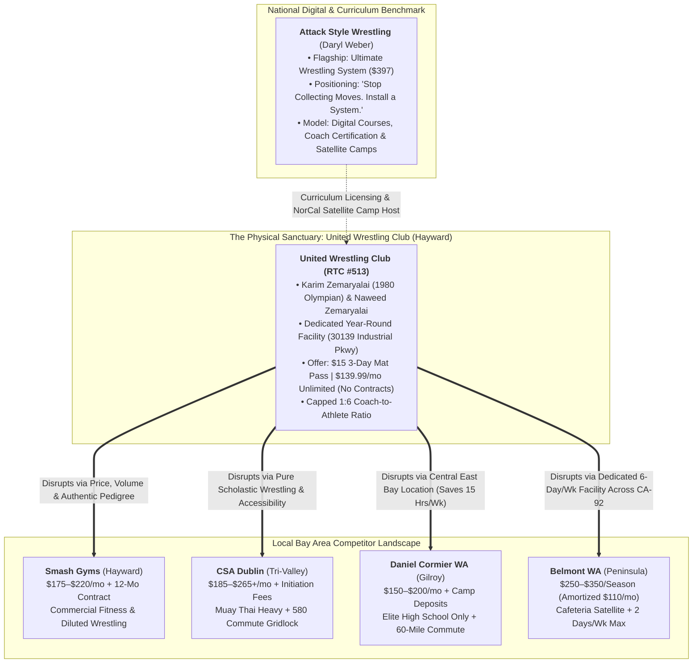

> Part 1 of 5 of [attack_style_wrestling_and_competitor_offers](../attack_style_wrestling_and_competitor_offers.md). Text is verbatim from the original; only links were rewritten.

# Attack Style Wrestling & Competitor Offers Audit: Strategic Synthesis
## Technical Analysis, Positioning Intelligence & Regional Value Architecture for United Wrestling Club (UWC)

> **Client:** United Wrestling Club (Hayward, CA)  
> **Facility Address:** 30139 Industrial Pkwy SW Ste C, Hayward, CA 94544  
> **Executive Leadership:** Coach Karim Zemaryalai (1980 Moscow Olympian & Ali Aliyev Dagestan Medalist) & Coach Naweed Zemaryalai (Chabot College Wrestling Coach / Kinesiology Faculty)  
> **Document Code:** `UWC-DISCOVERY-ASW-COMPETITOR-OFFERS-V1`  
> **Date:** November 2026  
> **Deliverable Path:** `discovery/market/attack_style_wrestling_and_competitor_offers.md`  

---

## Executive Summary: The Strategic Matrix

United Wrestling Club (UWC) possesses the most authentic international and collegiate wrestling pedigree in Northern California. Operating out of an unvarnished industrial flex park on Industrial Parkway in Hayward, UWC bridges elite Olympic/Caucasian freestyle lineage with practical scholastic CIF development and adult No-Gi "Wrestle-Jitsu."

However, combat sports consumers in Alameda, Santa Clara, Contra Costa, and San Mateo counties are consistently routed toward commercial fitness chains, MMA mega-gyms, or distant satellite rooms due to two primary factors:
1. **Aggressive Digital Funnels & Packaging:** Commercial competitors package average training into frictionless intro passes, high-gloss branding, and structured memberships.
2. **The "Move Collector" Trap:** Recreational grapplers and scholastic athletes waste years collecting isolated techniques from social media rather than mastering an integrated wrestling system.

This discovery audit provides a two-part operational blueprint:
* **Part I: Deep Profile of Attack Style Wrestling (ASW):** Analyzing Daryl Weber’s nationally dominant digital training platform, deconstructing the flagship **Ultimate Wrestling System ($397)**, unpacking the core positioning hook (*"Stop collecting moves. Install a system"*), and establishing an actionable partnership framework for UWC as **USA Wrestling Regional Training Center #513 (RTC #513)**.
* **Part II: Bay Area Competitor Offer & Schedule Audit:** A granular teardown of four key regional contenders—**Smash Gyms (Hayward Hub)**, **Combat Sports Academy / CSA (Dublin)**, **Daniel Cormier Wrestling Academy / DCWA (Gilroy)**, and **Belmont Wrestling Academy / Peninsula WC (Peninsula)**—exposing their contract lock-ins, schedule friction, and coaching vulnerabilities against UWC's **$15 3-Day Mat Pass**, **$139.99/mo Unlimited (No Contracts)**, and **1:6 Coach-to-Athlete Ratio**.

---

# PART I: Deep Profile of Attack Style Wrestling (ASW)

## 1. Founder Dossier: Daryl Weber

* **Website:** [`attackstylewrestling.com`](https://attackstylewrestling.com/)
* **Athletic Pedigree:** 
  * 1996 NCAA Division I National Champion at the University of Iowa under legendary head coach **Dan Gable**.
  * 3-time NCAA Division I All-American.
  * Member of Dan Gable’s historic University of Iowa dynasty, renowned for extreme pace, mental conditioning, aggressive hand-fighting, and relentless forward pressure.
* **Coaching Dynasty:**
  * Former Head Coach at Christiansburg High School (Christiansburg, Virginia).
  * Built one of the most dominant high school wrestling dynasties in United States scholastic history, winning **14 consecutive Virginia State Team Championships**.
  * Coached over **40 individual state champions**, numerous high school All-Americans, and collegiate Division I competitors.
* **Core Philosophy & Mission:**
  Daryl Weber translated Dan Gable’s legendary University of Iowa training philosophy into a repeatable, modular teaching framework that works for elementary, middle school, and high school athletes. Weber realized that while coaches and athletes desire Gable-level intensity, they fail because they lack structured practice roadmaps and teach isolated, disconnected moves. ASW was founded to democratize championship-level training systems for athletes, parents, and wrestling coaches nationwide.

---
