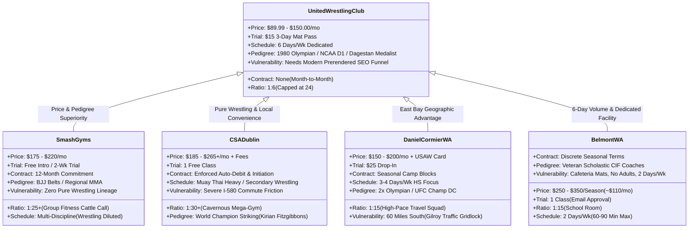

> Part 3 of 5 of [attack_style_wrestling_and_competitor_offers](../attack_style_wrestling_and_competitor_offers.md). Text is verbatim from the original; only links were rewritten.

## 6. Brand & Marketing Inspiration for UWC

United Wrestling Club can directly incorporate the best elements of ASW’s branding, messaging, and offer architecture into its live website and marketing funnels:

### 1. The "System vs. Moves" Copy Hook
UWC can adapt Weber’s hook to solve the specific pain points of Bay Area grapplers:
* **For Scholastic High School Wrestlers:**  
  > *"Stop collecting random YouTube moves that fail under live section pressure. Install an integrated Olympic and collegiate wrestling system under Coach Karim and Coach Naweed Zemaryalai."*
* **For Adult BJJ Grapplers (Wrestle-Jitsu):**  
  > *"Tired of giving up easy takedowns or pulling guard? Stop learning isolated sweeps. Install a complete hand-fighting, ankle-pick, and mat-return system that makes you impossible to take down."*

### 2. Brutalist, High-Contrast Visual Architecture
ASW eschews generic corporate fitness aesthetics in favor of high-impact, industrial combat cues:
* **Typography:** Bold, all-caps condensed athletic display typefaces (DIN Pro, Bebas Neue, Oswald) paired with crisp tabular mono numerals.
* **Palette:** Heavy black, charcoal slate, crisp white, and intense crimson/gold accents—mirroring UWC’s Afghan/Olympic heritage colors (`#121316` Dark Iron, `#902524` Heritage Crimson, `#C59B27` Calibrated Brass).
* **Authentic Imagery:** Candid, high-contrast chiaroscuro photography showing mat sweat, worn headgear, and unvarnished warehouse mats rather than smiling stock fitness models.

### 3. Modular Value Stacking & Risk-Reversal Framing
ASW succeeds by breaking a complex sport into digestible, outcome-oriented packages. UWC already replicates this by organizing its training into 4 clear tracks (Junior Olympian Foundation, Scholastic Varsity Pipeline, Adult Wrestle-Jitsu, and Women's Self-Defense) backed by clear risk reversals:
* UWC’s **$15 3-Day Mat Pass** (`WrestlingIQ Session #6327`).
* UWC’s **14-Day Mat-Fit Guarantee** (100% tuition refund if a child isn’t more confident within 14 days).

---

# PART II: Local Bay Area Competitor Offers & Schedule Audit

To dominate local search and conversion across Alameda, Contra Costa, and San Mateo counties, UWC must systematically exploit the vulnerabilities, pricing bloat, and schedule friction of its primary regional rivals.

---
