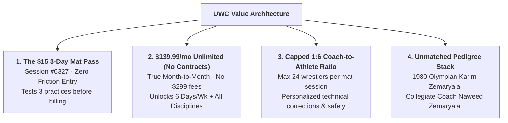

> Part 5 of 5 of [attack_style_wrestling_and_competitor_offers](../attack_style_wrestling_and_competitor_offers.md). Text is verbatim from the original; only links were rewritten.

## 3. UWC's Disruptive Value Architecture

United Wrestling Club beats every commercial gym and scholastic satellite in the Bay Area across four pillars:

### Pillar 1: The $15 3-Day Mat Pass (`WrestlingIQ Session #6327`)
* **The Problem It Solves:** Commercial MMA gyms force parents into aggressive sales presentations or 12-month contracts after a single 30-minute intro class. Traditional high school clubs demand $300 upfront seasonal checks before a child even knows if they like wrestling.
* **The UWC Solution:** A frictionless **$15.00 3-Day Mat Pass**. For $5 a session, parents and athletes get 3 full practices across a single week to experience the coaching room, meet Coach Naweed and Coach Karim, and test their grit with zero ongoing billing commitment.

### Pillar 2: The $139.99/mo Unlimited Membership (Zero Contracts)
* **The Problem It Solves:** Bay Area BJJ academies and Smash Gyms charge $175 to $225/mo and enforce predatory 1-year auto-renewing contracts with cancellation penalties.
* **The UWC Solution:** Transparent, honest month-to-month billing at **$139.99/month**.
  * **6 Days a Week:** Monday through Friday training plus Saturday regional open mat.
  * **Multi-Discipline Access:** Unlocks Olympic Folkstyle, Freestyle, Greco-Roman, No-Gi "Wrestle-Jitsu", Gi BJJ, Combat Sambo, and Boxing Fundamentals under a single flat tuition.
  * **Zero Hidden Fees:** No mandatory $299 uniform gear packages, no registration fees, no cancellation penalties.

### Pillar 3: Capped 1:6 Coach-to-Athlete Ratio
* **The Problem It Solves:** Commercial gyms run profitable "cattle-call" classes where 30 to 40 kids are supervised by a single tired coach, resulting in poor technique, chaotic mat safety, and injuries.
* **The UWC Solution:** Strict cap of **24 athletes per youth session**, manned by a minimum of 3 to 4 coaches and senior mentors (Coach Karim, Coach Naweed, Coach Sandeep, Coach Rashad). This guarantees a **1:6 coach-to-athlete ratio**, ensuring every wrestler receives individual hand-fighting adjustments, stance corrections, and dedicated mat safety oversight.

### Pillar 4: The 1980 Olympic & Dagestan Pedigree Stack
* While commercial gyms hire casual hobbyist instructors and high school clubs rely on parent volunteers, UWC is led by **Karim Zemaryalai**—a 1980 Moscow Olympic qualifier and Ali Aliyev International Tournament medalist in Dagestan—alongside Chabot College wrestling coach **Naweed Zemaryalai**. UWC teaches authentic Caucasian, Russian, and collegiate chaining systems that cannot be replicated anywhere else in Northern California.

---

# PART III: Strategic Head-to-Head Battle Cards

These battle cards equip UWC front-desk staff, phone responders, and digital landing pages (`/compare/*`) to instantly neutralize competitor objections:

### Battle Card 1: UWC vs. Smash Gyms (Hayward)
* **Prospect Scenario:** An adult grappler or parent considering Smash Gyms for general martial arts/fitness in Hayward.
* **The Positioning Response:**
  > *"Smash Gyms is a great multi-location commercial fitness facility if you want heavy-bag cardio kickboxing and casual group workouts. But if you or your child want real, high-performance wrestling and grappling, Smash Gyms does not have an Olympic or NCAA Division 1 coaching staff. At Smash, you'll pay $180 to $220 a month locked into a 12-month contract for a crowded room with a 1:25 coach ratio. At United Wrestling Club, you train directly under 1980 Olympian Karim Zemaryalai and college coach Naweed Zemaryalai. We cap our youth room at a 1:6 ratio, we charge $139.99 a month with zero contracts, and you get 6 days a week of dedicated mat time. Try our $15 3-Day Mat Pass first and feel the difference."*

### Battle Card 2: UWC vs. Combat Sports Academy / CSA (Dublin)
* **Prospect Scenario:** A Tri-Valley or Hayward parent considering driving to Dublin for combat sports training.
* **The Positioning Response:**
  > *"CSA is world-famous for professional Muay Thai striking and MMA. But if your goal is scholastic wrestling, CIF high school podiums, or fundamental youth development, CSA is a striking mega-gym where wrestling is an afterthought for cage defense. Furthermore, you'll be paying $225 to $265 a month plus initiation fees, while spending 2 hours stuck in I-580 rush-hour traffic over the Dublin grade. UWC is right here on Industrial Parkway in Hayward. We are a pure wrestling sanctuary with 1980 Olympic pedigree, dedicated scholastic CIF competition tracks, and zero corporate mega-gym intimidation—at nearly half the monthly cost."*

### Battle Card 3: UWC vs. Daniel Cormier Wrestling Academy (Gilroy)
* **Prospect Scenario:** A serious high school wrestler or parent wondering if they should drive to Gilroy to train under Daniel Cormier.
* **The Positioning Response:**
  > *"Coach Cormier is an absolute legend and his Gilroy room is one of the best in America. But Gilroy is 60 miles south. Driving down I-880 through San Jose traffic every Tuesday and Thursday means spending 15 hours a week in a car. You cannot maintain school grades and athletic recovery with that commute. United Wrestling Club brings that exact same Olympic-caliber standard to the East Bay. Coach Karim Zemaryalai competed internationally in the same Olympic era and medaled at the Ali Aliyev tournament in Dagestan. Our travel team competes at the exact same SCYWAY, USA Wrestling, and CIF tournaments. Train at UWC 6 days a week, save 15 hours of driving, and sleep in your own bed."*

### Battle Card 4: UWC vs. Belmont Wrestling Academy (Peninsula)
* **Prospect Scenario:** A Peninsula parent in San Mateo, Belmont, or Foster City looking for youth wrestling options.
* **The Positioning Response:**
  > *"Belmont WA is a fine seasonal program run by good high school coaches. But they only practice 2 days a week for 60 to 90 minutes in a high school cafeteria, and practices are frequently canceled when school is out. A motivated young athlete cannot reach their potential on 2 hours of mat time a week. United Wrestling Club is just 15 minutes across the San Mateo Bridge (CA-92) on Industrial Parkway. We have a dedicated, permanent year-round wrestling facility open 6 days a week with Olympic instruction, adult classes, and tournament travel coaching. Grab our $15 3-Day Pass and test our room."*

---

# PART IV: Actionable Recommendations for Naweed & Karim Zemaryalai

1. **Deploy the $15 3-Day Mat Pass Front-and-Center on the Live Website:**
   * Replace confusing "free trial" mentions and raw drop-in links with a single prominent CTA: **`[ Claim $15 3-Day Mat Pass ]`**. Route this directly into the native 1-click modal linked to `WrestlingIQ Session #6327`.
2. **Launch Dedicated Prerendered Competitor Comparison Routes:**
   * Publish four targeted comparison pages to capture high-intent organic search volume:
     * `/compare/uwc-vs-smash-gyms` (Targeting Hayward & Alameda County martial arts searchers)
     * `/compare/uwc-vs-csa-dublin` (Targeting East Bay combat sports families)
     * `/compare/uwc-vs-daniel-cormier-wrestling` (Targeting serious scholastic wrestlers evaluating regional RTCs)
     * `/compare/uwc-vs-belmont-wrestling-academy` (Targeting Peninsula commuters via the CA-92 bridge)
3. **Initiate Partnership Outreach to Attack Style Wrestling (Daryl Weber):**
   * Contact Daryl Weber via `attackstylewrestling.com` to propose UWC (`RTC #513`) as the official **Northern California host for an Attack Style 3-Day Pre-Season Clinic** in Fall 2027.
   * Highlight UWC’s facility specs (two regulation mat areas, easy airport/highway access from Oakland/SFO/San Jose, 1980 Olympic lineage).
4. **Incorporate the "System vs. Moves" Message into Adult Wrestle-Jitsu Marketing:**
   * Market directly to East Bay BJJ academies (10th Planet, Gracie Barra, One World BJJ): *"Stop pulling guard. Install an Olympic wrestling takedown and ride system at UWC for $139.99/mo (no contracts)."*
5. **Feature the 1:6 Ratio & Safety Protocols on All Youth Pages:**
   * Reassure risk-averse parents that beginner children will never be lost in a 30-kid cattle call, emphasizing UWC's 24-athlete mat cap and direct coach supervision.
