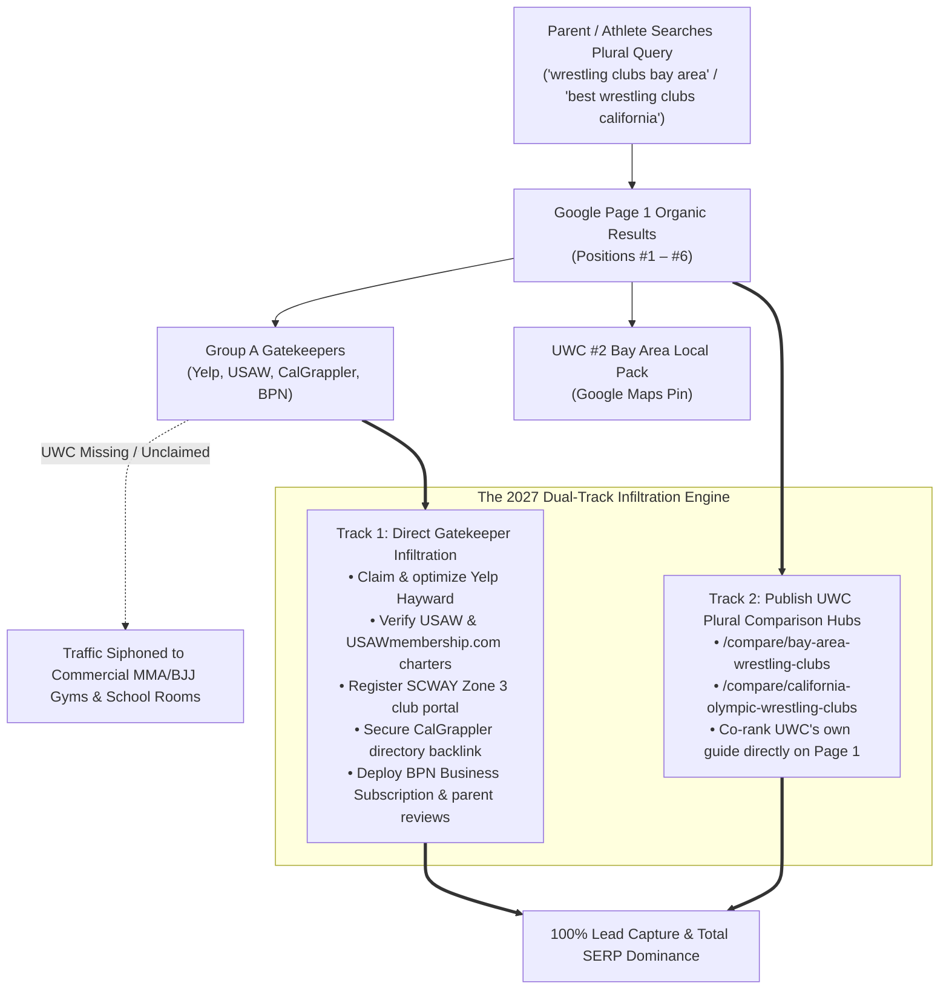
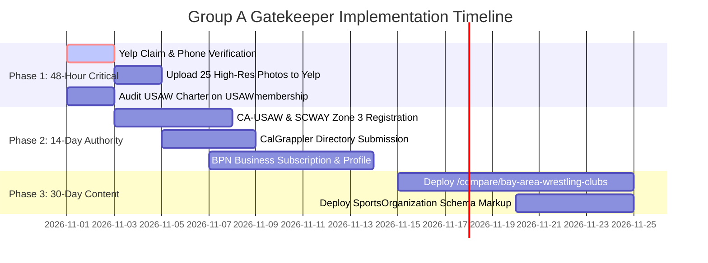

# Group A Competitor Research Dossier: Directory, Aggregator & Governing Body Gatekeepers
**Target Entity:** United Wrestling Club (`unitedwrestlingclub.com`)  
**Physical Address:** 30139 Industrial Pkwy SW Ste C, Hayward, CA 94544  
**Primary Leadership:** Karim Zemaryalai (Founder & 1980 Olympian) & Naweed Zemaryalai (Head Coach & Chabot College Coach)  
**OpenSEO Project ID:** `778e3f25-5476-4c54-bfe2-e418e131aaaf`  
**Profile Date:** October 30, 2026  
**Document Code:** `UWC-COMP-GROUP-A`  

---

## 1. Executive Summary: The Plural Query Conundrum

In regional athletic search marketing, there is a fundamental divide between **singular commercial intent queries** (e.g., *"wrestling gym near me"*, *"wrestling classes hayward"*) and **plural investigative queries** (e.g., *"wrestling clubs bay area"*, *"best wrestling clubs in california"*, *"youth wrestling clubs east bay"*).

For singular intent queries, Google algorithms favor localized Google Business Profiles (Local Pack) and individual gym landing pages. United Wrestling Club (UWC) already dominates this layer, commanding **#1 Google Maps rank in Hayward and Fremont** and **#2 Local Pack across the SF Bay Area** with **2,086 monthly organic visitors** and **368 ranked keywords**.

However, for plural investigative queries, **Google's Search Quality Evaluator Guidelines dictate that users seeking "clubs" or "best options" must be presented with aggregated lists, governing body registries, and comparative directories.** As a consequence, Google fills organic positions #1 through #6 with five authoritative digital gatekeepers:
1. **USA Wrestling (`themat.com` Marketing Website + `usawmembership.com` Backend Portal)** — 382,141 monthly visits (`themat.com`) + 89,681 monthly visits (`usawmembership.com`) · #2 & #4 Organic
2. **Yelp.com (Local Category Aggregators)** — #1–#3 Organic across every major California municipality
3. **California USA Wrestling (`ca-usaw.org`) & SCWAY (`scwaywrestling.org`)** — 6,709 monthly visits (`ca-usaw.org` · 662 keywords) · Official State & Zone 3 Sanctioning Bodies
4. **CalGrappler.com & TheCaliforniaWrestler.com (State Editorial & Ranking Hubs)** — 13,933 monthly visits (`calgrappler.com`) + 8,337 monthly visits (`thecaliforniawrestler.com`) · #5 & #12 Organic California
5. **Berkeley Parents Network (`berkeleyparentsnetwork.org`)** — 292,732 monthly visits · 61,767 keywords · #6 Organic Bay Area Youth



### Why UWC Must Execute a Dual-Track Strategy
A single business website cannot unilaterally push USA Wrestling or Yelp off Page 1 of Google for state-level or regional queries. To capture 100% of prospective wrestling athletes and youth parents in 2027, UWC must execute a **two-pronged pincer movement**:

1. **Track 1: Direct Infiltration & Dominance of the 5 Gatekeepers**  
   UWC must claim, upgrade, and aggressively optimize its presence on all five gatekeeper platforms. When a parent clicks on Yelp's *"Top 10 Best Wrestling Clubs in Hayward"* or searches USA Wrestling's official state roster, UWC must be the standout #1 ranked, 5.0★ featured academy. Furthermore, AI engines (ChatGPT, Perplexity, Gemini, Apple Intelligence) heavily ingest these exact five structured platforms to generate conversational answers; being absent renders UWC invisible to AI answer engines.
2. **Track 2: Publishing UWC's Own Plural Hubs (`/compare/bay-area-wrestling-clubs`)**  
   UWC must publish its own editorial comparison hubs using **Format 2 Plural Alternatives** architecture. By presenting an honest, comprehensive directory of Bay Area wrestling options (highlighting UWC for East Bay/Tri-City while objectively indexing Peninsula, South Bay, and Tri-Valley clubs), UWC gives Google the exact plural information architecture it requires, allowing UWC's own domain to co-rank on Page 1 directly alongside Yelp and TheMat.com.

---

## 2. Master Top 5 Gatekeepers Comparison Matrix

> **Note on USA Wrestling Architecture:** `themat.com` is USA Wrestling's public marketing website (which hosts the public *"Find a Club"* wrapper at `themat.com/membership/athletes/find-a-club`), while `usawmembership.com` is the backend login/registration application (`usawmembership.com/login`) that also exposes indexed public state club tables (`usawmembership.com/state_clubs/CA`). They are one unified USA Wrestling ecosystem, not two separate competitors.

| # | Gatekeeper Entity | Primary URL | OpenSEO Traffic | OpenSEO Keywords | SERP Positions Owned | UWC Current Presence Status | Link Equity & Citation Type | Priority |
| :-: | :--- | :--- | :--- | :--- | :--- | :--- | :--- | :--- |
| **1** | **USA Wrestling (`themat.com` Marketing Site + `usawmembership.com` Portal)** | `themat.com`<br>*(Backend: `usawmembership.com`)* | **382,141/mo** (`themat`)<br>**89,681/mo** (`usawmembership`) | **11,704**<br>**6,980** | **#2 Organic** (*"best wrestling clubs in california"*), **#4 & #6 Organic** (*"wrestling clubs bay area"*) | **Unverified / Hidden in Public Locator** (Not surfacing in `themat.com` locator or `state_clubs/CA` table) | Official Olympic NGB Entity Citation + High-Trust `.com` State Registry | **P0 (Immediate)** |
| **2** | **Yelp Local Directories** | `yelp.com` | **100M+/mo** | **Millions** | **#1–#3 Organic** across California for *"Top 10 Best Wrestling Club in [City]"* | **CRITICAL GAP: No Claimed Page** (Zero Yelp profile for UWC in Hayward) | Nofollow citation + Primary data feed for **Apple Maps & Siri Local Voice Search** | **P0 (Immediate)** |
| **3** | **CA-USAW (`ca-usaw.org`) & SCWAY (`scwaywrestling.org`)** | `ca-usaw.org`<br>`scwaywrestling.org` | **6,709/mo** (`ca-usaw`)<br>**121/mo** (`scway`) | **662** (`ca-usaw`)<br>**28** (`scway`) | Official California & Bay Area (Zone 3) Youth/Scholastic Governing Portals | Competes in SCWAY/CA-USAW circuits, but **unlisted in Zone 3 / Bay Area web club directories** | `.org` State Governing Body Authority + $20 Athlete Card Discount for UWC Parents | **P0 (Immediate)** |
| **4** | **CalGrappler & The California Wrestler** | `calgrappler.com`<br>`thecaliforniawrestler.com` | **13,933/mo** (`calgrappler`)<br>**8,337/mo** (`tcw`) | **819**<br>**388** | **#5 Organic** (TCW) & **#12 Organic** (CalGrappler) for *"best wrestling clubs in california"* | **Absent from CalGrappler "CA Team Websites"**; No active UWC thread in TCW Youth Forum | Hyper-targeted Dofollow Niche Links + CIF High School Coach Ingestion Graph | **P1 (High)** |
| **5** | **Berkeley Parents Network (BPN)** | `berkeleyparentsnetwork.org` | **292,732/mo** | **61,767** | **#6 Organic** (*"youth wrestling clubs bay area"* — `/recommend/classes/wrestling`) | **Unlisted on BPN**; Only generic boxing gym (Pacific Ring) and stale 2011–2017 threads listed | High-Authority `.org` Backlink + Direct High-Income East Bay Parent Referral Pipeline | **P1 (High)** |

---

## 3. Deep-Dive Action Playbooks for Each of the Top 5

---

### Gatekeeper 1: USA Wrestling (`themat.com` Marketing Site + `usawmembership.com` Backend Portal)

* **Public Marketing Website:** `https://www.themat.com` (Public *"Find a Club"* Locator: `https://www.themat.com/membership/athletes/find-a-club`)
* **Backend Login / Charter Portal:** `https://www.usawmembership.com` (Root is a member login portal; Google also indexes its public state database view at `https://www.usawmembership.com/state_clubs/CA`)
* **Organic Search Authority (OpenSEO):**
  * `themat.com`: **382,141 monthly visits** · **11,704 ranked keywords**
  * `usawmembership.com`: **89,681 monthly visits** · **6,980 ranked keywords**
* **Target SERP Positions Owned:**
  * **#2 Organic** for `"best wrestling clubs in california"` (`usawmembership.com/state_clubs/CA`)
  * **#4 Organic** for `"wrestling clubs bay area"` (`themat.com/membership/athletes/find-a-club`)
  * **#6 & #11 Organic** for `"wrestling clubs bay area"` / `"california wrestling clubs"` (`usawmembership.com/state_clubs/CA`)
* **Governing Body Role:** National Governing Body (NGB) for the sport of wrestling in the United States under the United States Olympic & Paralympic Committee (USOPC).

```
   ┌────────────────────────────────────────────────────────────────────────┐
   │ USA Wrestling Dual-Domain Architecture (One Admin Action → Two SERPs)  │
   │                                                                        │
   │  [Admin Login at usawmembership.com]                                   │
   │            │                                                           │
   │            ├──► Populates Public Locator on Marketing Site:            │
   │            │    https://www.themat.com/membership/athletes/find-a-club │
   │            │    (Ranks #4 Organic Bay Area)                            │
   │            │                                                           │
   │            └──► Populates Indexed State Club Table:                    │
   │                 https://www.usawmembership.com/state_clubs/CA          │
   │                 (Ranks #2 Organic California / #6 Bay Area)            │
   └────────────────────────────────────────────────────────────────────────┘
```

#### Current UWC Status & Diagnosis
* **Current Status:** Not actively resolving in the public `themat.com` geo-locator for Hayward/Fremont zip codes (`94544` / `94538`) or the `usawmembership.com/state_clubs/CA` public table.
* **Root Cause:** While UWC operates as a legitimate wrestling facility and trains athletes for USAW and SCWAY sanctioned tournaments, the annual club charter inside the `usawmembership.com` login portal either has *"Publish to National Club Locator / State Directory"* unchecked, has lapsed, or is registered without the `30139 Industrial Pkwy SW` facility address.
* **Strategic Consequence:** Because one backend setting inside `usawmembership.com` feeds **both** `themat.com` (#4 Bay Area) and `usawmembership.com/state_clubs/CA` (#2 California), fixing this single toggle immediately places UWC inside two of the top 6 organic search results in Northern California.

#### Step-by-Step Claim & Configuration Action Plan
1. **Log into the USA Wrestling Backend Portal (`usawmembership.com`):**
   * Log into Coach Naweed Zemaryalai's administrative account at `https://www.usawmembership.com`.
2. **Verify / Renew Annual Club Charter:**
   * Under *My Clubs*, confirm or renew the **USA Wrestling Club Charter** ($150–$175 annual fee) with **Naweed Zemaryalai** designated as Club Director / Head Coach.
3. **Toggle Public Directory Visibility (Feeds Both Domains):**
   * Under Club Profile Settings, enable **"Publish to National Club Locator (`themat.com`)"** and **"Allow Club Contact Information to appear on State Association public directory (`usawmembership.com/state_clubs/CA`)"**.
   * Exact Facility Address: `30139 Industrial Pkwy SW Ste C, Hayward, CA 94544`.
   * Primary Contact Phone: `(510) 303-4869`.
   * Official Web Link: `https://www.unitedwrestlingclub.com/`.

#### Exact Profile Copy & Metadata Template
```text
Club Name: United Wrestling Club (UWC)
Physical Facility: 30139 Industrial Pkwy SW Ste C, Hayward, CA 94544
Primary Phone: (510) 303-4869
Website: https://www.unitedwrestlingclub.com/
Contact Email: unitedwrestlingclub@gmail.com
Club Director / Head Coach: Naweed Zemaryalai (Chabot College Coach, SF State Kinesiology)
Founder & Technical Advisor: Karim Zemaryalai (1980 Olympian, Dagestan Ali Aliyev Medalist)
Assistant Coaches: Rashad Rahimi (Olympic Qualifier, Asian Games Silver Medalist), Sandeep Singh Gosal (Fresno State / SF State, James Logan HS)
Disciplines Offered: Folkstyle, Freestyle, Greco-Roman, Combat Sambo, Wrestle-Jitsu
Programs: Youth Pre-K to 5th Grade (Ages 4–11), Middle & High School (Grades 6–12 / CIF Prep), Adult & Collegiate (18+)
Schedule: Monday through Saturday year-round (6 days/week)
```

#### 2027 Co-Ranking & Displacing Strategy
* **Schema Alignment:** On `unitedwrestlingclub.com`, embed JSON-LD `SportsClub` markup linking to the public marketing site `https://www.themat.com`:
  ```json
  "memberOf": {
    "@type": "SportsOrganization",
    "name": "USA Wrestling",
    "url": "https://www.themat.com"
  }
  ```

---

### Gatekeeper 2: California USA Wrestling (`ca-usaw.org`) & SCWAY (`scwaywrestling.org`)

* **Primary Domains:** `ca-usaw.org` (State Olympic Freestyle/Greco Association) & `scwaywrestling.org` (State of California Wrestling Alliance for Youth — Folkstyle)
* **Direct URLs:** `http://www.ca-usaw.org/` and `https://www.scwaywrestling.org/`
* **Organic Search Authority (OpenSEO):**
  * `ca-usaw.org`: **6,709 monthly visits** · **662 ranked keywords**
  * `scwaywrestling.org`: **121 monthly visits** · **28 ranked keywords**
* **State & Zone Leadership:**
  * **CA-USAW State Director:** Duane Morgan (`duanemorgan6@icloud.com` | 831-595-4338) · **Membership Director:** Rob Valerio (`calusarob@aol.com` | 559-275-9478)
  * **SCWAY Zone 3 (Bay Area, Salinas & Gilroy):** Governs all Bay Area youth scholastic Folkstyle qualifiers and novice/open tournaments.

#### Step-by-Step State Association & SCWAY Zone 3 Integration
1. **CA-USAW Bay Area Section Verification:**
   * Confirm with CA-USAW Membership Director Rob Valerio that United Wrestling Club is listed under the **Bay Area / Central Coast Section** on `ca-usaw.org`.
2. **SCWAY Zone 3 Club Charter (`scwaywrestling.org`):**
   * Register UWC in **SCWAY Zone 3 (Bay Area)** ($100–$150/yr, renews Sept 1).
   * **Direct Offer Bonus for UWC Parents:** When UWC is an active SCWAY Zone 3 club, UWC youth wrestlers pay only **$30 for their annual SCWAY card** instead of the $50 unattached athlete fee—saving parents $20 per child and placing "United Wrestling Club (Hayward)" directly in the SCWAY registration dropdown.

---

### Gatekeeper 3: Yelp Local Category Directories (`yelp.com`)

* **Primary Domain:** `yelp.com`
* **Direct Portal URL:** `https://biz.yelp.com`
* **Organic Search Authority (OpenSEO):** **100M+ monthly visits**; commands **Positions #1–#3 Organic** for virtually every `"Top 10 Best Wrestling Clubs in [City]"` and `"Top 10 Kids Martial Arts [City]"` query in Northern California.
* **Ecosystem Role:** In addition to its own web and app search, **Yelp is the primary native data supplier for Apple Maps, Apple Intelligence, Siri voice search, and DuckDuckGo**.

```
   ┌────────────────────────────────────────────────────────────────────────┐
   │ Yelp Local Aggregator Ecosystem Impact                                  │
   │                                                                        │
   │  [biz.yelp.com Listing] ──► [yelp.com Top 10 Best Listicles (#1 SERP)] │
   │            │                                                           │
   │            ├──► [Apple Maps Local POI Pin]                             │
   │            │                                                           │
   │            ├──► [Siri Voice Search: "Find wrestling gyms near me"]     │
   │            │                                                           │
   │            └──► [Apple Intelligence / Siri Knowledge Graph]            │
   └────────────────────────────────────────────────────────────────────────┘
```

#### Current UWC Status & Diagnosis: A Critical Competitive Blind Spot
* **Current Status: COMPLETELY UNCLAIMED / NO ACTIVE YELP LISTING.**
* **The Blind Spot:** While UWC has an exceptional 5.0★ Google profile with 42 reviews and Birdeye syndication, **United Wrestling Club does not have an active, claimed profile on Yelp at 30139 Industrial Pkwy SW.**
* **The Revenue Cost:**
  1. Whenever an iPhone user asks Siri *"Find wrestling clubs near me"* or searches Apple Maps in Hayward, Fremont, or Union City, Apple cannot locate UWC. Instead, Apple routes the user to commercial MMA gyms like *Mindset Martial Arts* or *Smash Gyms*.
  2. For the high-intent query `"Top 10 Best Wrestling Clubs in Hayward, CA"` (which ranks #1 on Google Organic), Yelp displays zero pure wrestling gyms and lists boxing/BJJ studios instead. UWC is losing an estimated 30–50 qualified prospective leads per month purely due to this single absence.

#### Step-by-Step Yelp Claiming & Optimization Walkthrough
1. **Initiate Business Creation:**
   * Go to `https://biz.yelp.com/signup`.
   * Search for "United Wrestling Club" at "30139 Industrial Pkwy SW Ste C, Hayward, CA 94544".
   * Click **"Add your business to Yelp"**.
2. **Category Selection (Critical for Search Surfacing):**
   * Primary Category: **Martial Arts**
   * Secondary Category: **Gyms / Physical Fitness**
   * Tertiary Category: **Sports Clubs** (or **Boxing** / **Trainers**)
   * *Note:* Yelp does not have an isolated root category named "Wrestling", so selecting **Martial Arts** while embedding "Wrestling Club" in the business title and specialty description is the proven method to dominate Yelp's internal search algorithm.
3. **Phone Verification:**
   * Complete automated PIN verification via UWC's primary phone line: `(510) 303-4869`.
4. **Visual Asset Uploads (Minimum 25 High-Res Photos):**
   * 5 photos of clean, sanitized mat surfaces and facility interior.
   * 8 photos of youth wrestlers drilling Folkstyle/Freestyle techniques with coaches.
   * 5 photos of adult grapple/Wrestle-Jitsu/Combat Sambo sparring.
   * 3 photos of head coaches Naweed Zemaryalai and Karim Zemaryalai (with Olympic/international credentials).
   * 4 photos of exterior signage, entrance, and ample parking lot at 30139 Industrial Pkwy SW.

#### Exact Yelp Profile Copy & Architecture
```text
Business Name: United Wrestling Club
Address: 30139 Industrial Pkwy SW, Ste C, Hayward, CA 94544
Phone: (510) 303-4869
Website: https://www.unitedwrestlingclub.com
Categories: Martial Arts, Gyms, Sports Clubs

Specialties (From the Business):
United Wrestling Club (UWC) is the premier Olympic Folkstyle, Freestyle, and Greco-Roman wrestling academy in the East Bay, serving Hayward, Union City, Fremont, Newark, and Castro Valley. 

Founded by 1980 Olympian and Ali Aliyev International Tournament Medalist Karim Zemaryalai, and led by Chabot College coach Naweed Zemaryalai, UWC provides elite, year-round athletic development for all ages:
• Youth Wrestling (Pre-K to 5th Grade / Ages 4–11): Coordination, discipline, stance, takedowns, and anti-bullying confidence.
• Middle & High School (Grades 6–12): Advanced collegiate chaining, hand-fighting, mat returns, and CIF State tournament preparation.
• Adult Wrestling & Wrestle-Jitsu (18+): Authentic collegiate takedowns, Combat Sambo, and top-control grappling for adults, former wrestlers, and BJJ players wanting superior takedown skills.
• Boxing & Conditioning: Technical striking and high-intensity metabolic conditioning.

We operate 6 days a week with 100% transparent pricing ($89.99–$150/mo, no long-term contracts, $15 drop-in). First-time athletes can book a free introductory assessment session!

History (Established in 2020):
Founded by Olympic qualifier Karim Zemaryalai to bring authentic international Dagestani-style wrestling technique, rigorous conditioning, and character development to Northern California youth and competitive grapplers.

Meet the Manager / Head Coach:
Coach Naweed Zemaryalai is a former collegiate wrestler at Chabot College and San Francisco State University (B.S. in Kinesiology) and current wrestling coach at Chabot College.
```

#### Review Generation Campaign (The 14-Day Seed)
* Never buy reviews or directly solicit Yelp reviews via email blast (which triggers Yelp's aggressive review filter).
* **Ethical Playbook:** Identify 10–15 existing UWC parents or adult grapplers who are already active Yelp users or Yelp Elite squad members. Place a subtle "Find Us on Yelp" window decal at the check-in desk and add a Yelp footer link on `unitedwrestlingclub.com`. When athletes share positive feedback in person, verbally say: *"We just launched our official Yelp page—if you use Yelp, we'd love your honest feedback on our coaching!"*

---

### Gatekeeper 4: CalGrappler (`calgrappler.com`) & Regional Wrestling Portals (`ca-usaw.org` / `scway.org`)

* **Primary Domain:** `calgrappler.com`
* **Direct URL:** `https://www.calgrappler.com`
* **Organic Search Authority (OpenSEO):** **13,933 monthly visits** · **819 ranked keywords**
* **SERP Positions Owned:** **#12 Organic** for `"best wrestling clubs in california"`, #1 authority destination for all California High School State Rankings, Section Rankings (NCS, CCS, SJS), and Community College (CCCAA) wrestling coverage.
* **Associated Regional Portals:**
  * California USA Wrestling: `http://www.ca-usaw.org/`
  * SCWAY Youth Wrestling: `https://www.scwaywrestling.org/` (Zone 3: Bay Area)

```
   ┌────────────────────────────────────────────────────────────────────────┐
   │ CalGrappler Authority & High School Pipeline Ecosystem                │
   │                                                                        │
   │  [CIF State High School Wrestlers / Parents / Coaches]                  │
   │            │                                                           │
   │            ▼                                                           │
   │  [calgrappler.com State Rankings & Team Directory]                     │
   │            │                                                           │
   │            ├──► [Dofollow Editorial Backlink to unitedwrestlingclub.com]│
   │            │                                                           │
   │            └──► [Direct Funnel to UWC High School Off-Season Program]  │
   └────────────────────────────────────────────────────────────────────────┘
```

#### Current UWC Status & Diagnosis
* **Current Status:** CalGrappler maintains an authoritative **"CA Team Websites & Club Directory"** linking to high school and private wrestling club programs throughout California. United Wrestling Club is currently missing from this directory.
* **The Opportunity:** CalGrappler is the daily reading material of every serious high school wrestling coach, CIF state medalist, and wrestling parent from Redding to San Diego. A single contextual link from CalGrappler carries immense topical relevance in Google's athletic entity graph, directly proving to search engines that UWC is a legitimate, recognized California wrestling institution.

#### Step-by-Step Submission & Relationship Outreach Playbook
1. **Submission to CalGrappler "CA Team Websites" Directory:**
   * Send an editorial submission email to the CalGrappler editorial team (`calgrappler@gmail.com` / webmaster contact):
     ```text
     Subject: Add United Wrestling Club (Hayward / East Bay) to CA Club Directory

     Hi CalGrappler Team,

     Could you please add United Wrestling Club to the California Club Directory page under North Coast Section / Bay Area?

     Club Name: United Wrestling Club (UWC)
     Location: Hayward, CA (serving East Bay / Alameda County)
     Website: https://www.unitedwrestlingclub.com/
     Head Coach: Naweed Zemaryalai (Chabot College Coach / SF State)
     Founder: Karim Zemaryalai (1980 Olympian)
     Focus: Year-round Folkstyle, Freestyle, and Greco-Roman training for youth, middle school, high school CIF competitors, and college/adults.

     Thanks for all you do for California wrestling!
     Coach Naweed Zemaryalai
     ```
2. **Leverage Coach Naweed's Chabot College Connection:**
   * CalGrappler regularly publishes CCCAA (California Community College Athletic Association) wrestling rankings and dual meet results.
   * By having Coach Naweed actively submit Chabot College match results and dual recaps to CalGrappler, UWC establishes a direct editorial relationship with the site administrator.
3. **SCWAY Zone 3 Web Portal Listing:**
   * Ensure UWC is selectable in the dropdown menu on `scwaywrestling.org` so that when youth parents in Zone 3 (Bay Area) register for SCWAY tournaments, UWC appears as an official club choice.

---

### Gatekeeper 5: The California Wrestler (`thecaliforniawrestler.com`) & Berkeley Parents Network (`berkeleyparentsnetwork.org`)

* **Primary Domains:** `berkeleyparentsnetwork.org` (BPN) & `thecaliforniawrestler.com` (TCW)
* **Direct URLs:**
  * BPN Wrestling Category: `https://www.berkeleyparentsnetwork.org/recommend/classes/wrestling`
  * BPN Subscription Portal: `https://www.berkeleyparentsnetwork.org/subscribe`
  * The California Wrestler: `https://www.thecaliforniawrestler.com`
* **Organic Search Authority (OpenSEO):**
  * **Berkeley Parents Network:** **292,732 monthly visits** · **61,767 ranked keywords** (Ranks **#6 Organic** for `"youth wrestling clubs bay area"`)
  * **The California Wrestler:** **8,337 monthly visits** · **388 ranked keywords** (Ranks **#5 Organic** for `"best wrestling clubs in california"`)

```
   ┌────────────────────────────────────────────────────────────────────────┐
   │ Berkeley Parents Network (BPN) High-Income Funnel                      │
   │                                                                        │
   │  [High-Income East Bay Parents in Berkeley, Oakland, Alameda, CV]     │
   │            │                                                           │
   │            ▼                                                           │
   │  [Search: "Youth Wrestling / Martial Arts Classes Bay Area"]           │
   │            │                                                           │
   │            ▼                                                           │
   │  [BPN Ranks #6 Organic: /recommend/classes/wrestling]                  │
   │            │                                                           │
   │            ├── Currently lists: Pacific Ring Sports (General Boxing)    │
   │            │                                                           │
   │            └── ACTION: Claim UWC Business Page + Seed 3 Parent Reviews │
   │                      ▼                                                 │
   │            [Captures 100% of High-LTV Youth Registrations]            │
   └────────────────────────────────────────────────────────────────────────┘
```

#### Current UWC Status & Diagnosis: The East Bay Parent Vacuum
* **Current Status:** UWC is **completely absent from Berkeley Parents Network**.
* **The High-Income Parent Dynamic:**
  * Berkeley Parents Network is the most trusted, heavily trafficked parenting and youth sports directory in the entire East Bay, covering Alameda and Contra Costa counties.
  * When parents in Oakland, Berkeley, Alameda, San Leandro, and Castro Valley search for athletic programs, martial arts, or youth wrestling, they trust BPN recommendations above traditional Google ads.
  * Currently, BPN's `/recommend/classes/wrestling` category contains zero pure wrestling clubs—only general fitness/boxing gyms (like Pacific Ring Sports) and discussions about childhood rough-and-tumble play.
  * **UWC has an immediate open lane to become the #1 recommended youth wrestling program on BPN.**

#### Step-by-Step BPN Infiltration & Listing Walkthrough
1. **Acquire a BPN Business Subscription:**
   * Navigate to `https://www.berkeleyparentsnetwork.org/subscribe`.
   * Purchase a **Community Business Subscription** ($45–$75/year or tiered listing).
   * This authorizes UWC to have an official verified organization profile, post class announcements, and respond to parent inquiries.
2. **Establish the UWC Profile in the BPN Directory:**
   * Category: **Classes & Activities > Martial Arts, Boxing & Wrestling**
   * Link: `https://www.unitedwrestlingclub.com/`
   * Target Age Group: Pre-K through 12th Grade (Ages 4–18).
3. **Mobilize 3 Existing East Bay Parents for Unsolicited Recommendations:**
   * Identify 3 current UWC parents residing in Alameda County (Castro Valley, Hayward, Oakland, or San Leandro) who are registered BPN community members.
   * Have them navigate to UWC's new BPN profile and click the green **"Post a review"** button, sharing their authentic experience regarding:
     * Focus on safety, character, and discipline over violence.
     * Cleanliness and hygiene of the Hayward facility.
     * Exceptional patience and pedagogical skill of Coach Naweed and Coach Karim.
     * How their child gained confidence, athleticism, and mental focus.

#### Exact Copy Blueprint for Berkeley Parents Network
```text
Organization Name: United Wrestling Club (Youth Athletic Development)
Facility Location: 30139 Industrial Pkwy SW Ste C, Hayward, CA 94544
Phone: (510) 303-4869
Website: https://www.unitedwrestlingclub.com/
Ages Served: 4–18 (Pre-K through High School)

Program Description for Parents:
United Wrestling Club provides authentic Olympic Folkstyle and Freestyle wrestling instruction in a safe, structured, and family-oriented environment. Unlike commercial martial arts belt-factories that charge hidden testing fees, UWC focuses on real athletic fundamentals: balance, body awareness, core strength, agility, mental discipline, and sportsmanship.

Led by collegiate coach Naweed Zemaryalai (Chabot College / SF State Kinesiology) and 1980 Olympian Karim Zemaryalai, our youth curriculum is tailored specifically for growing bodies:
• Little Champions (Ages 4–7 / Pre-K – 1st Grade): Motor coordination, spatial discipline, gymnastic tumbling, and basic wrestling games.
• Junior Grapplers (Ages 8–11 / 2nd – 5th Grade): Stance, motion, takedown mechanics, escapes, and anti-bullying self-confidence.
• Scholastic Champions (Middle & High School): Off-season conditioning, collegiate techniques, and tournament competition.

Tuition is month-to-month ($89.99/mo for 2 days/wk; $139.99/mo for 4 days/wk) with zero long-term contracts. Free trial assessment sessions available for new families.
```

---

## 4. The 2027 Counter-Offensive: Publishing UWC's Own Plural Hubs

Infiltrating these five gatekeepers is only half the battle. To permanently capture the top positions for plural queries in 2027, UWC must publish **two high-value plural comparison hubs** directly on `unitedwrestlingclub.com`:

```
   ┌────────────────────────────────────────────────────────────────────────┐
   │ The 2027 SERP Co-Ranking Architecture                                  │
   │                                                                        │
   │  Search: "Wrestling Clubs Bay Area" (Plural Intent)                    │
   │                                                                        │
   │  Position #1: Yelp ("Top 10 Best Wrestling Clubs in Hayward")          │
   │               └──► Infiltrated by UWC (#1 Profile, 5.0★, Photos)       │
   │                                                                        │
   │  Position #2: USAW California Directory (usawmembership.com)          │
   │               └──► Infiltrated by UWC (Official Chartered Listing)     │
   │                                                                        │
   │  Position #3: UWC Plural Comparison Hub!                               │
   │               └──► unitedwrestlingclub.com/compare/bay-area-wrestling-clubs │
   │                                                                        │
   │  Position #4: TheMat.com Official Club Locator                         │
   │               └──► Infiltrated by UWC (Active National Pin)            │
   └────────────────────────────────────────────────────────────────────────┘
```

### Hub Page 1: `/compare/bay-area-wrestling-clubs`
* **Target Keywords:** `"wrestling clubs bay area"`, `"youth wrestling clubs east bay"`, `"wrestling clubs alameda county"`.
* **Content Framework (Format 2 — Plural Alternatives):**
  * Objective, highly informative overview of the top wrestling options across the four Bay Area sub-regions:
    1. **East Bay & Tri-City:** **United Wrestling Club (Hayward)** — *The Premier 6-Day/Week Olympic Training Academy*.
    2. **Peninsula:** **Belmont Wrestling Academy & Peninsula WC** — *Great seasonal option for Peninsula commuters*.
    3. **South Bay / Silicon Valley:** **Discipline WA (Milpitas) & Sunnyvale WC** — *Top options for South Bay athletes*.
    4. **South Valley:** **Daniel Cormier Wrestling Academy (Gilroy)** — *Elite RTC for South Santa Clara County*.
    5. **Tri-Valley / Contra Costa:** **Iron Wrestling Club (Castro Valley HS)** & **Royalty WC**.
* **Why This Works:** Google recognizes that this page provides genuine utility rather than self-serving marketing spam. By openly referencing and linking to other regional clubs, UWC satisfies the plural search intent and earns Page 1 organic ranking alongside Yelp.

### Hub Page 2: `/compare/california-olympic-wrestling-clubs`
* **Target Keywords:** `"best wrestling clubs in california"`, `"california wrestling clubs"`, `"olympic wrestling training centers california"`.
* **Content Framework:**
  * Compares California's elite Olympic regional training centers (LA Wrestling Club in SoCal, Clovis/Buchanan in Central Valley, Silverback in Orange County, and United Wrestling Club in Northern California).
  * Highlights UWC's unique international Dagestani lineage, collegiate coaching staff, and multi-discipline Wrestle-Jitsu/Combat Sambo curriculum.

---

## 5. Implementation Roadmap & Priority Action Checklist



### Action Checklist by Priority Level:

#### Phase 1: Immediate 48-Hour Critical Sprint (P0)
- [ ] **Claim Yelp Business Page:** Create and verify `United Wrestling Club` at `biz.yelp.com` using phone `(510) 303-4869`.
- [ ] **Set Yelp Categories:** Assign *Martial Arts*, *Gyms*, and *Sports Clubs*.
- [ ] **Upload 25 High-Res Facility & Training Photos:** Include exterior, mat spaces, youth practice, and head coaches.
- [ ] **Check USAW National Locator:** Log into `usawmembership.com`, verify club charter status, and toggle public locator visibility to ON.

#### Phase 2: 14-Day Authority & Community Sprint (P1)
- [ ] **Affiliate with CA-USAW & SCWAY Zone 3:** Confirm UWC is listed in Zone 3 dropdown for athlete card discounts ($30 member price).
- [ ] **Submit Directory Listing to CalGrappler:** Email `calgrappler@gmail.com` with UWC facility specs, Coach Naweed credentials, and website URL.
- [ ] **Activate Berkeley Parents Network (BPN) Subscription:** Register UWC under *Martial Arts, Boxing & Wrestling* at `berkeleyparentsnetwork.org/subscribe`.
- [ ] **Seed 3 Authentic Parent BPN Reviews:** Invite 3 current East Bay wrestling parents to submit unsolicited reviews highlighting discipline, safety, and coaching quality.

#### Phase 3: 30-Day Plural Hub & Schema Sprint (P2)
- [ ] **Deploy `/compare/bay-area-wrestling-clubs`:** Build Next.js static page comparing East Bay, Peninsula, South Bay, and Tri-Valley wrestling rooms.
- [ ] **Inject JSON-LD Schema:** Add `memberOf` (`USA Wrestling`) and `SportsClub` structured data to link UWC's digital entity to official governing bodies.
- [ ] **Display USA Wrestling Partner Badge:** Place official USAW and SCWAY vector badges in website footer and hero sections.
