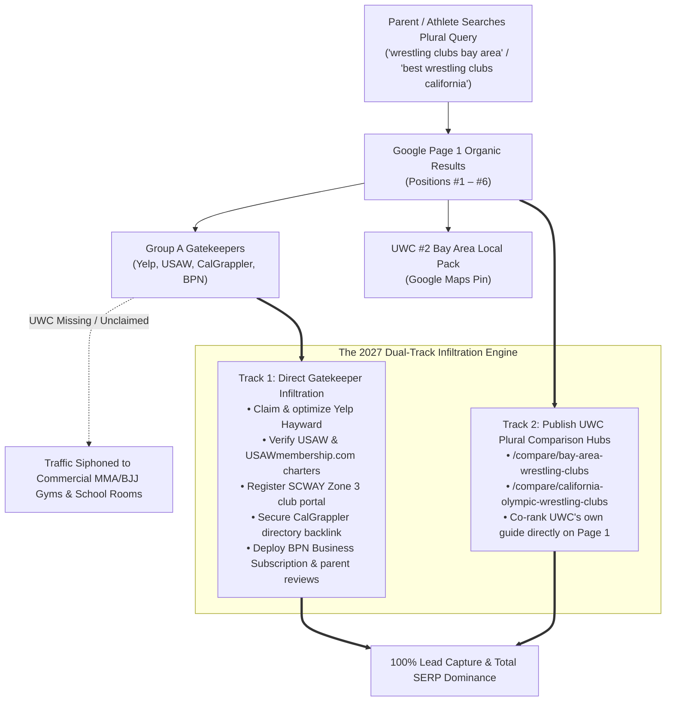

> Part 1 of 3 of [groupA_directories_and_governing_bodies](../groupA_directories_and_governing_bodies.md). Text is verbatim from the original; only links were rewritten.

# Group A Competitor Research Dossier: Directory, Aggregator & Governing Body Gatekeepers
**Target Entity:** United Wrestling Club (`unitedwrestlingclub.com`)  
**Physical Address:** 30139 Industrial Pkwy SW Ste C, Hayward, CA 94544  
**Primary Leadership:** Karim Zemaryalai (Founder & 1980 Olympian) & Naweed Zemaryalai (Head Coach & Chabot College Coach)  
**OpenSEO Project ID:** `778e3f25-5476-4c54-bfe2-e418e131aaaf`  
**Profile Date:** October 30, 2026  
**Document Code:** `UWC-COMP-GROUP-A`  

---

## 1. Executive Summary: The Plural Query Conundrum

In regional athletic search marketing, there is a fundamental divide between **singular commercial intent queries** (e.g., *"wrestling gym near me"*, *"wrestling classes hayward"*) and **plural investigative queries** (e.g., *"wrestling clubs bay area"*, *"best wrestling clubs in california"*, *"youth wrestling clubs east bay"*).

For singular intent queries, Google algorithms favor localized Google Business Profiles (Local Pack) and individual gym landing pages. United Wrestling Club (UWC) already dominates this layer, commanding **#1 Google Maps rank in Hayward and Fremont** and **#2 Local Pack across the SF Bay Area** with **2,086 monthly organic visitors** and **368 ranked keywords**.

However, for plural investigative queries, **Google's Search Quality Evaluator Guidelines dictate that users seeking "clubs" or "best options" must be presented with aggregated lists, governing body registries, and comparative directories.** As a consequence, Google fills organic positions #1 through #6 with five authoritative digital gatekeepers:
1. **USA Wrestling (`themat.com` Marketing Website + `usawmembership.com` Backend Portal)** — 382,141 monthly visits (`themat.com`) + 89,681 monthly visits (`usawmembership.com`) · #2 & #4 Organic
2. **Yelp.com (Local Category Aggregators)** — #1–#3 Organic across every major California municipality
3. **California USA Wrestling (`ca-usaw.org`) & SCWAY (`scwaywrestling.org`)** — 6,709 monthly visits (`ca-usaw.org` · 662 keywords) · Official State & Zone 3 Sanctioning Bodies
4. **CalGrappler.com & TheCaliforniaWrestler.com (State Editorial & Ranking Hubs)** — 13,933 monthly visits (`calgrappler.com`) + 8,337 monthly visits (`thecaliforniawrestler.com`) · #5 & #12 Organic California
5. **Berkeley Parents Network (`berkeleyparentsnetwork.org`)** — 292,732 monthly visits · 61,767 keywords · #6 Organic Bay Area Youth

### Why UWC Must Execute a Dual-Track Strategy
A single business website cannot unilaterally push USA Wrestling or Yelp off Page 1 of Google for state-level or regional queries. To capture 100% of prospective wrestling athletes and youth parents in 2027, UWC must execute a **two-pronged pincer movement**:

1. **Track 1: Direct Infiltration & Dominance of the 5 Gatekeepers**  
   UWC must claim, upgrade, and aggressively optimize its presence on all five gatekeeper platforms. When a parent clicks on Yelp's *"Top 10 Best Wrestling Clubs in Hayward"* or searches USA Wrestling's official state roster, UWC must be the standout #1 ranked, 5.0★ featured academy. Furthermore, AI engines (ChatGPT, Perplexity, Gemini, Apple Intelligence) heavily ingest these exact five structured platforms to generate conversational answers; being absent renders UWC invisible to AI answer engines.
2. **Track 2: Publishing UWC's Own Plural Hubs (`/compare/bay-area-wrestling-clubs`)**  
   UWC must publish its own editorial comparison hubs using **Format 2 Plural Alternatives** architecture. By presenting an honest, comprehensive directory of Bay Area wrestling options (highlighting UWC for East Bay/Tri-City while objectively indexing Peninsula, South Bay, and Tri-Valley clubs), UWC gives Google the exact plural information architecture it requires, allowing UWC's own domain to co-rank on Page 1 directly alongside Yelp and TheMat.com.

---

## 2. Master Top 5 Gatekeepers Comparison Matrix

> **Note on USA Wrestling Architecture:** `themat.com` is USA Wrestling's public marketing website (which hosts the public *"Find a Club"* wrapper at `themat.com/membership/athletes/find-a-club`), while `usawmembership.com` is the backend login/registration application (`usawmembership.com/login`) that also exposes indexed public state club tables (`usawmembership.com/state_clubs/CA`). They are one unified USA Wrestling ecosystem, not two separate competitors.

| # | Gatekeeper Entity | Primary URL | OpenSEO Traffic | OpenSEO Keywords | SERP Positions Owned | UWC Current Presence Status | Link Equity & Citation Type | Priority |
| :-: | :--- | :--- | :--- | :--- | :--- | :--- | :--- | :--- |
| **1** | **USA Wrestling (`themat.com` Marketing Site + `usawmembership.com` Portal)** | `themat.com` *(Backend: `usawmembership.com`)* | **382,141/mo** (`themat`) **89,681/mo** (`usawmembership`) | **11,704** **6,980** | **#2 Organic** (*"best wrestling clubs in california"*), **#4 & #6 Organic** (*"wrestling clubs bay area"*) | **Unverified / Hidden in Public Locator** (Not surfacing in `themat.com` locator or `state_clubs/CA` table) | Official Olympic NGB Entity Citation + High-Trust `.com` State Registry | **P0 (Immediate)** |
| **2** | **Yelp Local Directories** | `yelp.com` | **100M+/mo** | **Millions** | **#1–#3 Organic** across California for *"Top 10 Best Wrestling Club in [City]"* | **CRITICAL GAP: No Claimed Page** (Zero Yelp profile for UWC in Hayward) | Nofollow citation + Primary data feed for **Apple Maps & Siri Local Voice Search** | **P0 (Immediate)** |
| **3** | **CA-USAW (`ca-usaw.org`) & SCWAY (`scwaywrestling.org`)** | `ca-usaw.org` `scwaywrestling.org` | **6,709/mo** (`ca-usaw`) **121/mo** (`scway`) | **662** (`ca-usaw`) **28** (`scway`) | Official California & Bay Area (Zone 3) Youth/Scholastic Governing Portals | Competes in SCWAY/CA-USAW circuits, but **unlisted in Zone 3 / Bay Area web club directories** | `.org` State Governing Body Authority + $20 Athlete Card Discount for UWC Parents | **P0 (Immediate)** |
| **4** | **CalGrappler & The California Wrestler** | `calgrappler.com` `thecaliforniawrestler.com` | **13,933/mo** (`calgrappler`) **8,337/mo** (`tcw`) | **819** **388** | **#5 Organic** (TCW) & **#12 Organic** (CalGrappler) for *"best wrestling clubs in california"* | **Absent from CalGrappler "CA Team Websites"**; No active UWC thread in TCW Youth Forum | Hyper-targeted Dofollow Niche Links + CIF High School Coach Ingestion Graph | **P1 (High)** |
| **5** | **Berkeley Parents Network (BPN)** | `berkeleyparentsnetwork.org` | **292,732/mo** | **61,767** | **#6 Organic** (*"youth wrestling clubs bay area"* — `/recommend/classes/wrestling`) | **Unlisted on BPN**; Only generic boxing gym (Pacific Ring) and stale 2011–2017 threads listed | High-Authority `.org` Backlink + Direct High-Income East Bay Parent Referral Pipeline | **P1 (High)** |

---
