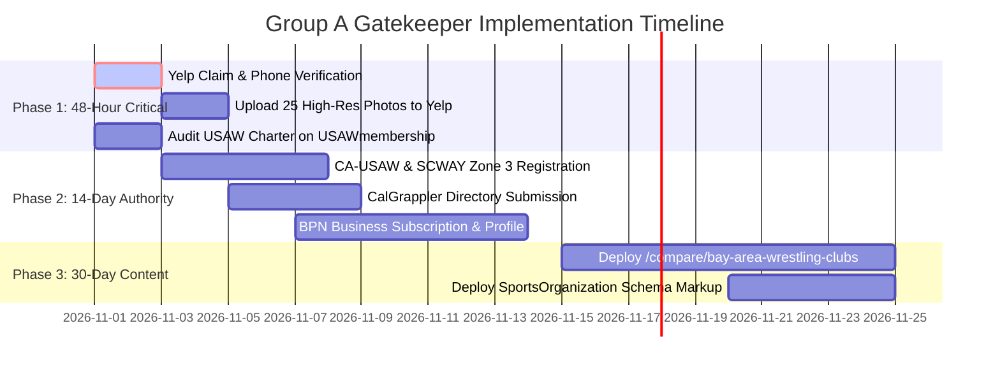

> Part 3 of 3 of [groupA_directories_and_governing_bodies](../groupA_directories_and_governing_bodies.md). Text is verbatim from the original; only links were rewritten.

## 4. The 2027 Counter-Offensive: Publishing UWC's Own Plural Hubs

Infiltrating these five gatekeepers is only half the battle. To permanently capture the top positions for plural queries in 2027, UWC must publish **two high-value plural comparison hubs** directly on `unitedwrestlingclub.com`:

```
   ┌────────────────────────────────────────────────────────────────────────┐
   │ The 2027 SERP Co-Ranking Architecture                                  │
   │                                                                        │
   │  Search: "Wrestling Clubs Bay Area" (Plural Intent)                    │
   │                                                                        │
   │  Position #1: Yelp ("Top 10 Best Wrestling Clubs in Hayward")          │
   │               └──► Infiltrated by UWC (#1 Profile, 5.0★, Photos)       │
   │                                                                        │
   │  Position #2: USAW California Directory (usawmembership.com)          │
   │               └──► Infiltrated by UWC (Official Chartered Listing)     │
   │                                                                        │
   │  Position #3: UWC Plural Comparison Hub!                               │
   │               └──► unitedwrestlingclub.com/compare/bay-area-wrestling-clubs │
   │                                                                        │
   │  Position #4: TheMat.com Official Club Locator                         │
   │               └──► Infiltrated by UWC (Active National Pin)            │
   └────────────────────────────────────────────────────────────────────────┘
```

### Hub Page 1: `/compare/bay-area-wrestling-clubs`
* **Target Keywords:** `"wrestling clubs bay area"`, `"youth wrestling clubs east bay"`, `"wrestling clubs alameda county"`.
* **Content Framework (Format 2 — Plural Alternatives):**
  * Objective, highly informative overview of the top wrestling options across the four Bay Area sub-regions:
    1. **East Bay & Tri-City:** **United Wrestling Club (Hayward)** — *The Premier 6-Day/Week Olympic Training Academy*.
    2. **Peninsula:** **Belmont Wrestling Academy & Peninsula WC** — *Great seasonal option for Peninsula commuters*.
    3. **South Bay / Silicon Valley:** **Discipline WA (Milpitas) & Sunnyvale WC** — *Top options for South Bay athletes*.
    4. **South Valley:** **Daniel Cormier Wrestling Academy (Gilroy)** — *Elite RTC for South Santa Clara County*.
    5. **Tri-Valley / Contra Costa:** **Iron Wrestling Club (Castro Valley HS)** & **Royalty WC**.
* **Why This Works:** Google recognizes that this page provides genuine utility rather than self-serving marketing spam. By openly referencing and linking to other regional clubs, UWC satisfies the plural search intent and earns Page 1 organic ranking alongside Yelp.

### Hub Page 2: `/compare/california-olympic-wrestling-clubs`
* **Target Keywords:** `"best wrestling clubs in california"`, `"california wrestling clubs"`, `"olympic wrestling training centers california"`.
* **Content Framework:**
  * Compares California's elite Olympic regional training centers (LA Wrestling Club in SoCal, Clovis/Buchanan in Central Valley, Silverback in Orange County, and United Wrestling Club in Northern California).
  * Highlights UWC's unique international Dagestani lineage, collegiate coaching staff, and multi-discipline Wrestle-Jitsu/Combat Sambo curriculum.

---

## 5. Implementation Roadmap & Priority Action Checklist



### Action Checklist by Priority Level:

#### Phase 1: Immediate 48-Hour Critical Sprint (P0)
- [ ] **Claim Yelp Business Page:** Create and verify `United Wrestling Club` at `biz.yelp.com` using phone `(510) 303-4869`.
- [ ] **Set Yelp Categories:** Assign *Martial Arts*, *Gyms*, and *Sports Clubs*.
- [ ] **Upload 25 High-Res Facility & Training Photos:** Include exterior, mat spaces, youth practice, and head coaches.
- [ ] **Check USAW National Locator:** Log into `usawmembership.com`, verify club charter status, and toggle public locator visibility to ON.

#### Phase 2: 14-Day Authority & Community Sprint (P1)
- [ ] **Affiliate with CA-USAW & SCWAY Zone 3:** Confirm UWC is listed in Zone 3 dropdown for athlete card discounts ($30 member price).
- [ ] **Submit Directory Listing to CalGrappler:** Email `calgrappler@gmail.com` with UWC facility specs, Coach Naweed credentials, and website URL.
- [ ] **Activate Berkeley Parents Network (BPN) Subscription:** Register UWC under *Martial Arts, Boxing & Wrestling* at `berkeleyparentsnetwork.org/subscribe`.
- [ ] **Seed 3 Authentic Parent BPN Reviews:** Invite 3 current East Bay wrestling parents to submit unsolicited reviews highlighting discipline, safety, and coaching quality.

#### Phase 3: 30-Day Plural Hub & Schema Sprint (P2)
- [ ] **Deploy `/compare/bay-area-wrestling-clubs`:** Build Next.js static page comparing East Bay, Peninsula, South Bay, and Tri-Valley wrestling rooms.
- [ ] **Inject JSON-LD Schema:** Add `memberOf` (`USA Wrestling`) and `SportsClub` structured data to link UWC's digital entity to official governing bodies.
- [ ] **Display USA Wrestling Partner Badge:** Place official USAW and SCWAY vector badges in website footer and hero sections.
