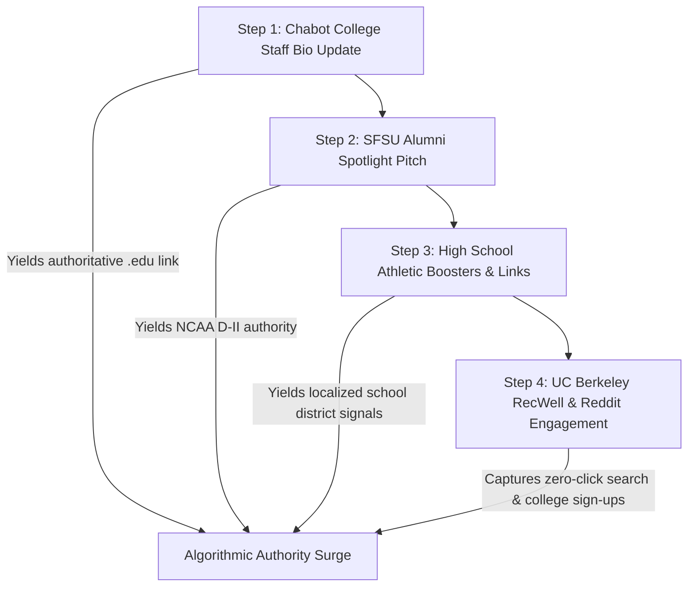

# Group C Competitor & Feeder Dossier: High School Scholastic Programs, College Rooms & RTC Ecosystems

> **Client:** Naweed Zemaryalai & Karim Zemaryalai  
> **Brand:** United Wrestling Club (`unitedwrestlingclub.com`)  
> **OpenSEO Project ID:** `778e3f25-5476-4c54-bfe2-e418e131aaaf`  
> **Location:** 30139 Industrial Pkwy SW Ste C, Hayward, CA 94544  
> **Focus Group:** Group C — High School Scholastic Camps, Collegiate Club Teams, NCAA Rooms & RTC Feeder Ecosystems  
> **Profile Date:** October 30, 2026  

---

## 1. Executive Summary: The Institutional & `.edu` Moat

In standard local SEO, commercial fitness gyms compete strictly on Google Business Profile (GBP) proximity signals and commercial directory citations. However, combat sports—and **Olympic Folkstyle, Freestyle, and Greco-Roman wrestling in particular**—operates within an entirely different institutional hierarchy. Wrestling participation is anchored to academic institutions: middle schools, high schools (CIF/NCS), community colleges (3C2A/CCCAA), and universities (NCAA D-I, D-II, and NCWA club teams).

**United Wrestling Club (UWC) possesses a generational, virtually unreplicable structural advantage** that commercial BJJ studios (e.g., Mindset Martial Arts, One World Jiu-Jitsu, Ralph Gracie) cannot duplicate:

```
Institutional Wrestling Moat:
┌────────────────────────────────────────────────────────────────────────┐
│                        UNITED WRESTLING CLUB                           │
│                 (30139 Industrial Pkwy SW, Hayward)                    │
└───────────────────────────────────┬────────────────────────────────────┘
                                    │
       ┌────────────────────────────┼────────────────────────────┐
       ▼                            ▼                            ▼
Chabot College (3C2A)     SF State Univ. (NCAA D-II)   James Logan HS (MVAL Power)
25555 Hesperian Blvd,     1600 Holloway Ave, SF        1801 H St, Union City
Hayward (3.8 miles)       (Alumni Hub)                 (Alumni & Coach Hub)
• Coach Naweed Zemaryalai • Coach Naweed (B.S. Kin)    • Coach Sandeep Singh Gosal
  (Staff Coach & Alum)    • Coach Sandeep (Alum)         (State Placer & Alum)
• Direct .edu Link Target • D-II Transfer Pipeline     • MVAL Feeder Core
```

### The Three Structural Advantages:

1. **Direct Collegiate Staff Integration (Chabot College — 3.8 miles away):**
   * Head Coach **Naweed Zemaryalai** is an active coach and former standout competitor at **Chabot College** (25555 Hesperian Blvd, Hayward). 
   * Chabot is the *only* collegiate wrestling room in Alameda County. Every competitive post-high-school athlete looking to continue wrestling collegiately without NCAA D-I scholarships lands at Chabot.
   * UWC serves as the primary off-season training facility for Chabot wrestlers, creating a high-level live room for scholastic high schoolers preparing for college recruiting.
   * **The Digital Opportunity:** A verified faculty/staff coaching profile and athletic department reference on `chabotathletics.com` or `chabotcollege.edu` provides an authoritative `.edu` backlink—the single highest-authority backlink tier in search engine algorithms.

2. **NCAA Division II Pedigree & SF State Pipeline:**
   * Both **Coach Naweed Zemaryalai** (B.S. in Kinesiology) and **Coach Sandeep Singh Gosal** wrestled and studied at **San Francisco State University** (`sfstategators.com`). SFSU is the *only* active NCAA Division II wrestling program in the San Francisco Bay Area and Northern California.
   * This provides UWC with a direct pathway to connect Bay Area high school recruits directly to NCAA college wrestling while creating high-credibility alumni profiles that siphon college student-athletes to UWC during summer breaks and weekend training blocks.

3. **High School Scholastic Feeder Hegemony (MVAL & WACC Conferences):**
   * High school scholastic wrestling across Alameda County (Mission Valley Athletic League - MVAL and Western Alameda County Conference - WACC) operates on a strict **4-month winter season (November to February)**.
   * From March through October (8 months!), CIF high school athletes are barred by CIF off-season rules from organized school-run practices. To place at NCS (North Coast Section) or qualify for the CIF State Championships in Bakersfield, these athletes **must train at an off-campus club**.
   * Coach **Sandeep Singh Gosal** is a legendary alumnus of **James Logan High School** (Union City)—the premier historic wrestling dynasty of the East Bay (which produced Olympic Silver Medalist Stephen Abas). Coach Gosal was a 2001 California State place-winner, wrestled NCAA Division I at Fresno State, and coached at both James Logan and John F. Kennedy High Schools.
   * By capturing the search queries of MVAL/WACC parents and wrestlers searching for *"off-season wrestling camp"* or *"freestyle club near me"*, UWC establishes an unbreakable local athletic pipeline.

---

## 2. Top 5 Scholastic/College Matrix (Confirmed Data & Opportunities)

| # | Organization / Institution | Target Geo & Distance | Confirmed Official URLs | SERP & Maps Footprint | Connection to UWC Staff | High-Impact Actionable Opportunity |
| :-: | :--- | :--- | :--- | :--- | :--- | :--- |
| **1** | **Chabot College Wrestling** | Hayward, CA<br>25555 Hesperian Blvd<br>(3.8 mi N of UWC) | • `chabotathletics.com/sports/wrest/`<br>• `chabotathletics.com/sports/wrest/coaches/`<br>• `chabotcollege.edu` | • #1 CCCAA/3C2A wrestling search in East Bay<br>• Local collegiate search anchor | **Coach Naweed Zemaryalai** is an active coach on staff & former standout 184 lb regional placer | Secure reciprocal coaching bio citation on `chabotathletics.com` pointing to UWC; establish UWC as official off-season RTC facility for Chabot student-athletes. |
| **2** | **San Francisco State University (SFSU) Wrestling** | San Francisco, CA<br>1600 Holloway Ave<br>(26.5 mi NW) | • `sfstategators.com/sports/wrestling`<br>• `sfstategators.com/sports/wrestling/roster`<br>• `sfsu.edu` | • Top NCAA D-II grappling program in Northern California<br>• RMAC Conference authority | **Coach Naweed Zemaryalai** (B.S. Kinesiology alum) & **Coach Sandeep Singh Gosal** (alumnus) | Co-promote seasonal pre-season clinics; create SFSU Wrestling Alumni showcase page; capture college transfers looking for Greco/Freestyle training. |
| **3** | **Wrestling Club at UC Berkeley** | Berkeley, CA<br>2301 Bancroft Way (RSF)<br>(23.2 mi N) | • `recwell.berkeley.edu`<br>• `calwrestling.org` (Historic)<br>• `lead.berkeley.edu` | • **Ranks #17 Organic** for *"wrestling clubs alameda county"*<br>• Strong `r/berkeley` Reddit volume | No institutional connection (pure competitor/feeder vacuum) | Target Cal students via direct BART route; build `/college-and-adult-wrestling-bay-area` landing page solving Cal's lack of year-round mat space; offer student discount. |
| **4** | **Cardinal Wrestling Club & California RTC (Stanford)** | Stanford, CA<br>641 Campus Dr (Arrillaga)<br>(21.5 mi SW across bridge) | • `cardinalwrestlingclub.com`<br>• `californiartc.org`<br>• `gostanford.com/sports/wrestling` | • **Ranks #8 & #9 on Google Maps** across Bay Area for *"wrestling club"*<br>• Elite NCAA D-I ACC room | Mutual platform parity (Both use **WrestlingIQ**!) | Position UWC as the **East Bay Regional Training Center** counterpart—same Olympic/collegiate intensity without the $7 bridge toll or 60-min rush hour commute over the Dumbarton/San Mateo bridges. |
| **5** | **MVAL & WACC High School Scholastic Camps** | Alameda County<br>(James Logan, Castro Valley, San Leandro) | • `jameslogan.org`<br>• `cv.k12.ca.us` (Iron WC)<br>• `eastbaywrestlingleague.com`<br>• `mapwrestling.com` | • **Bronco Camp ranks #13 Organic** for *"youth wrestling clubs bay area"*<br>• Iron WC owns Castro Valley | **Coach Sandeep Gosal** is Logan alum, state placer & former coach; Coach Naweed trains MVAL/WACC athletes | Build dedicated `/mval-wacc-offseason-wrestling` silo targeting high school athletes from all 16 league schools; offer high school pre-season prep intensives. |

---

## 3. Deep-Dive Profiles & Actionable Execution Steps

---

### Profile 1: Chabot College Wrestling (Hayward, CA)
* **Institutional Domain:** `chabotathletics.com` / `chabotcollege.edu`
* **Athletic Facility:** Chabot College Gymnasium (Building 2600), 25555 Hesperian Blvd, Hayward, CA 94545
* **Distance to UWC:** 3.8 miles (~7 minutes drive down Industrial Pkwy / Hesperian Blvd)
* **Governing Body:** California Community College Athletic Association (3C2A / CCCAA), Coast Conference
* **Athletic Leadership:**
  * Michael Grijalba (Head Wrestling Coach — `mgrijalba@chabotcollege.edu` / 510-723-6968)
  * Steve Siroy (Assistant Coach / CCCAA Hall of Fame — `ssiroy@chabotcollege.edu` / 510-723-6934)
  * Naweed Zemaryalai (Assistant Coach — Head Coach of United Wrestling Club)

#### Institutional Background & Regional Significance:
Chabot College is an athletic powerhouse in Northern California community college sports, boasting a wrestling tradition spanning over 50 years under legendary coach Steve Siroy. Chabot serves as the critical academic and athletic stepping stone for East Bay high school wrestlers who aspire to compete at the NCAA Division I or Division II level but need academic development or physical seasoning. 

Because California Community College wrestling seasons run solely during the autumn semester (September through December), Chabot collegiate athletes require a high-intensity, year-round wrestling room to drill Freestyle, Greco-Roman, and Folkstyle from January through August.

#### The United Wrestling Club Synergy & Coaching Connection:
Head Coach **Naweed Zemaryalai** is part of the Chabot College wrestling DNA:
1. **Athlete Pedigree:** Naweed wrestled at 184 lbs for Chabot, taking 5th place at the 2011 California Community College North Regional Championships and qualifying for the CCCAA State Championships.
2. **Current Staff Coach:** Naweed serves on the active Chabot coaching staff under Head Coach Michael Grijalba.
3. **Proximity:** UWC’s facility on Industrial Parkway Southwest is literally 3.8 miles from the Chabot mats.

#### Actionable Execution Steps for UWC:
1. **Secure the Authoritative `.edu` Backlink:**
   * Ensure Coach Naweed’s biography page on `chabotathletics.com/sports/wrest/coaches/` explicitly includes: *"Coach Naweed is also the Head Coach and Director of United Wrestling Club in Hayward, California ([unitedwrestlingclub.com](https://www.unitedwrestlingclub.com/)), where he trains elite scholastic and collegiate athletes in Olympic Freestyle, Greco-Roman, and Folkstyle wrestling."*
   * `.edu` backlinks provide immense domain authority in Google's PageRank algorithm, immediately elevating UWC above commercial gyms.
2. **Establish UWC as the Unofficial Chabot Off-Season RTC:**
   * Package an exclusive **"Collegiate Summer Training Pass"** for current and incoming Chabot wrestlers at $99/mo (or WrestlingIQ college discount) during spring and summer semesters.
   * Having 10–15 collegiate wrestlers in UWC’s 7:00 PM evening room instantly transforms UWC into the toughest, most attractive training environment in Northern California for high school juniors and seniors looking for college-level live wrestling.
3. **Joint Community College Clinics:**
   * Host an annual *"Chabot College Showcase & Clinic"* at UWC in September right before the CCCAA season kicks off, featuring Coach Grijalba and Coach Naweed. High school seniors from across the Bay Area attend to get scouted for junior college recruitment.

---

### Profile 2: San Francisco State University (SFSU) Wrestling (San Francisco, CA)
* **Institutional Domain:** `sfstategators.com` / `sfsu.edu`
* **Athletic Facility:** The Swamp / Gymnasium (Don Nasser Family Plaza), 1600 Holloway Ave, San Francisco, CA 94132
* **Distance to UWC:** 26.5 miles (~35–45 minutes via I-880 N / I-80 W or San Mateo Bridge / I-280 N)
* **Governing Body:** NCAA Division II, Rocky Mountain Athletic Conference (RMAC)
* **Athletic Leadership:**
  * Jason Welch (Head Wrestling Coach — 3x NCAA D-I All-American & 4x CIF State Champion at Las Lomas HS)
  * Scott Loescher & Chris Cannon (Assistant Coaches)

#### Institutional Background & Regional Significance:
San Francisco State University is the **sole remaining NCAA Division II collegiate wrestling program in the San Francisco Bay Area and Northern California**. Following the elimination of NCAA programs at UC Berkeley, Fresno State (dropped twice), San Jose State, and Santa Clara, SFSU represents a vital collegiate bastion for California high school wrestlers seeking NCAA athletic competition. SFSU competes in the RMAC against programs like Colorado Mesa, Western Colorado, and Nebraska-Kearney.

#### The United Wrestling Club Synergy & Alumni Connection:
UWC’s coaching leadership has direct roots at SF State:
1. **Coach Naweed Zemaryalai:** Transferred from Chabot College to SFSU, where he studied and graduated with a **Bachelor of Science in Kinesiology**, studying exercise science, movement mechanics, and athletic performance.
2. **Coach Sandeep Singh Gosal:** Competed in collegiate wrestling at both Fresno State and SF State, building deep ties within the Northern California collegiate coaching community.
3. **Head Coach Jason Welch Connection:** SFSU Head Coach Jason Welch is a Bay Area wrestling legend (Las Lomas High School in Walnut Creek, where he was a 4x CIF State Champion before becoming an NCAA finalist at Northwestern). He shares deep cultural alignment with local East Bay club coaches who feed high-character athletes into collegiate programs.

#### Actionable Execution Steps for UWC:
1. **Alumni Bridge & Direct Link Building:**
   * Request inclusion in the SFSU Wrestling Alumni Directory or Alumni Spotlight feature on `sfstategators.com`, highlighting Coach Naweed’s career as an SFSU Kinesiology graduate who founded/leads a premier Olympic wrestling facility in the East Bay.
2. **NCAA D-II Feeder Status:**
   * Feature a dedicated sub-heading on UWC's website: *"The Collegiate Pathway: From East Bay Scholastic Wrestling to SFSU & NCAA Division II."* Detail how UWC's Greco/Freestyle training equips athletes for college recruiting visits.
3. **Summer Mat Retainers for Collegiate SFSU Athletes:**
   * Many SFSU wrestlers live in the East Bay (Hayward, San Leandro, Oakland, Fremont) during the summer or off-season. UWC should offer specialized summer training memberships for collegiate student-athletes looking to maintain mat endurance and hand-fighting sharpness without commuting to the SFSU campus every day.

---

### Profile 3: Wrestling Club at UC Berkeley (Berkeley, CA)
* **Institutional Domain:** `recwell.berkeley.edu` / `calwrestling.org` / `lead.berkeley.edu`
* **Athletic Facility:** Recreational Sports Facility (RSF) - Combatives Room, 2301 Bancroft Way, Berkeley, CA 94720
* **Distance to UWC:** 23.2 miles (~28 minutes via direct BART from Downtown Berkeley to Hayward, or via I-80 E / I-880 S)
* **Governing Body:** National Collegiate Wrestling Association (NCWA) / UC Berkeley RecWell Club Sports
* **OpenSEO Search Position:** **Ranks #17 Organic** for `"wrestling clubs alameda county"`

#### Institutional Background & The "Cal Wrestling Vacuum":
UC Berkeley historically boasted a powerhouse NCAA Division I wrestling program (producing NCAA champions and Olympic medalists) before dropping the sport from varsity status in 1980. Since then, wrestling at Cal has survived exclusively as a student-run sports club competing intermittently in the NCWA.

However, Cal's student wrestling club suffers from systemic structural handicaps:
1. **Facility Shortages at the RSF:** The RSF Combatives Room (2301 Bancroft Way) is heavily congested, forced to share mat space between club wrestling, Judo, Karate, Taekwondo, gymnastics, and general campus recreational classes.
2. **Leadership Turnover:** As a student-run club, leadership fluctuates every 1–2 years as student officers graduate, leading to periods where the club becomes inactive.
3. **Massive Reddit Search Volume on `r/berkeley`:** University students actively post on `r/berkeley` and `r/bayarea` asking: *"Where can I wrestle in the East Bay?"*, *"Are there beginner wrestling classes around Berkeley?"*, and *"Can adults learn folkstyle/freestyle takedowns?"* Students frequently resort to practicing wrestling drills on the grass at Memorial Glade or Strawberry Canyon due to lack of open mat space.

#### Actionable Execution Steps for UWC:
1. **BART Corridor Transit Positioning:**
   * UWC is located directly down the East Bay transit artery. A Cal student can walk to Downtown Berkeley BART, take the Orange Line (Berryessa/North San José) straight to Hayward Station (32-minute ride), and take a quick bus or rideshare to UWC's facility on Industrial Parkway.
2. **Deploy the Dedicated Landing Page: `/college-and-adult-wrestling-bay-area`:**
   * Target exact queries: *"college wrestling club east bay"*, *"wrestling for uc berkeley students"*, *"adult wrestling classes berkeley hayward"*.
   * Address Cal students directly: *"Missing mat time at the RSF? United Wrestling Club provides 6-day-a-week access to Olympic-grade mats, Dagestani hand-fighting, and collegiate live rooms just down the BART corridor."*
3. **Cal Student & Alumni Discount ($99/mo or Semester Passes):**
   * Provide a discounted student membership with valid `.edu` student ID ($99/mo vs. regular $139.99/mo).
   * Engage with verified Cal students on `r/berkeley` and `r/bayarea` recommending UWC as the primary year-round off-campus training home.
4. **Partner with CSU East Bay (Right in Hayward!):**
   * California State University, East Bay (`csueastbay.edu`) is located at 25800 Carlos Bee Blvd in Hayward—less than 4 miles from UWC! CSU East Bay has no collegiate wrestling team. UWC should target the CSUEB student body with campus bulletin board flyers, club sponsorships, and campus recreation partnerships.

---

### Profile 4: Cardinal Wrestling Club & California Regional Training Center (Stanford, CA)
* **Institutional Domain:** `cardinalwrestlingclub.com` / `californiartc.org` / `gostanford.com/sports/wrestling`
* **Athletic Facility:** Arrillaga Family Sports Center / Maples Pavilion, 641 Campus Dr, Stanford, CA 94305
* **Distance to UWC:** 21.5 miles (~35–55 minutes across the Dumbarton Bridge / CA-84 W or San Mateo Bridge / CA-92 W)
* **Governing Body:** USA Wrestling Regional Training Center (RTC) / NCAA Division I (Stanford Wrestling - ACC)
* **Athletic Leadership:**
  * Chris Ayres (The Matt Gentry Head Wrestling Coach at Stanford — former Princeton Head Coach)
  * Myles Amine (Assistant Coach — 2020 Tokyo Olympic Bronze Medalist, 5x NCAA All-American)
  * Patrick Brucki & Sean Gray (Assistant Coaches)
* **OpenSEO SERP / Maps Footprint:** **Ranks #8 & #9 on Google Maps** across the San Francisco Bay Area for `"wrestling club"`

#### Institutional Background & Regional Significance:
Cardinal Wrestling Club (CWC) and the California Regional Training Center (CRTC) represent the apex of Olympic Freestyle and senior-level collegiate wrestling in Northern California. Operating out of Stanford University's athletic facilities, CWC hosts Stanford's Division I wrestlers (now competing in the Atlantic Coast Conference - ACC), senior-level international contenders, and elite high school wrestlers from across Northern California.

#### Strategic Benchmark & Competitive Comparison:
* **Platform Parity:** Both Cardinal Wrestling Club and United Wrestling Club utilize **WrestlingIQ** as their backend registration and member management platform.
* **The Trans-Bay Commute Friction:**
  * For families and high school wrestlers living in Hayward, Union City, Fremont, San Leandro, Castro Valley, and Oakland, traveling to Stanford requires crossing either the **Dumbarton Bridge (CA-84)** or the **San Mateo-Hayward Bridge (CA-92)**.
  * During peak training hours (4:30 PM – 7:30 PM), bridge traffic routinely pushes one-way travel times to **50–75 minutes**, plus **$7.00 in bridge tolls** each day ($140+/month just in tolls!).
  * While elite high school wrestlers make the journey once a week or for weekend RTC practices, weeknight club training at Stanford is logistically impractical for East Bay parents.

#### Actionable Execution Steps for UWC:
1. **Position UWC as "The East Bay Regional Training Center":**
   * Craft messaging targeting serious East Bay parents: *"Get Olympic-level instruction, Dagestani technique, and collegiate live goes without the 90-minute bridge traffic or $7 tolls. United Wrestling Club is the premier wrestling hub on the East Bay side of the San Mateo and Dumbarton bridges."*
2. **Curriculum Differentiation (The Dagestani Advantage):**
   * Stanford and CRTC excel at American Folkstyle hand-fighting and standard Freestyle finishes. 
   * UWC offers something unique: **authentic Dagestani and Soviet wrestling lineage** through Founder Karim Zemaryalai (Moscow Olympic qualifier, Ali Aliyev medalist) and Coach Rashad Rahimi (Asian Games medalist). UWC teaches the tie-ups, 2-on-1 Russian ties, upper-body throws, and ankle-pick mechanics that have come to dominate international combat sports.
3. **Collaboration Rather Than Hostility:**
   * Promote UWC athletes attending Stanford camps and weekend clinics while encouraging Stanford club staff to recognize UWC as an elite East Bay feeder club. Maintain mutual respect with Stanford RTC coaching staff while capturing everyday East Bay training volume.

---

### Profile 5: MVAL & WACC High School Scholastic Camps & Programs (Alameda County)
* **Institutional Scope:** 16+ High Schools across Western Alameda County Conference (WACC) and Mission Valley Athletic League (MVAL)
* **Anchor Facilities & Programs:**
  1. **James Logan High School Wrestling:** 1801 H St, Union City, CA 94587 (MVAL)
  2. **Castro Valley High School / Iron Wrestling Club:** 19400 Santa Maria Ave, Castro Valley, CA 94546 (WACC — `cv.k12.ca.us` / `ironwrestlingclub.com`)
  3. **Bronco Wrestling Camp / San Leandro High School:** 2200 Bancroft Ave, San Leandro, CA 94577 (WACC — **Ranks #13 Organic** for `"youth wrestling clubs bay area"`, `eastbaywrestlingleague.com`)
  4. **Fremont MVAL Cluster:** American HS, Irvington HS, John F. Kennedy HS, Mission San Jose HS, Washington HS
  5. **Hayward / San Lorenzo WACC Cluster:** Hayward HS, Mt. Eden HS, Tennyson HS, Arroyo HS, San Lorenzo HS

#### The Scholastic Ecosystem Reality:
In Alameda County, scholastic wrestling is partitioned into two dominant CIF leagues within the North Coast Section (NCS):
* **MVAL (Tri-City):** James Logan, Newark Memorial, American, Irvington, Kennedy, Mission San Jose, Washington.
* **WACC (Hayward/Oakland/Alameda):** Castro Valley, San Leandro, Hayward, Mt. Eden, Arroyo, San Lorenzo, Berkeley, Alameda, Encinal.

#### The Critical 8-Month "Off-Season Vacuum":
Under California Interscholastic Federation (CIF) bylaws, high school coaches are prohibited from conducting mandatory team practices outside the official winter season (November to mid-February). 

* **The Problem for High School Athletes:** If a sophomore or junior wrestler stops training in February when the high school season ends, they lose their conditioning, hand-fighting instincts, and technical sharpness before the November tryouts. Those who aspire to win league titles (MVAL/WACC), qualify for the NCS tournament, or reach CIF State **must train at an independent club from March to October**.
* **The Problem with Existing High School Clubs:**
  * Programs like *Iron Wrestling Club* at Castro Valley High School or *Bronco Wrestling Camp* at San Leandro High are seasonal, volunteer-run, and practice only 2 days a week in cramped auxiliary gyms during spring.
  * None of these school-run clubs offer year-round, 6-day-a-week facilities with dedicated collegiate and Olympic coaches, adult wrestling, or cross-training in Sambo and No-Gi Wrestle-Jitsu.

#### The Sandeep Singh Gosal Legacy at James Logan:
Coach **Sandeep Singh Gosal** is a legendary name within the MVAL and James Logan High School wrestling community:
* James Logan High School in Union City is an athletic institution that produced **Stephen Abas** (3x NCAA Champion at Fresno State and 2004 Olympic Silver Medalist at 55 kg in Athens).
* Coach Sandeep Gosal was a 2001 CIF California State place-winner for James Logan, followed the same path to NCAA Division I wrestling at Fresno State, and later served as an assistant wrestling coach at both James Logan and John F. Kennedy High Schools.
* His presence at UWC provides instant, unmatched trust among MVAL parents, athletic directors, and high school coaches.

#### Actionable Execution Steps for UWC:
1. **Deploy `/mval-wacc-offseason-wrestling` Landing Page:**
   * Create an authoritative guide for high school wrestlers across Alameda County targeting terms like:
     * *"MVAL wrestling off season training"*
     * *"high school wrestling club union city hayward fremont"*
     * *"NCS wrestling preparation clinic"*
     * *"James Logan wrestling club offseason"*
     * *"Castro Valley wrestling offseason training"*
2. **Pre-Season "NCS Championship Prep Camp" (October):**
   * Host an intensive 4-week pre-season camp in October just before high school tryouts start on November 1st. Focus on mat returns, hand-fighting conditioning, referee's position escapes, and mental toughness.
3. **Spring Freestyle & Greco-Roman State Qualifier Silo (March – May):**
   * Run a dedicated USA Wrestling / SCWAY spring tournament team for middle and high school wrestlers competing at the California Freestyle & Greco-Roman State Championships in Fresno.
4. **Direct Outreach to MVAL and WACC Head Coaches:**
   * Position UWC not as a rival to high school teams, but as their **greatest off-season partner**. UWC does not compete during the high school season; UWC builds the athletes that make high school coaches look like champions in the winter.

---

## 4. Tactical Implementation Roadmaps

### Roadmap A: Securing Institutional & `.edu` Backlinks

To build an authoritative link profile that permanently outranks commercial BJJ gyms and directories, UWC should execute this 4-step outreach campaign:



1. **Chabot College Athletics (`chabotathletics.com`):**
   * Submit updated coaching profile text for Coach Naweed Zemaryalai to the Chabot Sports Information Director (SID) and Head Coach Michael Grijalba.
   * Include exact anchor text: `United Wrestling Club (Hayward, CA)` linking directly to `https://www.unitedwrestlingclub.com/`.
2. **SFSU Kinesiology & Athletics Department (`sfsu.edu` / `sfstategators.com`):**
   * Submit an alumni career spotlight to the SF State College of Health & Social Sciences (Kinesiology Department) featuring Naweed Zemaryalai: *"From Gator Wrestling & Kinesiology to Building the East Bay's Premier Combat Sports Academy."*
   * Link back to UWC’s curriculum page on exercise physiology and youth athletic development.
3. **High School Athletic Booster Directories:**
   * Sponsor banners or booster club listings on athletic websites for James Logan High (`jameslogan.org`), Castro Valley High (`cvhs.cv.k12.ca.us`), and San Leandro High (`slhs.slusd.us`), earning localized high-trust school district links.

---

### Roadmap B: URL Blueprint — `/college-and-adult-wrestling-bay-area`

* **Target URL:** `https://www.unitedwrestlingclub.com/college-and-adult-wrestling-bay-area`
* **Target Query Cluster:**
  * *"college wrestling club bay area"*
  * *"adult wrestling classes east bay"*
  * *"where can adults learn wrestling after high school"*
  * *"wrestling for college students berkeley hayward"*
  * *"adult folkstyle wrestling oakland fremont"*
* **Page Hierarchy & Content Architecture:**
  1. **H1:** College & Adult Wrestling in the San Francisco Bay Area (Hayward & East Bay)
  2. **Hero Hook:** *"Wrestling doesn't stop after high school or college graduation. Train 6 days a week on Olympic mats with collegiate and international coaches."*
  3. **Section 1: The College Room Experience for Local University Students:**
     * Dedicated callouts for students from **UC Berkeley (Cal)**, **Chabot College**, **CSU East Bay**, **San Jose State**, and **SF State**.
     * Transit guide: Direct BART access from Downtown Berkeley / Oakland to Hayward + student transit tips.
  4. **Section 2: Adult Beginners to Competitive Grapplers ("Wrestle-Jitsu"):**
     * Solves the adult fear: *"Am I too old to learn wrestling?"*
     * How UWC teaches adult beginners takedown mechanics, level changes, and injury-preventative mat movement without throwing them into reckless collegiate scrambles.
  5. **Section 3: Sambo, Greco-Roman & Freestyle Specialization:**
     * Overview of Kyrgyz Combat Sambo throws, Russian 2-on-1 ties, and upper-body throws.
  6. **Interactive Widget / Schedule:**
     * Monday – Friday 7:00 PM Adult Wrestling / No-Gi Grappling slots + Saturday 10:00 AM Open Mat.
  7. **Clear Offer / CTA:**
     * *"Claim Your $15 Single-Session Drop-In Pass or Free First-Week College Student Trial via WrestlingIQ."*
  8. **Structured Data:**
     * `SportsClub` JSON-LD schema with `audience: Adult, CollegeStudent` and `amenityFeature: Olympic Wrestling Mats, Shower Facilities, Conditioning Zone`.

---

### Roadmap C: URL Blueprint — `/mval-wacc-offseason-wrestling`

* **Target URL:** `https://www.unitedwrestlingclub.com/mval-wacc-offseason-wrestling`
* **Target Query Cluster:**
  * *"MVAL wrestling offseason club"*
  * *"WACC high school wrestling training"*
  * *"high school wrestling club hayward fremont union city"*
  * *"freestyle and greco wrestling camps bay area"*
  * *"NCS state qualifier wrestling training"*
* **Page Hierarchy & Content Architecture:**
  1. **H1:** MVAL & WACC Off-Season High School Wrestling Academy (East Bay CIF Champions)
  2. **Hero Hook:** *"High school champions are crowned in February at CIF State, but they are built from March to October at United Wrestling Club."*
  3. **Section 1: The Off-Season Advantage (Why 4 Months of High School Practice Isn't Enough):**
     * Detailed breakdown of the CIF off-season rules and why elite wrestlers must transition to club training for Freestyle, Greco-Roman, and advanced Folkstyle chaining.
  4. **Section 2: The Coaching Pedigree (James Logan, Chabot & Olympic Lineage):**
     * Highlighting Coach Sandeep Singh Gosal (James Logan State Placer, Fresno State D-I, former Logan/Kennedy coach) and Coach Naweed Zemaryalai (Chabot College Coach, SF State).
     * Highlighting Founder Karim Zemaryalai's Dagestani technical lineage.
  5. **Section 3: Target High Schools Served (Direct Geo Reinforcement):**
     * *MVAL League:* James Logan, Newark Memorial, American, Irvington, John F. Kennedy, Mission San Jose, Washington.
     * *WACC League:* Castro Valley, San Leandro, Hayward, Mt. Eden, Tennyson, Arroyo, San Lorenzo.
  6. **Section 4: The 4-Stage Scholastic Roadmap:**
     * *Stage 1 (March – May):* USA Wrestling Freestyle & Greco-Roman Season (California State Finals in Fresno).
     * *Stage 2 (June – July):* Summer Wrestling Bootcamps & Mat Return Intensives.
     * *Stage 3 (August – October):* Pre-Season High School Preparation & Collegiate Live Goes (drilling with Chabot College athletes).
     * *Stage 4 (November – February):* Supplemental Sunday/Weekend Technique Clinics during the high school season.
  7. **Clear Offer / CTA:**
     * *"Register for the High School Off-Season Pass ($139.99/mo) on WrestlingIQ."*
  8. **Structured Data:**
     * `Course` / `EducationalOrganization` and `SportsClub` schema linking MVAL/WACC high school athletic terms to UWC’s curriculum.

---

## 5. Strategic Conclusion & 2027 Competitive Outlook

By aggressively executing on Group C, United Wrestling Club will accomplish what no commercial martial arts studio in Alameda County can:

1. **Capture Institutional Backlinks:** Earning `.edu` links from Chabot College and alumni citations from SFSU cements UWC as a permanent institutional entity in Google's Knowledge Graph, rendering it immune to algorithm shifts.
2. **Monopolize the High School Athlete Pipeline:** High school wrestlers represent high-LTV, long-retention customers who train 4–6 days a week, buy team apparel, recruit their teammates, and graduate into UWC's adult grappling classes.
3. **Solve the East Bay Collegiate Grappling Vacuum:** Welcoming UC Berkeley, CSU East Bay, and Chabot students into evening and weekend rooms creates the highest-level live wrestling environment between San Jose and Sacramento.
