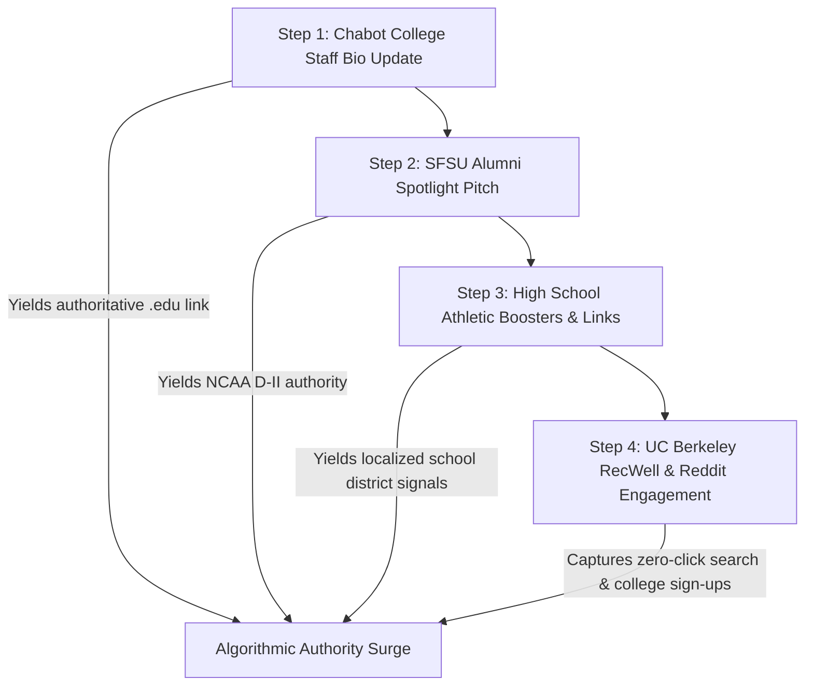

> Part 3 of 3 of [groupC_scholastic_and_college_programs](../groupC_scholastic_and_college_programs.md). Text is verbatim from the original; only links were rewritten.

## 4. Tactical Implementation Roadmaps

### Roadmap A: Securing Institutional & `.edu` Backlinks

To build an authoritative link profile that permanently outranks commercial BJJ gyms and directories, UWC should execute this 4-step outreach campaign:

1. **Chabot College Athletics (`chabotathletics.com`):**
   * Submit updated coaching profile text for Coach Naweed Zemaryalai to the Chabot Sports Information Director (SID) and Head Coach Michael Grijalba.
   * Include exact anchor text: `United Wrestling Club (Hayward, CA)` linking directly to `https://www.unitedwrestlingclub.com/`.
2. **SFSU Kinesiology & Athletics Department (`sfsu.edu` / `sfstategators.com`):**
   * Submit an alumni career spotlight to the SF State College of Health & Social Sciences (Kinesiology Department) featuring Naweed Zemaryalai: *"From Gator Wrestling & Kinesiology to Building the East Bay's Premier Combat Sports Academy."*
   * Link back to UWC’s curriculum page on exercise physiology and youth athletic development.
3. **High School Athletic Booster Directories:**
   * Sponsor banners or booster club listings on athletic websites for James Logan High (`jameslogan.org`), Castro Valley High (`cvhs.cv.k12.ca.us`), and San Leandro High (`slhs.slusd.us`), earning localized high-trust school district links.

---

### Roadmap B: URL Blueprint — `/college-and-adult-wrestling-bay-area`

* **Target URL:** `https://www.unitedwrestlingclub.com/college-and-adult-wrestling-bay-area`
* **Target Query Cluster:**
  * *"college wrestling club bay area"*
  * *"adult wrestling classes east bay"*
  * *"where can adults learn wrestling after high school"*
  * *"wrestling for college students berkeley hayward"*
  * *"adult folkstyle wrestling oakland fremont"*
* **Page Hierarchy & Content Architecture:**
  1. **H1:** College & Adult Wrestling in the San Francisco Bay Area (Hayward & East Bay)
  2. **Hero Hook:** *"Wrestling doesn't stop after high school or college graduation. Train 6 days a week on Olympic mats with collegiate and international coaches."*
  3. **Section 1: The College Room Experience for Local University Students:**
     * Dedicated callouts for students from **UC Berkeley (Cal)**, **Chabot College**, **CSU East Bay**, **San Jose State**, and **SF State**.
     * Transit guide: Direct BART access from Downtown Berkeley / Oakland to Hayward + student transit tips.
  4. **Section 2: Adult Beginners to Competitive Grapplers ("Wrestle-Jitsu"):**
     * Solves the adult fear: *"Am I too old to learn wrestling?"*
     * How UWC teaches adult beginners takedown mechanics, level changes, and injury-preventative mat movement without throwing them into reckless collegiate scrambles.
  5. **Section 3: Sambo, Greco-Roman & Freestyle Specialization:**
     * Overview of Kyrgyz Combat Sambo throws, Russian 2-on-1 ties, and upper-body throws.
  6. **Interactive Widget / Schedule:**
     * Monday – Friday 7:00 PM Adult Wrestling / No-Gi Grappling slots + Saturday 10:00 AM Open Mat.
  7. **Clear Offer / CTA:**
     * *"Claim Your $15 Single-Session Drop-In Pass or Free First-Week College Student Trial via WrestlingIQ."*
  8. **Structured Data:**
     * `SportsClub` JSON-LD schema with `audience: Adult, CollegeStudent` and `amenityFeature: Olympic Wrestling Mats, Shower Facilities, Conditioning Zone`.

---

### Roadmap C: URL Blueprint — `/mval-wacc-offseason-wrestling`

* **Target URL:** `https://www.unitedwrestlingclub.com/mval-wacc-offseason-wrestling`
* **Target Query Cluster:**
  * *"MVAL wrestling offseason club"*
  * *"WACC high school wrestling training"*
  * *"high school wrestling club hayward fremont union city"*
  * *"freestyle and greco wrestling camps bay area"*
  * *"NCS state qualifier wrestling training"*
* **Page Hierarchy & Content Architecture:**
  1. **H1:** MVAL & WACC Off-Season High School Wrestling Academy (East Bay CIF Champions)
  2. **Hero Hook:** *"High school champions are crowned in February at CIF State, but they are built from March to October at United Wrestling Club."*
  3. **Section 1: The Off-Season Advantage (Why 4 Months of High School Practice Isn't Enough):**
     * Detailed breakdown of the CIF off-season rules and why elite wrestlers must transition to club training for Freestyle, Greco-Roman, and advanced Folkstyle chaining.
  4. **Section 2: The Coaching Pedigree (James Logan, Chabot & Olympic Lineage):**
     * Highlighting Coach Sandeep Singh Gosal (James Logan State Placer, Fresno State D-I, former Logan/Kennedy coach) and Coach Naweed Zemaryalai (Chabot College Coach, SF State).
     * Highlighting Founder Karim Zemaryalai's Dagestani technical lineage.
  5. **Section 3: Target High Schools Served (Direct Geo Reinforcement):**
     * *MVAL League:* James Logan, Newark Memorial, American, Irvington, John F. Kennedy, Mission San Jose, Washington.
     * *WACC League:* Castro Valley, San Leandro, Hayward, Mt. Eden, Tennyson, Arroyo, San Lorenzo.
  6. **Section 4: The 4-Stage Scholastic Roadmap:**
     * *Stage 1 (March – May):* USA Wrestling Freestyle & Greco-Roman Season (California State Finals in Fresno).
     * *Stage 2 (June – July):* Summer Wrestling Bootcamps & Mat Return Intensives.
     * *Stage 3 (August – October):* Pre-Season High School Preparation & Collegiate Live Goes (drilling with Chabot College athletes).
     * *Stage 4 (November – February):* Supplemental Sunday/Weekend Technique Clinics during the high school season.
  7. **Clear Offer / CTA:**
     * *"Register for the High School Off-Season Pass ($139.99/mo) on WrestlingIQ."*
  8. **Structured Data:**
     * `Course` / `EducationalOrganization` and `SportsClub` schema linking MVAL/WACC high school athletic terms to UWC’s curriculum.

---

## 5. Strategic Conclusion & 2027 Competitive Outlook

By aggressively executing on Group C, United Wrestling Club will accomplish what no commercial martial arts studio in Alameda County can:

1. **Capture Institutional Backlinks:** Earning `.edu` links from Chabot College and alumni citations from SFSU cements UWC as a permanent institutional entity in Google's Knowledge Graph, rendering it immune to algorithm shifts.
2. **Monopolize the High School Athlete Pipeline:** High school wrestlers represent high-LTV, long-retention customers who train 4–6 days a week, buy team apparel, recruit their teammates, and graduate into UWC's adult grappling classes.
3. **Solve the East Bay Collegiate Grappling Vacuum:** Welcoming UC Berkeley, CSU East Bay, and Chabot students into evening and weekend rooms creates the highest-level live wrestling environment between San Jose and Sacramento.
