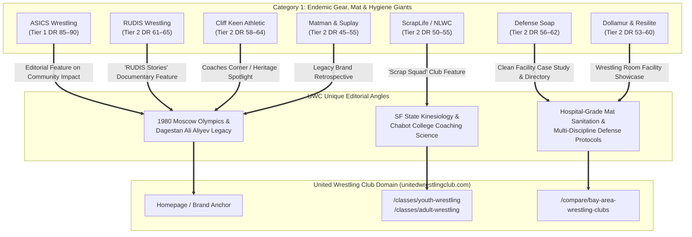
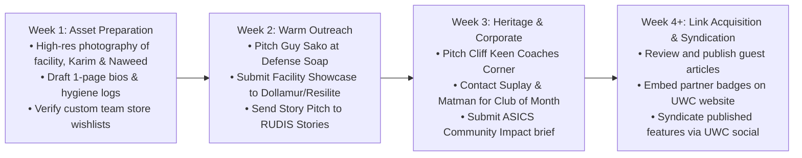

# Category 1 Link Equity Dossier: Wrestling Apparel, Gear, Mats & Hygiene Brands
**Target Entity:** United Wrestling Club (`unitedwrestlingclub.com`)  
**Physical Address:** 30139 Industrial Pkwy SW Ste C, Hayward, CA 94544  
**Primary Leadership:** Karim Zemaryalai (Founder & 1980 Olympian) & Naweed Zemaryalai (Head Coach & Chabot College Coach)  
**OpenSEO Project ID:** `778e3f25-5476-4c54-bfe2-e418e131aaaf`  
**Research Date:** October 31, 2026  
**Document Code:** `UWC-LINK-CAT1-GEAR`

---

## 1. Executive Summary & Strategic Link Equity Value

In Google's Knowledge Graph and combat sports entity graph, backlinks from **endemic gear, mat, and apparel manufacturers** provide the highest degree of **Topical Authority (Relevance)** and **Co-Occurrence Trust**. 

While local directories (e.g., Yelp, Chamber of Commerce) establish geographic proximity, they carry zero wrestling-specific topical trust. Conversely, when authoritative wrestling apparel brands (like RUDIS or ScrapLife), Olympic mat manufacturers (Dollamur and Resilite), and combat hygiene authorities (Defense Soap) reference, quote, or spotlight United Wrestling Club, search engine algorithms identify UWC not merely as a generic gym, but as an **authoritative node in the American wrestling ecosystem**.



### Why Category 1 Brands Need UWC Just as Much as UWC Needs Them
These brands run continuous content engines (podcasts, YouTube docuseries, blogs, customer spotlights) and suffer from content fatigue. They are perpetually hunting for:
1. **Authentic Olympic Lore:** Karim Zemaryalai's journey from the 1980 Moscow Olympic qualification and his bronze medal at the brutal Ali Aliyev Tournament in Dagestan to establishing a coaching pipeline in Northern California is one of the rarest, most compelling untold stories in American wrestling.
2. **Kinesiology-Backed Coaching:** Naweed Zemaryalai brings an academic science background (SF State B.S. in Kinesiology) combined with active collegiate coaching (Chabot College), offering brands credible technical authority on movement prep, injury reduction, and youth conditioning.
3. **Real-World High-Volume Mat Cleanliness:** UWC's 6-day-a-week multi-discipline rotation (Youth Folkstyle, Collegiate Freestyle, Adult "Wrestle-Jitsu", Kyrgyz Combat Sambo) presents a brutal stress-test for mat resilience and skin-infection prevention that brands like Defense Soap and Dollamur actively seek to feature as proof-of-performance case studies.

---

## 2. Master Top 7 Brand Targets Evaluation Matrix

| # | Brand Entity | Primary Domain | Authority Tier & Metric | Existing Content Franchise | Prime UWC Pitch Hook | Link Opportunity Type | Key Contact Channel |
| :-: | :--- | :--- | :--- | :--- | :--- | :--- | :--- |
| **1** | **RUDIS** | `therudis.com`<br>`rudis.com` | **Tier 2 (High)**<br>DR 61–65 · 90.4k links · Rank 61 | *"RUDIS Stories"*<br>RUDIS Films<br>*The Way* Podcast | Karim's Dagestan Ali Aliyev medal & 1980 Olympic lineage ("A Way of Life") | Editorial Longform Article, Podcast Interview, Custom Team Store | `stories@rudis.com`<br>`custom@therudis.com` |
| **2** | **ScrapLife** | `scraplife.com` | **Tier 2**<br>DR 50–55 · 293 links · Rank 26 | NLWC Squad Spotlights<br>Training Camp Vlogs<br>ScrapLife News | Dagestani hand-fighting & grip pressure meets blue-collar American folkstyle scrap | Club Spotlight Feature, Team Store Portal, Social Collab | `teams@scraplife.com`<br>`support@scraplife.com` |
| **3** | **Cliff Keen Athletic** | `cliffkeen.com` | **Tier 2**<br>DR 58–64 · 6.6k links · Rank 48 | *"The Keen Edge"*<br>Cliff Keen Stories<br>CKWC Media Hub | 50-year wrestling gear heritage: 1980 Olympic veterans outfitting East Bay youth | Historical Coach Feature, Coaches Newsletter, Team Dealer Page | `marketing@cliffkeen.com`<br>`CustomerService@CliffKeen.com` |
| **4** | **Defense Soap** | `defensesoap.com` | **Tier 2**<br>DR 56–62 · 9.9k links · Rank 46 | Guy Sako Docuseries<br>Mat Hygiene Guides<br>Clean Facility Series | Multi-discipline pathogen control across Youth, Collegiate, Sambo & BJJ | Clean Facility Directory Link, Case Study Article, Podcast Guest | Guy Sako (`guy@defensesoap.com`)<br>`hello@defensesoap.com` |
| **5** | **Dollamur Sport Surfaces / Resilite** | `dollamur.com`<br>`resilite.com` | **Tier 2**<br>DR 53–60 · 27.2k links · Rank 46–53 | *"Facility Spotlight"*<br>Room Transformations<br>Resilite Blog | Industrial flex space to Olympic training hall conversion in the SF East Bay | "Wrestling Room Spotlight" Blog Post, Photo Gallery Link | `marketing@dollamur.com`<br>`marketing@resilite.com` |
| **6** | **ASICS Wrestling / AthletePS Nike** | `asics.com`<br>`athleteps.com` | **Tier 1 (ASICS)**<br>DR 85–90 · 1.07M links<br>**Tier 2 (Nike/AthletePS)**<br>DR 60–65 · 32.8k links | ASICS *"Sound Mind, Sound Body"*<br>Nike AthletePS Team Portal<br>Community Ambassadors | Grassroots youth mentorship for working-class Bay Area kids; Kinesiology footwear review | ASICS Official Blog Editorial Feature (High Tier 1), Team Portal Link | ASICS PR (`pr@asics.com`)<br>AthletePS (`info@athleteps.com`) |
| **7** | **Matman Wrestling / Suplay** | `matmanusa.com`<br>`suplay.com` | **Tier 2**<br>DR 45–55 · 1.6k links · Rank 33–34 | Matman 1969 Heritage<br>Suplay Catalog Spotlight<br>Gary Frey Legacy Series | Nostalgic synergy: 1980 Olympic competitor teaching modern youth using legacy brands | Heritage Coach Profile, Club of the Month Feature, Partner Link | `Custom@MatmanUSA.com`<br>Shayne Jasper (`suplay@suplay.com`) |

---

## 3. Brand Deep-Dive Dossiers & Pitch Strategies

---

### Brand 1: RUDIS (`therudis.com` / `rudis.com`)

* **Domain & Authority Profile:**
  * **Primary URLs:** [rudis.com](https://www.rudis.com) / [therudis.com](https://therudis.com)
  * **Authority Tier:** **Tier 2 (High / Borderline Tier 1)** — OpenSEO Rank 61; Estimated DR 61–65.
  * **Backlink Metrics:** 90,437 backlinks across 1,395 referring domains. Anchored by gold-standard governing bodies: United World Wrestling (`uww.org` – 64.9k backlinks), USA Wrestling (`usawrestlingevents.com` – 15.4k backlinks; `themat.com` – 3.3k backlinks), National Wrestling Hall of Fame (`nwhof.org` – 1,015 backlinks), and Ohio RTC (`theohiortc.com`).
* **Existing Editorial & Documentary Franchise:**
  * **"RUDIS Stories" (`rudis.com/blogs/rudis-stories`):** Longform written features delving into wrestler origin stories, coaching philosophies, and technical lineages.
  * **"RUDIS Films" / YouTube Documentaries (`@the_rudis`):** Award-winning cinematic short films profiling legends and gritty training rooms (e.g., *Men of Iron*, Dave Schultz Memorial features, Jordan Burroughs and Kyle Snyder mini-docs).
  * **"The Way: A RUDIS Wrestling Podcast":** Elite podcast covering technical mastery, mindset, and the global wrestling lifestyle.
  * **"Custom Team Gear" Portal (`rudis.com/pages/custom-gear`):** High-volume platform hosting dedicated team stores for select national clubs and high schools.
* **Specific Collaboration & Pitch Hook for UWC:**
  * **The Pitch:** *"From the Ali Aliyev Tournament to the San Francisco Bay: Karim Zemaryalai's Untamed Way of Life."*
  * **Why RUDIS Cares:** RUDIS' entire brand identity revolves around the ancient Latin concept of the *Rudis* (the wooden sword given to gladiators upon winning their freedom) and the brand motto *"A Way of Life."* Karim Zemaryalai is a living embodiment of this philosophy: an Afghan-born Olympic-caliber wrestler who qualified for the 1980 Moscow Olympics, survived the international boycott, earned a bronze medal at the legendary Ali Aliyev Tournament in Makhachkala, Dagestan (the world's toughest freestyle tournament), and dedicated the next 40 years to mentoring youth wrestlers in Northern California. 
* **Backlink Opportunity Type:**
  * **Editorial Feature Article:** Longform story published on `rudis.com/blogs/rudis-stories` with permanent dofollow links to `unitedwrestlingclub.com`.
  * **Podcast Episode:** Founder Karim and Head Coach Naweed as guests on *The Way* podcast, linking to UWC in show notes.
  * **Custom Team Store & Club Directory:** Official UWC team store hosted on RUDIS, earning an e-commerce partner backlink.
* **Contact & Submission Channels:**
  * **Editorial / Story Pitch:** `stories@rudis.com` / `media@therudis.com`
  * **Custom Team Uniforms & Gear:** `custom@therudis.com` | Web Form: [rudis.com/pages/custom-gear](https://www.rudis.com/pages/custom-gear)
  * **Social Media DM:** Direct message to Brand Content Director on Instagram `@the_rudis`.

---

### Brand 2: ScrapLife (`scraplife.com`)

* **Domain & Authority Profile:**
  * **Primary URL:** [scraplife.com](https://www.scraplife.com)
  * **Authority Tier:** **Tier 2** — OpenSEO Rank 26; Estimated DR 50–55.
  * **Backlink Metrics:** 293 backlinks across 131 referring domains. Outsized industry influence due to exclusive outfitting agreements with Penn State Wrestling, the Nittany Lion Wrestling Club (NLWC), and individual signature athlete sites (`bonickal.com`, `jasonnolf.com`, `zainretherford.com`, FloWrestling).
* **Existing Editorial & Documentary Franchise:**
  * **"The ScrapLife Squad" Athlete Spotlights (`scraplife.com/pages/athletes`):** Profiles on world champions and NCAA icons (Bo Nickal, David Taylor, Jason Nolf, Carter Starocci) focusing on tenacity and mat work ethic.
  * **"ScrapLife News & Stories":** Features on grassroots clubs, training vlogs, and technical breakdowns behind signature shoes like the *Ascend One* and *Velocity*.
  * **Custom Team Stores & Uniform Builders (`scraplife.com/pages/custom-team-uniforms`):** Full team uniform and spiritwear design hubs for youth and scholastic wrestling clubs.
* **Specific Collaboration & Pitch Hook for UWC:**
  * **The Pitch:** *"Bridging the Dagestan Grip with the American Folkstyle Scrap."*
  * **Why ScrapLife Cares:** ScrapLife champions the raw, unpolished, gritty grind of wrestling ("No Handouts. Just Work."). UWC brings a technical angle no other West Coast gym can offer: combining Dagestani wrist-control, hand-fighting, and relentless top pressure with gritty American folkstyle mat wrestling. Furthermore, Head Coach Naweed Zemaryalai's role as a junior college coach (Chabot College) highlights the gritty recruiting ground where athletes fight for D1/D2 transfer opportunities.
* **Backlink Opportunity Type:**
  * **Club Spotlight Editorial:** Feature on ScrapLife News highlighting UWC as an elite West Coast training partner.
  * **Team Store Portal:** Custom UWC x ScrapLife gear page with a live link back to `unitedwrestlingclub.com`.
  * **Social Cross-Promotion:** Instagram reel featuring UWC athletes testing ScrapLife footwear during high-intensity live wrestling.
* **Contact & Submission Channels:**
  * **Team Sales & Partnerships:** `teams@scraplife.com`
  * **Customer Care / General Media:** `support@scraplife.com`
  * **Phone:** (862) 701-5643 (Mon–Fri, 8:30 AM – 4:00 PM EST)
  * **Social Media:** Instagram `@scraplifepro` / Facebook `@ScrapLife`

---

### Brand 3: Cliff Keen Athletic (`cliffkeen.com`)

* **Domain & Authority Profile:**
  * **Primary URLs:** [cliffkeen.com](https://www.cliffkeen.com) / [cliffkeenwrestlingclub.com](https://cliffkeenwrestlingclub.com)
  * **Authority Tier:** **Tier 2** — OpenSEO Rank 48; Estimated DR 58–64.
  * **Backlink Metrics:** 6,599 backlinks across 687 referring domains. Backlink profile anchored by national institutions: WIN Magazine (`win-magazine.com` – 1.3k backlinks), National Wrestling Hall of Fame (`nwhof.org` – 1.08k backlinks), Wisconsin Interscholastic Athletic Association (`wiaawi.org`), and Mat Talk Online.
* **Existing Editorial & Documentary Franchise:**
  * **"The Keen Edge" / Cliff Keen Stories:** Brand retrospectives, product innovations (since Coach Cliff Keen invented the modern foam ear guard in 1958), and coaching milestone articles.
  * **Cliff Keen Wrestling Club (CKWC) Media Hub (`cliffkeenwrestlingclub.com`):** Training camp coverage, Olympic trials recaps, and video masterclasses out of the Ann Arbor Regional Training Center (RTC).
  * **Coaches Education & Newsletter:** Digital publication sent to over 15,000 high school, middle school, and club wrestling coaches nationwide.
* **Specific Collaboration & Pitch Hook for UWC:**
  * **The Pitch:** *"Fifty Years on the Mat: How an Olympic Veteran Passes the Cliff Keen Heritage to California's Next Generation."*
  * **Why Cliff Keen Cares:** Cliff Keen is wrestling's heritage brand. Karim Zemaryalai and Asian Games silver medalist Rashad Rahimi have spent over 45 years in combat sports, wearing Cliff Keen headgear and singlets since the late 1970s. The pitch highlights living combat history: two international medalists from the 1980 Olympic era who chose Cliff Keen gear when they competed internationally and continue to mandate Cliff Keen Signature headgear for all UWC youth and high school athletes in Hayward today.
* **Backlink Opportunity Type:**
  * **"Coaches Corner" / Master Coach Feature:** Written interview with Karim and Naweed Zemaryalai on `cliffkeen.com` or `cliffkeenwrestlingclub.com`.
  * **Dealer & Team Partner Backlink:** Featured listing in Cliff Keen's official team gear directory.
  * **Coaches Newsletter Inset:** Story featured in Cliff Keen’s monthly digital coaching blast linking to UWC's technical curriculum.
* **Contact & Submission Channels:**
  * **Marketing & Brand Communications:** `marketing@cliffkeen.com`
  * **Customer Care / Team Uniforms:** `CustomerService@CliffKeen.com`
  * **Phone:** (800) 992-0799 / (734) 975-8833
  * **Story Submission:** Web form at [cliffkeen.com/pages/contact](https://www.cliffkeen.com/pages/contact)
  * **Social Media:** Instagram `@cliffkeenathletic`

---

### Brand 4: Defense Soap (`defensesoap.com`)

* **Domain & Authority Profile:**
  * **Primary URL:** [defensesoap.com](https://www.defensesoap.com)
  * **Authority Tier:** **Tier 2** — OpenSEO Rank 46; Estimated DR 56–62.
  * **Backlink Metrics:** 9,910 backlinks across 1,059 referring domains. High-trust combat authority with referring links from 10th Planet Jiu-Jitsu (`10thplanetjj.com` – 1,652 backlinks), Mat Talk Online, CalGrappler, FloWrestling, and major combat sports academies.
* **Existing Editorial & Documentary Franchise:**
  * **Guy Sako's Docuseries & Podcast Interviews:** Founder Guy Sako (former NCAA wrestler, 25-year police officer, Westshore Wrestling Club head coach) routinely appears on podcasts discussing combat hygiene, ringworm eradication, and natural antimicrobials (tea tree & eucalyptus oils).
  * **"Mat Hygiene Education" Portal (`defensesoap.com/education`):** Scientific protocols detailing mat washing, disinfectant contact times, foot hygiene, and fungal barrier maintenance.
  * **"Clean Facility Partner" Program:** Certification directory honoring academies that adhere to strict hospital-grade mat disinfection standards.
* **Specific Collaboration & Pitch Hook for UWC:**
  * **The Pitch:** *"Zero Infections Across 6 Daily Disciplines: United Wrestling Club's Hospital-Grade Mat Protocol."*
  * **Why Defense Soap Cares:** Guy Sako founded Defense Soap after his youth team suffered 100 cases of ringworm in one season. UWC operates under the highest cross-contamination risk in athletics: back-to-back classes of 40+ youth wrestlers (ages 4–11), followed by scholastic wrestlers, followed by barefoot adult No-Gi BJJ practitioners ("Wrestle-Jitsu"), followed by jacketed Kyrgyz Combat Sambo grapplers. Pitch a clinical case study: How Naweed Zemaryalai uses his SF State Kinesiology background to implement Defense Soap’s neutral-pH mat cleaner and BruTab 6S disinfectant, achieving a **0% transmission rate** across 150+ multi-discipline athletes.
* **Backlink Opportunity Type:**
  * **"Clean Facility Partner" Directory Backlink:** Permanent listing on Defense Soap’s certified academy directory.
  * **Educational Case Study / Guest Column:** Featured post on `defensesoap.com/blogs/news` authored by Coach Naweed Zemaryalai, B.S. Kinesiology.
  * **Video / Podcast Feature:** Guy Sako interviewing Naweed and Karim on mat hygiene and coaching longevity.
* **Contact & Submission Channels:**
  * **Founder & CEO Direct:** Guy Sako (`guy@defensesoap.com`)
  * **General Partnerships & Sponsorships:** `hello@defensesoap.com` / `info@defensesoap.com`
  * **Phone:** (866) 544-1689 / (216) 255-6677
  * **Social Media:** Instagram `@defensesoap` / Facebook `@defensesoap`

---

### Brand 5: Dollamur Sport Surfaces (`dollamur.com`) / Resilite (`resilite.com`)

* **Domain & Authority Profile:**
  * **Primary URLs:** [dollamur.com](https://www.dollamur.com) & [resilite.com](https://www.resilite.com)
  * **Authority Tier:** **Tier 2** — Dollamur Rank 46 (DR ~53–58); Resilite Rank 53 (DR ~56–60).
  * **Backlink Metrics:**
    * **Dollamur:** 6,295 backlinks across 765 referring domains. Official mat provider for USA Wrestling, United World Wrestling, and IBJJF.
    * **Resilite:** 20,919 backlinks across 785 referring domains. Provider to 99% of NCAA D1 wrestling programs, National Wrestling Hall of Fame, and Wrestle Like a Girl (`wrestlelikeagirl.org`).
* **Existing Editorial & Documentary Franchise:**
  * **Dollamur:** *"Wrestling Room Spotlight"* / *"Customer Project Gallery"* (`dollamur.com/blogs/news`) — Profiles on state-of-the-art wrestling rooms, custom mat graphics, and FLEXI-Roll® installations.
  * **Resilite:** *"Facility Transformations"* & *"The Resilite Blog"* (`resilite.com/blogs/news`) — In-depth architectural case studies showcasing collegiate wrestling rooms (e.g., Maryland, Penn State, Ohio State), custom wall padding, and safety compliance guides.
* **Specific Collaboration & Pitch Hook for UWC:**
  * **The Pitch:** *"Converting an East Bay Industrial Flex Space into an Olympic Training Hall."*
  * **Why Mat Makers Care:** Both Dollamur and Resilite aggressively target club owners looking to convert commercial warehouses into athletic facilities. UWC's location at 30139 Industrial Pkwy SW is a textbook success story: converting a concrete warehouse into an elite combat haven with seamless roll-out mats, custom perimeter wall padding, impact-dampening subfloors, and dedicated safety zones.
  * **The Technical Angle:** Stress-testing mat vinyl under extreme multi-sport duress: high-impact freestyle throws (suplexes, lateral drops) alongside continuous abrasive BJJ guard work.
* **Backlink Opportunity Type:**
  * **"Facility of the Month" / "Wrestling Room Spotlight" Blog Post:** Detailed writeup on `dollamur.com/blogs/news` or `resilite.com/blogs/news` detailing UWC’s facility specs with backlinks to `unitedwrestlingclub.com`.
  * **Customer Gallery Showcase:** High-resolution photo gallery inclusion featuring UWC’s mat branding and room layout.
  * **Social Media Co-Feature:** Instagram carousel highlighting UWC's wrestling room setup.
* **Contact & Submission Channels:**
  * **Dollamur Marketing & Media:** `marketing@dollamur.com` | Phone: (800) 520-7647 | Web: [dollamur.com/contact](https://www.dollamur.com/pages/contact-us)
  * **Resilite Marketing & Inquiries:** `marketing@resilite.com` | Phone: (800) 843-6287 | Web: [resilite.com/pages/request-a-quote](https://www.resilite.com/pages/request-a-quote)
  * **Social Media:** Instagram `@dollamur` & `@resilitemats`

---

### Brand 6: ASICS Wrestling (`asics.com`) / AthletePS Nike Wrestling (`athleteps.com`)

* **Domain & Authority Profile:**
  * **Primary URLs:** [asics.com](https://www.asics.com) & [athleteps.com](https://www.athleteps.com)
  * **Authority Tier:**
    * **ASICS:** **Tier 1 (Titan)** — OpenSEO Rank 71; Estimated DR 85–90; 1,070,918 backlinks across 24,631 referring domains (`worldathletics.org`, national Olympic committees, international sports media).
    * **AthletePS (Nike Wrestling):** **Tier 2** — OpenSEO Rank 61; Estimated DR 60–65; 32,894 backlinks across 552 referring domains (official licensee and distributor for Nike Wrestling, Boxing, Fencing, and Weightlifting; links from `uww.org`, `usaboxing.org`, `usajudo.com`).
* **Existing Editorial & Documentary Franchise:**
  * **ASICS "Sound Mind, Sound Body Blog" (`asics.com/us/en-us/blog`):** High-traffic editorial hub focusing on athlete mental wellness, community uplift through movement, and grassroots athletic academies.
  * **ASICS Community & Ambassador Programs:** Spotlights on organizations that rescue youth through sport (e.g., *Beat the Streets* partnerships, Jordan Burroughs community clinics).
  * **AthletePS / Nike Wrestling Hub:** Features elite national wrestling federations, Titan Mercury Wrestling Club stories, and official Nike footwear releases (Nike Inflict, Tawa, Fury, Speedsweep).
* **Specific Collaboration & Pitch Hook for UWC:**
  * **The Pitch (ASICS):** *"Sound Mind, Sound Body on the Mats of Hayward: How Olympic Mentorship is Reshaping At-Risk Youth."*
  * **Why ASICS Cares:** ASICS' founding Latin motto *Anima Sana In Corpore Sano* ("A Sound Mind in a Sound Body") specifically funds editorial features on grassroots coaches who build character in underserved communities. In Hayward and the Southern Alameda County corridor, UWC provides a disciplined, structured sanctuary for working-class youth, preventing gang involvement and academic drop-off through daily wrestling practice.
  * **The Pitch (AthletePS / Nike):** *"Kinesiology on the Mat: A Collegiate Coach's Biomechanical Teardown of Nike Wrestling Footwear."* Coach Naweed provides a scientific analysis of ankle inversion resistance, grip radius, and split-sole flexibility for collegiate and high school scramblers.
* **Backlink Opportunity Type:**
  * **ASICS Official Blog Editorial Feature (High Tier 1):** A featured story on `asics.com/us/en-us/blog`—this would be one of the highest authority backlinks in the entire martial arts / wrestling space!
  * **AthletePS Nike Wrestling Team Partner Profile:** Dedicated listing on `athleteps.com` team footwear store.
  * **Brand Ambassador Spotlight:** Feature on ASICS or AthletePS social channels with bio link.
* **Contact & Submission Channels:**
  * **ASICS Global Media & PR:** `pr@asics.com` / `community@asics.com`
  * **AthletePS Team Sales & Corporate:** `info@athleteps.com` / Phone: +1 (888) 588-8834 (Mon–Fri, 10 AM – 3 PM CDT)
  * **AthletePS Address:** 1212 Long Lake Rd, Suite 200, New Brighton, MN 55112
  * **Social Media:** Instagram `@asicswrestling` & `@athleteps`

---

### Brand 7: Matman Wrestling (`matmanusa.com`) / Suplay (`suplay.com`)

* **Domain & Authority Profile:**
  * **Primary URLs:** [matmanusa.com](https://matmanusa.com) & [suplay.com](https://www.suplay.com)
  * **Authority Tier:** **Tier 2** — Matman Rank 33 (Estimated DR 45–50); Suplay Rank 34 (Estimated DR 48–54).
  * **Backlink Metrics:**
    * **Matman:** 363 backlinks across 106 referring domains. American heritage brand founded in 1969; outfitter of 6 Olympic Games (1988–2008).
    * **Suplay:** 1,288 backlinks across 433 referring domains. Founded in 1967 by Washington State Hall of Fame coach Gary Frey; iconic wrestling equipment mail-order and online distributor.
* **Existing Editorial & Documentary Franchise:**
  * **Matman:** *"Matman Heritage Stories"* — Documenting Olympic singlets, USA Wrestling historic moments, and community club sponsorships.
  * **Suplay:** *"Suplay Wrestler's World"* — Seasonal catalog print/digital features, "Club of the Month" spotlights, and tournament sponsorship recaps.
* **Specific Collaboration & Pitch Hook for UWC:**
  * **The Pitch:** *"Fifty Years of Combat Brotherhood: A 1980 Olympian Who Rose During Suplay & Matman's Golden Era."*
  * **Why Heritage Brands Care:** Matman and Suplay were founded in 1969 and 1967. They are legacy American wrestling institutions currently working to re-engage younger audiences while celebrating their roots. Karim Zemaryalai competed and coached throughout the 1970s and 1980s—the exact era when Suplay catalogs were the wrestling bible in every school locker room. This nostalgia angle allows Suplay and Matman to celebrate a legendary competitor who used their gear 40 years ago and is still running a thriving club today.
* **Backlink Opportunity Type:**
  * **"Club of the Month" Feature:** Spotlight on `suplay.com` or `matmanusa.com` blog profiling UWC’s youth competition team.
  * **Heritage Coach Profile:** Dedicated Q&A article highlighting Karim’s international journey and advice for youth wrestlers.
  * **Preferred Regional Club Directory Link:** Permanent backlink in Suplay’s club partner registry.
* **Contact & Submission Channels:**
  * **Matman USA Custom & Media:** `Custom@MatmanUSA.com` / Phone: (800) 426-3999 / Address: 4807 104th St SW, Lakewood, WA 98499
  * **Suplay Leadership:** Shayne Jasper (Grandson of founder Gary Frey) via `suplay@suplay.com` / Phone: (800) 634-4874 / Address: 2360 W. Airport Blvd, Sanford, FL 32771
  * **Social Media:** Instagram `@matmanusa` & `@suplaywrestling`

---

## 4. Turnkey Pitch & Collaboration Playbook for UWC

To maximize link conversion, UWC should execute outreach using the three battle-tested pitch scripts below, customized by narrative pillar.

### Script 1: The Olympic & Dagestan Lineage Pitch
**Target Audience:** RUDIS (`stories@rudis.com`), Cliff Keen (`marketing@cliffkeen.com`), Matman (`Custom@MatmanUSA.com`)  
**Subject:** Story Pitch: 1980 Olympian & Dagestan Medalist Building an East Bay Wrestling Dynasty

```text
Hi [First Name / Editorial Team],

I’m reaching out on behalf of United Wrestling Club in Hayward, California, spearheaded by 1980 Moscow Olympic qualifier Karim Zemaryalai and collegiate coach Naweed Zemaryalai (SF State Kinesiology / Chabot College).

Your editorial work with [Franchise Name, e.g., RUDIS Stories / The Keen Edge] consistently sets the standard for celebrating the soul and heritage of wrestling. We have an extraordinary story that fits your audience perfectly:

In the late 1970s and 1980, Karim competed at the highest levels of international freestyle wrestling, qualifying for the 1980 Moscow Olympics and taking bronze at the legendary Ali Aliyev Tournament in Dagestan—arguably the toughest freestyle room on earth. 

Today, Karim and his son Naweed have brought that authentic Dagestani grip pressure, hand-fighting, and technical relentless conditioning to Northern California, building an East Bay powerhouse that takes working-class youth from Hayward, Union City, and Fremont and molds them into CIF state contenders and collegiate wrestlers.

We’d love to collaborate on a feature article, podcast conversation, or coach profile highlighting:
1. What training in Dagestan in the 1980s taught Karim about wrestling culture.
2. How UWC is bridging old-school international technique with modern kinesiology.
3. High-res archival and modern mat photography from our room.

Would you be open to a 10-minute introductory call with Coach Naweed and Karim next week?

Best regards,

[Name / Title]
United Wrestling Club (Hayward, CA)
Website: https://www.unitedwrestlingclub.com
Direct: (510) 303-4869
```

---

### Script 2: The Mat Hygiene & Clean Facility Case Study Pitch
**Target Audience:** Guy Sako & Defense Soap (`guy@defensesoap.com`, `hello@defensesoap.com`)  
**Subject:** Case Study: Zero Skin Infections Across 6 Daily Combat Disciplines at United Wrestling Club

```text
Hi Guy and the Defense Soap Team,

I’m reaching out from United Wrestling Club in Hayward, California. We follow Defense Soap's mat hygiene guidelines religiously and wanted to share a compelling proof-of-performance case study for your education hub.

Our academy runs under one of the highest mat-pathogen risks in combat sports:
We run 6 days a week with back-to-back classes spanning:
- Youth Wrestling (ages 4–11 / 40+ kids per session)
- Scholastic Middle & High School Folkstyle
- Barefoot Adult "Wrestle-Jitsu" (No-Gi BJJ)
- Jacketed Kyrgyz Combat Sambo

Despite this intense cross-discipline mat traffic, our Head Coach Naweed Zemaryalai (B.S. in Kinesiology from SF State) has instituted a strict hospital-grade protocol utilizing Defense Mat Cleaner and BruTab 6S, achieving a 0.0% skin infection rate across 150+ active members.

We’d love to write a guest case study or be featured as a Defense Clean Certified Facility:
- Topic: "Eliminating Cross-Discipline Mat Pathogens: How United Wrestling Club Keeps 150+ Wrestlers, Samboists, and BJJ Fighters Infection-Free."
- We can provide high-res facility photos of our mat-cleaning station, daily maintenance logs, and quotes from Coach Naweed on athlete hygiene compliance.

Let us know if you'd like us to draft this for your blog or discuss adding UWC to your certified facility map!

Warm regards,

Coach Naweed Zemaryalai & The UWC Team
United Wrestling Club
30139 Industrial Pkwy SW, Hayward, CA 94544
https://www.unitedwrestlingclub.com
```

---

### Script 3: The Facility Spotlight & Warehouse Conversion Pitch
**Target Audience:** Dollamur (`marketing@dollamur.com`), Resilite (`marketing@resilite.com`)  
**Subject:** Facility Spotlight: Converting an East Bay Industrial Flex Space into an Olympic Combat Arena

```text
Hi [First Name / Marketing Team],

We recently completed our facility buildout at United Wrestling Club in Hayward, California (30139 Industrial Pkwy SW), and we’d love to submit our room for your "Facility Spotlight" / customer showcase.

We converted an empty industrial warehouse unit into a dedicated, high-performance combat arena featuring:
- Full seamless competition mat coverage designed for high-impact international freestyle and collegiate folkstyle.
- Custom perimeter wall safety padding.
- High-traffic durability supporting youth, college athletes, and adult combat fighters 6 days a week.

Our club was founded by 1980 Olympic qualifier Karim Zemaryalai, and our room serves over 150 athletes across Southern Alameda County.

We have professional high-resolution photography of the completed room, athlete action shots, and facility specs ready to share. Would you be interested in featuring our installation on your blog or customer project gallery?

Best regards,

Naweed Zemaryalai
Head Wrestling Coach | United Wrestling Club
https://www.unitedwrestlingclub.com
Phone: (510) 303-4869
```

---

## 5. Implementation Roadmap & Outreach Milestones



### Actionable Next Steps:
1. **Photo Asset Bundle:** Gather 8–10 high-resolution photos of:
   * Karim Zemaryalai coaching youth and adult wrestlers on the mat.
   * Archival photos or medals (e.g., Ali Aliyev tournament medal, 1980 Olympic qualification memorabilia).
   * Clean facility wide shots showing the mat space and wall padding.
   * Naweed Zemaryalai coaching collegiate drills and mat hygiene routines.
2. **Deploy Email Pitches:** Send out Scripts 1, 2, and 3 to the respective verified contact emails listed in Section 3.
3. **Internal Linking Integration:** When external features go live, link back to them from UWC’s new website under `/about`, `/coaches/karim-zemaryalai`, and `/safety-and-hygiene` to complete the high-trust link loop.
