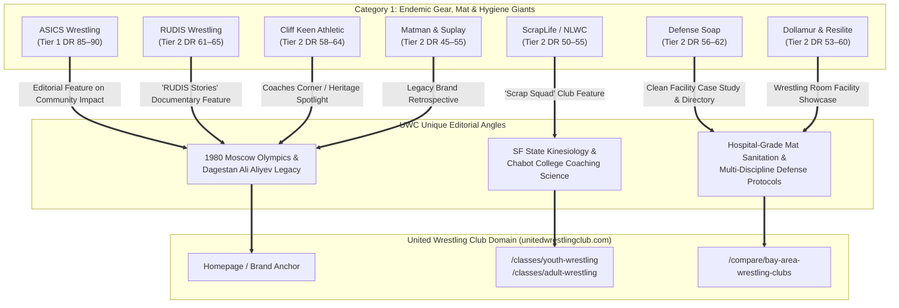

> Part 1 of 3 of [category1_gear_and_apparel](../category1_gear_and_apparel.md). Text is verbatim from the original; only links were rewritten.

# Category 1 Link Equity Dossier: Wrestling Apparel, Gear, Mats & Hygiene Brands
**Target Entity:** United Wrestling Club (`unitedwrestlingclub.com`)  
**Physical Address:** 30139 Industrial Pkwy SW Ste C, Hayward, CA 94544  
**Primary Leadership:** Karim Zemaryalai (Founder & 1980 Olympian) & Naweed Zemaryalai (Head Coach & Chabot College Coach)  
**OpenSEO Project ID:** `778e3f25-5476-4c54-bfe2-e418e131aaaf`  
**Research Date:** October 31, 2026  
**Document Code:** `UWC-LINK-CAT1-GEAR`

---

## 1. Executive Summary & Strategic Link Equity Value

In Google's Knowledge Graph and combat sports entity graph, backlinks from **endemic gear, mat, and apparel manufacturers** provide the highest degree of **Topical Authority (Relevance)** and **Co-Occurrence Trust**. 

While local directories (e.g., Yelp, Chamber of Commerce) establish geographic proximity, they carry zero wrestling-specific topical trust. Conversely, when authoritative wrestling apparel brands (like RUDIS or ScrapLife), Olympic mat manufacturers (Dollamur and Resilite), and combat hygiene authorities (Defense Soap) reference, quote, or spotlight United Wrestling Club, search engine algorithms identify UWC not merely as a generic gym, but as an **authoritative node in the American wrestling ecosystem**.

### Why Category 1 Brands Need UWC Just as Much as UWC Needs Them
These brands run continuous content engines (podcasts, YouTube docuseries, blogs, customer spotlights) and suffer from content fatigue. They are perpetually hunting for:
1. **Authentic Olympic Lore:** Karim Zemaryalai's journey from the 1980 Moscow Olympic qualification and his bronze medal at the brutal Ali Aliyev Tournament in Dagestan to establishing a coaching pipeline in Northern California is one of the rarest, most compelling untold stories in American wrestling.
2. **Kinesiology-Backed Coaching:** Naweed Zemaryalai brings an academic science background (SF State B.S. in Kinesiology) combined with active collegiate coaching (Chabot College), offering brands credible technical authority on movement prep, injury reduction, and youth conditioning.
3. **Real-World High-Volume Mat Cleanliness:** UWC's 6-day-a-week multi-discipline rotation (Youth Folkstyle, Collegiate Freestyle, Adult "Wrestle-Jitsu", Kyrgyz Combat Sambo) presents a brutal stress-test for mat resilience and skin-infection prevention that brands like Defense Soap and Dollamur actively seek to feature as proof-of-performance case studies.

---
