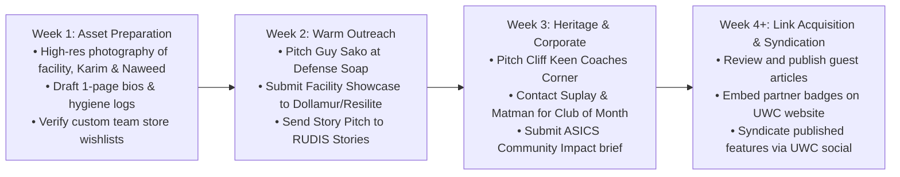

> Part 3 of 3 of [category1_gear_and_apparel](../category1_gear_and_apparel.md). Text is verbatim from the original; only links were rewritten.

## 4. Turnkey Pitch & Collaboration Playbook for UWC

To maximize link conversion, UWC should execute outreach using the three battle-tested pitch scripts below, customized by narrative pillar.

### Script 1: The Olympic & Dagestan Lineage Pitch
**Target Audience:** RUDIS (`stories@rudis.com`), Cliff Keen (`marketing@cliffkeen.com`), Matman (`Custom@MatmanUSA.com`)  
**Subject:** Story Pitch: 1980 Olympian & Dagestan Medalist Building an East Bay Wrestling Dynasty

```text
Hi [First Name / Editorial Team],

I’m reaching out on behalf of United Wrestling Club in Hayward, California, spearheaded by 1980 Moscow Olympic qualifier Karim Zemaryalai and collegiate coach Naweed Zemaryalai (SF State Kinesiology / Chabot College).

Your editorial work with [Franchise Name, e.g., RUDIS Stories / The Keen Edge] consistently sets the standard for celebrating the soul and heritage of wrestling. We have an extraordinary story that fits your audience perfectly:

In the late 1970s and 1980, Karim competed at the highest levels of international freestyle wrestling, qualifying for the 1980 Moscow Olympics and taking bronze at the legendary Ali Aliyev Tournament in Dagestan—arguably the toughest freestyle room on earth. 

Today, Karim and his son Naweed have brought that authentic Dagestani grip pressure, hand-fighting, and technical relentless conditioning to Northern California, building an East Bay powerhouse that takes working-class youth from Hayward, Union City, and Fremont and molds them into CIF state contenders and collegiate wrestlers.

We’d love to collaborate on a feature article, podcast conversation, or coach profile highlighting:
1. What training in Dagestan in the 1980s taught Karim about wrestling culture.
2. How UWC is bridging old-school international technique with modern kinesiology.
3. High-res archival and modern mat photography from our room.

Would you be open to a 10-minute introductory call with Coach Naweed and Karim next week?

Best regards,

[Name / Title]
United Wrestling Club (Hayward, CA)
Website: https://www.unitedwrestlingclub.com
Direct: (510) 303-4869
```

---

### Script 2: The Mat Hygiene & Clean Facility Case Study Pitch
**Target Audience:** Guy Sako & Defense Soap (`guy@defensesoap.com`, `hello@defensesoap.com`)  
**Subject:** Case Study: Zero Skin Infections Across 6 Daily Combat Disciplines at United Wrestling Club

```text
Hi Guy and the Defense Soap Team,

I’m reaching out from United Wrestling Club in Hayward, California. We follow Defense Soap's mat hygiene guidelines religiously and wanted to share a compelling proof-of-performance case study for your education hub.

Our academy runs under one of the highest mat-pathogen risks in combat sports:
We run 6 days a week with back-to-back classes spanning:
- Youth Wrestling (ages 4–11 / 40+ kids per session)
- Scholastic Middle & High School Folkstyle
- Barefoot Adult "Wrestle-Jitsu" (No-Gi BJJ)
- Jacketed Kyrgyz Combat Sambo

Despite this intense cross-discipline mat traffic, our Head Coach Naweed Zemaryalai (B.S. in Kinesiology from SF State) has instituted a strict hospital-grade protocol utilizing Defense Mat Cleaner and BruTab 6S, achieving a 0.0% skin infection rate across 150+ active members.

We’d love to write a guest case study or be featured as a Defense Clean Certified Facility:
- Topic: "Eliminating Cross-Discipline Mat Pathogens: How United Wrestling Club Keeps 150+ Wrestlers, Samboists, and BJJ Fighters Infection-Free."
- We can provide high-res facility photos of our mat-cleaning station, daily maintenance logs, and quotes from Coach Naweed on athlete hygiene compliance.

Let us know if you'd like us to draft this for your blog or discuss adding UWC to your certified facility map!

Warm regards,

Coach Naweed Zemaryalai & The UWC Team
United Wrestling Club
30139 Industrial Pkwy SW, Hayward, CA 94544
https://www.unitedwrestlingclub.com
```

---

### Script 3: The Facility Spotlight & Warehouse Conversion Pitch
**Target Audience:** Dollamur (`marketing@dollamur.com`), Resilite (`marketing@resilite.com`)  
**Subject:** Facility Spotlight: Converting an East Bay Industrial Flex Space into an Olympic Combat Arena

```text
Hi [First Name / Marketing Team],

We recently completed our facility buildout at United Wrestling Club in Hayward, California (30139 Industrial Pkwy SW), and we’d love to submit our room for your "Facility Spotlight" / customer showcase.

We converted an empty industrial warehouse unit into a dedicated, high-performance combat arena featuring:
- Full seamless competition mat coverage designed for high-impact international freestyle and collegiate folkstyle.
- Custom perimeter wall safety padding.
- High-traffic durability supporting youth, college athletes, and adult combat fighters 6 days a week.

Our club was founded by 1980 Olympic qualifier Karim Zemaryalai, and our room serves over 150 athletes across Southern Alameda County.

We have professional high-resolution photography of the completed room, athlete action shots, and facility specs ready to share. Would you be interested in featuring our installation on your blog or customer project gallery?

Best regards,

Naweed Zemaryalai
Head Wrestling Coach | United Wrestling Club
https://www.unitedwrestlingclub.com
Phone: (510) 303-4869
```

---

## 5. Implementation Roadmap & Outreach Milestones



### Actionable Next Steps:
1. **Photo Asset Bundle:** Gather 8–10 high-resolution photos of:
   * Karim Zemaryalai coaching youth and adult wrestlers on the mat.
   * Archival photos or medals (e.g., Ali Aliyev tournament medal, 1980 Olympic qualification memorabilia).
   * Clean facility wide shots showing the mat space and wall padding.
   * Naweed Zemaryalai coaching collegiate drills and mat hygiene routines.
2. **Deploy Email Pitches:** Send out Scripts 1, 2, and 3 to the respective verified contact emails listed in Section 3.
3. **Internal Linking Integration:** When external features go live, link back to them from UWC’s new website under `/about`, `/coaches/karim-zemaryalai`, and `/safety-and-hygiene` to complete the high-trust link loop.
