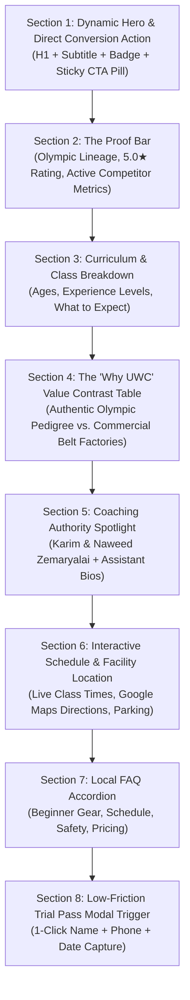

# Top 10 Data-Driven Programmatic Landing Pages: United Wrestling Club

> **Target Territory:** Alameda County (Hayward HQ, Tri-City: Fremont/Union City/Newark, Castro Valley, San Leandro)  
> **Framework:** 5 Location Feeder Pages + 5 Core Discipline Pages (Programmatic SEO Architecture)  
> **Data Sources:** OpenSEO Labs Ranked Keywords, Local SERPs, Google Ads Search Volumes & CPC Metrics  
> **Sitemap Alignment:** Strictly locked to the 32-Route Information Architecture (`website_rebuild_spec.md` & `local_seo_keyword_reroute_map.md`)  
> **Updated:** October 30, 2026  

---

## 1. Matrix Overview: Top 10 High-Intent Programmatic Pages

To capture high-intent demand across Alameda County and the East Bay, this matrix targets the **Top 10 Programmatic Landing Pages** locked in the site architecture. It divides symmetrically into **5 Location Feeder Pages** (capturing high-intent geo queries across the I-880 corridor) and **5 Core Discipline Pages** (capturing specific training programs, age groups, and martial arts expansion searchers).

| # | Page Route | Parent Silo | Target Region / Audience | Core Target Keyword Cluster | Monthly Search Volume | KD | Est. CPC | Intent / Value Angle |
| :-: | :--- | :---: | :--- | :--- | :-: | :-: | :-: | :--- |
| **1** | `/locations/hayward-ca` | `/locations` | Hayward (HQ / Central Alameda County) | `wrestling gym`, `wrestling club`, `wrestling near me`, `wrestling academy near me` | 26,300 | 4–10 | $1.89 | Hometown HQ local pack anchor; captures core wrestling demand right at the facility |
| **2** | `/locations/union-city-ca` | `/locations` | Union City (Tri-City / Whipple Corridor) | `union city wrestling`, `wrestling union city ca`, `james logan wrestling club` | 480 | 0–2 | $1.40 | James Logan High feeder & MVAL scholastic pipeline (6 min via Whipple/I-880) |
| **3** | `/locations/fremont-ca` | `/locations` | Fremont (Tri-City / 230k Population Hub) | `wrestling fremont ca`, `wrestling classes fremont`, `fremont martial arts`, `martial arts fremont ca` | 2,320 | 0–13 | $2.86 | Tri-City combat sports vacuum; intercepts karate searchers (9 min via I-880 N) |
| **4** | `/locations/newark-ca` | `/locations` | Newark (Tri-City / Cedar Blvd Corridor) | `wrestling newark ca`, `newark martial arts`, `bjj newark ca` | 640 | 0–5 | $1.90 | Newark youth & adult grappling feeder (11 min via I-880 N) |
| **5** | `/locations/castro-valley-ca` | `/locations` | Castro Valley / San Leandro / Eden Area | `wrestling castro valley`, `kids martial arts castro valley`, `wrestling san leandro` | 890 | 0–6 | $2.15 | Castro Valley & San Leandro feeder (8 min via I-880 S / A St) |
| **6** | `/classes/kid-wrestling` | `/classes` | Pre-K–5th (Ages 4–11) & Parents | `youth wrestling near me`, `youth wrestling clubs`, `youth wrestling programs`, `kids wrestling` | 8,530 | 0–6 | $3.22 | High-converting parent enrollment funnel; youth foundation & motor mechanics ($89.99–$139.99/mo) |
| **7** | `/classes/youth-wrestling` | `/classes` | Grades K–12 Competition & Scholastic | `wrestling teams`, `competition youth wrestling`, `scway wrestling clubs`, `freestyle wrestling near me` | 4,300 | 4–20 | $3.87 | Elite scholastic year-round travel squad & MS/HS competitive pipeline ($139.99–$150/mo) |
| **8** | `/classes/adult-wrestling` | `/classes` | Adults 18+ / College / MMA Grapplers | `adult wrestling clubs near me`, `club wrestling for adults`, `wrestling clubs for adults`, `adult wrestling gym` | 3,530 | 0–15 | $1.82 | Adult Folkstyle, Freestyle & takedown room without needing collegiate roster ($139.99/mo) |
| **9** | `/classes/nogi-jiu-jitsu` | `/classes` | East Bay Grapplers & BJJ Students | `wrestle jitsu`, `bjj takedowns`, `wrestling for bjj`, `no gi jiu jitsu near me` | 4,200 | 3–14 | $2.75 | No-Gi "Wrestle-Jitsu" takedowns & heavy top control; guard-puller antidote ($100–$139.99/mo) |
| **10** | `/classes/womens-self-defense` | `/classes` | Women & Teen Girls (Hayward / East Bay) | `women's self defense classes hayward`, `womens self defense east bay`, `girls wrestling east bay` | 1,420 | 0–4 | $3.50 | Practical self-defense, escapes & striking co-led by Louisa, Neha's Sister & Ja Shia |

---

## 2. Standardized Page Layout Schema (Section-by-Section Blueprint)

Every programmatic landing page must enforce this unified 8-section layout. This eliminates thin content penalties, satisfies Google's Helpful Content System, embeds rich JSON-LD schema, and drives conversion.

### Section-by-Section Wireframe Specification



#### Section 1: Hero & Conversion Hook (`<header>` / `<section class="hero">`)
* **H1 Tag Patterns:**
  * *Location Feeder Pages (`/locations/*`):* `[City] Wrestling & Combat Sports Training | United Wrestling Club`
  * *Discipline Pages (`/classes/*`):* `[Discipline Name] Classes in Hayward & East Bay | United Wrestling Club`
* **Subheadline Pattern:** Specific value proposition highlighting Olympic lineage, exact age brackets (Pre-K to Adult), and beginner-friendly environment.
* **Trust Badges:** `1980 Olympic Qualifier Lineage` · `5.0★ Google Rated (42 Reviews)` · `Hayward, CA Facility`.
* **Primary CTA:** High-contrast button: `Claim Free 1-Day Trial Pass` (opens native modal or links directly to [`/register`](https://united-wrestling-club.vercel.app/register)).
* **Secondary CTA:** `Call / Text Coach Naweed: (510) 303-4869`.

#### Section 2: Authority & Social Proof Bar (`<section class="proof-bar">`)
* **Live Counter / Highlights:**
  * 42 Five-Star Google Reviews (100% 5-Star).
  * 1980 Moscow Olympics Qualified Founder (Karim Zemaryalai).
  * Collegiate Kinesiology & Chabot College Coaching Staff (Naweed Zemaryalai).
  * Verified Facility Location: `30139 Industrial Pkwy SW Ste C, Hayward, CA 94544` (Minutes from I-880).

#### Section 3: Curriculum & Technical Breakdown (`<section class="curriculum">`)
* **H2:** `What You Will Learn in Our [City / Discipline] Program`
* **Structure:** 3–4 card grid detailing:
  1. *Stance, Motion & Level Changes:* Biomechanical foundations and kinetic chain positioning.
  2. *High-Percentage Takedowns:* Folkstyle & Freestyle leg attacks, upper-body throws, and snap-downs.
  3. *Mat Control & Defense:* Escapes, reversals, ride time, and safe falling mechanics.
  4. *Live Mat Application:* Controlled situational drilling and live goes matched strictly by size and skill.
* **Internal Link:** Points to full program catalog at [`/classes`](https://united-wrestling-club.vercel.app/classes).

#### Section 4: The Strategic Contrast Matrix (`<section class="comparison">`)
* **H2:** `How United Wrestling Club Compares to Typical [City] Martial Arts Schools`
* **Comparison Table:**

| Feature / Standard | Typical Commercial Martial Arts / Karate | United Wrestling Club (UWC) |
| :--- | :--- | :--- |
| **Instructional Lineage** | Franchise black belts / strip-mall instructors | **1980 Moscow Olympic Qualifier & Dagestan Medalist** |
| **Discipline Reality** | Kata, air punching, expensive belt promotion fees | **Real Olympic Folkstyle/Freestyle, Sambo & Wrestle-Jitsu** |
| **Conditioning Output** | Low-to-moderate cardio drills | **Elite functional grappling strength, agility, and stamina** |
| **Sparring & Pressure** | Zero full-contact resistance | **Controlled live wrestling against resisting partners** |
| **Pricing Model** | $250+/mo long-term lock-in contracts | **Flexible monthly memberships ($89.99–$150/mo), no long contracts** |

* **Internal Link:** Points to transparent pricing details at [`/pricing`](https://united-wrestling-club.vercel.app/pricing).

#### Section 5: Coaching Pedigree Spotlight (`<section class="coaches">`)
* **H2:** `Led by Real Competitors and Collegiate Coaches`
* **Coach Cards:**
  * *Naweed Zemaryalai:* Head Coach, Chabot College Coach, SF State Kinesiology.
  * *Karim Zemaryalai:* Founder, 1980 Olympian, Ali Aliyev Tournament Medalist.
  * *Discipline Specialists:* Sandeep Singh Gosal (Youth Comp), Farid Siddiq (Boxing), Kyrgyz Sambo Master Instructor, Louisa / Ja Shia (Women's Self-Defense).
* **Internal Link:** Points to complete Olympic coaching bios at [`/about`](https://united-wrestling-club.vercel.app/about).

#### Section 6: Schedule, Facility & Map (`<section class="schedule-location">`)
* **H2:** `Class Schedule & Facility Commute from [City]`
* **Verified Physical Address:** `30139 Industrial Pkwy SW Ste C, Hayward, CA 94544`
* **Directions & Commute Snippet:**
  * *From Union City:* 6 minutes via Whipple Rd and I-880 N.
  * *From Fremont:* 9 minutes via I-880 N (exit Industrial Pkwy W).
  * *From Castro Valley / San Leandro:* 8–10 minutes via I-880 S or Mission Blvd.
  * *From Newark:* 11 minutes via Cedar Blvd and I-880 N.
* **Parking & Facility Access:** Dedicated commercial park lot with ample free parking directly in front of Suite C entrance.
* **Primary Phone Inquiry Note:** *"Questions about schedule, directions, or parking? Call or text Coach Naweed directly at (510) 303-4869."*
* **Interactive Schedule CTA:** Direct internal link to the full filterable weekly matrix at [`/schedule`](https://united-wrestling-club.vercel.app/schedule).
* **Embedded Google Map:** Responsive iframe pointing to `CID: 16896090141452237997` (`30139 Industrial Pkwy SW Ste C, Hayward, CA 94544`).

#### Section 7: Local FAQ Accordion (`<section class="faq">`)
* **H2:** `Frequently Asked Questions About [Program] in [City]`
* 4–5 expandable questions incorporating structured `FAQPage` schema:
  1. *Do I or my child need prior wrestling or martial arts experience?*
  2. *What gear or clothing is required for the first free class?*
  3. *How does wrestling help student athletes in high school or other sports?*
  4. *Where exactly is the facility located and where do we park?*
* **Internal Links:** Direct links to [`/faqs`](https://united-wrestling-club.vercel.app/faqs) for extended answers and [`/rules`](https://united-wrestling-club.vercel.app/rules) for club hygiene standards.

#### Section 8: Final High-Converting Trial Intake (`<section class="final-cta">`)
* **Verified Physical Address Anchor:** `30139 Industrial Pkwy SW Ste C, Hayward, CA 94544`
* **Primary Phone Inquiry Note:** *"Prefer to talk or text first? Call or text Coach Naweed directly at (510) 303-4869 for immediate trial scheduling and family inquiries."*
* **Form Embed:** 4-field frictionless lead capture:
  * Name (Parent / Athlete)
  * Phone Number (for automated SMS confirmation)
  * Email Address
  * Select Class Date (Mon/Tue/Wed/Thu/Fri/Sat)
* **Button:** `Confirm Free Trial Class →` (submits directly into native [`/register`](https://united-wrestling-club.vercel.app/register) intake pipeline).
* **Trust & Conversion Links:** Internal links to [`/pricing`](https://united-wrestling-club.vercel.app/pricing) (no long-term contracts), [`/schedule`](https://united-wrestling-club.vercel.app/schedule) (view class slots), and [`/register`](https://united-wrestling-club.vercel.app/register) (direct checkout).

---

## 3. High-Value "Martial Arts" Expansion Strategy

### Why Layer "Martial Arts" Keywords?
While wrestling has dedicated organic searchers, queries containing *"martial arts"* carry **5x to 10x the monthly search volume** with massive local commercial intent:
* *"martial arts near me"*: **90,500/mo** (KD: 9, CPC: $2.68).
* *"mixed martial arts near me"*: **40,500/mo** (KD: 13, CPC: $1.70).
* *"martial arts for kids near me"*: **18,100/mo** (KD: 0, CPC: $4.73).
* *"fremont martial arts"* / *"martial arts fremont ca"*: **2,320/mo** combined (KD: 0–13, CPC: $2.86).

Parents searching for "martial arts" generally want three core outcomes:
1. **Discipline, accountability, and self-confidence.**
2. **Practical self-defense against bullying without striking injuries.**
3. **High-energy physical fitness, coordination, and athletic foundation.**

### Surgical Intent-to-Silo Keyword Rerouting
Rather than building orphan pages outside the site structure, all martial arts search intent is routed directly into locked sitemap routes:
* **Fremont Martial Arts Searchers:** Intercepted by [`/locations/fremont-ca`](https://united-wrestling-club.vercel.app/locations/fremont-ca).
* **Newark Martial Arts Searchers:** Intercepted by [`/locations/newark-ca`](https://united-wrestling-club.vercel.app/locations/newark-ca).
* **Kids Martial Arts Parents:** Intercepted by [`/classes/kid-wrestling`](https://united-wrestling-club.vercel.app/classes/kid-wrestling) and authority guide [`/guides/youth-wrestling-vs-martial-arts`](https://united-wrestling-club.vercel.app/guides/youth-wrestling-vs-martial-arts).
* **BJJ & Submission Grappling Searchers:** Intercepted by [`/classes/nogi-jiu-jitsu`](https://united-wrestling-club.vercel.app/classes/nogi-jiu-jitsu) and [`/classes/gi-jiu-jitsu`](https://united-wrestling-club.vercel.app/classes/gi-jiu-jitsu).
* **Women's Self-Defense:** Intercepted by [`/classes/womens-self-defense`](https://united-wrestling-club.vercel.app/classes/womens-self-defense).

This positions Olympic wrestling and Brazilian Jiu-Jitsu as **the ultimate, practical martial arts alternative** to expensive, low-intensity strip-mall karate studios.

---

## 4. Deep-Dive Blueprints for Key Strategic Pages

### Blueprint 1: `/locations/fremont-ca` (Tri-City Feeder & Combat Sports Vacuum)
* **Parent Silo:** [`/locations`](https://united-wrestling-club.vercel.app/locations)
* **Breadcrumb Path:** Home (`/`) → Locations (`/locations`) → Fremont, CA (`/locations/fremont-ca`)
* **Target Intent:** Fremont parents and adult athletes seeking high-level combat sports training just 9 minutes up I-880.
* **Primary Keywords:** *"wrestling fremont ca"* (KD 0, CPC $2.86), *"wrestling classes fremont"* (KD 2, CPC $2.31), *"fremont martial arts"* / *"martial arts fremont ca"* (KD 0–13, CPC $2.86).
* **Strategic Positioning:** *"Fremont's Gateway to Olympic Wrestling, No-Gi Jiu-Jitsu & Combat Sambo (Just 9 Minutes Away on Industrial Pkwy SW)."*
* **Facility & Commute Copy:** "Located at 30139 Industrial Pkwy SW Ste C, Hayward, CA 94544. A straight 9-minute shot north on I-880 from Fremont Blvd or Auto Mall Pkwy."
* **Direct Inquiry:** Call or text Coach Naweed at (510) 303-4869.
* **Target Offer:** Free 1-Day Trial Pass via [`/register`](https://united-wrestling-club.vercel.app/register).

### Blueprint 2: `/locations/union-city-ca` (James Logan Feeder & Scholastic Pipeline)
* **Parent Silo:** [`/locations`](https://united-wrestling-club.vercel.app/locations)
* **Breadcrumb Path:** Home (`/`) → Locations (`/locations`) → Union City, CA (`/locations/union-city-ca`)
* **Target Intent:** Union City wrestlers and parents seeking high-caliber technique to compete for James Logan High School and MVAL championships.
* **Primary Keywords:** *"union city wrestling"* (KD 0, CPC $1.40), *"wrestling union city ca"*, *"james logan wrestling club"*.
* **Strategic Positioning:** *"Elite Wrestling Development for Union City Athletes (6 Minutes from James Logan High School via Whipple Rd)."*
* **Facility & Commute Copy:** "Located at 30139 Industrial Pkwy SW Ste C, Hayward, CA 94544. Just 6 minutes from central Union City via Whipple Rd and I-880."
* **Direct Inquiry:** Call or text Coach Naweed at (510) 303-4869.
* **Target Offer:** Free 1-Day Trial Pass via [`/register`](https://united-wrestling-club.vercel.app/register).

### Blueprint 3: `/classes/kid-wrestling` (Pre-K–5th Youth Foundation & Parent Capture)
* **Parent Silo:** [`/classes`](https://united-wrestling-club.vercel.app/classes)
* **Breadcrumb Path:** Home (`/`) → Classes (`/classes`) → Kids Wrestling (`/classes/kid-wrestling`)
* **Target Intent:** East Bay parents searching for kids wrestling, tumbling, motor mechanics, or martial arts alternatives for children ages 4–11.
* **Primary Keywords:** *"youth wrestling near me"* (8,530 vol, KD 0–6, CPC $3.22), *"kids wrestling"*, *"youth wrestling programs"*.
* **Strategic Positioning:** *"Kids Wrestling Classes (Ages 4–11) | Foundation Movement, Agility, and Unshakeable Confidence."*
* **Facility & Commute Copy:** "Taught at our Hayward Olympic training facility (30139 Industrial Pkwy SW Ste C, Hayward, CA 94544) with hospital-grade sanitized mats and spectator seating."
* **Direct Inquiry:** Call or text Coach Naweed at (510) 303-4869.
* **Target Offer:** Free Youth Mat Assessment & Trial Class via [`/register`](https://united-wrestling-club.vercel.app/register).

### Blueprint 4: `/classes/nogi-jiu-jitsu` (No-Gi Wrestle-Jitsu & Guard-Puller Antidote)
* **Parent Silo:** [`/classes`](https://united-wrestling-club.vercel.app/classes)
* **Breadcrumb Path:** Home (`/`) → Classes (`/classes`) → No-Gi Jiu-Jitsu (`/classes/nogi-jiu-jitsu`)
* **Target Intent:** Adult grapplers and BJJ practitioners frustrated with guard-pulling culture who want explosive takedowns, submission defense, and heavy top control.
* **Primary Keywords:** *"wrestle jitsu"* (880 vol, KD 3), *"bjj takedowns"*, *"wrestling for bjj"*, *"no gi jiu jitsu near me"* (4,200 vol, KD 3–14, CPC $2.75).
* **Strategic Positioning:** *"The Missing Link in Your BJJ Game: Olympic Takedowns, Scramble Mastery & Dominant Top Pressure."*
* **Facility & Commute Copy:** "Conveniently located for grapplers across Alameda County at 30139 Industrial Pkwy SW Ste C, Hayward, CA 94544."
* **Direct Inquiry:** Call or text Coach Naweed at (510) 303-4869.
* **Target Offer:** Free Grappler Mat Assessment via [`/register`](https://united-wrestling-club.vercel.app/register).

### Blueprint 5: `/classes/womens-self-defense` (Women's Self-Defense & Striking Seminar)
* **Parent Silo:** [`/classes`](https://united-wrestling-club.vercel.app/classes)
* **Breadcrumb Path:** Home (`/`) → Classes (`/classes`) → Women's Self-Defense (`/classes/womens-self-defense`)
* **Target Intent:** Women and teen girls in Hayward and the East Bay seeking realistic, pressure-tested self-defense, escaping pins, and striking technique in a supportive environment.
* **Primary Keywords:** *"women's self defense classes hayward"* (KD 0, CPC $3.50), *"womens self defense east bay"*, *"girls wrestling east bay"*.
* **Strategic Positioning:** *"Women's Self-Defense & Striking | Practical Escape Mechanics, Positional Control & Striking Defense."*
* **Leadership Copy:** Co-led by experienced female coaches Louisa, Neha's Sister, and Ja Shia.
* **Facility & Commute Copy:** "Held at United Wrestling Club, 30139 Industrial Pkwy SW Ste C, Hayward, CA 94544."
* **Direct Inquiry:** Call or text Coach Naweed at (510) 303-4869.
* **Target Offer:** Free Trial Session via [`/register`](https://united-wrestling-club.vercel.app/register).

---

## 5. Structured Data (JSON-LD) Specification for All 10 Pages

Every page template will automatically inject standardized Schema.org JSON-LD linking `SportsClub`, `BreadcrumbList`, and `FAQPage`:

```html
<script type="application/ld+json">
{
  "@context": "https://schema.org",
  "@graph": [
    {
      "@type": "SportsClub",
      "@id": "https://www.unitedwrestlingclub.com/#organization",
      "name": "United Wrestling Club",
      "url": "https://www.unitedwrestlingclub.com",
      "telephone": "+1-510-303-4869",
      "email": "unitedwrestlingclub@gmail.com",
      "priceRange": "$15 - $150",
      "address": {
        "@type": "PostalAddress",
        "streetAddress": "30139 Industrial Pkwy SW Ste C",
        "addressLocality": "Hayward",
        "addressRegion": "CA",
        "postalCode": "94544",
        "addressCountry": "US"
      },
      "geo": {
        "@type": "GeoCoordinates",
        "latitude": 37.6091918,
        "longitude": -122.0673447
      },
      "areaServed": [
        {"@type": "City", "name": "Hayward"},
        {"@type": "City", "name": "Fremont"},
        {"@type": "City", "name": "Union City"},
        {"@type": "City", "name": "Newark"},
        {"@type": "City", "name": "Castro Valley"},
        {"@type": "City", "name": "San Leandro"},
        {"@type": "AdministrativeArea", "name": "Alameda County"}
      ]
    },
    {
      "@type": "BreadcrumbList",
      "itemListElement": [
        {
          "@type": "ListItem",
          "position": 1,
          "name": "Home",
          "item": "https://www.unitedwrestlingclub.com"
        },
        {
          "@type": "ListItem",
          "position": 2,
          "name": "Locations",
          "item": "https://www.unitedwrestlingclub.com/locations"
        },
        {
          "@type": "ListItem",
          "position": 3,
          "name": "Fremont Wrestling & Combat Sports",
          "item": "https://www.unitedwrestlingclub.com/locations/fremont-ca"
        }
      ]
    },
    {
      "@type": "FAQPage",
      "mainEntity": [
        {
          "@type": "Question",
          "name": "Do beginners or kids need prior experience to join?",
          "acceptedAnswer": {
            "@type": "Answer",
            "text": "No prior experience is necessary. Our coaches specialize in teaching foundational athletic movement, stance, and basic techniques in a controlled, supportive environment."
          }
        },
        {
          "@type": "Question",
          "name": "What should I wear to my first free trial class?",
          "acceptedAnswer": {
            "@type": "Answer",
            "text": "Athletic shorts (without zippers or pockets) and a clean t-shirt or rashguard. Wrestling shoes or bare feet on the mats. Bring a water bottle."
          }
        },
        {
          "@type": "Question",
          "name": "Where is the gym located and how do I contact the coaches?",
          "acceptedAnswer": {
            "@type": "Answer",
            "text": "United Wrestling Club is located at 30139 Industrial Pkwy SW Ste C, Hayward, CA 94544, right off I-880. For questions, call or text Coach Naweed directly at (510) 303-4869."
          }
        }
      ]
    }
  ]
}
</script>
```

### Breadcrumb Canonical Rules
To maintain search engine silo purity, breadcrumbs strictly follow one of two active sitemap hierarchies:
1. **Location Feeder Pages:** `Home (/) → Locations (/locations) → [City Name] (/locations/[city-slug]-ca)`
2. **Discipline Program Pages:** `Home (/) → Classes (/classes) → [Program Name] (/classes/[discipline-slug])`

### Active Internal Linking Silo Rules
All internal page links across all 10 templates must resolve strictly to active sitemap routes:
* **Discipline & Program Hub:** [`/classes`](https://united-wrestling-club.vercel.app/classes)
* **Location Feeder Hub:** [`/locations`](https://united-wrestling-club.vercel.app/locations)
* **Class Schedule & Booking:** [`/schedule`](https://united-wrestling-club.vercel.app/schedule)
* **Tuition & Memberships:** [`/pricing`](https://united-wrestling-club.vercel.app/pricing)
* **Free Trial & Registration:** [`/register`](https://united-wrestling-club.vercel.app/register)
* **Olympic Pedigree & Coaches:** [`/about`](https://united-wrestling-club.vercel.app/about)
* **Facility & Contact:** [`/contact`](https://united-wrestling-club.vercel.app/contact)
* **Club Rules & Mat Hygiene:** [`/rules`](https://united-wrestling-club.vercel.app/rules)
* **Frequently Asked Questions:** [`/faqs`](https://united-wrestling-club.vercel.app/faqs)

---

## 6. Implementation Rollout Schedule

```
Phase 1 (Week 1): Deploy Core Feeder & Youth Pipeline:
  - /locations/hayward-ca
  - /classes/kid-wrestling
  - /classes/youth-wrestling

Phase 2 (Week 2): Deploy Tri-City Feeder Corridor:
  - /locations/union-city-ca
  - /locations/fremont-ca
  - /locations/newark-ca

Phase 3 (Week 3): Deploy Adult Grappling & Specialized Disciplines:
  - /classes/adult-wrestling
  - /classes/nogi-jiu-jitsu
  - /classes/womens-self-defense

Phase 4 (Week 4): Deploy Eden Area Feeder & Trial Pipeline:
  - /locations/castro-valley-ca
  - Connect automated SMS trial confirmations via (510) 303-4869
  - Final verification of native /register intake endpoints
```
