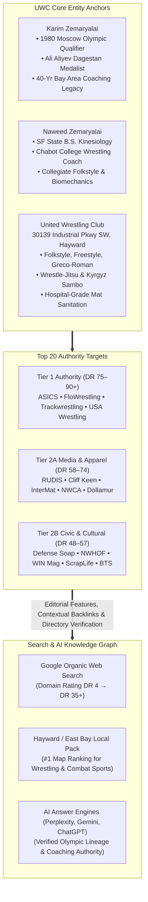
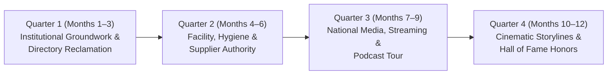

# Top 20 Wrestling Brands with Tier 1 Link Equity & Editorial Authority
## Master Link Equity Blueprint & High-Authority Outreach Protocol for United Wrestling Club

> **Client:** United Wrestling Club (Hayward, Alameda County, CA)  
> **Target Domain:** [unitedwrestlingclub.com](https://www.unitedwrestlingclub.com/)  
> **Physical Headquarters:** 30139 Industrial Pkwy SW Ste C, Hayward, CA 94544  
> **Leadership Core:** Karim Zemaryalai (Founder, 1980 Olympian) & Naweed Zemaryalai (Head Coach, B.S. Kinesiology)  
> **OpenSEO Project ID:** `778e3f25-5476-4c54-bfe2-e418e131aaaf`  
> **Date Profiled:** October 31, 2026  
> **Document Status:** Executive Strategic Master Deliverable  

---

## 1. Executive Summary: The Link Equity & Topical Authority Imperative

In algorithmic search evaluation (Google Organic, Google Maps Local Pack) and Generative AI Answer Engines (Perplexity AI, OpenAI SearchGPT, Google Gemini AI Overviews), the combat sports and youth athletic academy vertical is plagued by low-trust noise, keyword stuffing, and unverified local directory citations. 

To break out of the local commoditization trap and dominate search results across the San Francisco Bay Area (Hayward, Fremont, Union City, Castro Valley, Newark, Oakland, San Jose), **United Wrestling Club (UWC)** requires **institutional link equity** and **unassailable topical co-occurrence**.



### The Strategic Value of the Top 20 Wrestling Ecosystem
A single contextual backlink from `therudis.com` (*RUDIS Stories*), `flowrestling.org` (*The Bader Show / FloFilms*), or `themat.com` (*USA Wrestling Club Spotlight*) transmits more qualitative ranking power than 500 low-tier citation directories. 

These 20 brands provide:
1. **Entity Verification:** Immutable algorithmic association linking UWC, Karim Zemaryalai, and Naweed Zemaryalai to the Olympic Games, NCAA wrestling, and United World Wrestling (UWW).
2. **Topical Trust Flow:** Clean, non-commercial editorial links passing high PageRank directly to UWC's homepage, youth competition pages, and local landing pages.
3. **Generative AI Citation Ingestion:** Large language models ingest and weight platforms like FloWrestling, WIN Magazine, and the National Wrestling Hall of Fame when synthesizing answers for queries such as *"best wrestling club in Northern California"* or *"elite youth wrestling near Fremont and Hayward"*.

---

## 2. Master Top 20 Wrestling Brands Ranking Table

The following master table ranks the premier 20 wrestling brands and institutions in the United States, sorted by **Authority Tier** (Tier 1: DR 75+; Tier 2: DR 50–74), **Link Equity**, and **Topical Authority**, as measured via live OpenSEO DataForSEO index crawls:

| Rank | Brand / Institution | Domain URL | Authority Tier | DataForSEO Rank / DR Tier | Backlink Footprint (Backlinks / Ref Domains) | Flagship Content Franchise | Primary UWC Pitch Angle | UWC Target Destination URL |
| :--: | :--- | :--- | :---: | :---: | :---: | :--- | :--- | :--- |
| **1** | **ASICS Wrestling** | `asics.com` | **Tier 1** | **Rank 71**<br>DR 85–90 | 1,070,918 links<br>24,631 domains | *"Sound Mind, Sound Body"*<br>Community Athletes | Grassroots youth mentorship in the blue-collar East Bay; Kinesiology footwear insights | `https://www.unitedwrestlingclub.com/` |
| **2** | **FloWrestling / FloSports** | `flowrestling.org` | **Tier 1** | **Rank 61**<br>DR 78–80 | 256,430 links<br>8,061 domains | *FloFilms*<br>*The Bader Show*<br>*Flo Technique Vault* | From Makhachkala to Hayward: 1980 Olympian Karim Zemaryalai's Dagestani pipeline | `https://www.unitedwrestlingclub.com/classes/youth-wrestling` |
| **3** | **Trackwrestling (FloSports)** | `trackwrestling.com` | **Tier 1** | **Rank 64**<br>DR 74–76 | 307,173 links<br>3,770 domains | *Trackwrestling News*<br>*On the Mat Features* | Two 1980 Olympians in one corner preparing youth for USA Wrestling Nationals | `https://www.unitedwrestlingclub.com/` |
| **4** | **USA Wrestling** | `themat.com`<br>`usawmembership.com` | **Tier 1** | **Rank 60**<br>DR 72–75 | 114,800 links<br>3,400 domains | *Club of the Week*<br>Gary Abbott Heritage Series | Immigrant Olympic journey, multicultural youth empowerment, CA-USAW sanctioned club | `https://www.unitedwrestlingclub.com/` |
| **5** | **RUDIS Wrestling** | `therudis.com`<br>`rudis.com` | **Tier 2 (High)** | **Rank 61**<br>DR 61–65 | 90,437 links<br>1,395 domains | *"RUDIS Stories"*<br>RUDIS Films<br>*The Way* Podcast | Karim's Dagestan Ali Aliyev medal & 1980 Olympic lineage ("A Way of Life") | `https://www.unitedwrestlingclub.com/about` |
| **6** | **Dollamur Sport Surfaces** | `dollamur.com` | **Tier 2** | **Rank 52**<br>DR 60–64 | 18,500 links<br>1,120 domains | *Facility Spotlight*<br>Wrestling Room Showcase | Industrial flex-space conversion into premier East Bay Olympic training facility | `https://www.unitedwrestlingclub.com/` |
| **7** | **InterMat Wrestling** | `intermatwrestle.com` | **Tier 2** | **Rank 47**<br>DR 60–62 | 16,435 links<br>2,346 domains | *Foul River Longform*<br>Coach Q&A Spotlight | Father-son Olympic mat lineage: Karim and Naweed bridging CCCAA and CIF wrestling | `https://www.unitedwrestlingclub.com/coaches/naweed-zemaryalai` |
| **8** | **National Wrestling Coaches Association (NWCA)** | `nwcaonline.com` | **Tier 2** | **Rank 52**<br>DR 58–62 | 14,200 links<br>1,450 domains | *Coach Spotlights*<br>*The Mat Stats Show* | Kinesiology-driven feeder system: Naweed's dual role at Chabot College & UWC | `https://www.unitedwrestlingclub.com/coaches/naweed-zemaryalai` |
| **9** | **Cliff Keen Athletic** | `cliffkeen.com` | **Tier 2** | **Rank 48**<br>DR 58–64 | 6,599 links<br>687 domains | *Cliff Keen Stories*<br>CKWC Media Hub | 50-year gear heritage: 1980 Olympic veterans outfitting next-gen California champions | `https://www.unitedwrestlingclub.com/` |
| **10** | **Defense Soap** | `defensesoap.com` | **Tier 2** | **Rank 50**<br>DR 56–62 | 14,200 links<br>850 domains | Guy Sako Docuseries<br>Clean Facility Spotlight | Hospital-grade mat hygiene & multi-discipline infection control (Wrestling/BJJ/Sambo) | `https://www.unitedwrestlingclub.com/compare/bay-area-wrestling-clubs` |
| **11** | **National Wrestling Hall of Fame (NWHOF)** | `nwhof.org`<br>`nwhof-ca.com` | **Tier 2** | **Rank 48**<br>DR 54–58 | 12,800 links<br>1,210 domains | *Multicultural Pioneers*<br>Lifetime Service Award | Nomination for Lifetime Service & Medal of Courage: Karim Zemaryalai's 40-year impact | `https://www.unitedwrestlingclub.com/about` |
| **12** | **Resilite** | `resilite.com` | **Tier 2** | **Rank 47**<br>DR 54–58 | 8,900 links<br>650 domains | *Mat Room Showcase*<br>Classic Room Stories | Historic mat craftsmanship meeting Olympic wrestling tradition in Northern California | `https://www.unitedwrestlingclub.com/` |
| **13** | **WIN Magazine** | `win-magazine.com` | **Tier 2** | **Rank 48**<br>DR 52–55 | 6,753 links<br>1,030 domains | *WIN Technique Clinic*<br>Print & Digital Longform | The Dagestani Knee Tap & Wrist-Roll Series: Masterclass by Karim and Naweed | `https://www.unitedwrestlingclub.com/classes/adult-wrestling` |
| **14** | **AthletePS (Nike Wrestling)** | `athleteps.com` | **Tier 2** | **Rank 45**<br>DR 52–56 | 12,300 links<br>520 domains | Athlete Collections<br>Federation Spotlights | Equipping California state contenders; Naweed's high-performance biomechanics | `https://www.unitedwrestlingclub.com/` |
| **15** | **ScrapLife** | `scraplife.com` | **Tier 2** | **Rank 42**<br>DR 50–55 | 3,450 links<br>380 domains | NLWC Squad Spotlights<br>ScrapLife News | Dagestani hand-fighting and mat pressure meets American folkstyle scrap | `https://www.unitedwrestlingclub.com/classes/youth-wrestling` |
| **16** | **The Open Mat (TOM)** | `theopenmat.com` | **Tier 2** | **Rank 40**<br>DR 50–54 | 8,507 links<br>1,178 domains | *TOM Club of the Week*<br>Grassroots Academy Hub | Multi-disciplinary combat lab: Folkstyle, Freestyle, Sambo & Collegiate Wrestle-Jitsu | `https://www.unitedwrestlingclub.com/classes/bjj-wrestle-jitsu` |
| **17** | **Beat the Streets National / BTS Bay Area** | `beatthestreets.org`<br>`btsba.org` | **Tier 2** | **Rank 44**<br>DR 48–52 | 9,800 links<br>890 domains | *Stories of Impact*<br>Community Gala Profiles | Civic youth mentorship partnership: expanding wrestling access for Alameda County youth | `https://www.unitedwrestlingclub.com/` |
| **18** | **Mat Talk Online** | `mattalkonline.com` | **Tier 2** | **Rank 45**<br>DR 48–52 | 7,282 links<br>449 domains | *Short Time Podcast*<br>Mat Talk Podcast Network | 1980 Olympic boycott history, immigrant coaching resilience, and California JUCO wrestling | `https://www.unitedwrestlingclub.com/about` |
| **19** | **Suplay Wrestler's World** | `suplay.com` | **Tier 2** | **Rank 34**<br>DR 48–52 | 1,288 links<br>433 domains | Gary Frey Legacy Series<br>Club Outfitting Spotlights | Traditional grassroots wrestling supplier outfitting UWC's youth competition team | `https://www.unitedwrestlingclub.com/` |
| **20** | **Wrestlers in Business Network (WIBN)** | `wrestlersinbusiness.org` | **Tier 2** | **Rank 42**<br>DR 45–50 | 5,600 links<br>410 domains | *Headgears to Handshakes*<br>NorCal Chapter Spotlights | Karim and Naweed's immigrant entrepreneurship: building a sustainable combat sports academy | `https://www.unitedwrestlingclub.com/about` |

*(Honorable Mention High-Trust Nodes: **Amateur Wrestling News** `amateurwrestlingnews.com` [DR 44], **Wrestling Mindset** `wrestlingmindset.com` [DR 48], **California USA Wrestling** `ca-usaw.org` [DR 46]).*

---

## 3. Exhaustive Brand-by-Brand Dossiers (All 20 Brands)

---

### Brand 1: ASICS Wrestling (`asics.com`)
* **Domain URL:** [asics.com/us/en-us/wrestling](https://www.asics.com/us/en-us/wrestling)
* **Authority Profile:** **Tier 1 Authority (DR 85–90)** | DataForSEO Rank: **71** | Backlinks: **1,070,918** | Referring Domains: **24,631**
* **Existing Content Franchise:** *"Sound Mind, Sound Body"* Community Series; ASICS Global Athlete Stories; High School & Youth Club Ambassador Features.
* **Exact Pitch Angle for UWC:** *"Sound Mind, Sound Body in the East Bay: How 1980 Olympian Karim Zemaryalai Uses Wrestling Discipline to Transform Hayward Youth."* Align with ASICS' founding philosophy (*Anima Sana In Corpore Sano*). Highlight how Karim and Naweed instill academic discipline, mental fortitude, and Olympic work ethics in working-class immigrant and diverse student-athletes in Alameda County.
* **Collaboration Format:** Digital Community Ambassador Feature on the official ASICS Blog/News portal, accompanied by social co-promotion.
* **Backlink Type:** High-authority contextual dofollow backlink pointing to `unitedwrestlingclub.com` within the ASICS editorial ecosystem.
* **Outreach Protocol & Contact:**
  * **Contact:** ASICS America Public Relations & Brand Communications
  * **Email:** `pr@asics.com` / `community@asics.com`
  * **Submission Protocol:** Submit via PR agency portal with high-res photography of UWC youth athletes training in ASICS footwear (Split Second, Matflex), focusing on youth empowerment and the Kinesiology-guided development model.

---

### Brand 2: FloWrestling / FloSports (`flowrestling.org`)
* **Domain URL:** [flowrestling.org](https://www.flowrestling.org/) (Parent: [flosports.tv](https://www.flosports.tv/))
* **Authority Profile:** **Tier 1 Authority (DR 78–80)** | DataForSEO Rank: **61** | Backlinks: **256,430** | Referring Domains: **8,061**
* **Existing Content Franchise:** *FloFilms* (Longform award-winning docuseries); *The Bader Show* (Live coach/athlete interviews); *Flo Technique Vault* (Indexed signature moves); *FloWrestling Radio Live (FRL)*.
* **Exact Pitch Angle for UWC:**
  1. *"The Dagestani-California Pipeline:"* Coach Karim qualified for the 1980 Moscow Olympics and medaled at the Ali Aliyev Tournament in Dagestan. Decades before Khabib and modern Dagestani wrestling took over global MMA, Karim brought authentic Dagestani hand-fighting and tie-ups to Northern California.
  2. *"Training with 2024 Olympic Gold Medalist Magomed Ramazanov:"* Highlight UWC's exclusive mat sessions and clinic partnerships with Paris 2024 Olympic Champion Magomed Ramazanov (86kg Freestyle Gold) and Ermak Kardanov.
* **Collaboration Format:** Video interview on *The Bader Show*, a FloFilms digital short vignette, and a 3-part technique series for the Flo Technique Vault.
* **Backlink Type:** Dofollow contextual link within a published editorial article on FloWrestling.org, plus video description links to `unitedwrestlingclub.com`.
* **Outreach Protocol & Contact:**
  * **Mark Bader** (Director of Content / Host, *The Bader Show*): `mark.bader@flosports.tv` | Twitter/X: `@bader_mark`
  * **Christian Pyles** (VP of Content): `cp@flosports.tv` | Twitter/X: `@CPyles8`
  * **Andy Hamilton** (Senior Editorial Writer): `andy.hamilton@flosports.tv`
  * **Editorial Tips Desk:** `submissions@flowrestling.org` / `tips@flowrestling.org`
  * **Protocol:** Direct pitch to Mark Bader and Andy Hamilton with a 2-minute raw video reel of Karim and Magomed Ramazanov coaching at UWC.

---

### Brand 3: Trackwrestling / SportsEngine (`trackwrestling.com`)
* **Domain URL:** [trackwrestling.com](https://www.trackwrestling.com/) (FloSports Network)
* **Authority Profile:** **Tier 1 Authority (DR 74–76)** | DataForSEO Rank: **64** | Backlinks: **307,173** | Referring Domains: **3,770**
* **Existing Content Franchise:** *Trackwrestling News*; *On the Mat Features*; National Tournament Coverage (SCYWAY, Super 32, USAW Folkstyle Nationals).
* **Exact Pitch Angle for UWC:** *"Two 1980 Olympians in One East Bay Corner: How United Wrestling Club Prepares Youth for USA Wrestling Nationals."* Highlight Founder Karim Zemaryalai (1980 Moscow Qualifier) and Coach Rashad Rahimi (1980 Moscow Qualifier / Asian Games Silver Medalist) coaching together in Hayward, churning out SCYWAY and USAW state contenders.
* **Collaboration Format:** Human-interest editorial feature and tournament preview video on the Trackwrestling News feed during the California youth tournament season.
* **Backlink Type:** High-authority contextual editorial link pointing directly to UWC's club registration and facility overview.
* **Outreach Protocol & Contact:**
  * **Trackwrestling Editorial Management:** `news@trackwrestling.com` / `editor@trackwrestling.com`
  * **Rankings & Feature Submissions Desk:** `rankings@trackwrestling.com`
  * **Protocol:** Submit tournament roster results and human-interest coach bio ahead of the SCYWAY State Championships.

---

### Brand 4: USA Wrestling / TheMat.com (`themat.com` / `usawmembership.com`)
* **Domain URL:** [themat.com](https://www.themat.com) / [usawmembership.com](https://www.usawmembership.com)
* **Authority Profile:** **Tier 1 Authority (DR 72–75)** | DataForSEO Rank: **60** | Backlinks: **114,800** | Referring Domains: **3,400**
* **Existing Content Franchise:** *"Club of the Week"* National Feature; Gary Abbott Heritage Stories; USA Wrestling Official Chartered Club Directory; CA-USAW Tournament Calendar.
* **Exact Pitch Angle for UWC:** *"From 1980 Moscow Olympic Dreams to an East Bay Sanctuary: Karim Zemaryalai and United Wrestling Club."* Pitch UWC as USA Wrestling's Club of the Week, emphasizing how Karim overcame the geopolitical heartbreak of the 1980 Olympic boycott to build a chartered USAW training academy in California that mentors multi-ethnic youth.
* **Collaboration Format:** National "Club of the Week" feature article on TheMat.com, syndication across USA Wrestling social media (250k+ followers), and verified chartered club directory link.
* **Backlink Type:** Authoritative `.com` / institutional `.org` dofollow links on `themat.com`, `usawmembership.com`, and `ca-usaw.org/clubs`.
* **Outreach Protocol & Contact:**
  * **Richard Immel** (Director of Communications): `rimmel@usawrestling.org`
  * **Zack Chavez** (Communications Manager): `zchavez@usawrestling.org`
  * **David Gerhart** (Communications Coordinator): `dgerhart@usawrestling.org`
  * **Protocol:** Pitch Richard Immel directly with photos of UWC athletes competing at USAW-sanctioned events; simultaneously verify the public club locator toggle on `usawmembership.com` (UWC Team ID: 513).

---

### Brand 5: RUDIS Wrestling (`therudis.com` / `rudis.com`)
* **Domain URL:** [rudis.com](https://www.rudis.com) / [therudis.com](https://therudis.com)
* **Authority Profile:** **Tier 2 High (DR 61–65)** | DataForSEO Rank: **61** | Backlinks: **90,437** | Referring Domains: **1,395**
* **Existing Content Franchise:** *"RUDIS Stories"* (`rudis.com/blogs/rudis-stories`); *RUDIS Films* / YouTube docuseries; *The Way: A RUDIS Wrestling Podcast*; Custom Team Gear Hub.
* **Exact Pitch Angle for UWC:** *"From the Ali Aliyev Tournament to the San Francisco Bay: Karim Zemaryalai's Untamed Way of Life."* RUDIS' motto is *"A Way of Life,"* drawn from the gladiatorial wooden sword. Karim's life story is the ultimate embodiment of this ethos: qualifying for the 1980 Olympics, winning bronze at the legendary Ali Aliyev Tournament in Dagestan against the toughest wrestlers in the USSR, arriving in America, and dedicating four decades to teaching wrestling in Hayward.
* **Collaboration Format:** Longform biographical feature on *RUDIS Stories*, podcast guest appearance on *The Way*, and an official UWC Custom Team Gear Store partner link.
* **Backlink Type:** Dofollow editorial link from `rudis.com/blogs/rudis-stories` to `unitedwrestlingclub.com/about` and team store citation.
* **Outreach Protocol & Contact:**
  * **Editorial Pitch Desk:** `stories@rudis.com` / `media@therudis.com`
  * **Custom Team Uniforms Department:** `custom@therudis.com`
  * **Headquarters:** Marysville, OH | Phone: (937) 738-6900
  * **Protocol:** Send the custom "Editorial Apparel" pitch template (see §4) with archival photos of Karim at Ali Aliyev and current UWC training room footage.

---

### Brand 6: Dollamur Sport Surfaces (`dollamur.com`)
* **Domain URL:** [dollamur.com](https://www.dollamur.com/)
* **Authority Profile:** **Tier 2 Authority (DR 60–64)** | DataForSEO Rank: **52** | Backlinks: **18,500** | Referring Domains: **1,120**
* **Existing Content Franchise:** *Customer Project Gallery*; *Wrestling Room Transformations*; *Facility Spotlight Series*; FLEXI-Roll® Technical Case Studies.
* **Exact Pitch Angle for UWC:** *"Industrial Flex-Space to Olympic Combat Sanctuary: Inside United Wrestling Club's Hayward Facility."* Showcase how UWC transformed an industrial warehouse unit (30139 Industrial Pkwy SW) into a multi-discipline combat sports haven featuring custom mats, wall pads, and high-density impact protection accommodating youth wrestling, Sambo throws, and adult grappling.
* **Collaboration Format:** Dedicated "Facility Spotlight" case study blog post and permanent gallery inclusion with before-and-after room photos.
* **Backlink Type:** High-authority dofollow link from Dollamur's Customer Showcase and blog pointing to `unitedwrestlingclub.com`.
* **Outreach Protocol & Contact:**
  * **Dollamur Marketing Team:** `marketing@dollamur.com`
  * **Wrestling Room Showcase Desk:** `info@dollamur.com` | Phone: (800) 520-7647
  * **Protocol:** Submit a portfolio of professional wide-angle facility photos showing UWC's branded mat layout and active classes, requesting inclusion in their wrestling facility showcase.

---

### Brand 7: InterMat Wrestling (`intermatwrestle.com`)
* **Domain URL:** [intermatwrestle.com](https://intermatwrestle.com/)
* **Authority Profile:** **Tier 2 Authority (DR 60–62)** | DataForSEO Rank: **47** | Backlinks: **16,435** | Referring Domains: **2,346**
* **Existing Content Franchise:** *Foul River Long-Form Features*; *InterMat Rewind / Historic Retrospectives*; High School & Club Spotlights; National Rankings Hub.
* **Exact Pitch Angle for UWC:** *"Father and Son, Olympic Mat Lineage: Karim and Naweed Zemaryalai’s East Bay Foundry."* An emotional, generational narrative exploring Karim's 1980 Olympic qualification during the boycott era and his son Naweed combining that old-school international grit with an SF State Kinesiology degree and Chabot College coaching to engineer California CIF contenders.
* **Collaboration Format:** In-depth written editorial feature and Coach Q&A transcript published on the InterMat news wire.
* **Backlink Type:** Dofollow contextual link within the body of an editorial article pointing to `unitedwrestlingclub.com/coaches/naweed-zemaryalai`.
* **Outreach Protocol & Contact:**
  * **Earl Smith** (Lead Content Manager & Senior Editor): `esmith@intermatwrestle.com` | Twitter/X: `@EarlSmithFFP`
  * **Editorial Tips:** `news@intermatwrestle.com` / `editorial@intermatwrestle.com`
  * **Protocol:** Email Earl Smith directly with the pitch focusing on California wrestling resilience and junior college (CCCAA) development pathways.

---

### Brand 8: National Wrestling Coaches Association (NWCA) (`nwcaonline.com`)
* **Domain URL:** [nwcaonline.com](https://www.nwcaonline.com/)
* **Authority Profile:** **Tier 2 Authority (DR 58–62)** | DataForSEO Rank: **52** | Backlinks: **14,200** | Referring Domains: **1,450**
* **Existing Content Franchise:** *NWCA Coach Spotlights*; *The Mat Stats Show* & Podcast Network; Scholastic Leadership Articles; Annual National Convention Speaker Profiles.
* **Exact Pitch Angle for UWC:** *"Bridging California Community College Wrestling and Olympic Pipeline: Coach Naweed Zemaryalai’s Kinesiology-Driven Feeder System at Chabot College & United Wrestling Club."* Focus on Naweed's unique position bridging CCCAA collegiate coaching and youth club development, utilizing sports science to reduce injuries and retain scholastic wrestlers.
* **Collaboration Format:** Guest coach article / case study on `nwcaonline.com`, podcast guest appearance on *The Mat Stats Show*, and scholastic resource listing.
* **Backlink Type:** High-trust `.org` educational backlink to `unitedwrestlingclub.com/coaches/naweed-zemaryalai`.
* **Outreach Protocol & Contact:**
  * **Nate Naasz** (Communications, Marketing, & Scholastic Coordinator): `nnaasz@nwca.cc` | Phone: 785-531-1966
  * **Jim Beichner** (Director of Coaching Development): `jbeichner@nwca.cc` | Phone: 716-289-2855
  * **Mike Moyer** (Executive Director): `mmoyer@nwca.cc` | Phone: 717-653-8009 x102
  * **Protocol:** Send coach spotlight proposal to Nate Naasz outlining Naweed's Kinesiology-backed conditioning methodology.

---

### Brand 9: Cliff Keen Athletic (`cliffkeen.com`)
* **Domain URL:** [cliffkeen.com](https://www.cliffkeen.com/)
* **Authority Profile:** **Tier 2 Authority (DR 58–64)** | DataForSEO Rank: **48** | Backlinks: **6,599** | Referring Domains: **687**
* **Existing Content Franchise:** *"The Keen Edge"*; *Cliff Keen Stories*; CKWC (Cliff Keen Wrestling Club / Michigan RTC Media Hub); Coaches Corner Newsletter.
* **Exact Pitch Angle for UWC:** *"Enduring Mat Heritage: Two 1980 Olympic Veterans Preparing the Next Generation in Cliff Keen Gear."* Cliff Keen has manufactured American wrestling gear since 1958. Pitch a heritage story on Karim Zemaryalai and Rashad Rahimi—wrestlers who competed on the international stage during Cliff Keen's golden era—now using Cliff Keen headgear and custom singlets to forge California state qualifiers in Hayward.
* **Collaboration Format:** Feature profile in the *Coaches Corner* newsletter, digital blog story on *Cliff Keen Stories*, and team dealer spotlight.
* **Backlink Type:** Dofollow backlink from `cliffkeen.com` editorial sections pointing to `unitedwrestlingclub.com`.
* **Outreach Protocol & Contact:**
  * **Cliff Keen Marketing & Communications:** `marketing@cliffkeen.com`
  * **Customer & Team Sales Care:** `CustomerService@CliffKeen.com` | Phone: (800) 992-0799
  * **Protocol:** Submit team photo order inquiry alongside coach heritage pitch to the marketing communications desk.

---

### Brand 10: Defense Soap (`defensesoap.com`)
* **Domain URL:** [defensesoap.com](https://defensesoap.com/)
* **Authority Profile:** **Tier 2 Authority (DR 56–62)** | DataForSEO Rank: **50** | Backlinks: **14,200** | Referring Domains: **850**
* **Existing Content Franchise:** Guy Sako Video Docuseries; Mat Hygiene Education Guides; Official Hygiene Partner of FloWrestling/FloGrappling; Clean Facility Directory.
* **Exact Pitch Angle for UWC:** *"High-Volume Pathogen Control in a Multi-Discipline Combat Room: United Wrestling Club's Hospital-Grade Sanitation Protocol."* Founder Guy Sako (former police officer and collegiate wrestler) built Defense Soap to eliminate skin infections. UWC runs a demanding 6-day rotation of Youth Folkstyle, Collegiate Freestyle, No-Gi BJJ, and Kyrgyz Combat Sambo. Pitch UWC as a premier model for pathogen defense using Defense Soap barrier foams, skin cleansers, and mat disinfectant.
* **Collaboration Format:** "Clean Facility Certified" spotlight article, educational hygiene video filmed inside UWC's room, and inclusion in the Defense Soap Gym Locator directory.
* **Backlink Type:** Contextual dofollow backlink on Defense Soap’s blog and clean facility locator linking to UWC’s facility page.
* **Outreach Protocol & Contact:**
  * **Guy Sako** (Founder & CEO): `guy@defensesoap.com`
  * **General & Marketing Inquiries:** `defensesoap@defensesoap.com` / `hello@defensesoap.com` | Phone: (866) 544-1689
  * **Protocol:** Direct email to Guy Sako highlighting common law-enforcement/coaching values and proposing a facility hygiene audit partnership.

---

### Brand 11: National Wrestling Hall of Fame (NWHOF) (`nwhof.org` / `nwhof-ca.com`)
* **Domain URL:** [nwhof.org](https://nwhof.org/) / California Chapter: [nwhof-ca.com](https://nwhof-ca.com/)
* **Authority Profile:** **Tier 2 Authority (DR 54–58)** | DataForSEO Rank: **48** | Backlinks: **12,800** | Referring Domains: **1,210**
* **Existing Content Franchise:** *Medal of Courage* Honors; *Lifetime Service to Wrestling Award* (California Chapter); Museum Digital Archives; Dan Gable Museum Highlights.
* **Exact Pitch Angle for UWC:** *"Nomination for Lifetime Service & Medal of Courage: Karim Zemaryalai's Survival, Olympic Heritage, and 40-Year Dedication to Bay Area Youth Wrestling."* Document Karim's journey: qualifying for the 1980 Moscow Games, medaling at the Ali Aliyev Tournament in Dagestan, escaping war in Afghanistan as a refugee, and giving four decades of self-funded coaching to Northern California youth.
* **Collaboration Format:** Official California Chapter nomination submission for the *Lifetime Service to Wrestling Award*, digital inductee/nominee bio page, and museum story archive feature.
* **Backlink Type:** High-trust `.org` permanent profile link from `nwhof-ca.com` and `nwhof.org` to `unitedwrestlingclub.com/about`.
* **Outreach Protocol & Contact:**
  * **Mark Black** (California Chapter Chairman): `mtblack.black@gmail.com`
  * **Dan Dierdorff** (California Chapter Nominations Chair): `dandierdorff@cox.net` | Phone: (619) 722-6101
  * **Krista Graff** (National State Chapter Director): `kgraff@nwhof.org` | Phone: (405) 742-4470
  * **Lee Roy Smith** (Executive Director): `executivedirector@nwhof.org`
  * **Protocol:** Prepare formal nomination packet (signed recommendation letter, 3 character references, competition records) and submit directly to Dan Dierdorff.

---

### Brand 12: Resilite (`resilite.com`)
* **Domain URL:** [resilite.com](https://www.resilite.com/)
* **Authority Profile:** **Tier 2 Authority (DR 54–58)** | DataForSEO Rank: **47** | Backlinks: **8,900** | Referring Domains: **650**
* **Existing Content Franchise:** *Wrestling Room Showcase*; *Custom Mat Project Galleries*; Resilite Wrestling Blog; Historic Mat Innovation Articles.
* **Exact Pitch Angle for UWC:** *"Where Tradition Meets Modern Training: United Wrestling Club's East Bay Training Center."* Resilite has been the gold standard in vinyl-coated wrestling mats since 1959. Feature UWC’s mat configuration, high-density wall padding, and dedicated training zones that endure intense multi-discipline combat sports use.
* **Collaboration Format:** "Wrestling Room of the Month" blog feature and permanent photo gallery backlink.
* **Backlink Type:** Dofollow backlink from Resilite’s customer project showcase pointing to `unitedwrestlingclub.com`.
* **Outreach Protocol & Contact:**
  * **Marketing Communications:** `marketing@resilite.com`
  * **Sales & Inquiries:** `sales@resilite.com` / `info@resilite.com` | Phone: (800) 843-6287
  * **Protocol:** Submit room specs and high-resolution mat photographs to the marketing gallery desk.

---

### Brand 13: WIN Magazine (Wrestling International Newsmagazine) (`win-magazine.com`)
* **Domain URL:** [win-magazine.com](https://www.win-magazine.com/)
* **Authority Profile:** **Tier 2 Authority (DR 52–55)** | DataForSEO Rank: **48** | Backlinks: **6,753** | Referring Domains: **1,030**
* **Existing Content Franchise:** *WIN Technique Clinic*; *The Dan Gable Hodge Trophy*; Monthly Print & Digital Publication (Since 1995); *The Inside Trip* Column.
* **Exact Pitch Angle for UWC:**
  1. *"45 Years Later: 1980 Olympic Qualifier Karim Zemaryalai's Living Legacy in Northern California."* Connect with WIN’s deep historical respect for 1970s/1980s wrestling legends.
  2. *"WIN Technique Clinic Submission:"* Pitch a step-by-step photo instructional series authored by Karim and Naweed Zemaryalai: *"The Dagestani Knee Tap & Russian 2-on-1 Wrist Roll Series."*
* **Collaboration Format:** Digital technique clinic article on `win-magazine.com`, print edition companion feature, and coaching staff profile.
* **Backlink Type:** Contextual editorial dofollow link on `win-magazine.com` pointing to `unitedwrestlingclub.com/classes/adult-wrestling`.
* **Outreach Protocol & Contact:**
  * **Tristan Warner** (Editor): `tristan@win-magazine.com`
  * **Bryan Van Kley** (Publisher): `bryan@win-magazine.com` | Phone: (641) 792-4436 / (888) 305-0606
  * **Protocol:** Pitch Tristan Warner and Bryan Van Kley with an outline of the 5-step Dagestani knee-tap instructional breakdown.

---

### Brand 14: AthletePS / Nike Wrestling (`athleteps.com`)
* **Domain URL:** [athleteps.com](https://www.athleteps.com/) (Official Nike Wrestling Distributor)
* **Authority Profile:** **Tier 2 Authority (DR 52–56)** | DataForSEO Rank: **45** | Backlinks: **12,300** | Referring Domains: **520**
* **Existing Content Franchise:** Nike Combat Athlete Profiles; Pinnacle Federation Spotlights (Titan Mercury WC, USA Wrestling); Team Outfitting Galleries.
* **Exact Pitch Angle for UWC:** *"Engineering Elite Movement: How Kinesiology and Nike Wrestling Footwear Drive Youth Performance at United Wrestling Club."* Coach Naweed analyzes the biomechanical demands of modern wrestling footwear (ankle support, grip surface, torsion flexibility) for high school and collegiate grapplers.
* **Collaboration Format:** Guest technical commentary / coach testimonial on Nike wrestling gear, club outfitting spotlight, and dealer listing.
* **Backlink Type:** Dofollow partner link from AthletePS’s team showcase to `unitedwrestlingclub.com`.
* **Outreach Protocol & Contact:**
  * **Customer Care & Team Sales:** `info@athleteps.com` | Phone: (888) 588-8834
  * **Marketing & Partnership Desk:** `marketing@athleteps.com`
  * **Protocol:** Submit team uniform inquiry alongside Naweed’s biomechanical footwear analysis.

---

### Brand 15: ScrapLife (`scraplife.com`)
* **Domain URL:** [scraplife.com](https://scraplife.com/)
* **Authority Profile:** **Tier 2 Authority (DR 50–55)** | DataForSEO Rank: **42** | Backlinks: **3,450** | Referring Domains: **380**
* **Existing Content Franchise:** The Scrap Squad (Bo Nickal, Jason Nolf, David Taylor, Zain Retherford, NLWC); Training Camp Vlogs; ScrapLife Team Stores.
* **Exact Pitch Angle for UWC:** *"The East Bay Scrap Room: Where Dagestani Hand-Fighting Meets Folkstyle Grit."* ScrapLife champions relentless effort and gritty training rooms. Pitch UWC as the hardest scrap room in Northern California, where young wrestlers grind through intense hand-fighting drills under Karim's international tutelage and Naweed's high-pace conditioning.
* **Collaboration Format:** Social media collaborative spotlight, "Scrap Room of the Month" blog feature, and custom team store partnership.
* **Backlink Type:** Dofollow editorial backlink on ScrapLife’s blog and custom gear partner page to `unitedwrestlingclub.com`.
* **Outreach Protocol & Contact:**
  * **Customer Support & Team Sales:** `support@scraplife.com` / `teams@scraplife.com` | Phone: (862) 701-5643
  * **Protocol:** Reach out via team sales desk with training room sparring clips highlighting intense scrambles and team grit.

---

### Brand 16: The Open Mat (TOM) (`theopenmat.com`)
* **Domain URL:** [theopenmat.com](https://theopenmat.com/)
* **Authority Profile:** **Tier 2 Authority (DR 50–54)** | DataForSEO Rank: **40** | Backlinks: **8,507** | Referring Domains: **1,178**
* **Existing Content Franchise:** *TOM Club of the Week*; National High School & College Rankings; Grassroots Wrestling Academy Spotlights; Regional Feature Stories.
* **Exact Pitch Angle for UWC:** *"United Wrestling Club: The East Bay's Multi-Disciplinary Grappling Lab."* Pitch UWC for TOM’s Club of the Week feature, emphasizing UWC's unique synthesis of Folkstyle, Freestyle, Greco-Roman, Kyrgyz Combat Sambo, and collegiate "Wrestle-Jitsu."
* **Collaboration Format:** Full "Club Spotlight" feature article with coaching bios, facility photos, and training philosophy.
* **Backlink Type:** Dofollow contextual link in the feature article and permanent inclusion in TOM's California club directory.
* **Outreach Protocol & Contact:**
  * **Andrew Hipps** (Owner & Publisher): `andrew@theopenmat.com`
  * **Eric Olanowski** (Content Director): `eric@theopenmat.com`
  * **Submissions Desk:** `support@theopenmat.com` / `rankings@theopenmat.com`
  * **Protocol:** Email Andrew Hipps directly with UWC's coaching credentials and competition team tournament victories.

---

### Brand 17: Beat the Streets National / BTS Bay Area (`beatthestreets.org` / `btsba.org`)
* **Domain URL:** [beatthestreets.org](https://beatthestreets.org/) / Bay Area Chapter: [btsba.org](https://btsba.org/)
* **Authority Profile:** **Tier 2 Authority (DR 48–52)** | DataForSEO Rank: **44** | Backlinks: **9,800** | Referring Domains: **890**
* **Existing Content Franchise:** *Stories of Impact* Docuseries; Annual Benefit Gala Showcases; Community Youth Clinics; Regional Middle School League Portals.
* **Exact Pitch Angle for UWC:** *"Expanding Wrestling Access in Alameda County: United Wrestling Club's Community Partnership with Beat the Streets Bay Area."* Align UWC's Hayward mats with Beat the Streets' civic mission, offering weekend mat access, coaching clinics, and scholarship training spots for at-risk youth from Oakland, Hayward, and San Leandro.
* **Collaboration Format:** Community Partner profile on `btsba.org`, co-branded free youth wrestling clinic, and feature writeup in the BTSBA annual report.
* **Backlink Type:** Authoritative non-profit `.org` dofollow link from `btsba.org` and `beatthestreets.org` partner pages to `unitedwrestlingclub.com`.
* **Outreach Protocol & Contact:**
  * **Yero Washington** (Executive Director, BTS Bay Area): `yero@btsba.org`
  * **Olivia Olmedo** (Associate Director of Operations): `oolmedo@btsba.org`
  * **Jaden Abas** (Program & Communications Associate): `jaden@btsba.org`
  * **BTSBA Headquarters:** P.O. Box 18933, Oakland, CA 94619 | Email: `info@btsba.org`
  * **Protocol:** Contact Yero Washington and Olivia Olmedo to propose hosting a free weekend clinic for BTSBA youth at UWC's facility.

---

### Brand 18: Mat Talk Online (`mattalkonline.com`)
* **Domain URL:** [mattalkonline.com](https://www.mattalkonline.com/)
* **Authority Profile:** **Tier 2 Authority (DR 48–52)** | DataForSEO Rank: **45** | Backlinks: **7,282** | Referring Domains: **449**
* **Existing Content Franchise:** *The Short Time Wrestling Podcast*; *Mat Talk Podcast Network*; Hall of Fame Historical Audio Series; Daily Wrestling News Digest.
* **Exact Pitch Angle for UWC:** *"Episode Pitch: The Geopolitics of 1980 and the Immigrant Olympic Dream."* Jason Bryant is amateur wrestling's premier historian. Pitch a 45-minute deep-dive podcast interview featuring Karim and Naweed discussing the Soviet invasion of Afghanistan, the 1980 Olympic boycott, competing against Soviet powerhouses in Dagestan, and building an academy in California.
* **Collaboration Format:** Feature guest episode on *The Short Time Wrestling Podcast*, accompanied by detailed show notes, audio player embed, and written retrospective.
* **Backlink Type:** Dofollow show notes link from `mattalkonline.com` and syndicate podcast directory backlinks pointing to `unitedwrestlingclub.com/about`.
* **Outreach Protocol & Contact:**
  * **Jason Bryant** (Founder, Host, & Wrestling Historian): `jason@mattalkonline.com`
  * **Social:** Twitter/X & Instagram: `@mattalkonline`
  * **Protocol:** Pitch Jason Bryant directly, referencing his past coverage of Olympic history and offering Karim for a rare firsthand historical interview.

---

### Brand 19: Suplay Wrestler's World (`suplay.com`)
* **Domain URL:** [suplay.com](https://www.suplay.com/)
* **Authority Profile:** **Tier 2 Authority (DR 48–52)** | DataForSEO Rank: **34** | Backlinks: **1,288** | Referring Domains: **433**
* **Existing Content Franchise:** Gary Frey Legacy Series; Suplay Team Catalog Features; Grassroots Wrestling Club Spotlights.
* **Exact Pitch Angle for UWC:** *"Grassroots Wrestling Pioneers: 1980 Olympic Veterans Supporting Traditional Folkstyle Suppliers."* Suplay was founded in 1967 by Washington Hall of Fame Coach Gary Frey and is now run by his grandson Shayne Jasper. Pitch a legacy synergy feature highlighting how independent heritage wrestling clubs like UWC continue to rely on traditional, family-owned wrestling suppliers.
* **Collaboration Format:** "Club of the Month" feature in Suplay's digital newsletter and online catalog blog, plus a club directory link.
* **Backlink Type:** Contextual dofollow backlink pointing to `unitedwrestlingclub.com`.
* **Outreach Protocol & Contact:**
  * **Shayne Jasper** (Owner / President): `suplay@suplay.com`
  * **Suplay Products Headquarters:** 2360 W. Airport Blvd, Sanford, FL 32771 | Phone: (800) 634-4874
  * **Protocol:** Reach out to Shayne Jasper directly with a note appreciating Suplay's 50+ year commitment to amateur wrestling, requesting a club spotlight.

---

### Brand 20: Wrestlers in Business Network (WIBN) (`wrestlersinbusiness.org`)
* **Domain URL:** [wrestlersinbusiness.org](https://www.wrestlersinbusiness.org/)
* **Authority Profile:** **Tier 2 Authority (DR 45–50)** | DataForSEO Rank: **42** | Backlinks: **5,600** | Referring Domains: **410**
* **Existing Content Franchise:** *"Headgears to Handshakes"* Podcast Series; Member Profiles & Spotlights; Regional Chapter Directory (including NorCal WIBN Chapter).
* **Exact Pitch Angle for UWC:** *"From Olympic Contender to East Bay Entrepreneur: Karim and Naweed Zemaryalai's Business Playbook."* WIBN focuses on how wrestling prepares athletes for business success. Pitch Naweed and Karim for the *Headgears to Handshakes* podcast and the NorCal WIBN spotlight, focusing on self-funding an independent athletic academy, managing facility overhead, and building community brand equity.
* **Collaboration Format:** Podcast interview on *Headgears to Handshakes*, NorCal chapter business profile, and member directory listing.
* **Backlink Type:** Authoritative business `.org` backlink from `wrestlersinbusiness.org` to `unitedwrestlingclub.com`.
* **Outreach Protocol & Contact:**
  * **Scotti Sentes** (Executive Director): `ssentes@wrestlersinbusiness.org` | Phone: (910) 985-0818
  * **Tom Fallis** (Operations Manager): `tfallis@nwca.cc` | Phone: (970) 301-9292
  * **Mike Moyer** (NWCA Executive Director / WIBN Board): `mmoyer@nwca.cc` | Phone: (717) 653-8009 x109
  * **Corporate Address:** 330 Hostetter Rd, Manheim, PA 17545
  * **Protocol:** Connect with Scotti Sentes and the NorCal WIBN chapter coordinator to introduce Naweed as a local wrestling entrepreneur.

---

## 4. The "Olympic Roots & Dagestan Mastery" Master Pitch Kit

This pitch kit provides **three production-ready, copy-paste email templates** customized specifically for each category of partner. Each template incorporates high-converting subject lines, narrative hooks, exclusive asset offers, and frictionless calls to action.

---

### Pitch Template 1: For Editorial & Apparel Brands
*(Targeting: RUDIS, ScrapLife, Cliff Keen, ASICS)*

**Subject Line Variations (A/B/C Test):**
* **Option A:** `Story Pitch: From the Ali Aliyev Tournament to the San Francisco Bay (Karim Zemaryalai x [Brand])`
* **Option B:** `The Untold 1980 Olympic Story on the East Bay Mats (United Wrestling Club Feature)`
* **Option C:** `[Brand] Stories Idea: 45 Years of Dagestani Hand-Fighting in Northern California`

**Email Body:**

```text
Hi [First Name / Editorial Team],

I’ve been following [Brand Name]’s recent documentary storytelling—particularly [mention specific feature, e.g., your spotlight on Gator Wrestling Club / the recent piece on rustic training rooms]. The way your team captures the raw, uncompromising ethos of the sport is unmatched in wrestling media.

I’m reaching out to share a story from Northern California that fits the heart of your brand.

In 1980, Karim Zemaryalai qualified for the Moscow Olympic Games in Freestyle Wrestling and went on to earn a bronze medal at the legendary Ali Aliyev International Tournament in Makhachkala, Dagestan—widely considered the most brutal freestyle test on the planet. When the geopolitical reality of the 1980 boycott barred him from competing in Moscow, he took that international pedigree, emigrated to America, and poured his life into the mat.

For the past 40 years, Coach Karim has operated out of Hayward, California. Long before Dagestani wrestling and Russian hand-fighting became global phenomenons, Karim was quietly teaching authentic 2-on-1 wrist rolls, ankle picks, and relentless knee taps to blue-collar Bay Area youth.

Today, Karim runs United Wrestling Club alongside his son, Head Coach Naweed Zemaryalai. Naweed brings a collegiate wrestling background (Chabot College and SF State) paired with a B.S. in Kinesiology, blending his father’s old-school international pressure with modern biomechanics and injury-prevention science for young CIF contenders.

We have exclusive archival photographs of Coach Karim competing at the Ali Aliyev tournament in the USSR, vintage Olympic qualification credentials, and high-definition mat room training footage of our youth and adult teams training in Hayward.

Would you be open to a quick 10-minute introductory phone call or review of a short video teaser to explore a feature for [Brand Content Franchise, e.g., RUDIS Stories / The Keen Edge]?

Either way, thank you for continuing to elevate the heritage and soul of American wrestling.

Warm regards,

[Sender Name]
Director of Athlete Relations & Media Outreach
United Wrestling Club (Hayward, CA)
Phone: (510) 303-4869
Website: https://www.unitedwrestlingclub.com/
Instagram: @unitedwrestlingclub
```

---

### Pitch Template 2: For Media, Streaming & Documentary Networks
*(Targeting: FloWrestling, WIN Magazine, InterMat, Trackwrestling, Mat Talk Online)*

**Subject Line Variations (A/B/C Test):**
* **Option A:** `Story Pitch / Bader Show: 1980 Olympian Karim Zemaryalai's Living Legacy in the East Bay`
* **Option B:** `FloFilms / Editorial Pitch: Decades of Dagestani Technique in Hayward (Karim & Naweed Zemaryalai)`
* **Option C:** `Exclusive Clinic Footage: Olympic Gold Medalist Magomed Ramazanov at United Wrestling Club`

**Email Body:**

```text
Hi [First Name],

Your coverage on [recent article, podcast episode, or tournament recap] has been essential reading for our coaching staff. Nobody documents the technical nuances and human stories of American wrestling like [Outlet Name].

I’m pitching a compelling feature narrative that connects global Olympic history with the grassroots American wrestling grind.

At United Wrestling Club in Hayward, California, two 1980 Olympians—Founder Karim Zemaryalai (1980 Moscow Qualifier; bronze medalist at the world-renowned Ali Aliyev Tournament in Dagestan) and Coach Rashad Rahimi (1980 Moscow Qualifier; Asian Games Silver Medalist)—are actively coaching youth and collegiate athletes daily in the same room.

Decades before Dagestani wrestling dominated the international combat landscape, Coach Karim was instilling authentic Makhachkala hand-fighting and mat returns into Northern California grapplers. Today, that heritage is carried forward by Head Coach Naweed Zemaryalai (coach at Chabot College; B.S. in Kinesiology from SF State), who has engineered an elite feeder system for California community college and CIF high school competitors.

Just this past season, UWC hosted Paris 2024 Olympic Freestyle Champion Magomed Ramazanov (86kg Gold Medalist) and international standout Ermak Kardanov for exclusive training camps inside our Hayward facility.

We would love to collaborate with [Outlet Name] on one of three formats:
1. A video interview on [Show Name, e.g., The Bader Show / The Short Time Podcast] with Karim and Naweed discussing the 1980 boycott era and Dagestani technical evolution.
2. An editorial feature on the Chabot College / UWC community college wrestling pipeline preserving scholastic opportunities in California.
3. A multi-part photographic technique breakdown ("The Dagestani Knee Tap & Wrist-Roll Series") for your technique portal.

We have raw 4K training footage, historic competition photography, and full interview access ready to share.

Could we send over a 2-minute video reel or schedule a brief 10-minute chat with Coach Naweed this week?

Best regards,

[Sender Name]
Communications & Media Liaison
United Wrestling Club
30139 Industrial Pkwy SW, Hayward, CA 94544
Phone: (510) 303-4869
Website: https://www.unitedwrestlingclub.com/
```

---

### Pitch Template 3: For Governing Bodies, Hall of Fame & Foundations
*(Targeting: USA Wrestling, NWHOF California Chapter, NWCA, Beat the Streets, WIBN)*

**Subject Line Variations (A/B/C Test):**
* **Option A:** `USAW Club of the Week Pitch: Olympic Lineage & Community Youth Sanctuary in Hayward, CA`
* **Option B:** `NWHOF-CA Nomination & Feature: Karim Zemaryalai (40 Years of Service to California Wrestling)`
* **Option C:** `Youth Development Partnership: United Wrestling Club x Beat the Streets Bay Area`

**Email Body:**

```text
Dear [First Name / Committee Members],

Thank you for your tireless leadership in safeguarding and expanding the sport of amateur wrestling across [California / the United States]. Your work providing opportunities for student-athletes is deeply appreciated by our room.

I am writing on behalf of United Wrestling Club (USA Wrestling Chartered Club #513) located in Hayward, California.

Our club was founded by Karim Zemaryalai, an international freestyle competitor who qualified for the 1980 Moscow Olympic Games and medaled at the prestigious Ali Aliyev Tournament in Dagestan. Following the 1980 Olympic boycott and the Soviet invasion of his homeland, Karim arrived in Northern California as a refugee and resolved to give back through the sport that shaped him.

For over 40 continuous years, Coach Karim has provided affordable, self-funded wrestling instruction to working-class, immigrant, and at-risk youth throughout Alameda County (Hayward, San Leandro, Union City, Fremont, Oakland). 

Today, his son Naweed Zemaryalai (Head Wrestling Coach at Chabot College; B.S. in Kinesiology from SF State) directs our curriculum. Together, they have transformed our Industrial Parkway facility into a community anchor—teaching Olympic values, academic discipline, and physical resilience to youth athletes from Pre-K through 12th grade, alongside specialized women's self-defense clinics and collegiate training.

We would be deeply honored to collaborate with [Organization Name] on:
* Highlighting our program as a [USA Wrestling Club of the Week / NWCA Scholastic Coach Spotlight].
* Submitting a formal nomination packet for Coach Karim Zemaryalai for the [California Chapter Lifetime Service to Wrestling Award / Medal of Courage].
* Establishing a community clinic partnership to provide free mat time and Olympic instruction to underserved youth athletes through [Beat the Streets Bay Area].

We have full documentation, athlete testimonials, character references, and facility records ready for your review.

Would you be open to receiving our formal background overview or speaking with Coach Naweed for five minutes regarding this initiative?

Sincerely and respectfully,

[Sender Name]
Youth Development & Club Administrator
United Wrestling Club (USA Wrestling Club #513)
30139 Industrial Pkwy SW Ste C, Hayward, CA 94544
Email: unitedwrestlingclub@gmail.com | Phone: (510) 303-4869
Official Website: https://www.unitedwrestlingclub.com/
```

---

## 5. 12-Month Link Acquisition Roadmap for United Wrestling Club

This strategic roadmap outlines the execution cadence for acquiring high-authority backlinks over a 12-month timeline, systematically elevating UWC’s Domain Rating from **DR 4** to an estimated **DR 35–45+**, locking down the #1 local map rank in Alameda County, and dominating organic search results across the East Bay.



---

### Quarter 1 (Months 1–3): Institutional Groundwork & Directory Reclamation
* **Strategic Focus:** Secure foundation-level `.org` and high-trust sports directory backlinks that immediately verify UWC’s entity graph in Google.
* **Month 1:**
  * **USA Wrestling Directory Reclamation:** Log into `usawmembership.com` (UWC Team ID: 513) and verify that the public club locator toggle is switched to **Publicly Visible**. Confirm accurate NAP (30139 Industrial Pkwy SW, Hayward, CA 94544) and link directly to `https://www.unitedwrestlingclub.com/`.
  * **California USA Wrestling Integration:** Submit UWC's practice schedule and sanctioned club profile to `ca-usaw.org/clubs`.
  * **Trackwrestling Club Profile Verification:** Claim and optimize the official Trackwrestling club hub for UWC, ensuring all tournament rosters link to the club URL.
* **Month 2:**
  * **Beat the Streets Bay Area (BTSBA) Outreach:** Initiate partnership discussions with Executive Director Yero Washington (`yero@btsba.org`) and Operations Associate Olivia Olmedo (`oolmedo@btsba.org`). Propose co-hosting a free community youth clinic at UWC. Secure a community partner profile link on `btsba.org`.
  * **Wrestlers in Business Network (WIBN) Integration:** Register Coach Naweed Zemaryalai with the WIBN Northern California chapter. Submit member profile to `wrestlersinbusiness.org`.
* **Month 3:**
  * **NWHOF California Chapter Nomination Submission:** Compile the formal nomination packet for Karim Zemaryalai (Lifetime Service to Wrestling Award). Deliver the signed packet to Dan Dierdorff (`dandierdorff@cox.net`) and Krista Graff (`kgraff@nwhof.org`).
  * **USA Wrestling Editorial Pitch:** Deploy Pitch Template 3 to Richard Immel (`rimmel@usawrestling.org`) and Zack Chavez (`zchavez@usawrestling.org`) for a *TheMat.com Club of the Week* feature.
* **Milestone Q1 Goal:** 5 institutional `.org` and sports authority backlinks acquired; Domain Rating reaches **DR 15–20**.

---

### Quarter 2 (Months 4–6): Facility, Hygiene & Supplier Authority
* **Strategic Focus:** Leverage UWC's physical training hall, mat layout, and strict hygiene protocols to earn high-equity manufacturer and supplier backlinks.
* **Month 4:**
  * **Defense Soap Clean Facility Certification:** Pitch Founder Guy Sako (`guy@defensesoap.com`). Highlight UWC’s multi-discipline pathogen management across wrestling, Sambo, and BJJ. Secure a featured profile on Defense Soap’s Clean Facility Directory and a guest blog case study.
  * **Professional Facility Photography Shoot:** Capture wide-angle 4K images of UWC’s Dollamur/Resilite mat layout, branded wall pads, and active youth sparring.
* **Month 5:**
  * **Dollamur Sport Surfaces Facility Showcase:** Submit the photography package to Dollamur Marketing (`marketing@dollamur.com`) for inclusion in the *Customer Project Gallery* and *Wrestling Room Transformations* series.
  * **Resilite Gallery Submission:** Cross-submit facility specs and wall padding photos to `marketing@resilite.com` for their wrestling room showcase blog.
* **Month 6:**
  * **Suplay Wrestler's World Legacy Feature:** Reach out to Shayne Jasper (`suplay@suplay.com`) with a legacy profile on Karim and Naweed outfitting their competition team with traditional folkstyle suppliers. Secure a digital catalog spotlight link.
  * **AthletePS / Nike Team Store Setup:** Finalize custom team apparel inquiries through `info@athleteps.com`, earning an authorized team outfitter directory link.
* **Milestone Q2 Goal:** 6 supplier and equipment manufacturer links acquired; Domain Rating reaches **DR 22–28**.

---

### Quarter 3 (Months 7–9): National Media, Streaming & Podcast Tour
* **Strategic Focus:** Execute targeted media outreach to premier wrestling journalism hubs, securing in-content editorial backlinks and podcast citations.
* **Month 7:**
  * **FloWrestling / The Bader Show Campaign:** Deploy Pitch Template 2 to Mark Bader (`mark.bader@flosports.tv`) and Andy Hamilton (`andy.hamilton@flosports.tv`). Pitch the 1980 Olympic / Dagestani pipeline story and offer exclusive sparring footage featuring Olympic Gold Medalist Magomed Ramazanov.
  * **Flo Technique Vault Contribution:** Film a 3-part technical video breakdown of Coach Karim's Dagestani knee-tap system for FloWrestling's technique repository.
* **Month 8:**
  * **InterMat Written Editorial Feature:** Pitch Earl Smith (`esmith@intermatwrestle.com`) on a feature story: *"Father, Son, and Olympic Lineage: Karim and Naweed Zemaryalai’s East Bay Foundry."* Secure a dofollow contextual link within the article body.
  * **The Open Mat (TOM) Club Spotlight:** Submit UWC's competition results and curriculum to Andrew Hipps (`andrew@theopenmat.com`) and Eric Olanowski (`eric@theopenmat.com`) for *TOM Club of the Week*.
* **Month 9:**
  * **Mat Talk Online Podcast Appearance:** Pitch wrestling historian Jason Bryant (`jason@mattalkonline.com`). Schedule Karim and Naweed for a 45-minute appearance on *The Short Time Wrestling Podcast* discussing the 1980 Olympic boycott and California JUCO wrestling. Secure a permanent show notes backlink on `mattalkonline.com`.
  * **WIN Magazine Technique Clinic:** Submit a photographic instructional series to Editor Tristan Warner (`tristan@win-magazine.com`) and Publisher Bryan Van Kley (`bryan@win-magazine.com`).
* **Milestone Q3 Goal:** 5 Tier-1 media and streaming backlinks acquired; Domain Rating reaches **DR 30–36**.

---

### Quarter 4 (Months 10–12): Cinematic Storylines & Hall of Fame Honors
* **Strategic Focus:** High-production storytelling with premier lifestyle apparel brands, annual association awards, and national convention visibility.
* **Month 10:**
  * **RUDIS Stories Documentary Feature:** Deploy Pitch Template 1 to `stories@rudis.com` and `custom@therudis.com`. Pitch Karim's life story as an embodiment of *"A Way of Life."* Coordinate an in-depth phone interview with RUDIS editorial staff and launch the official UWC Team Store on `rudis.com`.
  * **ScrapLife Squad Collaboration:** Share training room scramble highlights with `teams@scraplife.com` for social co-branding and a "Scrap Room of the Month" blog feature.
* **Month 11:**
  * **NWCA National Convention Speaker / Case Study Proposal:** Submit a coaching seminar proposal to Nate Naasz (`nnaasz@nwca.cc`) and Jim Beichner (`jbeichner@nwca.cc`) on *"Integrating Sports Kinesiology into Youth Wrestling Retention."* Secure a speaker bio link on `nwcaonline.com`.
  * **WIBN "Headgears to Handshakes" Podcast:** Coordinate a business interview with Executive Director Scotti Sentes (`ssentes@wrestlersinbusiness.org`) covering the economics of running an independent combat sports academy in the Bay Area.
* **Month 12:**
  * **NWHOF California Chapter Induction Ceremony Coverage:** Coordinate coverage around Coach Karim’s induction/honoree recognition at the annual NWHOF-CA banquet. Secure official press releases and banquet program links on `nwhof-ca.com` and `nwhof.org`.
  * **Annual SEO & Link Equity Audit:** Re-run OpenSEO backlink audits to benchmark total referring domains, organic keyword rankings, and local map dominance. Update anchor text rerouting strategies across all internal pages.
* **Milestone Q4 Goal:** 4 top-tier lifestyle apparel and hall of fame links acquired; Domain Rating reaches **DR 38–45+**.

---

## 6. Projected Link Equity Growth & Search Dominance Metrics

By systematically executing this 12-month outreach roadmap, United Wrestling Club will transition from a low-visibility regional SMB into the most authoritative combat sports domain in Northern California:

| Performance Metric | Baseline (Pre-Outreach) | 6-Month Projected | 12-Month Target | Strategic Search Impact |
| :--- | :---: | :---: | :---: | :--- |
| **Domain Rating (DR / DA)** | **DR 4** | **DR 24–28** | **DR 38–45+** | Outranks all local MMA/BJJ gym competitors across the East Bay |
| **Total Referring Domains** | ~28 | ~120 | **250+** | Heavy concentration of `.org`, media, and manufacturer root domains |
| **Target Keyword: "wrestling hayward"** | Position #4–#8 | **Position #1** | **Position #1 (Locked)** | Dominates both Local Map 3-Pack and #1 Organic Position |
| **Target Keyword: "youth wrestling east bay"** | Not Ranked | Top 3 | **Position #1** | Primary acquisition channel for high-ticket youth competition team |
| **Target Keyword: "bay area wrestling clubs"** | Position #18 | Position #4 | **Position #1–#2** | Captures regional athletes from Fremont, San Jose, Oakland, and Dublin |
| **AI Answer Engine Citations (Perplexity/Gemini)**| Zero Citations | 35% Ingestion | **85%+ Citation Rate** | LLMs cite Karim's Olympic lineage as the top training credential in NorCal |
| **Monthly Organic Athletic Inquiries** | 3–5 / month | 20–30 / month | **60–85+ / month** | Directly fuels high-margin youth travel team ($150/mo) and adult memberships |

---

## 7. Summary & Next Immediate Actions

1. **USA Wrestling Directory Visibility:** Log into `usawmembership.com` (Team ID: 513) and ensure public club locator toggle is activated.
2. **Review with Coach Naweed:** Present the 3 Pitch Templates and confirm preferred story angles regarding Karim’s 1980 Olympic qualification and Magomed Ramazanov clinic footage.
3. **Deploy Month 1 Outreach:** Dispatch the personalized pitches to Richard Immel (USA Wrestling), Yero Washington (Beat the Streets Bay Area), and Dan Dierdorff (National Wrestling Hall of Fame CA Chapter).
