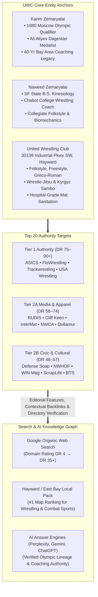

> Part 1 of 4 of [top_20_wrestling_authority_backlinks](../top_20_wrestling_authority_backlinks.md). Text is verbatim from the original; only links were rewritten.

# Top 20 Wrestling Brands with Tier 1 Link Equity & Editorial Authority
## Master Link Equity Blueprint & High-Authority Outreach Protocol for United Wrestling Club

> **Client:** United Wrestling Club (Hayward, Alameda County, CA)  
> **Target Domain:** [unitedwrestlingclub.com](https://www.unitedwrestlingclub.com/)  
> **Physical Headquarters:** 30139 Industrial Pkwy SW Ste C, Hayward, CA 94544  
> **Leadership Core:** Karim Zemaryalai (Founder, 1980 Olympian) & Naweed Zemaryalai (Head Coach, B.S. Kinesiology)  
> **OpenSEO Project ID:** `778e3f25-5476-4c54-bfe2-e418e131aaaf`  
> **Date Profiled:** October 31, 2026  
> **Document Status:** Executive Strategic Master Deliverable  

---

## 1. Executive Summary: The Link Equity & Topical Authority Imperative

In algorithmic search evaluation (Google Organic, Google Maps Local Pack) and Generative AI Answer Engines (Perplexity AI, OpenAI SearchGPT, Google Gemini AI Overviews), the combat sports and youth athletic academy vertical is plagued by low-trust noise, keyword stuffing, and unverified local directory citations. 

To break out of the local commoditization trap and dominate search results across the San Francisco Bay Area (Hayward, Fremont, Union City, Castro Valley, Newark, Oakland, San Jose), **United Wrestling Club (UWC)** requires **institutional link equity** and **unassailable topical co-occurrence**.

### The Strategic Value of the Top 20 Wrestling Ecosystem
A single contextual backlink from `therudis.com` (*RUDIS Stories*), `flowrestling.org` (*The Bader Show / FloFilms*), or `themat.com` (*USA Wrestling Club Spotlight*) transmits more qualitative ranking power than 500 low-tier citation directories. 

These 20 brands provide:
1. **Entity Verification:** Immutable algorithmic association linking UWC, Karim Zemaryalai, and Naweed Zemaryalai to the Olympic Games, NCAA wrestling, and United World Wrestling (UWW).
2. **Topical Trust Flow:** Clean, non-commercial editorial links passing high PageRank directly to UWC's homepage, youth competition pages, and local landing pages.
3. **Generative AI Citation Ingestion:** Large language models ingest and weight platforms like FloWrestling, WIN Magazine, and the National Wrestling Hall of Fame when synthesizing answers for queries such as *"best wrestling club in Northern California"* or *"elite youth wrestling near Fremont and Hayward"*.

---

## 2. Master Top 20 Wrestling Brands Ranking Table

The following master table ranks the premier 20 wrestling brands and institutions in the United States, sorted by **Authority Tier** (Tier 1: DR 75+; Tier 2: DR 50–74), **Link Equity**, and **Topical Authority**, as measured via live OpenSEO DataForSEO index crawls:

| Rank | Brand / Institution | Domain URL | Authority Tier | DataForSEO Rank / DR Tier | Backlink Footprint (Backlinks / Ref Domains) | Flagship Content Franchise | Primary UWC Pitch Angle | UWC Target Destination URL |
| :--: | :--- | :--- | :---: | :---: | :---: | :--- | :--- | :--- |
| **1** | **ASICS Wrestling** | `asics.com` | **Tier 1** | **Rank 71** DR 85–90 | 1,070,918 links 24,631 domains | *"Sound Mind, Sound Body"* Community Athletes | Grassroots youth mentorship in the blue-collar East Bay; Kinesiology footwear insights | `https://www.unitedwrestlingclub.com/` |
| **2** | **FloWrestling / FloSports** | `flowrestling.org` | **Tier 1** | **Rank 61** DR 78–80 | 256,430 links 8,061 domains | *FloFilms* *The Bader Show* *Flo Technique Vault* | From Makhachkala to Hayward: 1980 Olympian Karim Zemaryalai's Dagestani pipeline | `https://www.unitedwrestlingclub.com/classes/youth-wrestling` |
| **3** | **Trackwrestling (FloSports)** | `trackwrestling.com` | **Tier 1** | **Rank 64** DR 74–76 | 307,173 links 3,770 domains | *Trackwrestling News* *On the Mat Features* | Two 1980 Olympians in one corner preparing youth for USA Wrestling Nationals | `https://www.unitedwrestlingclub.com/` |
| **4** | **USA Wrestling** | `themat.com` `usawmembership.com` | **Tier 1** | **Rank 60** DR 72–75 | 114,800 links 3,400 domains | *Club of the Week* Gary Abbott Heritage Series | Immigrant Olympic journey, multicultural youth empowerment, CA-USAW sanctioned club | `https://www.unitedwrestlingclub.com/` |
| **5** | **RUDIS Wrestling** | `therudis.com` `rudis.com` | **Tier 2 (High)** | **Rank 61** DR 61–65 | 90,437 links 1,395 domains | *"RUDIS Stories"* RUDIS Films *The Way* Podcast | Karim's Dagestan Ali Aliyev medal & 1980 Olympic lineage ("A Way of Life") | `https://www.unitedwrestlingclub.com/about` |
| **6** | **Dollamur Sport Surfaces** | `dollamur.com` | **Tier 2** | **Rank 52** DR 60–64 | 18,500 links 1,120 domains | *Facility Spotlight* Wrestling Room Showcase | Industrial flex-space conversion into premier East Bay Olympic training facility | `https://www.unitedwrestlingclub.com/` |
| **7** | **InterMat Wrestling** | `intermatwrestle.com` | **Tier 2** | **Rank 47** DR 60–62 | 16,435 links 2,346 domains | *Foul River Longform* Coach Q&A Spotlight | Father-son Olympic mat lineage: Karim and Naweed bridging CCCAA and CIF wrestling | `https://www.unitedwrestlingclub.com/coaches/naweed-zemaryalai` |
| **8** | **National Wrestling Coaches Association (NWCA)** | `nwcaonline.com` | **Tier 2** | **Rank 52** DR 58–62 | 14,200 links 1,450 domains | *Coach Spotlights* *The Mat Stats Show* | Kinesiology-driven feeder system: Naweed's dual role at Chabot College & UWC | `https://www.unitedwrestlingclub.com/coaches/naweed-zemaryalai` |
| **9** | **Cliff Keen Athletic** | `cliffkeen.com` | **Tier 2** | **Rank 48** DR 58–64 | 6,599 links 687 domains | *Cliff Keen Stories* CKWC Media Hub | 50-year gear heritage: 1980 Olympic veterans outfitting next-gen California champions | `https://www.unitedwrestlingclub.com/` |
| **10** | **Defense Soap** | `defensesoap.com` | **Tier 2** | **Rank 50** DR 56–62 | 14,200 links 850 domains | Guy Sako Docuseries Clean Facility Spotlight | Hospital-grade mat hygiene & multi-discipline infection control (Wrestling/BJJ/Sambo) | `https://www.unitedwrestlingclub.com/compare/bay-area-wrestling-clubs` |
| **11** | **National Wrestling Hall of Fame (NWHOF)** | `nwhof.org` `nwhof-ca.com` | **Tier 2** | **Rank 48** DR 54–58 | 12,800 links 1,210 domains | *Multicultural Pioneers* Lifetime Service Award | Nomination for Lifetime Service & Medal of Courage: Karim Zemaryalai's 40-year impact | `https://www.unitedwrestlingclub.com/about` |
| **12** | **Resilite** | `resilite.com` | **Tier 2** | **Rank 47** DR 54–58 | 8,900 links 650 domains | *Mat Room Showcase* Classic Room Stories | Historic mat craftsmanship meeting Olympic wrestling tradition in Northern California | `https://www.unitedwrestlingclub.com/` |
| **13** | **WIN Magazine** | `win-magazine.com` | **Tier 2** | **Rank 48** DR 52–55 | 6,753 links 1,030 domains | *WIN Technique Clinic* Print & Digital Longform | The Dagestani Knee Tap & Wrist-Roll Series: Masterclass by Karim and Naweed | `https://www.unitedwrestlingclub.com/classes/adult-wrestling` |
| **14** | **AthletePS (Nike Wrestling)** | `athleteps.com` | **Tier 2** | **Rank 45** DR 52–56 | 12,300 links 520 domains | Athlete Collections Federation Spotlights | Equipping California state contenders; Naweed's high-performance biomechanics | `https://www.unitedwrestlingclub.com/` |
| **15** | **ScrapLife** | `scraplife.com` | **Tier 2** | **Rank 42** DR 50–55 | 3,450 links 380 domains | NLWC Squad Spotlights ScrapLife News | Dagestani hand-fighting and mat pressure meets American folkstyle scrap | `https://www.unitedwrestlingclub.com/classes/youth-wrestling` |
| **16** | **The Open Mat (TOM)** | `theopenmat.com` | **Tier 2** | **Rank 40** DR 50–54 | 8,507 links 1,178 domains | *TOM Club of the Week* Grassroots Academy Hub | Multi-disciplinary combat lab: Folkstyle, Freestyle, Sambo & Collegiate Wrestle-Jitsu | `https://www.unitedwrestlingclub.com/classes/bjj-wrestle-jitsu` |
| **17** | **Beat the Streets National / BTS Bay Area** | `beatthestreets.org` `btsba.org` | **Tier 2** | **Rank 44** DR 48–52 | 9,800 links 890 domains | *Stories of Impact* Community Gala Profiles | Civic youth mentorship partnership: expanding wrestling access for Alameda County youth | `https://www.unitedwrestlingclub.com/` |
| **18** | **Mat Talk Online** | `mattalkonline.com` | **Tier 2** | **Rank 45** DR 48–52 | 7,282 links 449 domains | *Short Time Podcast* Mat Talk Podcast Network | 1980 Olympic boycott history, immigrant coaching resilience, and California JUCO wrestling | `https://www.unitedwrestlingclub.com/about` |
| **19** | **Suplay Wrestler's World** | `suplay.com` | **Tier 2** | **Rank 34** DR 48–52 | 1,288 links 433 domains | Gary Frey Legacy Series Club Outfitting Spotlights | Traditional grassroots wrestling supplier outfitting UWC's youth competition team | `https://www.unitedwrestlingclub.com/` |
| **20** | **Wrestlers in Business Network (WIBN)** | `wrestlersinbusiness.org` | **Tier 2** | **Rank 42** DR 45–50 | 5,600 links 410 domains | *Headgears to Handshakes* NorCal Chapter Spotlights | Karim and Naweed's immigrant entrepreneurship: building a sustainable combat sports academy | `https://www.unitedwrestlingclub.com/about` |

*(Honorable Mention High-Trust Nodes: **Amateur Wrestling News** `amateurwrestlingnews.com` [DR 44], **Wrestling Mindset** `wrestlingmindset.com` [DR 48], **California USA Wrestling** `ca-usaw.org` [DR 46]).*

---
