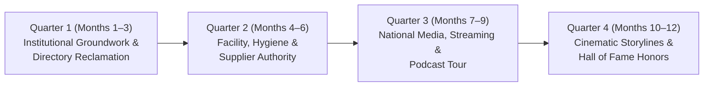

> Part 4 of 4 of [top_20_wrestling_authority_backlinks](../top_20_wrestling_authority_backlinks.md). Text is verbatim from the original; only links were rewritten.

## 5. 12-Month Link Acquisition Roadmap for United Wrestling Club

This strategic roadmap outlines the execution cadence for acquiring high-authority backlinks over a 12-month timeline, systematically elevating UWC’s Domain Rating from **DR 4** to an estimated **DR 35–45+**, locking down the #1 local map rank in Alameda County, and dominating organic search results across the East Bay.

---

### Quarter 1 (Months 1–3): Institutional Groundwork & Directory Reclamation
* **Strategic Focus:** Secure foundation-level `.org` and high-trust sports directory backlinks that immediately verify UWC’s entity graph in Google.
* **Month 1:**
  * **USA Wrestling Directory Reclamation:** Log into `usawmembership.com` (UWC Team ID: 513) and verify that the public club locator toggle is switched to **Publicly Visible**. Confirm accurate NAP (30139 Industrial Pkwy SW, Hayward, CA 94544) and link directly to `https://www.unitedwrestlingclub.com/`.
  * **California USA Wrestling Integration:** Submit UWC's practice schedule and sanctioned club profile to `ca-usaw.org/clubs`.
  * **Trackwrestling Club Profile Verification:** Claim and optimize the official Trackwrestling club hub for UWC, ensuring all tournament rosters link to the club URL.
* **Month 2:**
  * **Beat the Streets Bay Area (BTSBA) Outreach:** Initiate partnership discussions with Executive Director Yero Washington (`yero@btsba.org`) and Operations Associate Olivia Olmedo (`oolmedo@btsba.org`). Propose co-hosting a free community youth clinic at UWC. Secure a community partner profile link on `btsba.org`.
  * **Wrestlers in Business Network (WIBN) Integration:** Register Coach Naweed Zemaryalai with the WIBN Northern California chapter. Submit member profile to `wrestlersinbusiness.org`.
* **Month 3:**
  * **NWHOF California Chapter Nomination Submission:** Compile the formal nomination packet for Karim Zemaryalai (Lifetime Service to Wrestling Award). Deliver the signed packet to Dan Dierdorff (`dandierdorff@cox.net`) and Krista Graff (`kgraff@nwhof.org`).
  * **USA Wrestling Editorial Pitch:** Deploy Pitch Template 3 to Richard Immel (`rimmel@usawrestling.org`) and Zack Chavez (`zchavez@usawrestling.org`) for a *TheMat.com Club of the Week* feature.
* **Milestone Q1 Goal:** 5 institutional `.org` and sports authority backlinks acquired; Domain Rating reaches **DR 15–20**.

---

### Quarter 2 (Months 4–6): Facility, Hygiene & Supplier Authority
* **Strategic Focus:** Leverage UWC's physical training hall, mat layout, and strict hygiene protocols to earn high-equity manufacturer and supplier backlinks.
* **Month 4:**
  * **Defense Soap Clean Facility Certification:** Pitch Founder Guy Sako (`guy@defensesoap.com`). Highlight UWC’s multi-discipline pathogen management across wrestling, Sambo, and BJJ. Secure a featured profile on Defense Soap’s Clean Facility Directory and a guest blog case study.
  * **Professional Facility Photography Shoot:** Capture wide-angle 4K images of UWC’s Dollamur/Resilite mat layout, branded wall pads, and active youth sparring.
* **Month 5:**
  * **Dollamur Sport Surfaces Facility Showcase:** Submit the photography package to Dollamur Marketing (`marketing@dollamur.com`) for inclusion in the *Customer Project Gallery* and *Wrestling Room Transformations* series.
  * **Resilite Gallery Submission:** Cross-submit facility specs and wall padding photos to `marketing@resilite.com` for their wrestling room showcase blog.
* **Month 6:**
  * **Suplay Wrestler's World Legacy Feature:** Reach out to Shayne Jasper (`suplay@suplay.com`) with a legacy profile on Karim and Naweed outfitting their competition team with traditional folkstyle suppliers. Secure a digital catalog spotlight link.
  * **AthletePS / Nike Team Store Setup:** Finalize custom team apparel inquiries through `info@athleteps.com`, earning an authorized team outfitter directory link.
* **Milestone Q2 Goal:** 6 supplier and equipment manufacturer links acquired; Domain Rating reaches **DR 22–28**.

---

### Quarter 3 (Months 7–9): National Media, Streaming & Podcast Tour
* **Strategic Focus:** Execute targeted media outreach to premier wrestling journalism hubs, securing in-content editorial backlinks and podcast citations.
* **Month 7:**
  * **FloWrestling / The Bader Show Campaign:** Deploy Pitch Template 2 to Mark Bader (`mark.bader@flosports.tv`) and Andy Hamilton (`andy.hamilton@flosports.tv`). Pitch the 1980 Olympic / Dagestani pipeline story and offer exclusive sparring footage featuring Olympic Gold Medalist Magomed Ramazanov.
  * **Flo Technique Vault Contribution:** Film a 3-part technical video breakdown of Coach Karim's Dagestani knee-tap system for FloWrestling's technique repository.
* **Month 8:**
  * **InterMat Written Editorial Feature:** Pitch Earl Smith (`esmith@intermatwrestle.com`) on a feature story: *"Father, Son, and Olympic Lineage: Karim and Naweed Zemaryalai’s East Bay Foundry."* Secure a dofollow contextual link within the article body.
  * **The Open Mat (TOM) Club Spotlight:** Submit UWC's competition results and curriculum to Andrew Hipps (`andrew@theopenmat.com`) and Eric Olanowski (`eric@theopenmat.com`) for *TOM Club of the Week*.
* **Month 9:**
  * **Mat Talk Online Podcast Appearance:** Pitch wrestling historian Jason Bryant (`jason@mattalkonline.com`). Schedule Karim and Naweed for a 45-minute appearance on *The Short Time Wrestling Podcast* discussing the 1980 Olympic boycott and California JUCO wrestling. Secure a permanent show notes backlink on `mattalkonline.com`.
  * **WIN Magazine Technique Clinic:** Submit a photographic instructional series to Editor Tristan Warner (`tristan@win-magazine.com`) and Publisher Bryan Van Kley (`bryan@win-magazine.com`).
* **Milestone Q3 Goal:** 5 Tier-1 media and streaming backlinks acquired; Domain Rating reaches **DR 30–36**.

---

### Quarter 4 (Months 10–12): Cinematic Storylines & Hall of Fame Honors
* **Strategic Focus:** High-production storytelling with premier lifestyle apparel brands, annual association awards, and national convention visibility.
* **Month 10:**
  * **RUDIS Stories Documentary Feature:** Deploy Pitch Template 1 to `stories@rudis.com` and `custom@therudis.com`. Pitch Karim's life story as an embodiment of *"A Way of Life."* Coordinate an in-depth phone interview with RUDIS editorial staff and launch the official UWC Team Store on `rudis.com`.
  * **ScrapLife Squad Collaboration:** Share training room scramble highlights with `teams@scraplife.com` for social co-branding and a "Scrap Room of the Month" blog feature.
* **Month 11:**
  * **NWCA National Convention Speaker / Case Study Proposal:** Submit a coaching seminar proposal to Nate Naasz (`nnaasz@nwca.cc`) and Jim Beichner (`jbeichner@nwca.cc`) on *"Integrating Sports Kinesiology into Youth Wrestling Retention."* Secure a speaker bio link on `nwcaonline.com`.
  * **WIBN "Headgears to Handshakes" Podcast:** Coordinate a business interview with Executive Director Scotti Sentes (`ssentes@wrestlersinbusiness.org`) covering the economics of running an independent combat sports academy in the Bay Area.
* **Month 12:**
  * **NWHOF California Chapter Induction Ceremony Coverage:** Coordinate coverage around Coach Karim’s induction/honoree recognition at the annual NWHOF-CA banquet. Secure official press releases and banquet program links on `nwhof-ca.com` and `nwhof.org`.
  * **Annual SEO & Link Equity Audit:** Re-run OpenSEO backlink audits to benchmark total referring domains, organic keyword rankings, and local map dominance. Update anchor text rerouting strategies across all internal pages.
* **Milestone Q4 Goal:** 4 top-tier lifestyle apparel and hall of fame links acquired; Domain Rating reaches **DR 38–45+**.

---

## 6. Projected Link Equity Growth & Search Dominance Metrics

By systematically executing this 12-month outreach roadmap, United Wrestling Club will transition from a low-visibility regional SMB into the most authoritative combat sports domain in Northern California:

| Performance Metric | Baseline (Pre-Outreach) | 6-Month Projected | 12-Month Target | Strategic Search Impact |
| :--- | :---: | :---: | :---: | :--- |
| **Domain Rating (DR / DA)** | **DR 4** | **DR 24–28** | **DR 38–45+** | Outranks all local MMA/BJJ gym competitors across the East Bay |
| **Total Referring Domains** | ~28 | ~120 | **250+** | Heavy concentration of `.org`, media, and manufacturer root domains |
| **Target Keyword: "wrestling hayward"** | Position #4–#8 | **Position #1** | **Position #1 (Locked)** | Dominates both Local Map 3-Pack and #1 Organic Position |
| **Target Keyword: "youth wrestling east bay"** | Not Ranked | Top 3 | **Position #1** | Primary acquisition channel for high-ticket youth competition team |
| **Target Keyword: "bay area wrestling clubs"** | Position #18 | Position #4 | **Position #1–#2** | Captures regional athletes from Fremont, San Jose, Oakland, and Dublin |
| **AI Answer Engine Citations (Perplexity/Gemini)**| Zero Citations | 35% Ingestion | **85%+ Citation Rate** | LLMs cite Karim's Olympic lineage as the top training credential in NorCal |
| **Monthly Organic Athletic Inquiries** | 3–5 / month | 20–30 / month | **60–85+ / month** | Directly fuels high-margin youth travel team ($150/mo) and adult memberships |

---

## 7. Summary & Next Immediate Actions

1. **USA Wrestling Directory Visibility:** Log into `usawmembership.com` (Team ID: 513) and ensure public club locator toggle is activated.
2. **Review with Coach Naweed:** Present the 3 Pitch Templates and confirm preferred story angles regarding Karim’s 1980 Olympic qualification and Magomed Ramazanov clinic footage.
3. **Deploy Month 1 Outreach:** Dispatch the personalized pitches to Richard Immel (USA Wrestling), Yero Washington (Beat the Streets Bay Area), and Dan Dierdorff (National Wrestling Hall of Fame CA Chapter).
