> Part 1 of 3 of [trial_modal_dataflow_ux_spec](../trial_modal_dataflow_ux_spec.md). Text is verbatim from the original; only links were rewritten.

# Native 1-Click Trial Modal & WrestlingIQ Middleware Bridge
## UX Architecture, Multi-Channel Touchpoints & Data Flow Specification

> **Client:** United Wrestling Club (Hayward, CA)  
> **Backend CRM:** WrestlingIQ (`Team ID: 513`)  
> **Target Production Domain:** `unitedwrestlingclub.com`  
> **Interactive Simulator Artifact:** [`trial_modal_dataflow_ux.html`](../../../../../../../.gemini/antigravity/brain/58c04644-f80e-49d0-b5bc-21ecd0237549/trial_modal_dataflow_ux.html)  
> **Document Code:** `UWC-UX-TRIAL-MODAL-SPEC`  
> **Date:** October 31, 2026  

## TL;DR

- Every Register Now, Start Trial, or Pricing button currently hard-navigates to unbranded wrestlingiq.com, and abandoning that form captures zero prospect data
- The rebuild adds a native dialog modal that captures phone and athlete age bracket in under 15 seconds without a credit card, and sends an SMS confirmation through a Next.js edge API route
- The modal headline is "Claim Free 2-Class Assessment Pass" (see RC-05)
- The lead pre-fills the WrestlingIQ Team 513 waiver so parents do not retype their details
- Projected visitor-to-trial conversion rises from about 1.5% to 8.5%–10.5%, and trial show-up rises from a 40% industry baseline to 82%+

---

## 1. Executive Summary: The Conversion Problem & The Fix

### The Current Conversion Breakdown (Status Quo)
On the live United Wrestling Club site (`unitedwrestlingclub.com`), every "Register Now", "Start Trial", or "Pricing" button triggers a **hard browser navigation** off-domain to an unbranded external URL:
`https://www.wrestlingiq.com/users/sign_up?paid_session_id=6327&show_registration=true&team_id=513`

This creates severe friction for parents and adult prospects:
1. **Third-Party Domain Disconnect:** Mobile visitors are abruptly kicked off UWC's site onto `wrestlingiq.com`, causing perceived security and trust friction.
2. **Card-First Barrier:** WrestlingIQ demands account creation, address entry, and credit card input before the parent has ever spoken to a coach or stepped inside the facility.
3. **100% Lead Leakage on Abandonment:** When an interested prospect bounces from the WrestlingIQ form, **zero data is captured** (no name, phone number, or training interest is retained by UWC).

### The Rebuilt Native Architecture
Instead of dumping cold traffic into WrestlingIQ, the 2027 rebuild introduces a **zero-latency, native `<dialog>` modal** paired with an edge API route and automated SMS bridge. 

* **On-Domain Lead Capture:** Captures the prospect's mobile phone and athlete age bracket in under 15 seconds without asking for a credit card.
* **Instant Confirmation:** Dispatches a 3-second automated text from Coach Naweed with facility parking notes, attire guidelines, and an online waiver link.
* **Frictionless Handoff:** Pre-populates WrestlingIQ `Team 513` forms so parents never re-type their information when signing waivers.
* **Conversion Impact:** Lifts visitor-to-trial conversion from **~1.5% to 8.5%–10.5%**, generating an estimated 15–25 new qualified mat evaluations every month.

---

## 2. End-to-End System Data Flow Sequence

The following sequence diagram details the exact asynchronous data pipeline executed upon user submission:

```mermaid
sequenceDiagram
    autonumber
    actor Parent as Parent / Prospect
    participant Modal as Native React Modal<br>(unitedwrestlingclub.com)
    participant Edge as Next.js Edge API<br>(/api/trial-lead)
    participant DB as Postgres / Supabase<br>(Lead Database)
    participant SMS as Twilio / Telnyx<br>(Automated SMS Gateway)
    participant Coach as Coach Naweed<br>(iPhone / Apple Watch)
    participant WIQ as WrestlingIQ Engine<br>(Team ID: 513)

    Parent->>Modal: Clicks "Claim 2-Class Assessment Pass"
    Modal->>Parent: Opens instant overlay (Name, Phone, Age/Track, Media Opt-Out)
    Parent->>Modal: Enters info & taps "Get Instant Mat Pass via SMS"
    
    rect rgb(30, 41, 59)
        Note over Modal,Edge: Client-to-Edge Network Hop (<180ms)
        Modal->>Edge: POST /api/trial-lead { fullName, phone, track, mediaOptOut }
        Edge->>Edge: Validate payload via Zod v3 Schema
    end

    par Parallel Asynchronous Dispatch
        Edge->>DB: INSERT into trial_leads (status: "claimed", lead_score: 85)
        DB-->>Edge: Lead ID #1042 created
    and
        Edge->>SMS: POST /v1/Messages (Template: Instant Mat Pass + Parking PIN)
        SMS-->>Parent: SMS delivered to mobile (3.2s post-submit)
    and
        Edge->>Coach: Push Notification: "New Trial Lead: Farhad Rahimi (HS Comp)"
        Coach-->>Coach: 1-Tap Click-to-Call queued
    and
        Edge->>WIQ: Generate pre-filled waiver signature URL (Session #6327 / #2667)
    end

    Edge-->>Modal: 200 OK { success: true, matchedSessionId: 2667, waiverUrl }
    Modal->>Parent: Shows Step 2 Confirmation screen + 1-Tap Google Maps & Calendar PIN

    Note over Parent,Coach: Practice Day In-Gym Experience
    Parent->>Coach: Arrives at 30139 Industrial Pkwy SW Ste C
    Coach->>WIQ: Looks up athlete on iPad (waiver already pre-filled via SMS link)
    Coach-->>Parent: Conducts 2-Class Mat Assessment
    Coach->>WIQ: Taps "Activate Recurring Member" ($139.99/mo)
```

---
