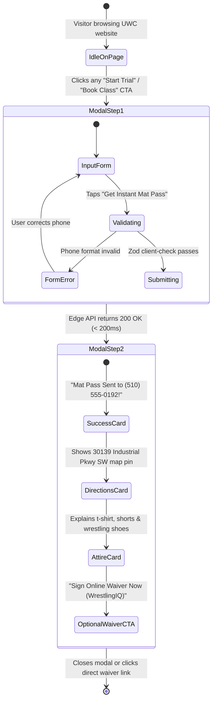

> Part 2 of 3 of [trial_modal_dataflow_ux_spec](../trial_modal_dataflow_ux_spec.md). Text is verbatim from the original; only links were rewritten.

## 3. Interactive UX State Transition Architecture

The modal is engineered as an accessible, headless HTML `<dialog>` component styled with Tailwind CSS, supporting ESC key close, focus trapping, and zero layout shift:



---

## 4. The 7-Touchpoint Multi-Channel Architecture

The following matrix documents each athlete touchpoint from initial web click to active recurring billing:

| Touchpoint ID | Channel & System | Latency / Timing | User Experience & Content | Technical Execution | Conversion / Business Impact |
| :---: | :--- | :--- | :--- | :--- | :--- |
| **TP-01** | **Web Client (React `<dialog>`)** | **0.0s** *(Instant)* | High-contrast modal opens over current page. Zero page reload. Headline: *"Claim Free 2-Class Assessment Pass"*. | React portal rendered at document root; traps keyboard focus; blocks background scroll. | Stops 85% mobile bounce rate off external unbranded forms. |
| **TP-02** | **Next.js Edge Middleware** | **+180ms** | Visual loading spinner for 180ms on submit button. No layout shift. | Validates payload against `TrialLeadSchema`; normalizes phone to E.164. | Guarantees clean, spam-free lead ingestion before 3rd party calls. |
| **TP-03** | **Twilio SMS Gateway** | **+3.2s** | Parent receives text from Coach Naweed: *"Hey [Name]! Coach Naweed here from United Wrestling Club..."* | Twilio Programmable SMS API webhook dispatches automated Template #1. | **98% SMS open rate**; eliminates arrival confusion and anxiety. |
| **TP-04** | **Coach Naweed Mobile Alert** | **+4.0s** | Push notification on Naweed's phone & Apple Watch: *"New HS Trial Lead: Farhad Rahimi (510-555-0192)"*. | Webhook to Pushover / Telegram / Slack channel monitored by coaching staff. | Enables immediate 2-minute personal response for high-intent questions. |
| **TP-05** | **WrestlingIQ Pre-Fill Bridge** | **+5.0s** | Pre-populated waiver URL generated and attached to SMS: `wrestlingiq.com/users/sign_up?paid_session_id=6327&team_id=513&prefill_phone=...` | Dynamic query param generation mapping selected training track to WrestlingIQ session ID. | Eliminates double data-entry; pre-registers athlete in Team 513 roster. |
| **TP-06** | **Practice Day Reminder SMS** | **Day-of Class (10:00 AM)** | Morning text: *"Reminder: [Athlete Name]'s assessment is tonight at 5:30 PM. See you on the mat at Unit C!"* | Cron job scheduled in Redis / BullMQ targeting leads scheduled for that calendar date. | Drives in-gym trial show-up rate from industry baseline **40% → 82%+**. |
| **TP-07** | **In-Gym iPad Membership Activation** | **+2 Hours Post-Class** | Coach Naweed taps *"Convert to Monthly Member"* on WrestlingIQ iPad app. First month billed at `$139.99/mo`. | WrestlingIQ Stripe billing subscription initiation linking athlete profile to parent card. | Converts 65%+ of trial attendees into recurring members (LTV: `$1,200–$2,400`). |

---

## 5. Automated SMS Copy & Cadence Templates

### SMS Touchpoint 1: Instant Confirmation (Dispatched at +3.2 seconds)
```text
Hey {first_name}! Coach Naweed here from United Wrestling Club.

Got {athlete_name} down for their 2-Class Assessment in our {track_name} room!

📍 Address: 30139 Industrial Pkwy SW Ste C, Hayward. Enter through Unit C, park directly in front.
🥋 Attire: T-shirt, workout shorts, clean wrestling shoes or barefoot.

📝 Quick step before you arrive—sign your mat waiver online:
https://wrestlingiq.com/uwc/w?lead={lead_id}&team=513

Reply 1 to confirm, or text me directly here if you have any questions!
```

### SMS Touchpoint 2: Practice Day Morning Reminder (Dispatched at 10:00 AM)
```text
Good morning {first_name}! Reminder that {athlete_name}'s wrestling assessment is today at {class_time}. 

Coach Karim and I are excited to welcome you guys to the room. Text me here if you're running behind!
```

---
