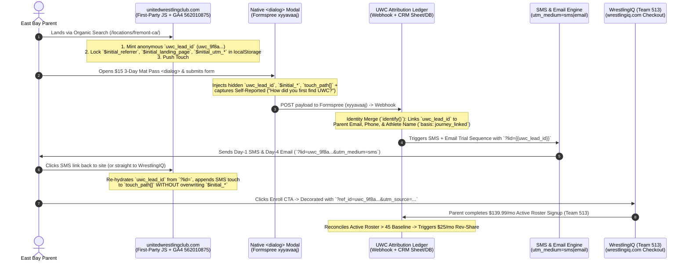

# United Wrestling Club (UWC): Organic SEO + SMS/Email Attribution Model & First-Party Stitching Architecture

> **Client:** United Wrestling Club (UWC) — 30139 Industrial Pkwy SW, Hayward, CA 94544  
> **Prepared By:** Sprintz Growth OS (Rodney Lewis)  
> **Client Principals:** Naweed Zemaryalai (Head Coach & Co-Founder), Karim Zemaryalai (Founder)  
> **Analytics & Roster Stack:** GA4 Property `562010875` · Formspree `xyyavaaj` (Native `<dialog>` Trial Modal) · SMS/Email Lifecycle Engine · WrestlingIQ (`Team ID: 513`)  
> **Commercial Baseline & Rev-Share:** $1,000/mo Base Retainer + **$25.00/mo per incremental active recurring athlete above the 45-member baseline** ($139.99/mo tuition)  

---

## 1. Executive Summary & The Commercial Problem

United Wrestling Club operates under a strict **100% Organic Growth Mandate** (*"bruh i'm not trying to pay for any paper clip things bruh i'm only looking for like organic"* — Naweed Zemaryalai, Nov 2, 2026). Every dollar of growth is driven by three Sprintz-engineered systems:
1. **Top-of-Funnel Acquisition:** Local Organic SEO (programmatic sub-market pages like `/locations/fremont-ca/`, `/locations/union-city-ca/`, `/locations/hayward-ca/`) and Google Business Profile (GBP) Map Pack dominance (`Place ID: ChIJsQd_yMaVj4ARrXw93nb4euo`).
2. **On-Site Conversion Capture:** The native HTML `<dialog>` **$15 3-Day Mat Pass** modal on `unitedwrestlingclub.com` (wired to Formspree `xyyavaaj`).
3. **Middle/Bottom-Funnel Lifecycle Closure:** Automated SMS and Email nurture sequences (`utm_medium=sms` and `utm_medium=email`) that drive parents from their 3-day trial onto a recurring **$139.99/mo membership** on `wrestlingiq.com` (`Team ID: 513`).

### Why Naive Attribution Fails UWC (And Costs Sprintz Money)
Right now, UWC has **two fatal measurement blind spots**:
* **The Un-Tagged / Cross-Domain Gap:** GA4 (`562010875`) currently has zero live tags on `unitedwrestlingclub.com`, and final tuition checkout happens on a third-party domain (`wrestlingiq.com`, Team ID `513`). Without first-party identity stitching, every parent who clicks from `unitedwrestlingclub.com` or an SMS link into WrestlingIQ appears in analytics as a disconnected `Direct` or `Referral` session.
* **The Last-Touch Cannibalization Trap:** In a standard local youth sports journey, a Fremont parent discovers UWC via an organic search (`"youth wrestling near me"` -> `/locations/fremont-ca/`), claims a $15 3-Day Trial Pass in the on-site modal, attends practice in Hayward, and 4 days later clicks a follow-up **SMS link** (`?utm_source=lifecycle&utm_medium=sms`) to complete their $139.99/mo enrollment on WrestlingIQ.
  * Under **Last-Touch Attribution**, **SMS gets 100% of the credit** and **Organic SEO gets 0%**.
  * Alternatively, if the parent opens a new browser tab on their laptop and types `unitedwrestlingclub.com` to sign up after getting an email reminder, **Direct / Branded Search gets 100% of the credit** and **Organic SEO gets 0%**.

This architecture solves both problems permanently using **Pillar A (Dual First-Touch + 40/20/40 U-Shaped Multi-Touch + Self-Reported Attribution)** and **Pillar B (First-Party `localStorage` Identity Graph + Cross-Domain Passthrough + WrestlingIQ Roster Reconciliation)**.

---

## 2. Pillar A: Attribution Model Selection & Mathematical Framework

### A. The Three-Layer Attribution Standard for UWC

Because UWC's buyer journey has a clear **Demand Creation moment** (Organic Search / GBP discovery + Trial Pass modal) and a clear **Lifecycle Closure moment** (SMS/Email follow-up -> WrestlingIQ recurring enrollment), no single-touch model tells the full operational truth. We deploy a three-layer triangulation architecture:

| Attribution Layer | Model Rule | Operational Question Answered | Role in UWC Growth OS |
| :--- | :--- | :--- | :--- |
| **Layer 1: Primary Acquisition Read** | **First-Touch (100% to Initial Touch)** | *"Which local SEO page, keyword cluster, or GBP listing brought this family into UWC's orbit?"* | Proves top-of-funnel SEO & Map Pack ROI (`/locations/fremont-ca/`, `/locations/union-city-ca/`, GBP Hayward). |
| **Layer 2: Full-Funnel Operating Model** | **Position-Based / U-Shaped (40% / 20% / 40%)** | *"How did Organic SEO discovery, SMS/Email trial nurture, and the closing conversion trigger work together?"* | Splits credit across the two moments we engineer: **40% First Organic Touch**, **20% Middle SMS/Email Nurture**, **40% Conversion Trigger**. |
| **Layer 3: Out-of-Model Triangulation** | **Self-Reported Attribution + Roster Match** | *"What does the parent remember, and did they become an active paying member in WrestlingIQ?"* | Captures Dark Social (word-of-mouth from James Logan / Chabot wrestlers, Instagram DMs, mat-side referrals) and anchors rev-share to real bank deposits. |

---

### B. Worked Journey: One East Bay Parent Scored Across All 6 Models

Consider a real UWC parent journey over 9 days resulting in a **$139.99/mo recurring membership** ($1,679.88 annualized LTV; **$25.00/mo Sprintz Rev-Share**):

* **Touch 1 (Day 0 — Discovery):** Parent searches `"youth wrestling fremont ca"` on Google and lands on `unitedwrestlingclub.com/locations/fremont-ca/` (`Organic Search — Non-Branded`).
* **Touch 2 (Day 0 — Capture):** Parent clicks *"Claim $15 3-Day Mat Pass"*, opens the native `<dialog>` modal, and submits the Formspree (`xyyavaaj`) form (`On-Site Modal`).
* **Touch 3 (Day 1 — Nurture 1):** Parent clicks the automated **SMS Welcome & Mat Schedule link** (`utm_source=uwc_sms&utm_medium=sms&utm_campaign=trial_welcome`) to check practice times (`SMS Nurture`).
* **Touch 4 (Day 4 — Nurture 2):** After attending two practices, parent opens the **Coach Naweed Trial Follow-Up Email** (`utm_source=uwc_email&utm_medium=email&utm_campaign=trial_day4`) and reviews tuition tiers (`Email Nurture`).
* **Touch 5 (Day 6 — Closure):** Parent receives the **Final Day-6 SMS Enrollment Link** (`utm_source=uwc_sms&utm_medium=sms&utm_campaign=trial_close`), clicks through to `wrestlingiq.com` (`Team ID: 513`), and activates a **$139.99/mo recurring membership** (`Conversion Trigger`).

#### How the 6 Standard Models Score This Single $139.99/mo Membership:

| Touchpoint | Channel / Medium | First-Touch (Acquisition) | Last-Touch (Naive) | Last Non-Direct | Linear (Equal) | Time-Decay (7d half-life) | **UWC Standard: U-Shaped (40/20/40)** |
| :--- | :--- | :---: | :---: | :---: | :---: | :---: | :---: |
| **T1 (Day 0)** | **Organic SEO (`/locations/fremont-ca/`)** | **$139.99 (100%)** | $0.00 (0%) | $0.00 (0%) | $35.00 (25%) | $18.90 (13.5%) | **$56.00 (40%)** |
| **T3 (Day 1)** | **SMS Welcome (`utm_medium=sms`)** | $0.00 (0%) | $0.00 (0%) | $0.00 (0%) | $35.00 (25%) | $20.86 (14.9%) | **$14.00 (10%)** |
| **T4 (Day 4)** | **Email Follow-Up (`utm_medium=email`)** | $0.00 (0%) | $0.00 (0%) | $0.00 (0%) | $35.00 (25%) | $28.14 (20.1%) | **$14.00 (10%)** |
| **T5 (Day 6)** | **SMS Closing Link → WrestlingIQ (`513`)** | $0.00 (0%) | **$139.99 (100%)** | **$139.99 (100%)** | $35.00 (25%) | $72.09 (51.5%) | **$56.00 (40%)** |
| **Total MRR** | **1 Verified New Roster Athlete** | **$139.99** | **$139.99** | **$139.99** | **$139.99** | **$139.99** | **$139.99** |
| **Sprintz Rev-Share** | **$25.00/mo Attribution Split** | **$25.00 SEO** | $0.00 SEO / $25 SMS | $0.00 SEO / $25 SMS | $6.25 each | $3.38 SEO / $21.62 Lifecycle | **$10.00 Discovery / $5.00 Nurture / $10.00 Close** |

#### Why First-Touch + U-Shaped (40/20/40) Is the Gold Standard for UWC:
1. **Side-by-Side First-Touch vs. Last-Touch Exposes Funnel Velocity:** Reporting First-Touch alongside U-Shaped (40/20/40) proves that **Organic SEO created 100% of the demand** (T1) while **SMS/Email automated the follow-up and close** (T3–T5). Without First-Touch and U-Shaped tracking, Naweed would see 100% of enrollments coming from SMS links or Direct traffic and mistakenly believe the local SEO sub-market pages (`/locations/fremont-ca/`, `/locations/union-city-ca/`) weren't driving athletes.
2. **No Volume Bottleneck (Why We Reject Data-Driven / Shapley):** Algorithmic Data-Driven Attribution (DDA) requires hundreds of monthly conversions to stabilize counterfactual Shapley weights. For a local wrestling academy scaling from 45 to 120+ recurring athletes, deterministic **Position-Based (40/20/40)** + **First-Touch** is 100% transparent, mathematically exact on every single athlete, and impossible to manipulate.
3. **Self-Reported Attribution Captures the East Bay "Dark Social" Blind Spot:** Wrestling is a tightly knit community. Parents talk at SCYWAY tournaments, high school matches (James Logan, Moreau Catholic, Hayward High), and in WhatsApp/text threads. Those touches carry zero digital referrer (`Direct`). Adding a required **"How did you first hear about UWC?"** field inside the `<dialog>` Trial Pass modal catches 100% of dark-social and word-of-mouth referrals.

---

### C. First-Touch Data Quality: Mandatory Referrer Exclusions

To prevent redirects and payment flows from overwriting `$initial_referrer` in GA4 (`562010875`) and our first-party attribution script, the following domains are **hard-excluded** from referrer classification (treated as self-referrals / passthroughs, never as acquisition sources):
* `unitedwrestlingclub.com` and `*.unitedwrestlingclub.com`
* `wrestlingiq.com` and `*.wrestlingiq.com` (Roster & checkout platform)
* `formspree.io` (Modal form handler)
* `stripe.com` and `checkout.stripe.com` (Payment processor redirects)
* `accounts.google.com` (OAuth logins)
* `localhost` and `127.0.0.1` (Staging/dev environments)

---

## 3. Pillar B: First-Party Identity & Cross-Domain Stitching Architecture

### A. System Data Flow Diagram



---

### B. Production JavaScript Snippet (`uwc-attribution.js`)

Deploy this script globally in the `<head>` (or Next.js root `_app` / `layout.tsx`) of `unitedwrestlingclub.com`. It handles:
1. **Anonymous ID Minting & URL Re-hydration (`uwc_lead_id`)**: Creates a persistent UUID (`uwc_<uuid>`) in `localStorage` and a 365-day first-party cookie (`_uwc_lid`), or re-hydrates it if the parent clicks an SMS/Email link containing `?lid=uwc_...` on a secondary device.
2. **Immutable First-Touch (`$initial_*`) + Ordered `touch_path[]`**: Locks the very first organic touch forever (`$set_once` logic) while appending subsequent SMS, Email, or organic return visits to `touch_path[]` (capped at 15 touches) so we can calculate both **First-Touch** and **U-Shaped (40/20/40)** models.
3. **Anonymity Guard (Fail Closed)**: Never leaks PII (emails or phone numbers) into outbound URLs—validates that `uwc_lead_id` starts with `uwc_`, contains no `@`, and is $\le 64$ characters.
4. **Native `<dialog>` Trial Pass Modal Hidden Field Injection**: Automatically populates hidden attribution inputs inside the Formspree (`xyyavaaj`) form and fires GA4 (`562010875`) conversion events.
5. **Capture-Phase Outbound WrestlingIQ (`Team 513`) Link Decorator**: Intercepts `click` and `auxclick` events on any `wrestlingiq.com` link and appends the anonymous `uwc_lead_id` and original acquisition UTMs.

```javascript
/**
 * UWC First-Party Attribution & Cross-Domain Identity Stitcher v1.0
 * Property: unitedwrestlingclub.com | GA4: 562010875 | Formspree: xyyavaaj | WrestlingIQ: Team 513
 */
(function () {
  "use strict";

  const STORAGE_KEY = "uwc_attr_v1";
  const COOKIE_NAME = "_uwc_lid";
  const MAX_TOUCHES = 15;

  // Domains excluded from ever counting as an external acquisition referrer
  const EXCLUDED_REFERRERS = [
    "unitedwrestlingclub.com",
    "wrestlingiq.com",
    "formspree.io",
    "stripe.com",
    "checkout.stripe.com",
    "accounts.google.com",
    "localhost",
    "127.0.0.1"
  ];

  // 1. ANONYMITY GUARD (FAIL CLOSED)
  // Only allow opaque anonymous IDs (uwc_<hex/uuid>). Reject anything resembling an email or PII.
  function isAnonymousLeadId(id) {
    if (typeof id !== "string") return false;
    const trimmed = id.trim();
    return (
      trimmed.length >= 12 &&
      trimmed.length <= 64 &&
      trimmed.startsWith("uwc_") &&
      !trimmed.includes("@") &&
      /^[a-zA-Z0-9_-]+$/.test(trimmed)
    );
  }

  // Generate a cryptographically random anonymous lead ID
  function generateLeadId() {
    if (typeof crypto !== "undefined" && crypto.randomUUID) {
      return "uwc_" + crypto.randomUUID().replace(/-/g, "");
    }
    return (
      "uwc_" +
      Date.now().toString(36) +
      Math.random().toString(36).substring(2, 12)
    );
  }

  // Cookie helpers for cross-session persistence (365 days)
  function setCookie(name, value, days) {
    try {
      const expires = new Date(Date.now() + days * 864e5).toUTCString();
      document.cookie = `${name}=${encodeURIComponent(value)}; expires=${expires}; path=/; SameSite=Lax; Secure`;
    } catch (_) {}
  }

  function getCookie(name) {
    try {
      const match = document.cookie
        .split(/;\s*/)
        .find((row) => row.startsWith(name + "="));
      return match ? decodeURIComponent(match.split("=")[1]) : null;
    } catch (_) {
      return null;
    }
  }

  // Check if referrer domain is internal/excluded
  function getCleanReferrer() {
    const ref = document.referrer;
    if (!ref) return { referrer: "$direct", referring_domain: "$direct" };
    try {
      const url = new URL(ref);
      const host = url.hostname.toLowerCase();
      const isExcluded = EXCLUDED_REFERRERS.some(
        (domain) => host === domain || host.endsWith("." + domain)
      );
      if (isExcluded) return { referrer: "$internal", referring_domain: "$internal" };
      return { referrer: ref, referring_domain: host };
    } catch (_) {
      return { referrer: "$direct", referring_domain: "$direct" };
    }
  }

  // Infer channel taxonomy (Earned Organic vs. Owned SMS/Email vs. Direct)
  function classifyTouch(utmSource, utmMedium, referringDomain, landingPath) {
    const med = (utmMedium || "").toLowerCase();
    const src = (utmSource || "").toLowerCase();
    const ref = (referringDomain || "").toLowerCase();

    if (med === "sms" || src.includes("sms")) {
      return { channel: "sms_nurture", taxonomy: "owned" };
    }
    if (med === "email" || src.includes("email")) {
      return { channel: "email_nurture", taxonomy: "owned" };
    }
    if (src === "gbp" || src === "google_business_profile" || med === "maps") {
      return { channel: "organic_gbp_maps", taxonomy: "earned" };
    }
    if (
      med === "organic" ||
      ref.includes("google.") ||
      ref.includes("bing.") ||
      ref.includes("duckduckgo.") ||
      ref.includes("yahoo.")
    ) {
      const isSubMarket = /^\/locations\/[a-z0-9-]+/i.test(landingPath);
      return {
        channel: isSubMarket ? "organic_seo_local_page" : "organic_search",
        taxonomy: "earned"
      };
    }
    if (ref !== "$direct" && ref !== "$internal") {
      return { channel: "organic_referral_social", taxonomy: "earned" };
    }
    return { channel: "direct_or_dark_social", taxonomy: "direct" };
  }

  // Read GA4 Client ID (_ga cookie) if available
  function getGaClientId() {
    const raw = getCookie("_ga");
    if (!raw) return "";
    const parts = raw.split(".");
    return parts.length >= 4 ? `${parts[2]}.${parts[3]}` : raw;
  }

  // 2. INITIALIZE OR UPDATE FIRST-PARTY ATTRIBUTION STATE
  function syncAttributionState() {
    const params = new URLSearchParams(window.location.search);
    const urlLeadId = params.get("lid") || params.get("uwc_lead_id");

    let state = null;
    try {
      const raw = localStorage.getItem(STORAGE_KEY);
      if (raw) state = JSON.parse(raw);
    } catch (_) {}

    // Determine stable anonymous uwc_lead_id (URL ?lid= from SMS/Email > localStorage > Cookie > Mint new)
    let leadId =
      (isAnonymousLeadId(urlLeadId) && urlLeadId) ||
      (state && isAnonymousLeadId(state.uwc_lead_id) && state.uwc_lead_id) ||
      (isAnonymousLeadId(getCookie(COOKIE_NAME)) && getCookie(COOKIE_NAME)) ||
      generateLeadId();

    setCookie(COOKIE_NAME, leadId, 365);

    const { referrer, referring_domain } = getCleanReferrer();
    const landingPage = window.location.pathname + window.location.search;
    const nowIso = new Date().toISOString();

    const currentUtm = {
      utm_source: params.get("utm_source") || "",
      utm_medium: params.get("utm_medium") || "",
      utm_campaign: params.get("utm_campaign") || "",
      utm_term: params.get("utm_term") || "",
      utm_content: params.get("utm_content") || "",
      gbp_cid: params.get("cid") || ""
    };

    const classification = classifyTouch(
      currentUtm.utm_source,
      currentUtm.utm_medium,
      referring_domain,
      window.location.pathname
    );

    // First visit: create immutable $initial_* properties ($set_once behavior)
    if (!state || !state.$initial_landing_page) {
      const initialRef = referrer === "$internal" ? "$direct" : referrer;
      const initialRefDomain =
        referring_domain === "$internal" ? "$direct" : referring_domain;

      state = {
        uwc_lead_id: leadId,
        first_seen_at: nowIso,
        $initial_referrer: initialRef,
        $initial_referring_domain: initialRefDomain,
        $initial_landing_page: landingPage,
        $initial_utm_source:
          currentUtm.utm_source ||
          (initialRefDomain !== "$direct" ? initialRefDomain : "direct"),
        $initial_utm_medium:
          currentUtm.utm_medium ||
          (classification.taxonomy === "earned" ? "organic" : "none"),
        $initial_utm_campaign: currentUtm.utm_campaign || "(organic)",
        $initial_utm_term: currentUtm.utm_term || "",
        $initial_utm_content: currentUtm.utm_content || "",
        $initial_channel: classification.channel,
        $initial_taxonomy: classification.taxonomy,
        last_seen_at: nowIso,
        last_utm_source: currentUtm.utm_source || initialRefDomain,
        last_utm_medium: currentUtm.utm_medium || "",
        last_utm_campaign: currentUtm.utm_campaign || "",
        last_landing_page: landingPage,
        touch_path: [
          {
            seq: 1,
            ts: nowIso,
            channel: classification.channel,
            taxonomy: classification.taxonomy,
            source:
              currentUtm.utm_source ||
              (initialRefDomain !== "$direct" ? initialRefDomain : "direct"),
            medium:
              currentUtm.utm_medium ||
              (classification.taxonomy === "earned" ? "organic" : "none"),
            campaign: currentUtm.utm_campaign || "",
            page: window.location.pathname
          }
        ]
      };
    } else {
      // Returning visit or SMS/Email click-through: NEVER overwrite $initial_*
      state.uwc_lead_id = leadId; // Ensure re-hydrated ID from SMS/Email ?lid= is saved
      state.last_seen_at = nowIso;

      const hasNewUtm = Boolean(
        currentUtm.utm_source || currentUtm.utm_medium || currentUtm.utm_campaign
      );
      const isExternalEntry =
        referring_domain !== "$internal" && referring_domain !== "$direct";

      if (hasNewUtm || isExternalEntry) {
        state.last_utm_source = currentUtm.utm_source || referring_domain;
        state.last_utm_medium = currentUtm.utm_medium || "referral";
        state.last_utm_campaign = currentUtm.utm_campaign || "";
        state.last_landing_page = landingPage;

        if (!Array.isArray(state.touch_path)) state.touch_path = [];
        if (state.touch_path.length < MAX_TOUCHES) {
          state.touch_path.push({
            seq: state.touch_path.length + 1,
            ts: nowIso,
            channel: classification.channel,
            taxonomy: classification.taxonomy,
            source: currentUtm.utm_source || referring_domain,
            medium: currentUtm.utm_medium || "referral",
            campaign: currentUtm.utm_campaign || "",
            page: window.location.pathname
          });
        }
      }
    }

    try {
      localStorage.setItem(STORAGE_KEY, JSON.stringify(state));
    } catch (_) {}

    // Push user_id and first-touch user_properties to GA4 (Property 562010875)
    if (typeof window.gtag === "function") {
      window.gtag("set", "user_properties", {
        uwc_lead_id: state.uwc_lead_id,
        initial_source: state.$initial_utm_source,
        initial_medium: state.$initial_utm_medium,
        initial_landing_page: state.$initial_landing_page,
        initial_channel: state.$initial_channel
      });
    }

    return state;
  }

  // 3. INJECT HIDDEN FIELDS INTO NATIVE <dialog> TRIAL PASS MODAL (FORMSPREE xyyavaaj)
  function populateTrialModalFields(state) {
    if (!state) return;
    const forms = document.querySelectorAll(
      'form[action*="formspree.io/f/xyyavaaj"], form[data-uwc-trial-form]'
    );

    const hiddenMap = {
      uwc_lead_id: state.uwc_lead_id,
      ga_client_id: getGaClientId(),
      initial_referrer: state.$initial_referrer,
      initial_referring_domain: state.$initial_referring_domain,
      initial_landing_page: state.$initial_landing_page,
      initial_utm_source: state.$initial_utm_source,
      initial_utm_medium: state.$initial_utm_medium,
      initial_utm_campaign: state.$initial_utm_campaign,
      initial_channel: state.$initial_channel,
      initial_taxonomy: state.$initial_taxonomy,
      last_utm_source: state.last_utm_source,
      last_utm_medium: state.last_utm_medium,
      last_utm_campaign: state.last_utm_campaign,
      touch_count: String((state.touch_path || []).length),
      touch_path_json: JSON.stringify(state.touch_path || [])
    };

    forms.forEach((form) => {
      Object.entries(hiddenMap).forEach(([name, value]) => {
        let input = form.querySelector(`input[name="${name}"]`);
        if (!input) {
          input = document.createElement("input");
          input.type = "hidden";
          input.name = name;
          form.appendChild(input);
        }
        input.value = value || "";
      });
    });
  }

  // 4. CAPTURE-PHASE LINK DECORATOR FOR OUTBOUND WRESTLINGIQ (TEAM 513) LINKS
  function decorateWrestlingIQLinks(event) {
    const anchor = event.target?.closest?.("a[href]");
    if (!(anchor instanceof HTMLAnchorElement)) return;

    let url;
    try {
      url = new URL(anchor.href, window.location.origin);
    } catch (_) {
      return;
    }

    const host = url.hostname.toLowerCase();
    if (host !== "wrestlingiq.com" && !host.endsWith(".wrestlingiq.com")) return;

    let state = null;
    try {
      state = JSON.parse(localStorage.getItem(STORAGE_KEY) || "null");
    } catch (_) {}
    if (!state || !isAnonymousLeadId(state.uwc_lead_id)) return; // Fail closed

    // Smuggle anonymous uwc_lead_id + initial organic source to WrestlingIQ Team 513
    url.searchParams.set("ref_id", state.uwc_lead_id);
    url.searchParams.set("metadata[uwc_lead_id]", state.uwc_lead_id);
    if (!url.searchParams.has("utm_source")) {
      url.searchParams.set("utm_source", state.$initial_utm_source || "uwc_organic");
    }
    if (!url.searchParams.has("utm_medium")) {
      url.searchParams.set("utm_medium", state.$initial_utm_medium || "organic");
    }
    if (!url.searchParams.has("utm_campaign")) {
      url.searchParams.set(
        "utm_campaign",
        state.$initial_landing_page || "uwc_site"
      );
    }
    if (!url.searchParams.has("utm_content")) {
      url.searchParams.set("utm_content", state.uwc_lead_id);
    }

    anchor.href = url.toString();

    // Log outbound checkout click in GA4 (562010875)
    if (typeof window.gtag === "function") {
      window.gtag("event", "wrestlingiq_checkout_click", {
        uwc_lead_id: state.uwc_lead_id,
        initial_source: state.$initial_utm_source,
        initial_landing_page: state.$initial_landing_page,
        last_medium: state.last_utm_medium || "organic",
        destination_url: anchor.href
      });
    }
  }

  // Boot on load & bind listeners
  const currentState = syncAttributionState();
  if (document.readyState === "loading") {
    document.addEventListener("DOMContentLoaded", () =>
      populateTrialModalFields(currentState)
    );
  } else {
    populateTrialModalFields(currentState);
  }

  // Re-populate whenever a <dialog> modal opens
  document.addEventListener("click", (e) => {
    if (e.target?.closest?.("[data-open-trial-modal], button")) {
      populateTrialModalFields(currentState);
    }
  });

  // Capture-phase listeners for outbound WrestlingIQ links
  document.addEventListener("click", decorateWrestlingIQLinks, true);
  document.addEventListener("auxclick", decorateWrestlingIQLinks, true);
})();
```

---

### C. Native `<dialog>` Trial Pass Modal Markup (With Self-Reported Attribution)

Inside the `$15 3-Day Mat Pass` `<dialog>` component on `unitedwrestlingclub.com` (submitting to Formspree `xyyavaaj`), we include both **Self-Reported Attribution** (pick-list + optional detail field) and the auto-injected first-party hidden fields:

```html
<dialog id="uwc-trial-modal" class="uwc-modal">
  <form action="https://formspree.io/f/xyyavaaj" method="POST" data-uwc-trial-form>
    <h3>Claim Your $15 3-Day Mat Pass</h3>
    <p>Train with Coach Naweed & UWC's Championship Coaching Staff in Hayward.</p>

    <label for="parent_name">Parent / Guardian Full Name *</label>
    <input type="text" id="parent_name" name="parent_name" required />

    <label for="athlete_name">Athlete Full Name & Age *</label>
    <input type="text" id="athlete_name" name="athlete_name" placeholder="e.g., Zayd Karim (Age 11)" required />

    <label for="email">Parent Email *</label>
    <input type="email" id="email" name="email" required />

    <label for="phone">Parent Mobile Phone (For Mat Schedule SMS) *</label>
    <input type="tel" id="phone" name="phone" required />

    <!-- PILLAR A §4: SELF-REPORTED ATTRIBUTION (Captures Dark Social + Validates SEO) -->
    <label for="self_reported_source">How did you first find United Wrestling Club? *</label>
    <select id="self_reported_source" name="self_reported_source" required>
      <option value="" disabled selected>Select one...</option>
      <option value="google_search">Google Search (Searching for wrestling near me)</option>
      <option value="google_maps_reviews">Google Maps / 5-Star Reviews</option>
      <option value="friend_family_referral">Current UWC Family / Coach / Teammate Referral</option>
      <option value="school_tournament">High School / SCYWAY Tournament / Local School</option>
      <option value="instagram_social">Instagram / YouTube / Social Media</option>
      <option value="drove_by_industrial_pkwy">Drove by the Facility (Industrial Pkwy)</option>
      <option value="other">Other</option>
    </select>

    <label for="self_reported_detail">If referred by a coach, school, or family, who can we thank? (Optional)</label>
    <input type="text" id="self_reported_detail" name="self_reported_detail" placeholder="e.g., Coach at James Logan, friend on mat..." />

    <!-- Hidden First-Party Attribution Fields (Auto-populated by uwc-attribution.js) -->
    <input type="hidden" name="uwc_lead_id" value="" />
    <input type="hidden" name="ga_client_id" value="" />
    <input type="hidden" name="initial_referrer" value="" />
    <input type="hidden" name="initial_referring_domain" value="" />
    <input type="hidden" name="initial_landing_page" value="" />
    <input type="hidden" name="initial_utm_source" value="" />
    <input type="hidden" name="initial_utm_medium" value="" />
    <input type="hidden" name="initial_utm_campaign" value="" />
    <input type="hidden" name="initial_channel" value="" />
    <input type="hidden" name="initial_taxonomy" value="" />
    <input type="hidden" name="last_utm_source" value="" />
    <input type="hidden" name="last_utm_medium" value="" />
    <input type="hidden" name="last_utm_campaign" value="" />
    <input type="hidden" name="touch_count" value="" />
    <input type="hidden" name="touch_path_json" value="" />

    <button type="submit">Lock In $15 3-Day Trial Pass →</button>
  </form>
</dialog>
```

---

### D. How SMS & Email Links Carry `uwc_lead_id` Across Devices

When a parent submits the Formspree (`xyyavaaj`) modal, the webhook writes their contact record (`email`, `phone`, `athlete_name`, `uwc_lead_id`, `$initial_*`, `self_reported_source`) into the **UWC Attribution Ledger** and triggers the SMS/Email trial nurture flow.

Every outbound link inside UWC's SMS and Email templates is dynamically parameterized with the parent's anonymous `uwc_lead_id`:

1. **SMS Link Back to `unitedwrestlingclub.com` (e.g., Day-1 Mat Prep & Schedule):**
   ```text
   https://unitedwrestlingclub.com/schedule?lid={{uwc_lead_id}}&utm_source=uwc_lifecycle&utm_medium=sms&utm_campaign=trial_day1_schedule
   ```
   * **What happens on click:** Even if the parent discovered UWC on their work laptop (`Organic Search -> /locations/fremont-ca/`) and clicks the SMS on their iPhone, `uwc-attribution.js` reads `?lid=uwc_9f8a...`, binds the iPhone session to the exact same `uwc_lead_id`, appends `{ channel: "sms_nurture", taxonomy: "owned", medium: "sms" }` to `touch_path[]`, and **preserves `$initial_landing_page = /locations/fremont-ca/`**.

2. **Direct-to-WrestlingIQ SMS/Email Enrollment Link (e.g., Day-4 / Day-6 Trial Close):**
   ```text
   https://www.wrestlingiq.com/unitedwrestlingclub/register?ref_id={{uwc_lead_id}}&utm_source=uwc_lifecycle&utm_medium=sms&utm_campaign=trial_day6_close&utm_content={{uwc_lead_id}}
   ```
   * **What happens on click:** The parent lands directly on WrestlingIQ (`Team ID: 513`) carrying `ref_id={{uwc_lead_id}}` and `utm_content={{uwc_lead_id}}`, while the UWC Attribution Ledger logs the SMS click as the closing touch (40% U-Shaped credit) and retains the initial Organic SEO page as the creation touch (40% U-Shaped credit; 100% First-Touch credit).

---

### E. Last-Mile CRM / Attribution Ledger Schema (Scoring & Confidence Basis)

Following Pillar B Step 5 (adapted from Tessa Kriesel's production attribution schema), every lead and active roster member in the UWC Attribution Ledger carries explicit **Source, Confidence, Basis, and Taxonomy** fields:

| Field Name | Example Value | Definition & Rules |
| :--- | :--- | :--- |
| `uwc_lead_id` | `uwc_9f8a7c6b5d4e3f2a1b0c` | Immutable anonymous UUID generated on first organic session. |
| `normalized_email` | `parent@gmail.com` | Lowercased, trimmed parent email (`identify()` primary merge key). |
| `normalized_phone` | `+15105550192` | E.164 normalized parent phone (`identify()` secondary merge key). |
| `athlete_name` | `Zayd Karim` | Used for deterministic roster matching against WrestlingIQ Team 513. |
| `first_touch_source` | `google / organic (/locations/fremont-ca/)` | 100% First-Touch Acquisition channel and landing page. |
| `u_shaped_40_20_40` | `{"first_40":"organic_seo_fremont","middle_20":["sms_d1","email_d4"],"last_40":"sms_d6_close"}` | Full 40/20/40 U-Shaped breakdown computed from `touch_path_json`. |
| `self_reported_source` | `google_search` | Parent's answer to *"How did you first find UWC?"* on the Trial Pass modal. |
| `source_basis` | `journey_linked` \| `self_reported` \| `campaign_window` | **Evidence type:** `journey_linked` (verified `uwc_lead_id` stitch), `self_reported` (modal answer when cookies blocked), or `campaign_window` (fallback). |
| `source_confidence` | `HIGH` \| `MEDIUM` \| `LOW` | `HIGH` when `journey_linked` + clean UTMs/referrer or corroborated by `self_reported`; `MEDIUM` when `self_reported` only; `LOW` when heuristic fallback. |
| `paid_vs_organic` | `earned` (Organic SEO/GBP) + `owned` (SMS/Email) | Operational taxonomy confirming $0 paid ad spend compliance. |

---

## 4. Monthly Rev-Share Verification Protocol (Naweed & Rodney)

### A. Commercial Baseline & Formula
* **Fixed Retainer:** **$1,000.00 / month**
* **Baseline Active Roster:** **45 Active Recurring Athletes** (Grandfathered baseline at $139.99/mo tuition = $6,299.55/mo baseline MRR).
* **Performance Rev-Share Rate:** **$25.00 / month per incremental active recurring athlete above 45** (~17.86% of incremental $139.99/mo athlete tuition; UWC retains **$114.99/mo** or **82.14%** of every new member).
* **Monthly Calculation Formula:**
  $$\text{Monthly Rev-Share Payout} = \max\left(0,\; \text{Active Recurring Roster}_{\text{WrestlingIQ}} - 45\right) \times \$25.00$$

---

### B. Source of Truth & The 3-Step Monthly Reconciliation Ritual

 per **Pillar A §5 (Reconciling Conflicting Sources)**, **WrestlingIQ (`Team ID: 513`) Active Recurring Roster** is the single source of truth for the *conversion count* (where money is actually collected). GA4 (`562010875`), Google Search Console, and the UWC Attribution Ledger explain *where those athletes came from*—they never inflate the headcount.

On the **1st business day of each month** (taking <10 minutes):

1. **Step 1 — Export Active Roster from WrestlingIQ (`Team ID: 513`):**
   * Navigate to `WrestlingIQ Admin > Reports > Active Subscriptions / Roster`.
   * Filter for: `Status = Active`, `Billing Type = Recurring Monthly ($139.99/mo)` (or active annual/PIF equivalent), `As of = Last Day of Prior Month`.
   * Freeze the initial **45 Baseline Roster IDs** on Day 1 of the engagement in Tab 1 (`Baseline_45_Lock`) of the shared **UWC Growth Ledger**.

2. **Step 2 — Automated 3-Key Join Against the UWC Attribution Ledger:**
   Every active athlete enrolled after the engagement start date is matched against the Attribution Ledger using a strict, deterministic 3-tier cascade:
   * **Match Key 1 (Exact Digital Stitch — `journey_linked`):** Match WrestlingIQ `Guardian Email`, `Guardian Phone (E.164)`, or `ref_id` (`uwc_lead_id`) against the Formspree (`xyyavaaj`) Trial Pass & SMS/Email Click Ledger.
   * **Match Key 2 (Athlete + Guardian Fuzzy Match — `journey_linked`):** If a spouse used a second email address on WrestlingIQ checkout after the other parent submitted the Trial Pass modal, match on `Athlete First + Last Name` + `Guardian Last Name` + `Zip Code / City`.
   * **Match Key 3 (Walk-In / Direct Enrollment Intake — `self_reported`):** If a parent bypassed the website modal entirely (e.g., called Coach Naweed from Google Maps or walked into 30139 Industrial Pkwy SW and enrolled directly on WrestlingIQ), WrestlingIQ's required custom registration field (*"How did you first hear about UWC?"*) supplies the `self_reported` attribution source.

3. **Step 3 — Sign-Off & Invoice Generation:**
   * Because UWC operates under a **100% Zero-Paid-Ads Mandate** ($0 PPC spend), there is zero conflict between Paid Ads and Organic/Lifecycle channels.
   * The ledger automatically outputs the **Monthly Attribution & Rev-Share Statement** showing:
     1. Total Active Recurring Roster count in WrestlingIQ (`Team 513`).
     2. Net Incremental Athletes above the 45-member baseline.
     3. The First-Touch Acquisition breakdown (which SEO location pages & GBP queries generated the members) alongside the U-Shaped (40/20/40) nurture breakdown (how SMS & Email closed them).

---

### C. Sample Monthly Reconciliation Readout (Month 4 Projection Example)

```markdown
# UWC Monthly Attribution & Rev-Share Readout — [Month Ending]

## 1. Source of Truth (WrestlingIQ Team ID: 513)
- Contractual Baseline Roster: 45 Active Athletes
- Verified Active Recurring Roster (EOM): 68 Active Athletes ($9,519.32/mo MRR)
- Net Incremental Active Athletes: +23 Athletes (+$3,219.77/mo Incremental MRR)
- Sprintz Rev-Share Earned (23 × $25.00): $575.00
- Total Monthly Invoice ($1,000 Base + $575 Rev-Share): $1,575.00
- Net Incremental Cash Flow Kept by UWC: +$2,644.77/mo

## 2. Attribution Breakdown of the 23 Incremental Athletes
| Acquisition Channel | First-Touch (Created) | Naive Last-Touch | U-Shaped (40/20/40) | Self-Reported Survey | Confidence / Basis |
| :--- | :---: | :---: | :---: | :---: | :--- |
| Organic SEO: Local Pages (/locations/*) | 11 (47.8%) | 2 (8.7%) | 9.2 (40.0%) | 10 (Google Search) | HIGH (`journey_linked`) |
| Google Business Profile (Map Pack) | 8 (34.8%) | 3 (13.0%) | 6.4 (27.8%) | 7 (Google Maps / Reviews) | HIGH (`journey_linked`) |
| SMS Trial Nurture (`utm_medium=sms`) | 0 (0.0%) | 12 (52.2%) | 4.8 (20.9%) | 0 (Post-Discovery Touch) | HIGH (`journey_linked`) |
| Email Trial Nurture (`utm_medium=email`) | 0 (0.0%) | 4 (17.4%) | 1.6 (7.0%) | 0 (Post-Discovery Touch) | HIGH (`journey_linked`) |
| Word-of-Mouth / Tournament Dark Social | 4 (17.4%) | 2 (8.7%) | 1.0 (4.3%) | 6 (Friend / Coach / HS) | MEDIUM (`self_reported`) |
| **Total Verified Incremental Athletes** | **23 (100%)** | **23 (100%)** | **23.0 (100%)** | **23 (100%)** | **100% Reconciled to WIQ** |
```

### D. Governance Guardrails (Zero-Ambiguity Rules)
1. **Churn & Pause Protection:** Rev-share applies strictly to **net active paying recurring athletes** above 45 in a given billing month. If total active roster is 60 in Month 3 and 58 in Month 4 due to seasonal graduation, Month 4 rev-share automatically adjusts to $58 - 45 = 13 \times \$25 = \$325$.
2. **Paid-in-Full (PIF) / Annual Memberships:** Any athlete who purchases a 6-month or 12-month Paid-in-Full membership on WrestlingIQ is counted as `1 Active Recurring Athlete` for each month their prepaid membership remains active.
3. **Sibling / Family Discounts:** Any athlete on an active recurring family plan with a monthly tuition contribution $\ge \$99/mo$ counts as 1 active roster spot; short-term $15 3-Day Trial Passes or drop-in mat fees are **excluded** from the recurring roster count until they convert to a full membership.
