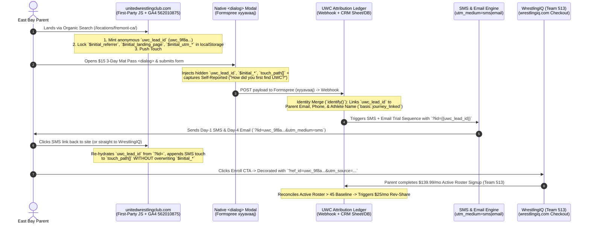

> Part 2 of 3 of [uwc_attribution_model](../uwc_attribution_model.md). Text is verbatim from the original; only links were rewritten.

## 3. Pillar B: First-Party Identity & Cross-Domain Stitching Architecture

### A. System Data Flow Diagram



---

### B. Production JavaScript Snippet (`uwc-attribution.js`)

Deploy this script globally in the `<head>` (or Next.js root `_app` / `layout.tsx`) of `unitedwrestlingclub.com`. It handles:
1. **Anonymous ID Minting & URL Re-hydration (`uwc_lead_id`)**: Creates a persistent UUID (`uwc_<uuid>`) in `localStorage` and a 365-day first-party cookie (`_uwc_lid`), or re-hydrates it if the parent clicks an SMS/Email link containing `?lid=uwc_...` on a secondary device.
2. **Immutable First-Touch (`$initial_*`) + Ordered `touch_path[]`**: Locks the very first organic touch forever (`$set_once` logic) while appending subsequent SMS, Email, or organic return visits to `touch_path[]` (capped at 15 touches) so we can calculate both **First-Touch** and **U-Shaped (40/20/40)** models.
3. **Anonymity Guard (Fail Closed)**: Never leaks PII (emails or phone numbers) into outbound URLs—validates that `uwc_lead_id` starts with `uwc_`, contains no `@`, and is $\le 64$ characters.
4. **Native `<dialog>` Trial Pass Modal Hidden Field Injection**: Automatically populates hidden attribution inputs inside the Formspree (`xyyavaaj`) form and fires GA4 (`562010875`) conversion events.
5. **Capture-Phase Outbound WrestlingIQ (`Team 513`) Link Decorator**: Intercepts `click` and `auxclick` events on any `wrestlingiq.com` link and appends the anonymous `uwc_lead_id` and original acquisition UTMs.

```javascript
/**
 * UWC First-Party Attribution & Cross-Domain Identity Stitcher v1.0
 * Property: unitedwrestlingclub.com | GA4: 562010875 | Formspree: xyyavaaj | WrestlingIQ: Team 513
 */
(function () {
  "use strict";

  const STORAGE_KEY = "uwc_attr_v1";
  const COOKIE_NAME = "_uwc_lid";
  const MAX_TOUCHES = 15;

  // Domains excluded from ever counting as an external acquisition referrer
  const EXCLUDED_REFERRERS = [
    "unitedwrestlingclub.com",
    "wrestlingiq.com",
    "formspree.io",
    "stripe.com",
    "checkout.stripe.com",
    "accounts.google.com",
    "localhost",
    "127.0.0.1"
  ];

  // 1. ANONYMITY GUARD (FAIL CLOSED)
  // Only allow opaque anonymous IDs (uwc_<hex/uuid>). Reject anything resembling an email or PII.
  function isAnonymousLeadId(id) {
    if (typeof id !== "string") return false;
    const trimmed = id.trim();
    return (
      trimmed.length >= 12 &&
      trimmed.length <= 64 &&
      trimmed.startsWith("uwc_") &&
      !trimmed.includes("@") &&
      /^[a-zA-Z0-9_-]+$/.test(trimmed)
    );
  }

  // Generate a cryptographically random anonymous lead ID
  function generateLeadId() {
    if (typeof crypto !== "undefined" && crypto.randomUUID) {
      return "uwc_" + crypto.randomUUID().replace(/-/g, "");
    }
    return (
      "uwc_" +
      Date.now().toString(36) +
      Math.random().toString(36).substring(2, 12)
    );
  }

  // Cookie helpers for cross-session persistence (365 days)
  function setCookie(name, value, days) {
    try {
      const expires = new Date(Date.now() + days * 864e5).toUTCString();
      document.cookie = `${name}=${encodeURIComponent(value)}; expires=${expires}; path=/; SameSite=Lax; Secure`;
    } catch (_) {}
  }

  function getCookie(name) {
    try {
      const match = document.cookie
        .split(/;\s*/)
        .find((row) => row.startsWith(name + "="));
      return match ? decodeURIComponent(match.split("=")[1]) : null;
    } catch (_) {
      return null;
    }
  }

  // Check if referrer domain is internal/excluded
  function getCleanReferrer() {
    const ref = document.referrer;
    if (!ref) return { referrer: "$direct", referring_domain: "$direct" };
    try {
      const url = new URL(ref);
      const host = url.hostname.toLowerCase();
      const isExcluded = EXCLUDED_REFERRERS.some(
        (domain) => host === domain || host.endsWith("." + domain)
      );
      if (isExcluded) return { referrer: "$internal", referring_domain: "$internal" };
      return { referrer: ref, referring_domain: host };
    } catch (_) {
      return { referrer: "$direct", referring_domain: "$direct" };
    }
  }

  // Infer channel taxonomy (Earned Organic vs. Owned SMS/Email vs. Direct)
  function classifyTouch(utmSource, utmMedium, referringDomain, landingPath) {
    const med = (utmMedium || "").toLowerCase();
    const src = (utmSource || "").toLowerCase();
    const ref = (referringDomain || "").toLowerCase();

    if (med === "sms" || src.includes("sms")) {
      return { channel: "sms_nurture", taxonomy: "owned" };
    }
    if (med === "email" || src.includes("email")) {
      return { channel: "email_nurture", taxonomy: "owned" };
    }
    if (src === "gbp" || src === "google_business_profile" || med === "maps") {
      return { channel: "organic_gbp_maps", taxonomy: "earned" };
    }
    if (
      med === "organic" ||
      ref.includes("google.") ||
      ref.includes("bing.") ||
      ref.includes("duckduckgo.") ||
      ref.includes("yahoo.")
    ) {
      const isSubMarket = /^\/locations\/[a-z0-9-]+/i.test(landingPath);
      return {
        channel: isSubMarket ? "organic_seo_local_page" : "organic_search",
        taxonomy: "earned"
      };
    }
    if (ref !== "$direct" && ref !== "$internal") {
      return { channel: "organic_referral_social", taxonomy: "earned" };
    }
    return { channel: "direct_or_dark_social", taxonomy: "direct" };
  }

  // Read GA4 Client ID (_ga cookie) if available
  function getGaClientId() {
    const raw = getCookie("_ga");
    if (!raw) return "";
    const parts = raw.split(".");
    return parts.length >= 4 ? `${parts[2]}.${parts[3]}` : raw;
  }

  // 2. INITIALIZE OR UPDATE FIRST-PARTY ATTRIBUTION STATE
  function syncAttributionState() {
    const params = new URLSearchParams(window.location.search);
    const urlLeadId = params.get("lid") || params.get("uwc_lead_id");

    let state = null;
    try {
      const raw = localStorage.getItem(STORAGE_KEY);
      if (raw) state = JSON.parse(raw);
    } catch (_) {}

    // Determine stable anonymous uwc_lead_id (URL ?lid= from SMS/Email > localStorage > Cookie > Mint new)
    let leadId =
      (isAnonymousLeadId(urlLeadId) && urlLeadId) ||
      (state && isAnonymousLeadId(state.uwc_lead_id) && state.uwc_lead_id) ||
      (isAnonymousLeadId(getCookie(COOKIE_NAME)) && getCookie(COOKIE_NAME)) ||
      generateLeadId();

    setCookie(COOKIE_NAME, leadId, 365);

    const { referrer, referring_domain } = getCleanReferrer();
    const landingPage = window.location.pathname + window.location.search;
    const nowIso = new Date().toISOString();

    const currentUtm = {
      utm_source: params.get("utm_source") || "",
      utm_medium: params.get("utm_medium") || "",
      utm_campaign: params.get("utm_campaign") || "",
      utm_term: params.get("utm_term") || "",
      utm_content: params.get("utm_content") || "",
      gbp_cid: params.get("cid") || ""
    };

    const classification = classifyTouch(
      currentUtm.utm_source,
      currentUtm.utm_medium,
      referring_domain,
      window.location.pathname
    );

    // First visit: create immutable $initial_* properties ($set_once behavior)
    if (!state || !state.$initial_landing_page) {
      const initialRef = referrer === "$internal" ? "$direct" : referrer;
      const initialRefDomain =
        referring_domain === "$internal" ? "$direct" : referring_domain;

      state = {
        uwc_lead_id: leadId,
        first_seen_at: nowIso,
        $initial_referrer: initialRef,
        $initial_referring_domain: initialRefDomain,
        $initial_landing_page: landingPage,
        $initial_utm_source:
          currentUtm.utm_source ||
          (initialRefDomain !== "$direct" ? initialRefDomain : "direct"),
        $initial_utm_medium:
          currentUtm.utm_medium ||
          (classification.taxonomy === "earned" ? "organic" : "none"),
        $initial_utm_campaign: currentUtm.utm_campaign || "(organic)",
        $initial_utm_term: currentUtm.utm_term || "",
        $initial_utm_content: currentUtm.utm_content || "",
        $initial_channel: classification.channel,
        $initial_taxonomy: classification.taxonomy,
        last_seen_at: nowIso,
        last_utm_source: currentUtm.utm_source || initialRefDomain,
        last_utm_medium: currentUtm.utm_medium || "",
        last_utm_campaign: currentUtm.utm_campaign || "",
        last_landing_page: landingPage,
        touch_path: [
          {
            seq: 1,
            ts: nowIso,
            channel: classification.channel,
            taxonomy: classification.taxonomy,
            source:
              currentUtm.utm_source ||
              (initialRefDomain !== "$direct" ? initialRefDomain : "direct"),
            medium:
              currentUtm.utm_medium ||
              (classification.taxonomy === "earned" ? "organic" : "none"),
            campaign: currentUtm.utm_campaign || "",
            page: window.location.pathname
          }
        ]
      };
    } else {
      // Returning visit or SMS/Email click-through: NEVER overwrite $initial_*
      state.uwc_lead_id = leadId; // Ensure re-hydrated ID from SMS/Email ?lid= is saved
      state.last_seen_at = nowIso;

      const hasNewUtm = Boolean(
        currentUtm.utm_source || currentUtm.utm_medium || currentUtm.utm_campaign
      );
      const isExternalEntry =
        referring_domain !== "$internal" && referring_domain !== "$direct";

      if (hasNewUtm || isExternalEntry) {
        state.last_utm_source = currentUtm.utm_source || referring_domain;
        state.last_utm_medium = currentUtm.utm_medium || "referral";
        state.last_utm_campaign = currentUtm.utm_campaign || "";
        state.last_landing_page = landingPage;

        if (!Array.isArray(state.touch_path)) state.touch_path = [];
        if (state.touch_path.length < MAX_TOUCHES) {
          state.touch_path.push({
            seq: state.touch_path.length + 1,
            ts: nowIso,
            channel: classification.channel,
            taxonomy: classification.taxonomy,
            source: currentUtm.utm_source || referring_domain,
            medium: currentUtm.utm_medium || "referral",
            campaign: currentUtm.utm_campaign || "",
            page: window.location.pathname
          });
        }
      }
    }

    try {
      localStorage.setItem(STORAGE_KEY, JSON.stringify(state));
    } catch (_) {}

    // Push user_id and first-touch user_properties to GA4 (Property 562010875)
    if (typeof window.gtag === "function") {
      window.gtag("set", "user_properties", {
        uwc_lead_id: state.uwc_lead_id,
        initial_source: state.$initial_utm_source,
        initial_medium: state.$initial_utm_medium,
        initial_landing_page: state.$initial_landing_page,
        initial_channel: state.$initial_channel
      });
    }

    return state;
  }

  // 3. INJECT HIDDEN FIELDS INTO NATIVE <dialog> TRIAL PASS MODAL (FORMSPREE xyyavaaj)
  function populateTrialModalFields(state) {
    if (!state) return;
    const forms = document.querySelectorAll(
      'form[action*="formspree.io/f/xyyavaaj"], form[data-uwc-trial-form]'
    );

    const hiddenMap = {
      uwc_lead_id: state.uwc_lead_id,
      ga_client_id: getGaClientId(),
      initial_referrer: state.$initial_referrer,
      initial_referring_domain: state.$initial_referring_domain,
      initial_landing_page: state.$initial_landing_page,
      initial_utm_source: state.$initial_utm_source,
      initial_utm_medium: state.$initial_utm_medium,
      initial_utm_campaign: state.$initial_utm_campaign,
      initial_channel: state.$initial_channel,
      initial_taxonomy: state.$initial_taxonomy,
      last_utm_source: state.last_utm_source,
      last_utm_medium: state.last_utm_medium,
      last_utm_campaign: state.last_utm_campaign,
      touch_count: String((state.touch_path || []).length),
      touch_path_json: JSON.stringify(state.touch_path || [])
    };

    forms.forEach((form) => {
      Object.entries(hiddenMap).forEach(([name, value]) => {
        let input = form.querySelector(`input[name="${name}"]`);
        if (!input) {
          input = document.createElement("input");
          input.type = "hidden";
          input.name = name;
          form.appendChild(input);
        }
        input.value = value || "";
      });
    });
  }

  // 4. CAPTURE-PHASE LINK DECORATOR FOR OUTBOUND WRESTLINGIQ (TEAM 513) LINKS
  function decorateWrestlingIQLinks(event) {
    const anchor = event.target?.closest?.("a[href]");
    if (!(anchor instanceof HTMLAnchorElement)) return;

    let url;
    try {
      url = new URL(anchor.href, window.location.origin);
    } catch (_) {
      return;
    }

    const host = url.hostname.toLowerCase();
    if (host !== "wrestlingiq.com" && !host.endsWith(".wrestlingiq.com")) return;

    let state = null;
    try {
      state = JSON.parse(localStorage.getItem(STORAGE_KEY) || "null");
    } catch (_) {}
    if (!state || !isAnonymousLeadId(state.uwc_lead_id)) return; // Fail closed

    // Smuggle anonymous uwc_lead_id + initial organic source to WrestlingIQ Team 513
    url.searchParams.set("ref_id", state.uwc_lead_id);
    url.searchParams.set("metadata[uwc_lead_id]", state.uwc_lead_id);
    if (!url.searchParams.has("utm_source")) {
      url.searchParams.set("utm_source", state.$initial_utm_source || "uwc_organic");
    }
    if (!url.searchParams.has("utm_medium")) {
      url.searchParams.set("utm_medium", state.$initial_utm_medium || "organic");
    }
    if (!url.searchParams.has("utm_campaign")) {
      url.searchParams.set(
        "utm_campaign",
        state.$initial_landing_page || "uwc_site"
      );
    }
    if (!url.searchParams.has("utm_content")) {
      url.searchParams.set("utm_content", state.uwc_lead_id);
    }

    anchor.href = url.toString();

    // Log outbound checkout click in GA4 (562010875)
    if (typeof window.gtag === "function") {
      window.gtag("event", "wrestlingiq_checkout_click", {
        uwc_lead_id: state.uwc_lead_id,
        initial_source: state.$initial_utm_source,
        initial_landing_page: state.$initial_landing_page,
        last_medium: state.last_utm_medium || "organic",
        destination_url: anchor.href
      });
    }
  }

  // Boot on load & bind listeners
  const currentState = syncAttributionState();
  if (document.readyState === "loading") {
    document.addEventListener("DOMContentLoaded", () =>
      populateTrialModalFields(currentState)
    );
  } else {
    populateTrialModalFields(currentState);
  }

  // Re-populate whenever a <dialog> modal opens
  document.addEventListener("click", (e) => {
    if (e.target?.closest?.("[data-open-trial-modal], button")) {
      populateTrialModalFields(currentState);
    }
  });

  // Capture-phase listeners for outbound WrestlingIQ links
  document.addEventListener("click", decorateWrestlingIQLinks, true);
  document.addEventListener("auxclick", decorateWrestlingIQLinks, true);
})();
```

---

### C. Native `<dialog>` Trial Pass Modal Markup (With Self-Reported Attribution)

Inside the `$15 3-Day Mat Pass` `<dialog>` component on `unitedwrestlingclub.com` (submitting to Formspree `xyyavaaj`), we include both **Self-Reported Attribution** (pick-list + optional detail field) and the auto-injected first-party hidden fields:

```html
<dialog id="uwc-trial-modal" class="uwc-modal">
  <form action="https://formspree.io/f/xyyavaaj" method="POST" data-uwc-trial-form>
    <h3>Claim Your $15 3-Day Mat Pass</h3>
    <p>Train with Coach Naweed & UWC's Championship Coaching Staff in Hayward.</p>

    <label for="parent_name">Parent / Guardian Full Name *</label>
    <input type="text" id="parent_name" name="parent_name" required />

    <label for="athlete_name">Athlete Full Name & Age *</label>
    <input type="text" id="athlete_name" name="athlete_name" placeholder="e.g., Zayd Karim (Age 11)" required />

    <label for="email">Parent Email *</label>
    <input type="email" id="email" name="email" required />

    <label for="phone">Parent Mobile Phone (For Mat Schedule SMS) *</label>
    <input type="tel" id="phone" name="phone" required />

    <!-- PILLAR A §4: SELF-REPORTED ATTRIBUTION (Captures Dark Social + Validates SEO) -->
    <label for="self_reported_source">How did you first find United Wrestling Club? *</label>
    <select id="self_reported_source" name="self_reported_source" required>
      <option value="" disabled selected>Select one...</option>
      <option value="google_search">Google Search (Searching for wrestling near me)</option>
      <option value="google_maps_reviews">Google Maps / 5-Star Reviews</option>
      <option value="friend_family_referral">Current UWC Family / Coach / Teammate Referral</option>
      <option value="school_tournament">High School / SCYWAY Tournament / Local School</option>
      <option value="instagram_social">Instagram / YouTube / Social Media</option>
      <option value="drove_by_industrial_pkwy">Drove by the Facility (Industrial Pkwy)</option>
      <option value="other">Other</option>
    </select>

    <label for="self_reported_detail">If referred by a coach, school, or family, who can we thank? (Optional)</label>
    <input type="text" id="self_reported_detail" name="self_reported_detail" placeholder="e.g., Coach at James Logan, friend on mat..." />

    <!-- Hidden First-Party Attribution Fields (Auto-populated by uwc-attribution.js) -->
    <input type="hidden" name="uwc_lead_id" value="" />
    <input type="hidden" name="ga_client_id" value="" />
    <input type="hidden" name="initial_referrer" value="" />
    <input type="hidden" name="initial_referring_domain" value="" />
    <input type="hidden" name="initial_landing_page" value="" />
    <input type="hidden" name="initial_utm_source" value="" />
    <input type="hidden" name="initial_utm_medium" value="" />
    <input type="hidden" name="initial_utm_campaign" value="" />
    <input type="hidden" name="initial_channel" value="" />
    <input type="hidden" name="initial_taxonomy" value="" />
    <input type="hidden" name="last_utm_source" value="" />
    <input type="hidden" name="last_utm_medium" value="" />
    <input type="hidden" name="last_utm_campaign" value="" />
    <input type="hidden" name="touch_count" value="" />
    <input type="hidden" name="touch_path_json" value="" />

    <button type="submit">Lock In $15 3-Day Trial Pass →</button>
  </form>
</dialog>
```

---

### D. How SMS & Email Links Carry `uwc_lead_id` Across Devices

When a parent submits the Formspree (`xyyavaaj`) modal, the webhook writes their contact record (`email`, `phone`, `athlete_name`, `uwc_lead_id`, `$initial_*`, `self_reported_source`) into the **UWC Attribution Ledger** and triggers the SMS/Email trial nurture flow.

Every outbound link inside UWC's SMS and Email templates is dynamically parameterized with the parent's anonymous `uwc_lead_id`:

1. **SMS Link Back to `unitedwrestlingclub.com` (e.g., Day-1 Mat Prep & Schedule):**
   ```text
   https://unitedwrestlingclub.com/schedule?lid={{uwc_lead_id}}&utm_source=uwc_lifecycle&utm_medium=sms&utm_campaign=trial_day1_schedule
   ```
   * **What happens on click:** Even if the parent discovered UWC on their work laptop (`Organic Search -> /locations/fremont-ca/`) and clicks the SMS on their iPhone, `uwc-attribution.js` reads `?lid=uwc_9f8a...`, binds the iPhone session to the exact same `uwc_lead_id`, appends `{ channel: "sms_nurture", taxonomy: "owned", medium: "sms" }` to `touch_path[]`, and **preserves `$initial_landing_page = /locations/fremont-ca/`**.

2. **Direct-to-WrestlingIQ SMS/Email Enrollment Link (e.g., Day-4 / Day-6 Trial Close):**
   ```text
   https://www.wrestlingiq.com/unitedwrestlingclub/register?ref_id={{uwc_lead_id}}&utm_source=uwc_lifecycle&utm_medium=sms&utm_campaign=trial_day6_close&utm_content={{uwc_lead_id}}
   ```
   * **What happens on click:** The parent lands directly on WrestlingIQ (`Team ID: 513`) carrying `ref_id={{uwc_lead_id}}` and `utm_content={{uwc_lead_id}}`, while the UWC Attribution Ledger logs the SMS click as the closing touch (40% U-Shaped credit) and retains the initial Organic SEO page as the creation touch (40% U-Shaped credit; 100% First-Touch credit).

---

### E. Last-Mile CRM / Attribution Ledger Schema (Scoring & Confidence Basis)

Following Pillar B Step 5 (adapted from Tessa Kriesel's production attribution schema), every lead and active roster member in the UWC Attribution Ledger carries explicit **Source, Confidence, Basis, and Taxonomy** fields:

| Field Name | Example Value | Definition & Rules |
| :--- | :--- | :--- |
| `uwc_lead_id` | `uwc_9f8a7c6b5d4e3f2a1b0c` | Immutable anonymous UUID generated on first organic session. |
| `normalized_email` | `parent@gmail.com` | Lowercased, trimmed parent email (`identify()` primary merge key). |
| `normalized_phone` | `+15105550192` | E.164 normalized parent phone (`identify()` secondary merge key). |
| `athlete_name` | `Zayd Karim` | Used for deterministic roster matching against WrestlingIQ Team 513. |
| `first_touch_source` | `google / organic (/locations/fremont-ca/)` | 100% First-Touch Acquisition channel and landing page. |
| `u_shaped_40_20_40` | `{"first_40":"organic_seo_fremont","middle_20":["sms_d1","email_d4"],"last_40":"sms_d6_close"}` | Full 40/20/40 U-Shaped breakdown computed from `touch_path_json`. |
| `self_reported_source` | `google_search` | Parent's answer to *"How did you first find UWC?"* on the Trial Pass modal. |
| `source_basis` | `journey_linked` \| `self_reported` \| `campaign_window` | **Evidence type:** `journey_linked` (verified `uwc_lead_id` stitch), `self_reported` (modal answer when cookies blocked), or `campaign_window` (fallback). |
| `source_confidence` | `HIGH` \| `MEDIUM` \| `LOW` | `HIGH` when `journey_linked` + clean UTMs/referrer or corroborated by `self_reported`; `MEDIUM` when `self_reported` only; `LOW` when heuristic fallback. |
| `paid_vs_organic` | `earned` (Organic SEO/GBP) + `owned` (SMS/Email) | Operational taxonomy confirming $0 paid ad spend compliance. |

---
