# Top 10 Non-Clothing Analogous Brands for United Wrestling Club (UWC)
## The Executive Synthesis & Master Visual Direction: "The Industrial Mat Sanctuary"

> **Client:** United Wrestling Club (Hayward, CA)  
> **Physical Sanctuary:** 30139 Industrial Pkwy SW Ste C, Hayward, CA 94544 (East Bay Industrial Flex Corridor)  
> **Executive Leadership:** Karim Zemaryalai (1980 Moscow Olympian & Ali Aliyev Dagestan Medalist) & Naweed Zemaryalai (SF State / Chabot College Kinesiology Coach)  
> **Target Audience (ICPs):** East Bay Parents (Character, Anti-Bullying, Real Grit), Scholastic CIF High School Contenders (High-Torque Collegiate Prep), Adult Grapplers & Tradesmen (Injury-Conscious, Unvarnished Mat Craft)  
> **Document Code:** `UWC-MASTER-ANALOGOUS-NONCLOTHING-V1`  
> **Date:** October 31, 2026 / 2027 Rebuild Master Reference  

---

## 1. Executive Summary: Why Non-Clothing Brands Unlock UWC's True Identity

United Wrestling Club is not a commercial strip-mall martial arts franchise ("McDojo"), nor is it a high-gloss suburban fitness club, nor an aggressive cage-fight basement. It is an unvarnished **Industrial Mat Sanctuary** operating inside an active industrial flex park among freight terminals, distribution depots, and machine shops on Industrial Parkway in Hayward, California.

Every previous attempt to design for UWC failed when it borrowed tropes from generic athletic apparel, trendy boutique gyms, or consumer fitness software:
- **Discarded Mistake 1 (The Olympic Museum):** Shiny faux-gold gradients, marble columns, and Roman serifs that felt pretentious, sterile, and disconnected from an East Bay warehouse.
- **Discarded Mistake 2 (The CrossFit / MMA Neon Cage):** Electric red glows, barbed-wire textures, snarling cage fighters, and dark techno club vibes that alienated high-intent East Bay parents seeking safety and discipline.
- **Discarded Mistake 3 (The Suburban Rec Center):** Pastel blues, generic stock photos of smiling children, bouncy rounded cards, and "free pass" pop-ups that diminished Karim’s authentic 1980 Olympic and Dagestani lineage to cheap day-care recreation.

### The Non-Clothing Breakthrough

To unlock UWC's genuine character, we must look beyond clothing and fitness apparel. Clothing brands sell seasonal trends, vanity, and lifestyle signaling. In contrast, the world's premier **heavy equipment, trade power tools, tactical hardware, expedition gear, precision optics, and human performance science brands** sell only one thing: **uncompromising, physical truth.**

When an athlete steps onto an unvarnished wrestling mat, reality is absolute. You cannot posture against gravity. You cannot buy a black belt. A double-leg takedown or an ankle pick either works through leverage, friction, and biomechanics—or it fails. 

By anchoring UWC’s 2027 visual architecture, copy tone, and user experience in the mechanical integrity of these **Top 10 Non-Clothing Analogous Brands**, UWC establishes an untouchable **Category of One** in Northern California:

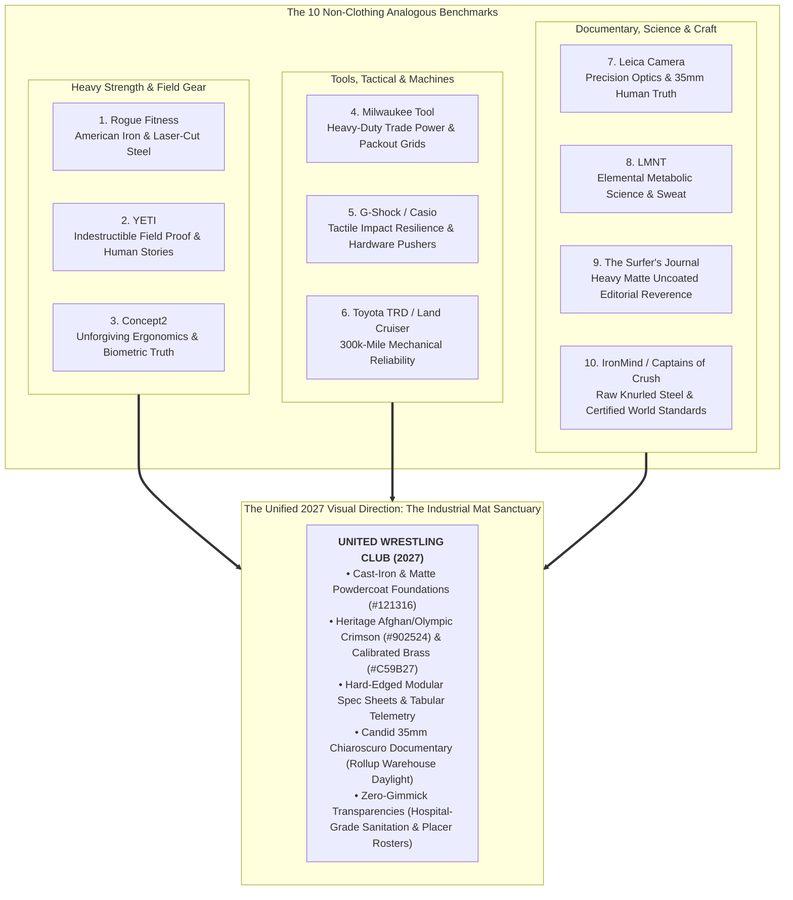

---

## 2. Master Comparative Matrix: Top 10 Non-Clothing Brands Ranked

The table below ranks and deconstructs all 10 non-clothing analogous benchmarks across their core philosophical DNA, target audience alignment, exact design tokens, and direct application to UWC's 2027 digital presence:

| Rank | Brand | Origin & Sector | Core Philosophy | Target ICP Emotional Magnet | Primary Typography | Signature Palette (Hex) | Key UI / Layout Component Borrowed | Direct UWC 2027 Translation |
| :---: | :--- | :--- | :--- | :--- | :--- | :--- | :--- | :--- |
| **1** | **Rogue Fitness** | Columbus, OH<br>*(Strength Equipment)* | American Iron & Laser-Cut Durability; built for the world's most punishing environments. | **HS Contenders & Parents:** Cold steel permanence; collegiate room standard (Iowa/Penn State). | `Agency FB` / `DIN Condensed` + `Roboto Mono` | `#C41230` (Rogue Red)<br>`#111111` (Matte Powdercoat)<br>`#8C929D` (Zinc Hardware) | Hard-edged 0px-radius "Spec Sheets" with 1px laser-etched borders | **"The Specs of the Sanctuary":** Mat thickness, coach-to-athlete density, subfloor dampening disclosures. |
| **2** | **YETI** | Austin, TX<br>*(Field Equipment)* | Built for the Wild; over-engineered for survival when failure is not an option. | **All ICPs (Parents especially):** The anti-disposable mindset; generational endurance over cheap plastic. | `Stratum 2` / `Knockout` + `Trade Gothic LT` | `#0C2340` (Deep Marine)<br>`#E85A2A` (Safety Blaze)<br>`#C2B69D` (Field Tundra Tan) | Full-bleed "Field Dispatch" widescreen documentary story cards | **"UWC Presents":** 90-second cinematic unscripted mini-docs on Karim's 1980 journey and local East Bay youth. |
| **3** | **Concept2** | Morrisville, VT<br>*(RowErg / Ergometers)* | Uncompromising Mechanical Engineering; unvarnished biometric and physiological truth. | **HS Athletes & Adult Grapplers:** Zero-fluff conditioning; you cannot lie to the monitor or the mat. | `DIN 1451` + `JetBrains Mono` / `Space Mono` | `#1A1A1A` (Cast Iron Frame)<br>`#8D9A88` (PM5 LCD Green)<br>`#005596` (Racing Blue) | Monochromatic segmented LCD telemetry HUD with tabular time/split readouts | **The Biomechanical Telemetry Grid:** Work-to-rest anaerobic ratios, live mat capacities, and Kinesiology force vectors. |
| **4** | **Milwaukee Tool** | Brookfield, WI<br>*(Industrial Power Tools)* | "Nothing but Heavy Duty"; high-torque brushless power engineered for job site union trades. | **East Bay Trades & STEM Parents:** Professional job site competence; zero tolerance for fragile toys. | `Industry Black` / `Barlow Condensed` + `Space Mono` | `#DB0015` (Heavy Crimson)<br>`#111215` (Nitrile Overmold)<br>`#3A3F47` (Brushed Steel) | Interlocking modular "Packout" cards with chamfered corners & mechanical badges | **"Heavy-Duty Human Craft":** Youth grappling presented as high-torque kinetic engine conditioning. |
| **5** | **G-Shock / Casio** | Tokyo, Japan<br>*(Shock Instrumentation)* | Absolute Toughness; triple-10 drop/impact resilience; physical pushers over fragile touchscreens. | **Parents & HS Athletes:** Psychological & physical antifragility; absorbing impact and popping back up. | `Eurostile Extended` / `Rajdhani` + `Share Tech Mono` | `#0D0E10` (Stealth Resin)<br>`#FF5500` (Emergency Orange)<br>`#FFCC00` (Hazard Yellow) | Recessed bezel HUD containers with physical push-button hover/depress mechanics | **"Antifragile Child Armor":** Framing wrestling as emotional shock-proofing against modern screen fragility. |
| **6** | **Toyota TRD / Land Cruiser** | Toyota City, Japan<br>*(Mechanical 4WD)* | 300,000-Mile Mechanical Endurance; solid-axle boxed ladder frame reliability across extreme terrain. | **Commuter Parents & Adults:** Longevity and unpretentious durability; substance over disposable luxury. | `DIN 1451 Mittelschrift` + `Public Sans` + `Overpass Mono` | `#17181A` (Boxed Chassis)<br>`#C4B59D` (Dune Khaki)<br>`#E65100` (TRD Solar Orange) | Boxed ladder-frame gridlines with 4WD multi-position transfer selector toggles | **"The 300,000-Mile Human Chassis":** Building joint, core, and character resilience that lasts 40+ years. |
| **7** | **Leica Camera** | Wetzlar, Germany<br>*(Precision Optics)* | *Das Wesentliche* (The Essential); stripping away all decorative clutter to capture raw human truth. | **Discerning Parents & Grapplers:** Timeless heirloom integrity; 35mm optical truth over artificial filters. | `DIN 1451` + `Akzidenz-Grotesk` / `Neue Haas` | `#121212` (Wetzlar Vulcanite)<br>`#F7F6F2` (Silver Halide)<br>`#E3001B` (Surgical Red Dot) | Viewfinder brightline frame borders with optical metadata strips and red-dot pips | **The Mat Dossier:** High-microcontrast 35mm Tri-X photo essays of Karim, Naweed, and unposed warehouse sweat. |
| **8** | **LMNT** | Bozeman, MT<br>*(Metabolic Hydration)* | Elemental Biochemical Rigor; real athletes need salt, electrolytes, and water—zero sugar, zero food dyes. | **STEM Parents & Serious Grapplers:** Evidence-based metabolic science; transparency without candy marketing. | `GT America Expanded Black` + `Space Mono` + `Public Sans` | `#15181B` (Carbon Asphalt)<br>`#FF5722` (Elemental Citrus)<br>`#2EC4B6` (Osmotic Cyan) | Stark nutritional-fact specification tables and high-contrast metric callout blocks | **The Kinesiology Lab:** Coach Naweed's SF State/Chabot collegiate periodization and safe youth hydration protocol. |
| **9** | **The Surfer's Journal** | San Clemente, CA<br>*(Independent Editorial)* | Reader-Supported Archival Reverence; heavy uncoated paper, longform literature, zero pop-up ads. | **Cultured Parents & Lifelong Grapplers:** Intellectual dignity and contemplation applied to a demanding physical art. | `Adobe Caslon Pro` / `Newsreader` + `Gill Sans` / `Public Sans` | `#F9F8F5` (Heavy Uncoated Book)<br>`#1C1D1F` (Carbon Ink)<br>`#782020` (Oxblood Letterpress) | Asymmetrical editorial monograph layout with hairline rules and literary pull quotes | **"The Hayward Folio":** Longform narrative monographs documenting Karim's escape from war and Olympic legacy. |
| **10** | **IronMind / Captains of Crush** | Nevada City, CA<br>*(Heavy Grip Strength)* | "Stronger Minds, Stronger Bodies"; raw knurled spring steel, certified world standards, zero hype. | **HS Wrestlers & Grapplers:** Crushing hand-fighting dominance; tendon armor; unbending physical standards. | `Rockwell Bold` / `Franklin Gothic` + `Courier Prime` | `#16181B` (Raw Billet Steel)<br>`#E9ECEF` (Knurled Aluminum)<br>`#D4A017` (Inspection Brass) | Machine-stamped certification badges and unyielding tabular Placer Rosters | **The Permanent Honor Roll & Sanitation Disclosures:** Uncompromising state placer ledgers and hospital-grade mat specs. |

---

## 3. Exhaustive Brand Profiles: The Top 10 Deconstructed

---

### Brand 1: Rogue Fitness (Columbus, OH) — American Iron & Laser-Cut Steel

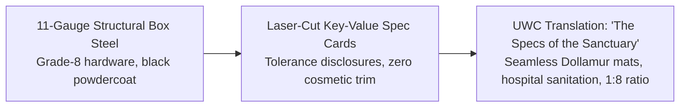

#### 1. Brand Ethos & Core Narrative
*"Forged in American Iron."* Rogue Fitness has revolutionized international strength sports by rejecting cheap outsourced manufacturing in favor of domestic laser-cut steel, robotic welding, and indestructible mechanical permanence. Their brand speaks through the unmistakable thud of a loaded barbell hitting dense rubber and the tactile bite of precision knurling.

#### 2. Why UWC's ICPs Revere It
* **East Bay Parents:** Parents immediately perceive structural safety. Rogue equipment in a facility communicates that the owners invest in commercial-grade physical permanence rather than cheap consumer shortcuts.
* **High School CIF Contenders:** High school wrestlers recognize Rogue as the uniform standard of NCAA Division I wrestling rooms (Iowa, Penn State, Oklahoma State). It represents the exact physical crucible required to place at the CIF State Championships in Bakersfield.
* **Adult Grapplers:** Practitioners of BJJ, Sambo, and Judo hate fragile commercial gym gimmicks. Rogue represents cold steel that never bends under load.

#### 3. Exact Visual Design DNA to Borrow
* **Typography:**
  * Header: `Agency FB Bold` or `DIN 1451 Mittelschrift` (All-Caps, tracking `-0.03em`, line-height `0.95`).
  * Body: `Roboto` / `Inter` (`15px`, line-height `1.6`, clean neutrality).
  * Specs: `Roboto Mono` (Tabular uppercase, tracking `+0.08em`).
* **Color Palette:**
  * Rogue Industrial Red: `#C41230`
  * Matte Powdercoat Black: `#111111`
  * Structural Gunmetal Slate: `#1E2226`
  * Grade-8 Hardware Zinc: `#8C929D`
  * Technical Contrast White: `#FFFFFF`
* **Photography Style:** High-contrast chiaroscuro with low-key industrial warehouse lighting. Single overhead beam cutting through airborne chalk dust and mat humidity. Shallow depth of field (`f/1.8` at 50mm) capturing knurling textures, sweat beading on brows, and unposed exhaustion.
* **UI Components:** Hard-edged rectangles (`border-radius: 0px` to `2px`), 1px solid borders (`#2A2F35`), laser-etched badge tags (`SPEC // YOUTH FOUNDATIONS`), and solid `#C41230` buttons with sharp corners and high-contrast hover states.

#### 4. Direct Translation to UWC 2027 Rebuild
* **"The Specs of the Sanctuary" Section:** Replace generic marketing copy with a structural facility disclosure detailing subfloor foam density (2.0" Dollamur), mat sanitization chemistry (hospital-grade quaternary ammonium 2x daily), and air exchange ventilation specs of the Hayward facility.
* **Program Tiers as Equipment Specs:** Format class levels like Rogue rig spec sheets—listing mat duration, physical intensity rating, contact ratio, and coach certification.

---

### Brand 2: YETI (Austin, TX) — Heavy-Duty Field Equipment & Raw Documentary

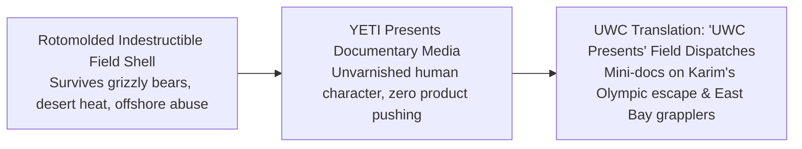

#### 1. Brand Ethos & Core Narrative
*"Built for the Wild — Field-Tested When Failure Is Not an Option."* YETI engineered a premium empire by taking a utilitarian commodity (coolers and drinkware) and making it virtually indestructible. Rather than bragging about features, YETI won the world’s cultural loyalty through *YETI Presents*—raw, cinematic documentary films about commercial fishermen, bull riders, and backcountry guides.

#### 2. Why UWC's ICPs Revere It
* **East Bay Parents:** Parents buy YETI because it represents the anti-disposable mindset. When they invest in YETI, they buy something that lasts for decades. They want that exact permanent character built into their children's work ethic.
* **High School CIF Contenders:** Wrestlers live out of YETI gallon jugs during grueling 14-hour weekend tournaments in hot gyms. It is an emblem of discipline and relentless hydration.
* **Adult Grapplers:** Grapplers appreciate equipment that withstands being thrown into truck beds, dragged across parking lots, and abused daily without cracking.

#### 3. Exact Visual Design DNA to Borrow
* **Typography:**
  * Header: `Stratum 2 Bold` or `Knockout No. 68` / `DIN 1451` (All-Caps, tracking `+0.04em`, line-height `1.05`).
  * Body: `Trade Gothic LT` or `Proxima Nova` (`16px`, line-height `1.65`).
  * Story Eyebrows: `Stratum 2 Medium` (Uppercase, tracking `+0.12em`, color `#A3AAB2`).
* **Color Palette:**
  * YETI Deep Marine Navy: `#0C2340`
  * Field Tundra Tan: `#C2B69D`
  * Safety Blaze Orange: `#E85A2A`
  * Slate Rock Charcoal: `#2B303A`
  * Field Ice White: `#F5F7FA`
* **Photography Style:** 100% natural environmental lighting. Natural morning fog rolling across the Bay, afternoon sunlight pouring through open warehouse rollups. Warm cinematic color grading with rich shadows and unpolished skin imperfections (mat burns, chalk-streaked forearms).
* **UI Components:** Full-bleed 16:9 documentary dispatch cards with subtle dark gradients, exploded durability diagrams, and heavyweight rectangular action buttons with generous padding (`18px 36px`) in Safety Blaze Orange (`#E85A2A`).

#### 4. Direct Translation to UWC 2027 Rebuild
* **The "UWC Presents" Storytelling Engine:** Anchor the homepage with high-caliber 90-second mini-docs: *The 1980 Olympian on Industrial Parkway* (Karim's lineage), *The Scholar-Athlete* (balancing AP classes with 6:00 AM drilling), and *The Tradesman's Decompression* (a Hayward machinist rolling at 7:30 PM).
* **Zero-Gimmick Guarantee Copy:** *"No participation trophies. No arbitrary belt grading fees. Just the immutable laws of leverage, stamina, and gravity on an East Bay mat."*

---

### Brand 3: Concept2 (Morrisville, VT) — Indestructible Ergonomics & Biometric Truth

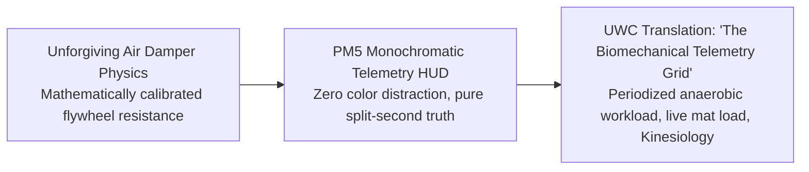

#### 1. Brand Ethos & Core Narrative
*"The Global Gold Standard of Athletic Truth."* Founded by Olympic rowers in Morrisville, Vermont, Concept2 manufactures indestructible ergometers (RowErg, SkiErg, BikeErg). Concept2 never uses subscription screens, fluorescent animations, or artificial gamification. The simple, black-and-grey PM5 performance monitor delivers unyielding, mathematically verifiable split times that cannot be fooled.

#### 2. Why UWC's ICPs Revere It
* **East Bay Parents:** Parents respect that Concept2 doesn't use predatory subscription software or fragile hardware. It lasts for 30 years. They want an athletic academy that coaches their child with that same unvarnished honesty.
* **High School CIF Contenders:** Wrestlers know the Concept2 RowErg as the ultimate crucible of mental and cardiovascular conditioning. If your split is 1:45/500m, you cannot lie to yourself or your coach. That mirror of physical truth is the soul of wrestling.
* **Adult Grapplers:** Adult athletes who cross-train recognize Concept2 as an indestructible workhorse. They see UWC as the mat equivalent: stripped of gimmicks, engineered for raw physical output.

#### 3. Exact Visual Design DNA to Borrow
* **Typography:**
  * Header: `DIN 1451 Mittelschrift` or `Barlow Semi Condensed` (Bold, tracking `+0.02em`).
  * Telemetry / Data: `JetBrains Mono` or `Space Mono` (`36px` numbers, `12px` labels, tabular figures).
  * Body: `Inter` or `Helvetica Neue` (`15px`, line-height `1.6`).
* **Color Palette:**
  * Concept2 Cast Iron Black: `#1A1A1A`
  * PM5 Backlit LCD Slate: `#8D9A88`
  * LCD Segment Charcoal: `#182019`
  * Flywheel Machine Silver: `#D1D5DB`
  * Vermont Racing Blue: `#005596`
* **Photography Style:** Crisp, cool directional daylight with zero theatrical mood filters. Straightforward floor-level framing (`50mm` at mat surface) looking up at footwork, stance depth, and hand-fighting. Unposed, heavy-breathing athletes with hands on knees between rounds.
* **UI Components:** Monochromatic LCD-inspired telemetry HUDs with border gridlines (`#2C3035`), alternating row shading, and low-latency rectangular buttons shifting instantly to `#005596` on hover.

#### 4. Direct Translation to UWC 2027 Rebuild
* **Kinesiology Telemetry Integration:** Showcase Coach Naweed's B.S. in Kinesiology through Concept2-style biometric telemetry: weekly training workload curves, takedown completion percentages, and periodized recovery cycles for growing youth spines.
* **The "Live Mat Telemetry" Schedule:** Replace static tables with a high-density, interactive training grid that displays the technical and physical focus of each session (e.g., *Monday: Russian 2-on-1 Leverage & Hand-Fighting; Wednesday: Mat Returns & Short Offense*).

---

### Brand 4: Milwaukee Tool (Brookfield, WI) — Industrial Trade Craftsmanship & Heavy Contrast

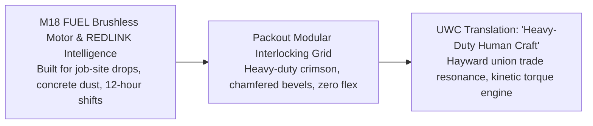

#### 1. Brand Ethos & Core Narrative
*"Nothing but Heavy Duty."* Milwaukee Tool engineers brushless cordless power tools designed to survive job site drops, concrete slurry, and continuous heavy torque in the hands of union tradesmen whose livelihoods depend on their tools never stalling out under load.

#### 2. Why UWC's ICPs Revere It
* **East Bay Trades & STEM Parents:** From union pipefitters and electricians (Local 342, Local 393) to Fremont and San Leandro mechanical engineers, Milwaukee is the universal badge of professional competence. Parents who work with their hands spot "McDojo" fluff instantly. They choose UWC because it operates with the same heavy-duty trade craftsmanship: no belt fees, no padded ribbons, just honest character forged rep by rep.
* **High School CIF Contenders:** Wrestlers revere raw torque and explosive power. The brushless motor ethos (maximum torque, zero thermal burnout, cool operating temps under friction) is the exact physical reality of third-period state tournament matches.
* **Adult Grapplers & Tradesmen:** Blue-collar practitioners train after 8–10 hours of heavy manual labor. Milwaukee's REDLINK intelligence (preventing motor burnouts through smart load monitoring) mirrors Coach Naweed’s kinesiological injury-prevention protocols.

#### 3. Exact Visual Design DNA to Borrow
* **Typography:**
  * Header: `Industry Black` or `Barlow Condensed Black` (Weight `900`, uppercase, tracking `-0.03em`, line-height `0.98`).
  * Spec Subheads: `Space Mono Bold` (Uppercase, tracking `+0.08em`).
  * Body: `Barlow` (Regular 400 / Medium 500) paired with `Inter` for micro-specs.
* **Color Palette:**
  * Milwaukee Heavy Crimson: `#DB0015`
  * Overmold Nitrile Black: `#111215`
  * Cast-Iron Tool Dark Slate: `#1E2024`
  * High-Torque Amber / Gold: `#F59E0B`
  * Cold Brushed Steel: `#3A3F47`
  * Thermal High-Contrast White: `#FFFFFF`
* **Photography Style:** Directional high-contrast key lighting mimicking high-output LED job-site floodlights. Fast shutter speed (1/1000s) freezing airborne sweat and chalk explosions. Deep shadows carving out trap muscles, neck bridges, and collar ties.
* **UI Components:** Modular Packout-style rectangular cards with 1px chamfered corners, mechanical spec data blocks (`DUTY CYCLE: 90-MIN MAT BLOCK`), beveled heavy-duty push buttons (`#DB0015`), and 4-segment battery-gauge style class capacity bars (`[■ ■ ■ □] 3 SPOTS REMAINING`).

#### 4. Direct Translation to UWC 2027 Rebuild
* **"Heavy-Duty Human Craftsmanship":** The homepage headline: *"Wrestling is the Heavy-Duty Trade of Human Movement. No Shortcuts. No Stalled Motors. Pure Grounded Competence."*
* **Exploded Biomechanical Schematics:** An interactive technical graphic breaking down Karim’s signature Russian 2-on-1 series styled like an exploded Milwaukee FUEL motor diagram, illustrating rotational torque, skeletal lever arms, and kinetic power transfer.

---

### Brand 5: G-Shock / Casio (Tokyo, Japan) — Tactile Resilience & Hardware Buttons

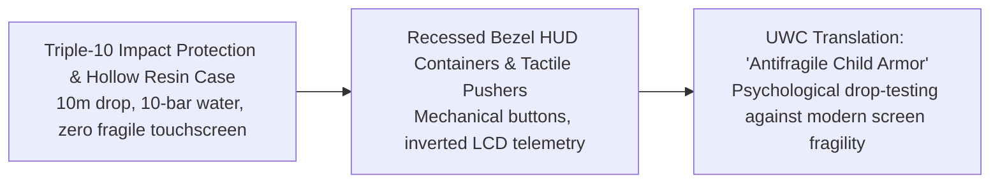

#### 1. Brand Ethos & Core Narrative
*"Absolute Toughness."* Created by engineer Kikuo Ibe to survive a 10-meter drop onto concrete, G-Shock rejected fragile luxury horology to build a shock-isolated, utilitarian instrument trusted by military operators, firefighters, and tradesmen worldwide.

#### 2. Why UWC's ICPs Revere It
* **East Bay Parents:** Parents fear raising fragile, screen-addicted children who crumble under social pressure or adversity. G-Shock represents absolute psychological and physical resilience. Wrestling is the human G-Shock drop test: being knocked down a thousand times and learning to absorb the shock and stand back up with defenses intact.
* **High School CIF Contenders:** In wrestling locker rooms, the classic matte black G-Shock (DW-5600) is a timeless badge of honor. It signals dedication to physical impact over suburban luxury posturing.
* **Adult Grapplers:** Grappling destroys delicate equipment. A touchscreen smartwatch shatters under a heavy knee slide; a G-Shock survives decades of open mats. Adult grapplers respect tools that operate on physical reality.

#### 3. Exact Visual Design DNA to Borrow
* **Typography:**
  * Header: `Eurostile Bold Extended` or `Rajdhani Bold` (Tracking `+0.06em`, squarish, mechanical, armored).
  * Telemetry / Timers: `Share Tech Mono` or `DSEG7 Classic` (Inverted LCD segmented numbers).
  * Body: `Space Grotesk` (Regular 400 / Medium 500, line-height `1.5`).
* **Color Palette:**
  * Stealth Matte Resin: `#0D0E10`
  * Gunship Carbon Core: `#181A1E`
  * Emergency Bezel Orange: `#FF5500`
  * Protection Hazard Yellow: `#FFCC00`
  * Etched Resin Infill Gray: `#343840`
  * Inverted LCD White: `#F0F2F5`
* **Photography Style:** Ground-level 24mm to 35mm wide-angle perspective right on the mat vinyl. Extreme shutter speeds (1/1250s) freezing the exact millisecond of impact: mat depressing under a drive foot, defensive sprawling, and forehead-to-collar contact.
* **UI Components:** Chamfered bezel HUD cards with recessed inner shadows, tactile knurled push-buttons with distinct 2px click depressions, and engraved caseback-style badges: `[SHOCK-TESTED: USAW REGULATION]`.

#### 4. Direct Translation to UWC 2027 Rebuild
* **"The Antifragile Human Armor" Pitch to Parents:** *"The World Will Push Your Child. We Teach Them How to Absorb the Shock and Push Back."*
* **Interactive Impact-Rating Schedule Filters:** Filter classes via rugged bezel-styled toggles (`[LIGHT CONTACT: YOUTH FOUNDATIONS]` / `[FULL IMPACT: SCHOLASTIC & ADULT OPEN MAT]`).

---

### Brand 6: Toyota TRD / Land Cruiser (Toyota City, Japan) — 300k-Mile Mechanical Reliability

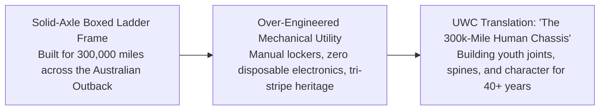

#### 1. Brand Ethos & Core Narrative
*"The World’s Toughest Machine."* The Toyota Land Cruiser (and TRD off-road platform) does not build fragile suburban show-cars. They manufacture solid-axle, over-engineered mechanical lifelines chosen by humanitarian aid convoys, outback ranchers, and desert explorers in environments where mechanical failure means death.

#### 2. Why UWC's ICPs Revere It
* **East Bay Commuter & Trade Parents:** The I-880 and Highway 92 corridors in Hayward and Fremont are packed with Tacomas, 4Runners, and Land Cruisers driven by parents who prize longevity over superficial flash. They know a 250,000-mile Toyota starts on the first crank in Sierra snow. They want that exact durability for their children’s bodies: joint health, core strength, and character that will carry them for 40 years.
* **High School CIF Contenders:** High school wrestlers look up to the rugged independence of TRD trucks hauling gear bags and camping gear on mountain trails—representing self-sufficiency without needing someone to hold their hand.
* **Adult Grapplers:** Grapplers know that wrestling builds a dense, boxed-ladder-frame physical chassis. A wrestler's hips, lower back, and core handle loads that twist and break untrained gym athletes.

#### 3. Exact Visual Design DNA to Borrow
* **Typography:**
  * Header: `DIN 1451 Mittelschrift` or `Barlow Semi Condensed Bold` (Tracking `+0.02em` to `+0.04em`).
  * Badging: `Overpass Mono Bold` (Extra-wide tracking `+0.12em`, stamped firewall VIN style).
  * Body: `Public Sans` (Regular 400 / Medium 500, line-height `1.6`).
* **Color Palette:**
  * Boxed-Chassis Black: `#17181A`
  * Heritage Dune Khaki: `#C4B59D`
  * Primer Slate Gray: `#26292E`
  * TRD Heritage Solar Orange: `#E65100`
  * Dakar Heritage Yellow: `#F59E0B`
  * Enamel Badge White: `#F8F9FA`
* **Photography Style:** Natural, organic daylight flooding through open warehouse roll-up doors. Golden dust motes in the air. 35mm film-style organic grain capturing worn canvas mat covers, salt-stained singlets, and multi-generational coaching moments between Karim and young athletes.
* **UI Components:** Boxed ladder-frame layouts bounded by solid 2px structural divider lines (`#383D45`), subtle 3-stripe micro-accents (`#D32F2F` Red, `#E65100` Orange, `#F59E0B` Yellow) representing UWC's triple lineage (1980 Moscow Olympics, Dagestan Sambo, and Collegiate Kinesiology), and 4WD transfer case selector toggles (`[2H: YOUTH]` / `[4H: SCHOLASTIC]` / `[4L: ADULT]`).

#### 4. Direct Translation to UWC 2027 Rebuild
* **"The 300,000-Mile Human Chassis" Hero Campaign:** Headline directed to parents: *"We Don't Build Fragile Athletes for One Season. We Build the 300,000-Mile Chassis That Carries Your Child Through High School, College, and the Next 40 Years of Life."*
* **Facility Maintenance Depot Positioning:** Presenting the Hayward warehouse as an athletic maintenance depot: clean vinyl mats, Olympic bumper plates, pull-up rigs, and elite human biomechanics.

---

### Brand 7: Leica Camera (Wetzlar, Germany) — Precision Mechanical Optics & 35mm Human Truth

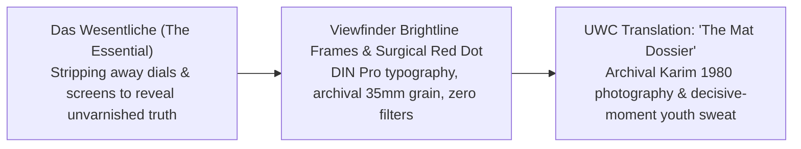

#### 1. Brand Ethos & Core Narrative
*Das Wesentliche* ("The Essential"). For over a century, Leica rangefinders have rejected electronic gimmickry and disposable trends to build precision mechanical optical instruments that capture the defining, unposed historical moments of human struggle and triumph without artificial distortion.

#### 2. Why UWC's ICPs Revere It
* **East Bay Parents (STEM & Discerning Professionals):** In an era of hyper-filtered, fake social media content, Leica represents heirloom optical truth. Parents trust that UWC is not a staged social-media gym, but a place where their children experience genuine, unfiltered personal development.
* **Scholastic CIF Contenders:** Wrestlers understand the manual rangefinder ethos: nothing is autofocus, nothing is handed to you, and your split-second execution determines whether you succeed or fail.
* **Adult Grapplers:** Grapplers admire tools machined to micron tolerances that outlast their owners, mirroring their own devotion to fundamental mechanics that never become obsolete.

#### 3. Exact Visual Design DNA to Borrow
* **Typography:**
  * Header: `DIN 1451 Mittelschrift` or `DIN Pro Bold` (Tracking `+0.06em` to `+0.12em`).
  * Body: `Akzidenz-Grotesk` or `Neue Haas Grotesk` (`15px`, line-height `1.55`).
  * Metadata: `DIN Pro Condensed` or `Space Mono` (All-caps lens-engraving style, tracking `+0.15em`).
* **Color Palette:**
  * Wetzlar Matte Black: `#121212`
  * Archival Silver Halide Off-White: `#F7F6F2`
  * Satin Chrome Lens Metal: `#C8C7C3`
  * Leica Vermilion Red Dot: `#E3001B`
  * Anodized Gunmetal: `#6E7072`
* **Photography Style:** Natural directional industrial light through rollups or high clerestory windows; zero harsh studio flash. Strict 35mm and 50mm focal lengths (human eye perspective). High-microcontrast black-and-white (Kodak Tri-X pushed to 1600 or Leica Monochrom), capturing sweat beads, skin tension, and chalk clouds.
* **UI Components:** Viewfinder brightline frame cards with 1px borders and subtle corner crop marks, lens-engraving metadata strips (`[ REC // 35MM EQUIV ] [ USAW CLUB #513 ]`), and a single surgical 8px red dot (`#E3001B`) for live status indicators.

#### 4. Direct Translation to UWC 2027 Rebuild
* **The "Field Archive" Homepage Hero:** A monumental 35mm monochrome photograph of a youth wrestler catching their breath after live rounds, framed with viewfinder crop marks, captioned: *"Hayward, California. 6:42 PM. The Mat Does Not Lie."*
* **The Karim Zemaryalai Lineage Dossier:** Karim's historical photos from Kabul, Moscow, and Dagestan presented with museum-grade precision and zero promotional fluff.

---

### Brand 8: LMNT (Bozeman, MT) — Elemental Hydration Science, Zero Dyes/Sugar, Pure Sweat

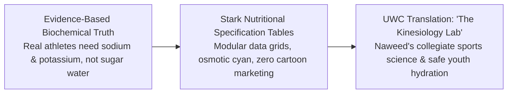

#### 1. Brand Ethos & Core Narrative
LMNT cuts through decades of sugary sports-drink deception with raw biochemical truth: hard training demands sodium and potassium, not high-fructose corn syrup, neon dyes, or maltodextrin. Founded by research biochemist Robb Wolf and combat sports coaches, LMNT treats hydration as an unyielding metabolic discipline rooted in peer-reviewed science.

#### 2. Why UWC's ICPs Revere It
* **East Bay Parents:** Parents hate seeing sports programs feed sugary snacks and neon blue drinks to 9-year-olds. LMNT represents clean, transparent nutritional integrity that treats young athletes like developing physiological organisms.
* **Scholastic CIF Contenders:** High school wrestlers endure brutal winter weight classes and fluid-electrolyte shifts. LMNT is a sacred staple in their gym bags to prevent third-period muscle cramps and restore osmolarity without empty calories.
* **Adult Grapplers:** Grapplers lose 2+ liters of sweat during 90-minute open mats and heavily overlap with metabolic health, longevity (Attia/Huberman), and zero-sugar performance science.

#### 3. Exact Visual Design DNA to Borrow
* **Typography:**
  * Header: `GT America Expanded Black` or `Druk Wide Bold` (Weight `900`, uppercase, tracking `-0.02em`).
  * Metrics: `Space Mono Bold` (Tabular numbers `36px`+, tracking `+0.04em`).
  * Body: `Public Sans` or `Inter` (Regular 400 / Semi-Bold 600, line-height `1.6`).
* **Color Palette:**
  * Carbon Asphalt Black: `#15181B`
  * Crystalline Salt White: `#F4F6F8`
  * Elemental Citrus Amber: `#FF5722`
  * Osmotic Kinesiology Cyan: `#2EC4B6`
  * High-Density Graphite: `#3D444D`
* **Photography Style:** Hard directional rim lighting emphasizing muscle striations, neck bridges, and sweat dripping off chins. Macro focus on salt stains dried on black rashguards, taped finger joints, and dilated veins under isometric pressure.
* **UI Components:** Nutritional/supplement-style specification grids, high-contrast metric callout blocks, and solid rectangular buttons with 2px borders and action phrasing (`[VIEW KINESIOLOGY PROTOCOL]`).

#### 4. Direct Translation to UWC 2027 Rebuild
* **Naweed Zemaryalai’s Kinesiology Lab:** Frame Coach Naweed's B.S. in Kinesiology as an elite competitive advantage. Publish modular data cards detailing how UWC's periodized drills prevent ACL tears and optimize power output.
* **The "Zero McDojo" Contrast Table:** Side-by-side comparison matrix contrasting commercial strip-mall martial arts (belt fees, participation trophies, sugar drinks) with UWC's zero-belt-fee, Olympic-standard training.

---

### Brand 9: The Surfer’s Journal (San Clemente, CA) — Reader-Supported Heavy Matte Editorial

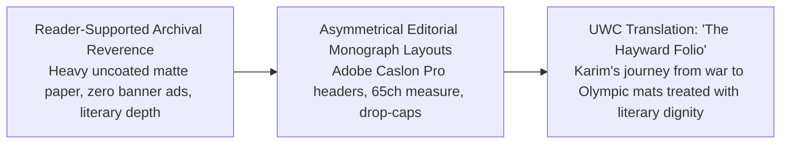

#### 1. Brand Ethos & Core Narrative
*The Surfer's Journal* (and sister publication *Cereal*) represents the pinnacle of independent, reader-funded print editorial craft. By rejecting sensationalist clickbait, animated pop-ups, and commercial brand compromise, they treat physically demanding subcultures with the literary dignity, contemplation, and permanent weight of museum-grade print.

#### 2. Why UWC's ICPs Revere It
* **East Bay Parents:** Educated Bay Area parents (Berkeley to Fremont) appreciate quiet, literary restraint. A website that looks like an editorial publication rather than a loud fitness ad reassures them that UWC is an institution of moral and intellectual substance.
* **Scholastic CIF Contenders:** Serious wrestlers know wrestling is a monastic, ancient craft. When high schoolers see their sport treated with literary beauty and archival respect, it validates their grueling daily sacrifice.
* **Adult Grapplers:** Lifelong martial artists view grappling as a physical meditation—a chess match played with bone and muscle. The meditative cadence of *The Surfer’s Journal* appeals directly to their introspective appreciation of the craft.

#### 3. Exact Visual Design DNA to Borrow
* **Typography:**
  * Editorial Headers: `Adobe Caslon Pro` or `Newsreader` (Regular 400 or Italic, line-height `1.25`, tracking `+0.02em`).
  * Body: `Minion Pro` or `Charter` (`18px`, line-height `1.75` to `1.85`, max column width `65ch`).
  * Foliated Captions: `Gill Sans Light` or `Public Sans Light` (All-caps, tracking `+0.18em`).
* **Color Palette:**
  * Heavy Uncoated Book Paper: `#F9F8F5`
  * Printer's Carbon Ink: `#1C1D1F`
  * Raw Canvas / Linen Sizing: `#D6CEBE`
  * Heritage Oxblood Letterpress: `#782020`
  * Muted Dust / Pencil Lead: `#8A8883`
* **Photography Style:** Golden hour afternoon light grazing across dusty gym floorboards; soft ambient shadows; light catching airborne chalk in the quiet hour before practice begins. Organic film grain (Kodak Portra profile), zero artificial HDR clarity sliders.
* **UI Components:** Asymmetrical editorial grids (60% wide image showcase, 40% text column), classical drop-caps, literary pull quotes between hairline rules, and complete elimination of obnoxious pop-ups or countdown timers.

#### 4. Direct Translation to UWC 2027 Rebuild
* **"The Hayward Folio" (Heritage Section):** A dedicated magazine-style longform essay tracing Karim’s journey from traditional dirt wrestling pits in Kabul, to competing at the 1980 Moscow Olympics, to medaling in Dagestan, to establishing a sanctuary on Industrial Parkway in Hayward.
* **The "Parents' Reading Room":** Thoughtful essays addressing core parent anxieties: *Why Wrestling Teaches What Team Sports Cannot* and *Building Emotional Resilience in the Age of Screens*.

---

### Brand 10: IronMind / Captains of Crush (Nevada City, CA) — Raw Knurled Spring Steel Grip

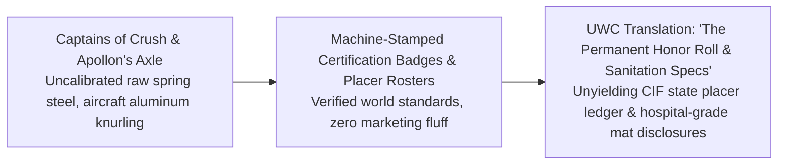

#### 1. Brand Ethos & Core Narrative
Founded in 1988 by Dr. Randall J. Strossen, IronMind represents the pinnacle of uncompromising physical strength: *"Stronger Minds, Stronger Bodies."* Makers of the legendary Captains of Crush grippers and Apollon's Axle, IronMind refuses to participate in fitness fads, unproven gadgets, or cosmetic bodybuilding hype. Their tools are forged from raw spring steel and aircraft-grade knurled aluminum, engineered to test human will against unyielding physical resistance.

#### 2. Why UWC's ICPs Revere It
* **East Bay Parents:** Parents want their children to develop genuine physical armor: indestructible tendon strength, neck and spine resilience, grip power, and the mental toughness that comes from testing oneself against unyielding physical reality.
* **Scholastic CIF Contenders:** Hand fighting and wrist control are the bedrock of high school wrestling. A wrestler with crushing hand strength dictates the tie-up and breaks an opponent's defense. Captains of Crush grippers are mythical badges of honor passed down in wrestling locker rooms.
* **Adult Grapplers:** In BJJ, Sambo, and Judo, grip strength is the ultimate bottleneck. Adult grapplers recognize IronMind as the global gold standard for tendon health and functional grappling power.

#### 3. Exact Visual Design DNA to Borrow
* **Typography:**
  * Header: `Rockwell Bold` or `Franklin Gothic Heavy` (Weight `800`, tracking `+0.04em`, uppercase).
  * Specifications & Rosters: `Courier Prime` or `SF Mono` (Strict tabular alignment with dotted leader lines).
  * Body: `Trade Gothic LT` or `Public Sans` (`15px`, line-height `1.50`).
* **Color Palette:**
  * Cast Iron / Raw Billet Steel: `#16181B`
  * Knurled Aircraft Aluminum: `#E9ECEF`
  * Industrial Tooling Red: `#B30000`
  * Cast Brass Inspection Stamp: `#D4A017`
  * Oiled Spring Wire Gunmetal: `#495057`
* **Photography Style:** Hard overhead shop lighting highlighting metal textures, cross-hatched knurling, and chalk dust. Macro close-ups of calloused hands coated in magnesium carbonate chalk locking onto heavy wrist ties; prominent forearm vascularity under isometric load.
* **UI Components:** Machined specification data tables with monospace values and stark rules, chamfered/octagonal stamped certification badges (`[CERTIFIED USAW CLUB #513]`), and unyielding tabular Placer Rosters.

#### 4. Direct Translation to UWC 2027 Rebuild
* **Facility Engineering & Antimicrobial Spec Sheet:** An engineering-grade disclosure of UWC's daily antimicrobial sanitation protocol, mat foam density, and air exchange rates—completely eliminating parental fears of skin infections.
* **The Permanent UWC Honor Roll & Wall of Champions:** Mirroring IronMind's famous Captains of Crush certification page, UWC publishes a permanent digital ledger honoring every East Bay wrestler who qualified for CIF State, Reno Worlds, or collegiate programs.

---

## 4. The Unified 2027 Master Visual Direction: "The Industrial Mat Sanctuary"

By synthesizing the structural engineering of Rogue and Milwaukee, the documentary soul of YETI and Leica, the physiological rigor of Concept2 and LMNT, the literary dignity of The Surfer's Journal, and the unbending standards of TRD and IronMind, United Wrestling Club establishes a master visual language tailored for its physical reality:

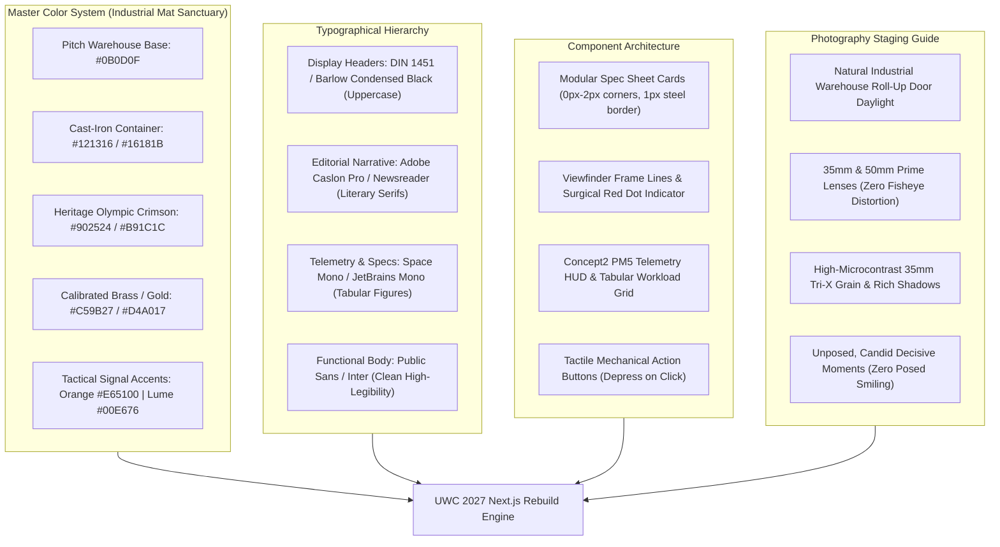

---

### A. Master Design Tokens (`globals.css` / Tailwind Config)

```css
:root {
  /* ==========================================================
     THE INDUSTRIAL MAT SANCTUARY: MASTER CSS DESIGN TOKENS
     Synthesized across Rogue, YETI, Concept2, Milwaukee, 
     G-Shock, TRD, Leica, LMNT, TSJ, and IronMind.
     ========================================================== */

  /* Surface & Container Grounds */
  --uwc-bg-void: #0B0D0F;              /* Deep warehouse perimeter black */
  --uwc-bg-surface: #121316;           /* Cast-iron primary background */
  --uwc-bg-card: #181A1E;              /* Elevated matte tool steel container */
  --uwc-bg-card-spec: #1E2127;         /* High-density telemetry box surface */
  --uwc-bg-canvas-light: #F9F8F5;      /* Heavy uncoated book paper (TSJ editorial) */

  /* Border & Chamfer Grids */
  --uwc-border-steel: #262B33;         /* 1px structural steel gridline */
  --uwc-border-hairline: #3A3F47;      /* 1px chamfered edge separator */
  --uwc-border-chrome: #C8C7C3;        /* Leica satin chrome viewfinder border */

  /* Signature Heritage & Authority Accents */
  --uwc-accent-crimson: #902524;       /* Heritage Afghan/Olympic Crimson (Rogue/UWC) */
  --uwc-accent-crimson-hover: #AA2C2B;
  --uwc-accent-brass: #C59B27;         /* Eleiko & IronMind calibrated medal gold */
  --uwc-accent-telemetry: #8D9A88;     /* Concept2 PM5 monochromatic LCD slate */
  --uwc-accent-orange: #E65100;        /* TRD Heritage & G-Shock emergency orange */
  --uwc-accent-red-dot: #E3001B;       /* Surgical Leica live active dot */
  --uwc-accent-lume: #00E676;          /* Sinn/Tudor phosphorescent active mat signal */

  /* Text & Ink Tokens */
  --uwc-text-primary: #F9FAFB;         /* Crisp high-contrast readout white */
  --uwc-text-muted: #9CA3AF;           /* Gunmetal secondary spec copy */
  --uwc-text-dark-ink: #1C1D1F;        /* Carbon printer's ink on light editorial canvas */
  --uwc-text-stamp: #6B7280;           /* Archival metadata and USAW license text */

  /* Typography Stacks */
  --uwc-font-display: 'Barlow Condensed', 'DIN 1451', -apple-system, sans-serif;
  --uwc-font-editorial: 'Newsreader', 'Adobe Caslon Pro', Georgia, serif;
  --uwc-font-mono: 'Space Mono', 'JetBrains Mono', SFMono-Regular, monospace;
  --uwc-font-sans: 'Public Sans', 'Inter', -apple-system, sans-serif;

  /* Structural Geometry */
  --uwc-radius-none: 0px;              /* Hard-forged industrial permanence */
  --uwc-radius-tight: 2px;             /* Subtle machine-tooled corner */
  --uwc-radius-max: 4px;               /* Absolute maximum; no bubbly rounded pills */
}
```

---

### B. Typography Pairings & Hierarchy

| Role | Font Family | Weight | Case & Tracking | Leading | Direct Analogous Influence |
| :--- | :--- | :--- | :--- | :--- | :--- |
| **Monolithic Display Headers** | `Barlow Condensed` / `DIN 1451` | `900` (Black) | UPPERCASE, `-0.03em` | `0.95` | Milwaukee Tool, Rogue Fitness, G-Shock |
| **Archival Heritage Headers** | `Newsreader` / `Adobe Caslon Pro` | `400` (Regular / Italic) | Sentence Case, `+0.02em` | `1.20` | The Surfer's Journal, Leica Camera |
| **Telemetry & Data Numerals** | `Space Mono` / `JetBrains Mono` | `700` (Bold) | Tabular Figures, `+0.04em` | `1.00` | Concept2 PM5, LMNT Science, IronMind |
| **Functional Body Text** | `Public Sans` / `Inter` | `400` (Regular) / `600` | Normal, `0.00em` | `1.60` | Toyota TRD, Sinn Horology, Rogue |
| **Metadata & Badging** | `DIN Pro` / `Space Mono` | `600` (Semi-Bold) | UPPERCASE, `+0.12em` | `1.00` | Leica Lens Engraving, USAW Badges |

---

### C. Master Component Architecture

#### 1. The High-Torque Program "Spec Sheet" Card (Rogue + Milwaukee + Concept2 Hybrid)

```html
<div class="relative bg-[#181A1E] border border-[#262B33] p-6 hover:border-[#902524] transition-colors duration-150 rounded-[2px] font-sans">
  <!-- Top Technical Header -->
  <div class="flex justify-between items-center pb-3 mb-4 border-b border-[#262B33]">
    <div class="flex items-center space-x-2">
      <span class="inline-block w-2 h-2 rounded-full bg-[#E3001B]"></span>
      <span class="font-mono text-[11px] uppercase tracking-widest text-[#C59B27]">SPEC // HS-CIF-01</span>
    </div>
    <span class="font-mono text-[11px] text-[#9CA3AF] tracking-wider">USAW SANCTIONED #513</span>
  </div>

  <!-- Title & Lineage -->
  <h3 class="font-display font-black text-3xl uppercase tracking-tight text-white mb-1">
    Scholastic CIF High School Prep
  </h3>
  <p class="text-xs uppercase tracking-wider text-[#9CA3AF] mb-5">
    Collegiate Hand-Fighting, Scramble Architecture & Periodized Engine
  </p>

  <!-- Technical Telemetry Data Grid (Concept2 / LMNT Style) -->
  <div class="grid grid-cols-2 gap-2 bg-[#0B0D0F] p-4 border border-[#262B33] mb-6 font-mono text-xs">
    <div>
      <span class="text-[#6B7280] block text-[10px] tracking-wider uppercase">SCHEDULE:</span>
      <span class="text-white font-medium">MON-THU 7:30–9:00 PM</span>
    </div>
    <div>
      <span class="text-[#6B7280] block text-[10px] tracking-wider uppercase">LEAD COACH:</span>
      <span class="text-white font-medium">NAWEED Z. (CHABOT / SF STATE)</span>
    </div>
    <div>
      <span class="text-[#6B7280] block text-[10px] tracking-wider uppercase">MAT HYGIENE:</span>
      <span class="text-emerald-400 font-medium">HOSPITAL-GRADE 2X/DAY</span>
    </div>
    <div>
      <span class="text-[#6B7280] block text-[10px] tracking-wider uppercase">COACH RATIO:</span>
      <span class="text-white font-medium">1 : 8 MAXIMUM MAT LOAD</span>
    </div>
  </div>

  <!-- Utilitarian Action Button (Milwaukee / Rogue Style) -->
  <button class="w-full bg-[#902524] hover:bg-[#AA2C2B] text-white font-display font-bold text-sm uppercase tracking-widest py-3.5 px-4 rounded-[2px] transition-all active:translate-y-0.5">
    Reserve 1-Day Evaluation Pass ($15) &rarr;
  </button>
</div>
```

#### 2. The Leica-Inspired "Viewfinder" Archival Story Card (Leica + The Surfer's Journal)

```html
<div class="relative bg-[#121316] text-[#F7F6F2] p-6 border border-[#262B33] font-mono rounded-[2px]">
  <!-- Viewfinder Metadata Row -->
  <div class="flex justify-between items-center text-[10px] tracking-widest text-[#8A8883] border-b border-[#262B33] pb-3 mb-4">
    <div class="flex items-center space-x-2">
      <span class="inline-block w-2 h-2 rounded-full bg-[#00E676] animate-pulse"></span>
      <span>HAYWARD ARCHIVE // INDUSTRIAL PKWY</span>
    </div>
    <span>35MM DOCUMENTARY PRIME</span>
    <span>EST. 1980 MOSCOW LINEAGE</span>
  </div>

  <!-- Main Image with Rangefinder Corner Crop Lines -->
  <div class="relative overflow-hidden mb-4 border border-[#262B33]">
    
    <div class="absolute top-2 left-2 w-3 h-3 border-t-2 border-l-2 border-[#C8C7C3]/70"></div>
    <div class="absolute top-2 right-2 w-3 h-3 border-t-2 border-r-2 border-[#C8C7C3]/70"></div>
    <div class="absolute bottom-2 left-2 w-3 h-3 border-b-2 border-l-2 border-[#C8C7C3]/70"></div>
    <div class="absolute bottom-2 right-2 w-3 h-3 border-b-2 border-r-2 border-[#C8C7C3]/70"></div>
  </div>

  <!-- Literary Monograph Caption -->
  <p class="font-serif italic text-base text-[#D6CEBE] leading-relaxed mb-2">
    "The mat does not care where you come from or what you say. It only respects leverage, conditioning, and truth."
  </p>
  <span class="text-[11px] font-sans uppercase tracking-wider text-[#9CA3AF]">
    — Coach Karim Zemaryalai (1980 Olympian, Kabul & Dagestan Veteran)
  </span>
</div>
```

---

### D. Photography Staging & Lighting Directive for Hayward

To ensure all photography produced for UWC's 2027 launch adheres to this master standard, photographer briefs must enforce the following four rules:

1. **Natural Industrial Lighting Only:**
   - Shoot during late afternoon (4:00 PM – 7:30 PM) when the Hayward warehouse roll-up doors are open to Industrial Parkway.
   - Use natural sunlight streaming across the vinyl mats mixed with ambient overhead shop fixtures. Zero bright flash units, zero colorful LED neon tubes.
2. **Fixed 35mm and 50mm Prime Lenses:**
   - Strictly prohibit wide-angle fisheye lenses or heavy telephoto zoom compression. Images must represent the natural field of vision of a human being standing mat-side.
3. **Decisive-Moment Candid Reality:**
   - Zero staged poses. Zero athletes looking into the lens with forced smiles. Zero fake snarling at the camera.
   - Capture real moments: Coach Karim physically adjusting an athlete's wrist-tie; Coach Naweed drawing a leverage vector on a whiteboard; a high school wrestler sitting on a wooden bench untying worn wrestling shoes with sweat dripping onto the floor.
4. **Authentic Micro-Texture & High Microcontrast:**
   - Emphasize the tactile reality of the sport: chalk dust settling on black mat borders, salt stains on cotton tees, taped fingers, and honest exhaustion.

---

## 5. Strategic Takeaways for the Pitch to Naweed & Karim

When Sprintz presents this master brand framework to Naweed and Karim Zemaryalai, anchor the pitch in these three commercial arguments:

1. **Transforming the Industrial Warehouse from a Liability into UWC's Greatest Asset:**
   - Strip-mall karate dojos and corporate gym franchises spend millions trying to look clean and domestic. UWC's location in an industrial flex park on Industrial Parkway is an authentic, rare treasure. Borrowing from Rogue, Milwaukee Tool, and YETI makes the warehouse feel like a **hallowed ground of physical labor**—a destination where serious people build unbreakable character.
2. **Winning High-Intent East Bay Parents (Safety & Character Over Fluff):**
   - High-income parents in Fremont, Castro Valley, Hayward Hills, and Union City are terrified of aggressive, meathead fight gyms and disgusted by commercial McDojos that charge $80 for plastic belt tests. The quiet, calibrated aesthetic of Leica, Eleiko, and Concept2 proves that UWC is a **disciplined educational institution** led by an Olympian and a college kinesiology professor.
3. **Dominating Local Competitors (Zero Category Confusion):**
   - Every local combat sports competitor (Combat Sports Academy, Tri-Valley, Yard Dogs) uses generic black-and-red template sites or outdated WordPress blogs. This 10-brand non-clothing synthesis establishes UWC as Northern California's sole **Industrial Mat Sanctuary**, positioning it in a category of one for the next decade.
